# Mapa de vistas y flujos — Shinobi Karaoke (MVP)

> Responsable: diseñador UX. Base: [00-vision-y-alcance.md](../00-vision-y-alcance.md), [01-pipeline.md](../01-pipeline.md), [arquitectura.md](../arquitectura.md) (sección "Restricciones e implicaciones para UX"), ADR [0003](../adr/0003-fuente-de-audio.md), [0004](../adr/0004-separacion-voz-instrumental.md), [0005](../adr/0005-letras-y-formato-de-sincronia.md), [0006](../adr/0006-persistencia-y-modelo-de-datos.md). Sistema visual: [sistema-visual.md](sistema-visual.md).

## 1. Inventario de vistas

| # | Vista | Spec | Tipo | Se llega desde |
|---|-------|------|------|----------------|
| — | **Descarga e instalación** (README e `INSTALAR.md`, fuera de la app) | [09-descarga-e-instalacion.md](09-descarga-e-instalacion.md) | Documentos del repositorio, no es una vista | Página del proyecto; notas de cada *Release* |
| 1 | **Primer arranque** (bienvenida → instalación del motor → listo) | [01-primer-arranque.md](01-primer-arranque.md) | Pantalla completa de la ventana, bloqueante | Arranque de la app si `config.instalacion.estado ≠ "completa"` |
| 2 | **Biblioteca** (vista inicial) | [02-biblioteca.md](02-biblioteca.md) | Vista raíz | Arranque normal, botón "Biblioteca" de cualquier vista, salir del reproductor |
| 3 | **Añadir canción** (fuente: archivo / YouTube + metadatos) | [03-anadir-cancion.md](03-anadir-cancion.md) | Paso 1 del espacio de canción | Botón "Añadir canción" (Ctrl/Cmd+N) |
| 4 | **Progreso del pipeline** (descarga, preparación, separación) | [04-progreso-pipeline.md](04-progreso-pipeline.md) | Paso 2 del espacio de canción + componentes globales (indicador de actividad, tarjeta) | Confirmar la fuente; "Continuar" de un borrador en ese paso; panel de actividad |
| 5 | **Letra** (buscar en LRCLIB, elegir, pegar/importar, revisar) | [05-letra.md](05-letra.md) | Paso 3 del espacio de canción | Vista de progreso ("Buscar la letra mientras tanto"), stepper, "Continuar" |
| 6 | **Editor** (sincronía + estilo + vista previa) | [06-editor.md](06-editor.md) | Paso 4 del espacio de canción | Letra ("Ir al editor"), stepper, "Continuar"/"Editar" desde la biblioteca |
| 7 | **Reproductor** a pantalla completa | [07-reproductor.md](07-reproductor.md) | Superpuesta (la Biblioteca o el Editor siguen montados debajo), pantalla completa | "Reproducir" en la biblioteca (tarjeta, menú ⋯, toast «lista para cantar»); "Probar a pantalla completa" o F en el editor |
| 8 | **Ajustes y Acerca de** | [08-ajustes-y-acerca.md](08-ajustes-y-acerca.md) | Vista secundaria | Botón ⚙ de la barra superior |
| 7b | **Reproductor en otra pantalla** (0.2.0, fase 4) | [07 · Fase 4](07-reproductor.md#fase-4-de-020--ventana-secundaria-y-cola) | **Segunda ventana** de rol fijo, en la pantalla elegida | «Abrir en otra pantalla…» de la Biblioteca o de su panel de cola |
| 2b | **Panel «Cola de reproducción»** (0.2.0, fase 4) | [02 · Fase 4](02-biblioteca.md#fase-4-de-020--ventana-secundaria-y-cola) | Panel lateral de la Biblioteca | Al abrir una sesión, «Cola {n}» de la cabecera, indicador de sesión de la barra superior |

Diálogos transversales (definidos en las specs que los originan): aviso legal de YouTube (03), confirmar cierre con trabajos (04), eliminar canción (02), volver a borrador (02/06), atajos de teclado (06/07).

### 0.2.0, fase 3 · Temas y biblioteca
- **Biblioteca** (02): «Agrupar por» Sin agrupar / Artista / Álbum, búsqueda en título, artista y álbum, modo selección con «Aplicar tema…» y [Tema…] en los encabezados de artista y álbum.
- **Editor › Estilo** (06): sección «Tema» (Temas definidos / Tema personalizado, procedencia, editar, guardar como, renombrar, duplicar, eliminar, tema del álbum o artista).
- **Ajustes › Temas** (08): tema predeterminado y lista completa del catálogo. Es el único lugar con todos los temas; el aspecto de un tema se edita solo desde el editor.
- Diálogos nuevos, definidos en 06 y reutilizados en 02 y 08: confirmar impacto (guardar en el tema, tema de grupo, cambiar o quitar el predeterminado), nombre del tema (nuevo, duplicar, renombrar), eliminar tema, descartar cambios del tema, salir con un borrador de tema (también al cerrar la ventana). En 02: tema de artista o álbum y «Aplicar tema» (con resultado por canción).

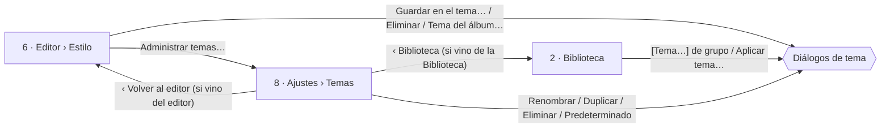
- **Ajustes vuelve a su origen**: «Volver» y Esc regresan a la Biblioteca o al editor de la canción desde la que se abrió (⚙, Ctrl/Cmd + , o «Administrar temas…»).
- Salir del editor con un borrador de tema pide confirmar antes que cualquier otra cosa (`tema.dialogo.salir`).
- Atajos nuevos de la Biblioteca (modo selección): Ctrl/Cmd + A selecciona las visibles, Espacio/Intro alternan, Esc termina. En vistas agrupadas, Ctrl/Cmd + Inicio/Fin van a la primera y última tarjeta.

### 0.2.0, fase 4 · Ventana secundaria y cola
- **Reproductor en otra pantalla** (07 · Fase 4): **segunda ventana** de rol fijo que solo muestra el reproductor y es la única que suena durante la **sesión**. Estados propios: cuenta entre canciones (contador central y tarjeta «A continuación»), en espera, fin de la cola, fallo de una entrada, reanudación. Esc no cierra la sesión.
- **Biblioteca** (02 · Fase 4): botón «Abrir en otra pantalla…» y «Reproducir en otra pantalla…» del menú de una Lista (los únicos puntos de inicio de una sesión), diálogo de pantallas, **panel «Cola de reproducción»** a la derecha (activa, pendientes, controles de operación, cola conservada), tarjetas con «A la cola» durante la sesión.
- **Barra superior**: **indicador de sesión** (a la izquierda del de actividad) visible con sesión o cola; lleva a la Biblioteca con el panel abierto.
- **Editor y Letra** (06 · Fase 4): bloqueados durante la sesión con el diálogo «No se puede editar mientras el reproductor está abierto en otra ventana». La escucha de la vista de progreso, también.
- **Ajustes › Reproductor** (08 · Fase 4): «Cuenta entre canciones» (4 s por defecto).
- Diálogos nuevos: abrir en otra pantalla / cambiar de pantalla (02), «Hay canciones en cola» al cerrar (02, en la ventana donde se pide el cierre), vaciar pendientes y eliminar cola (02), salir de la app con sesión o cola (02, combinado con el de trabajos de 04), bloqueo de edición (06).

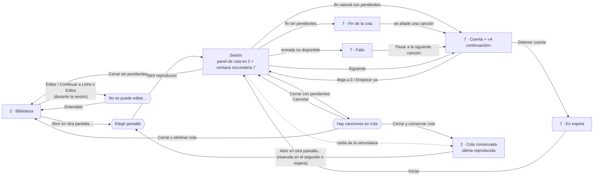
- **Una sola sesión** y un solo transporte audible: durante la sesión no se abre el reproductor local ni suena nada en la principal.
- La cola vive **en memoria** mientras la app está abierta: se puede preparar antes de abrir la sesión, conservar al cerrarla y se pierde al salir de la app (con confirmación).

### 0.2.0, fase 5 · Estilo, espera y Letra lista
No hay vistas nuevas. Cambios dentro de las existentes ([06](06-editor.md#fase-5-de-020--estilo-espera-y-letra-lista), [07](07-reproductor.md#fase-5-de-020--estilo-espera-y-letra-lista), [02](02-biblioteca.md#fase-5-de-020--estilo-espera-y-letra-lista)):
- **Editor › Estilo**: forma del degradado (lineal, radial, cónico), centro, movimiento con velocidad; sección «Indicadores de espera» (puntos, barra, cuenta 3·2·1, silencio mínimo, «Cambiar solo en esta canción», «Ver un ejemplo»). Bajo la vista previa, «Detener el movimiento del fondo».
- **Editor › Sincronía**: «Ajustar los silencios» en la fila de la línea de tiempo (y en el menú ⋯). La elección de indicadores hueco a hueco no entra en esta fase (propuesta 015).
- **Editor › dock**: «Marcar como letra lista» junto a «Marcar como lista»; menú ⋯ con «Cambiar a «Letra lista»…» / «Cambiar a «Lista»».
- **Reproductor** (local y secundaria): fondo en movimiento ligado a la canción, indicadores de espera en los huecos y modo Letra lista sin barrido.
- **Biblioteca**: insignia «Letra lista» (cuenta como Lista: mismo filtro, acciones y cola).
- Diálogos nuevos (en 06): «¿Marcar como letra lista?» (primera activación, con «No volver a mostrar este aviso») y «¿Ajustar los silencios?» (recuentos y lista de líneas).

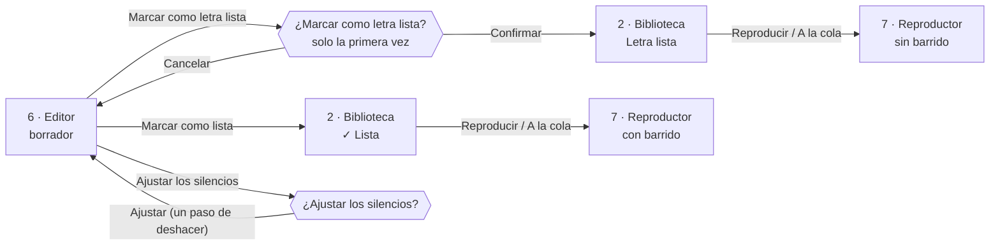
- «Lista» y «Letra lista» se cambian entre sí desde el menú ⋯ del editor sin pasar por borrador.

### 0.2.0, fase 6 · Exportación de video
- **Exportar a video** ([10](10-exportacion.md)): **diálogo** (no una vista) con cinco estados: formulario (audio, proporción, resolución, FPS, formato MKV o WebM, destino, estimación, muestra con la marca de agua), exportando (subpasos, cancelar, seguir en segundo plano), en cola, éxito («Mostrar en la carpeta») y fallo (causa, «Copiar detalles», «Cambiar opciones», «Reintentar»). Se abre encima de la Biblioteca o del Editor, que siguen montados.
- **Biblioteca** ([02 · Fase 6](02-biblioteca.md#fase-6-de-020--exportación)): «Exportar video…» en el ⋯ de las Listas (incluidas «Letra lista» e incompletas); «Ver exportación» y «Cancelar exportación…» mientras se exporta; línea «⟳ Exportando video {n} %» en la tarjeta.
- **Editor** ([06 · Fase 6](06-editor.md#fase-6-de-020--exportación)): «Exportar video…» en el ⋯ de la cabecera y **Ctrl/Cmd + E**, también en borradores con pistas y alguna línea sincronizada.
- **Panel de actividad** (04): las exportaciones son un trabajo más, con [Ir] (reabre el diálogo) y [✕]. El diálogo de cierre de la app las incluye.
- **Sesión en otra pantalla**: exportar convive con el evento ([ADR 0019](../adr/0019-exportacion-de-video-render-por-fotograma-y-worker-pyav.md) §9): sin candado, solo una nota informativa en el diálogo; abrir una sesión con una exportación en marcha no la detiene. Un perfil que el equipo no puede producir se marca **dentro** del diálogo como «no disponible en este equipo», sin candado.

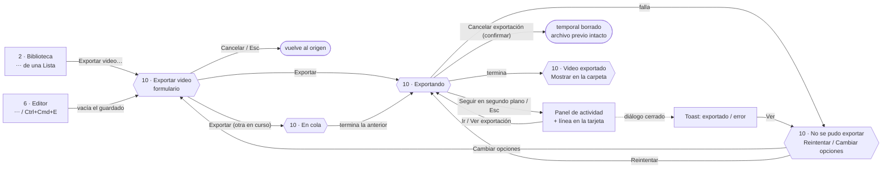
- Atajo nuevo: **Ctrl/Cmd + E** (solo Editor).
- Errores nuevos (detalle en spec 10 §"Errores"; códigos finales del ADR 0019 §10): `SIN_ESPACIO`, `DESTINO_NO_DISPONIBLE`, `DESTINO_OCUPADO`, `CANCION_NO_DISPONIBLE`, `PERFIL_NO_SOPORTADO`, `MEMORIA_INSUFICIENTE`, `RUNTIME_NO_DISPONIBLE`, `SIN_CODIFICADOR`, `LIMPIEZA_FALLIDA` y `ERROR_INTERNO` («Algo salió mal al crear el video»). No hay código de bloqueo por sesión.

### 0.2.1 · fases 7 a 9
No hay vistas nuevas. Cambios dentro de las existentes:
- **Exportar a video** ([10 · Fase 7](10-exportacion.md#fase-7-de-021--perfiles-capturables-reintentar-y-errores-tempranos)): perfiles que el equipo no puede capturar marcados antes de elegirlos; «Reintentar» como acción principal del fallo cuando puede funcionar; carpeta sin permiso detectada al pulsar «Exportar»; código nuevo `CANCION_EXPORTANDOSE` con [Ver exportación].
- **Biblioteca** ([02 · Fase 8](02-biblioteca.md#fase-8-de-021--estados-y-fecha-de-añadido)): «▶ Reproducir» y «✎ Editar» en las tarjetas Lista y Letra lista (tecla E); agrupar por «Fecha de añadido».
- **Editor** ([06 · Fase 8](06-editor.md#fase-8-de-021--sincronía-y-editor-más-simples)): sin palabras importadas, sin S, sin desplazamiento de toda la letra; doble clic en una región (o Mayús + L) escucha la línea; pestaña **«Funciones»** (exportar, ajustar los silencios, modo de reproducción, volver a borrador); el menú ⋯ queda con atajos y restablecer distribución; «Hecho» y «Marcar como …» en Lista y Letra lista.
- **Editor preciso de línea** ([06 · Fase 9](06-editor.md#fase-9-de-021--editor-preciso-de-línea)): **ventana flotante no modal** dentro del editor (no es una vista ni un diálogo modal), abierta desde la lista de líneas (botón, menú contextual o P).
- **Reproductor y video** ([07 · Fase 8](07-reproductor.md#fase-8-de-021--sin-palabras-importadas-ni-desplazamiento-y-barra-de-carga)): barra de espera como barra de carga; barrido palabra a palabra solo con palabras hechas a mano; sin `,` / `.`.

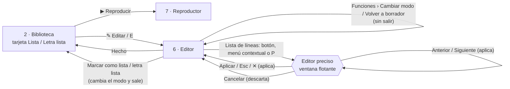

### 0.2.2 · features 1 a 3
No hay vistas nuevas ni cambia la navegación. Cambios dentro de las existentes:
- **Reproductor, vista previa y video** ([07 · Feature 1](07-reproductor.md#022--feature-1--letra-en-pantalla-con-varios-enunciados)): de 2 a 7 líneas a la vez (5 por defecto), línea ya cantada en gris y cambio de línea con «Desplazamiento», «Fundido» o «Sin animación». Se configura en **Editor › Estilo › «Letra en pantalla»** ([06 · Feature 1](06-editor.md#022--feature-1--letra-en-pantalla)), heredable con el tema y con «Cambiar solo en esta canción».
- **Resaltado que no depende solo del color** ([07 · Feature 2](07-reproductor.md#022--feature-2--resaltado-que-no-depende-solo-del-color)): «Subrayar lo ya cantado» en Editor › Estilo › Letra, «Subrayar siempre lo ya cantado» en Ajustes › Reproductor y un aviso de contraste nuevo para colores que se confunden con daltonismo.
- **Aviso de versión nueva** ([08 · Feature 3](08-ajustes-y-acerca.md#022--feature-3--aviso-de-versión-nueva)): cambia el **marco de la ventana**. El botón ⚙ de la barra superior puede llevar un **punto** cuando hay una versión nueva (ver §2). El detalle y las acciones están en **Ajustes › Acerca de › «Actualizaciones»**, con un aviso al principio de Ajustes. Sin diálogos ni toasts, y nada en el reproductor ni en la ventana del público. La app no descarga ni instala: «Ver novedades» y «Descargar» abren el navegador.

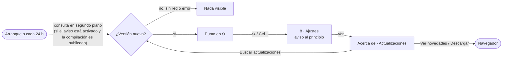

### 0.2.2 · Features 4 a 7 — flujo de entrada

Cuatro features que, juntas, convierten «añadir una canción» en «añado un álbum y vuelvo cuando está listo para revisar». Decisiones provisionales: [0154](../preguntas/0154-decisiones-provisionales-de-ux-de-las-features-4-a-7.md). Contratos pendientes: [0153](../preguntas/0153-contratos-de-las-features-4-a-7-para-las-specs.md). Specs:
- **Feature 4 · Comprobar la letra**: [05 · Feature 4](05-letra.md#022--feature-4--comprobar-la-letra-contra-el-audio-y-corregir-el-desfase) y [06 · Feature 4](06-editor.md#022--feature-4--comprobar-la-letra-con-la-voz-y-corregir-el-desfase).
- **Feature 5 · Preparación desatendida**: [04 · Feature 5](04-progreso-pipeline.md#022--feature-5--preparación-desatendida), [02 · Feature 5](02-biblioteca.md#022--feature-5--lista-para-revisar-y-bandeja-de-pendientes), [05 · Feature 5](05-letra.md#022--feature-5--preparación-desatendida-la-vista-letra), [06 · Feature 5](06-editor.md#022--feature-5--preparación-desatendida-lo-que-el-editor-cuenta) y [08 · Feature 5](08-ajustes-y-acerca.md#022--feature-5--letras-y-preparación-automática).
- **Feature 6 · Datos automáticos**: [03 · Feature 6](03-anadir-cancion.md#022--feature-6--datos-de-la-canción-automáticos).
- **Feature 7 · Importación por lotes**: [03 · Feature 7](03-anadir-cancion.md#022--feature-7--importación-por-lotes), [04 · Feature 7](04-progreso-pipeline.md#022--feature-7--cola-de-preparación-de-un-lote) y [02 · Feature 7](02-biblioteca.md#022--feature-7--lotes-en-la-biblioteca).

**Vistas.** No hay vistas nuevas en el inventario; sí un **modo nuevo** de una existente:

| # | Vista | Spec | Tipo | Se llega desde |
|---|---|---|---|---|
| 3b | **Añadir varias canciones** (tabla de revisión del lote) | [03 · Feature 7](03-anadir-cancion.md#022--feature-7--importación-por-lotes) | Modo de la vista 3, sin stepper de canción (cabecera «Nuevas canciones») | Elegir o soltar varios archivos o una carpeta; pegar varios enlaces o el de una lista; soltar varios archivos sobre la Biblioteca |

Cambios dentro de las existentes:
- **Añadir canción** (03): datos propuestos con su procedencia, autocompletado con los valores de la biblioteca, unificar grafías e «Intercambiar título y artista»; entrada de varios archivos, carpeta, varios enlaces o lista.
- **Progreso** (04): la canción sigue sola tras separar (buscar la letra, comprobarla con la voz, ajustar los fines) hasta un resultado: «Lista para revisar», «Elige la letra», «No encontramos la letra» o «Letra pendiente». La acción principal de la vista pasa a ser «Volver a la biblioteca».
- **Panel de actividad** (04): **cola de preparación** con progreso global, «Pausar», «Cancelar lo que falta…», «Reintentar las fallidas», paradas automáticas y diálogo «Resultado de la preparación». El botón de la barra superior dice «Preparando {i} de {n}».
- **Biblioteca** (02): insignia **«Lista para revisar»** con «Revisar» y «Probar»; líneas de paso nuevas para la letra; **bandeja de pendientes** bajo la barra de herramientas; «Preparar» en el ⋯ de un borrador; avisos de reanudación; soltar varios archivos abre el lote.
- **Letra** (05): cada candidata dice si coincide con el audio; la vista se abre con lo que la preparación ya encontró.
- **Editor** (06): «Comprobar la letra con la voz…» y «Preparación automática» en «Funciones»; banners de desfase y de canción preparada.
- **Ajustes** (08): sección «Letras y preparación automática» con la casilla «Buscar la letra automáticamente al añadir una canción».
- Diálogos nuevos: «¿Corregir el desfase de la letra?» y «La letra no encaja con la voz» (06), «¿Cancelar las canciones que faltan?» y «Resultado de la preparación» (04), «¿Descartar este lote?» (03).

**Stepper.** Los cuatro pasos no cambian. El paso 3 (Letra) gana dos indicadores: ⟳ mientras la app busca o comprueba la letra, y **!** («necesita tu atención», `aviso`) cuando la preparación terminó sin letra segura. En el modo lote no hay stepper.

**Estados de una canción** (detalle en 02 · Feature 5): ✎ Borrador → ◔ Lista para revisar → ✓ Lista o ▤ Letra lista. «Lista para revisar» es un borrador al que solo le falta el visto bueno; el paso a Lista lo da siempre el usuario.

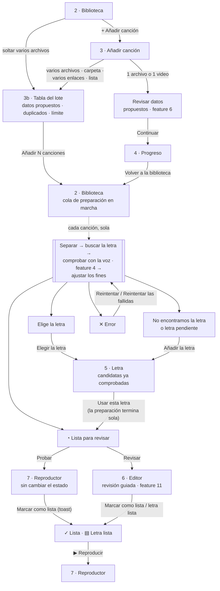

**De punta a punta: «añado un álbum y vuelvo cuando está listo para revisar»**

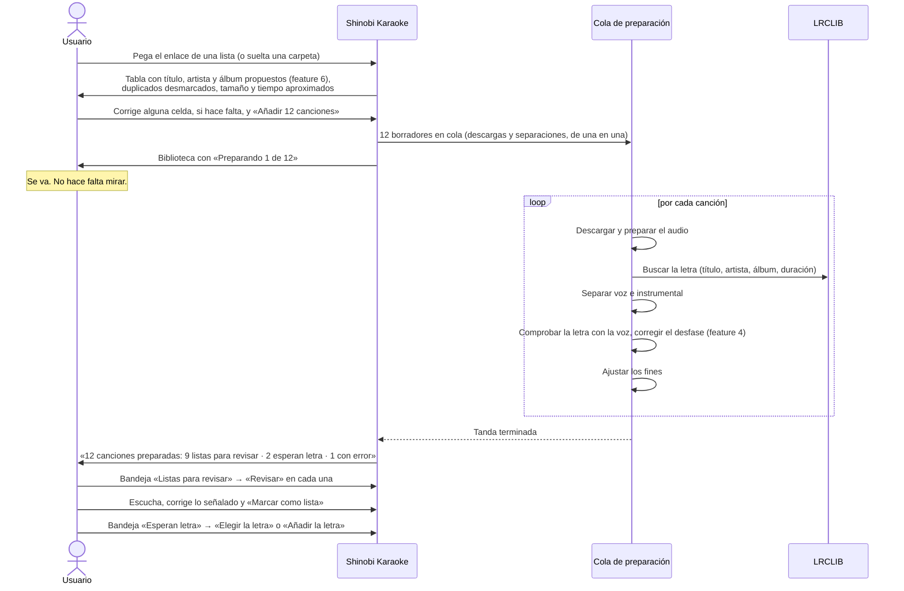

**Acción principal de un borrador** (amplía la tabla «Continuar» de §3):

| Situación de la canción | Botón de la tarjeta | Vista que abre |
|---|---|---|
| Buscando o comprobando la letra, ajustando los fines | (sin botón; línea ⟳) | — |
| Elige la letra | Elegir la letra | 5 Letra, resultados ya cargados |
| No encontramos la letra · Instrumental | Añadir la letra | 5 Letra, con su aviso |
| Letra pendiente (sin conexión o servicio caído) | Reintentar | Ninguna: repite la búsqueda |
| Lista para revisar | Revisar (y Probar) | 6 Editor (7 Reproductor) |
| Las demás | Como en la tabla de §3 | |

**Qué puede hacerse por separado**

| Feature | Necesita | Qué da sin las demás |
|---|---|---|
| **4** · Comprobar la letra | Nada (usa los picos de voz que ya existen) | Veredicto por candidata en Letra y corrección del desfase en Letra y en el editor. |
| **6** · Datos automáticos | Nada | Mejores propuestas, autocompletado, unificar e intercambiar al añadir una canción. Completar el álbum con LRCLIB funciona en cuanto se aplica una letra de LRCLIB, con o sin la 5. |
| **5** · Preparación desatendida | La 4 para elegir sola. Sin ella, la cadena busca y deja siempre «Elige la letra» | La canción llega sola a «Lista para revisar»; bandeja de pendientes; «Preparar»; reanudación al reabrir. |
| **7** · Importación por lotes | La 6 para que la tabla no dé trabajo. Sin la 5, deja borradores sin letra y lo avisa | Un álbum con una sola acción; cola con progreso global, pausa y resumen. |

Orden recomendado de implementación: **4 → 6 → 5 → 7**. Las features 8 («Preparar» varias canciones), 10 (alineación en el paso de fines) y 11 (revisión guiada al pulsar «Revisar») se enganchan en puntos ya previstos en estas specs.

**Atajos.** Ninguno global nuevo. En la tabla del lote: ↑/↓ entre filas, Espacio en la casilla, Ctrl/Cmd + Intro para añadir, Ctrl/Cmd + Z para deshacer la última edición, Mayús + Intro para un renglón nuevo en el campo de enlaces. Ninguna acción automática ni de cola tiene atajo de una tecla.

**Errores y avisos nuevos o que cambian** (se suman al índice de §7):

| Código o situación | Spec | Título visible |
|---|---|---|
| `URL_NO_SOPORTADA` (cambia: las listas ya se admiten) | 03 | «Este enlace no se puede usar» |
| `LISTA_NO_DISPONIBLE` (provisional, 0153) | 03 | «No podemos abrir esta lista» |
| carpeta sin audio | 03 | «En esa carpeta no hay archivos de audio ni de video» |
| sin espacio para el lote | 03 | «No hay espacio para todas» |
| cola parada por YouTube, sin conexión, sin espacio, motor o errores repetidos | 04 | Avisos `act.cola.*` del panel de actividad |
| letra pendiente | 02, 04 | «No pudimos buscar la letra: sin conexión a internet» |
| letra que no coincide con el audio | 05, 06 | «No coincide con tu audio: puede ser otra versión» |

### 0.2.2 · features 8 a 11
No hay vistas nuevas: todo son diálogos, secciones y un modo dentro de las vistas existentes. Decisiones provisionales: [0158](../preguntas/0158-decisiones-provisionales-de-ux-de-las-features-8-a-11.md). Contratos pendientes: [0157](../preguntas/0157-contratos-de-las-features-8-a-11-para-las-specs.md).

- **Acciones por lotes** ([02 · Feature 8](02-biblioteca.md#022--feature-8--acciones-por-lotes-en-la-biblioteca)): la barra del modo selección de la Biblioteca gana «Preparar» y el menú «Más acciones» (A la cola, Exportar video…, Exportar paquete…, Exportar la letra…, Editar datos…, Eliminar…). «Preparar» alimenta la cola de preparación de la feature 7. **Exportar varios videos** ([10 · Feature 8](10-exportacion.md#022--feature-8--exportar-varias-canciones)) es una variante del diálogo de exportación: mismas opciones, una carpeta, progreso y resultado por canción.
- **Copia de seguridad, paquete y letra** ([02 · Feature 9](02-biblioteca.md#022--feature-9--copia-de-seguridad-paquete-de-canción-y-exportar-la-letra), [08 · Feature 9](08-ajustes-y-acerca.md#022--feature-9--copia-de-seguridad)): tres **diálogos** nuevos. «Exportar paquete» (menú ⋯ de la tarjeta y selección múltiple), «Crear copia de seguridad» (Ajustes) e «Importar paquete / Restaurar copia» (Ajustes, estado vacío de la Biblioteca o arrastrando el archivo). «Exportar la letra (.lrc)…» usa el diálogo «Guardar» del sistema, desde el ⋯ de la tarjeta, la selección múltiple y Editor › Funciones. Es **copia personal**: ningún texto ni acción habla de compartir.
- **Sincronizar con la voz** ([06 · Feature 10](06-editor.md#022--feature-10--sincronizar-con-la-voz-etapa-1)): sección nueva de Editor › Funciones con un diálogo de tres pasos (idioma y modelo, escucha, vista previa del cambio) y una acción por línea en el menú contextual. Los modelos por idioma se ven y se gestionan en **Ajustes › Sincronía automática** ([08 · Feature 10](08-ajustes-y-acerca.md#022--feature-10--sincronía-automática-modelos-por-idioma)); el primer arranque no cambia. En la preparación desatendida es el paso «Ajustar los fines» ([04 · Feature 10](04-progreso-pipeline.md#022--feature-10--sincronizar-con-la-voz-en-la-preparación)). Solo se implementa si la prueba técnica cumple su criterio.
- **Revisión guiada** ([06 · Feature 11](06-editor.md#022--feature-11--revisión-guiada-de-líneas-dudosas), [02 · Feature 11](02-biblioteca.md#022--feature-11--revisión-guiada-en-la-biblioteca)): un **modo del editor** (no una vista): una tarjeta sobre el panel Sincronía que lleva de una línea dudosa a la siguiente. Se entra con «Revisar» de una tarjeta «Lista para revisar», desde Funciones o con R. La tarjeta de la Biblioteca muestra cuántas líneas quedan por revisar; el paso a «Lista» lo da siempre el usuario.

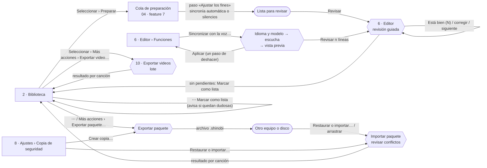

- **Atajos nuevos** (solo Editor): **R** (empezar o terminar la revisión guiada), **N** (en la revisión: está bien y siguiente) y **Ctrl/Cmd + ↓ / ↑** (línea dudosa siguiente o anterior). En la Biblioteca, **Supr** en modo selección abre «Eliminar…» de la selección. Ninguna acción por lotes ni «Sincronizar con la voz» tienen atajo de una tecla.
- **Errores nuevos** (códigos provisionales, 0157): `PAQUETE_NO_VALIDO` («Este archivo no es un paquete de Shinobi Karaoke.»), `PAQUETE_VERSION_NUEVA` («Este paquete es de una versión más nueva de Shinobi Karaoke.»), `PAQUETE_INCOMPLETO` («El paquete está dañado o incompleto.»), y para la sincronía automática `ALINEACION_NO_DISPONIBLE` («La sincronía automática no está disponible en este equipo.»), `IDIOMA_NO_ADMITIDO` («La sincronía automática todavía no funciona en este idioma.») y `MODELO_NO_DISPONIBLE` reutilizado para el modelo del idioma. Textos completos en las specs 02 y 06.

## 2. Estructura de la ventana

```
┌──────────────────────────────────────────────────────────────────────────┐
│ BARRA SUPERIOR (fija, 56 px)                                              │
│ [◆ Shinobi Karaoke]  ‹contexto›                [⟳ 1 en curso] [⚙] [+ Añadir]│
├──────────────────────────────────────────────────────────────────────────┤
│                                                                          │
│                     CONTENIDO DE LA VISTA                                │
│                                                                          │
└──────────────────────────────────────────────────────────────────────────┘
```
- El logotipo es un botón que lleva a la Biblioteca (equivale a "‹ Biblioteca").
- `‹contexto›`: en Biblioteca, nada; en el espacio de canción, el **stepper** con el título de la canción.
- `+ Añadir canción` (primario) solo aparece en la Biblioteca (en el resto de vistas no hay dos primarios).
- La barra superior no existe en Primer arranque ni en el Reproductor.
- **0.2.2, feature 3**: el botón ⚙ muestra un **punto** (8 px, `info`, arriba a la derecha del icono) cuando hay una versión nueva que el usuario aún no ha visto en Ajustes; su tooltip y su nombre accesible pasan a «Ajustes · hay una versión nueva». El punto se apaga al abrir Ajustes. No aparece en compilaciones de desarrollo o locales ni con el aviso desactivado ([08 · Feature 3](08-ajustes-y-acerca.md#022--feature-3--aviso-de-versión-nueva), [sistema visual](sistema-visual.md#022--feature-3--aviso-de-versión-nueva)).

### Espacio de canción (vistas 3–6)
Las vistas de creación comparten cabecera con stepper:
```
┌──────────────────────────────────────────────────────────────────────────┐
│ ‹ Biblioteca │ «Bohemian Rhapsody» · Queen     ✎ Borrador · guardado ✓   │
│   (1)✓ Fuente ──── (2)⟳ Separación 42 % ──── (3)● Letra ──── (4)○ Editor │
└──────────────────────────────────────────────────────────────────────────┘
```
**Reglas del stepper** (paso derivado del ADR 0006):
| Paso | Navegable cuando | Indicador |
|------|------------------|-----------|
| 1 Fuente | Siempre que exista la canción. Tras completarse, muestra un resumen de la fuente y permite editar los metadatos (no cambiar el audio). | ✓ completado · ⟳ descargando · ✕ error · ⚠ interrumpido |
| 2 Separación | Cuando la fuente está completada o en curso | ⟳ con % · "En cola" · ✓ · ✕ · ⚠ |
| 3 Letra | Cuando la fuente está completada (no espera a la separación) | ✓ si hay ≥ 1 línea (también estando en la vista Letra); ● si es el actual y aún no tiene líneas |
| 4 Editor | Cuando la fuente está completada y hay letra (≥ 1 línea) | ✓ si la canción está **Lista** (también estando en el Editor); ● si es el actual y no está Lista |

**Paso actual** ([0024](../preguntas/0024-stepper-letra-actual-y-volver-a-letra-desde-el-editor.md)): el indicador del círculo muestra siempre el estado del paso (✓, ⟳, ✕, ⚠…); ● solo sustituye a "pendiente" en el paso actual. El paso actual se marca además con la etiqueta en `texto-1` 600, subrayado de 2 px `acento-texto` y `aria-current="step"`; su `aria-label` añade ", paso actual" (p. ej. "Paso 3, Letra, completado, paso actual").
Los pasos no navegables tienen `aria-disabled` y muestran *tooltip* con el motivo (definitivos, `preguntas/0022` §8):

| Clave | Cuándo | Texto |
|-------|--------|-------|
| `paso.motivo.sinFuente` | Pasos 2–4 con la fuente `pendiente`, `error` o `interrumpido` | Primero añade el audio |
| `paso.motivo.descargando` | Pasos 3–4 con la fuente `en_curso` (descargando de YouTube) | Espera a que termine la descarga |
| `paso.motivo.sinLetra` | Paso 4 con la fuente completada y sin letra (0 líneas) | Primero elige una letra |
| `paso.motivo.sesion` | Pasos 3–4 durante una sesión en otra pantalla (0.2.0, fase 4; spec 06) | No se puede editar mientras el reproductor está abierto en otra ventana |

## 3. Navegación

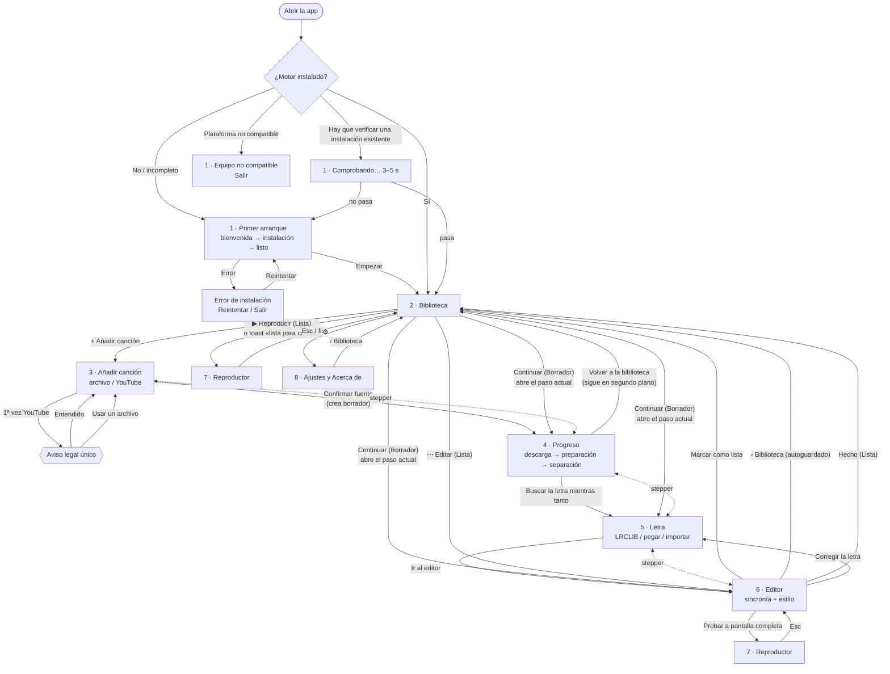

**"Continuar" de un borrador** abre la vista del paso actual derivado:
| Situación de la canción | Vista que abre |
|-------------------------|---------------|
| Fuente pendiente / error / interrumpida | 3 Añadir canción (con el error o "interrumpido" y Reintentar; YouTube pendiente sin trabajo vivo: "Falta descargar el audio" y "Descargar ahora", spec 03 wireframe E) |
| Fuente en curso (descargando) | 4 Progreso |
| Separación en curso / en cola / error / interrumpida **y** sin letra | 4 Progreso |
| Sin letra (separación completada o en curso pero ya vista) | 5 Letra |
| Con letra, sin terminar de sincronizar | 6 Editor |
Nota: si la separación está en curso pero ya hay letra, "Continuar" abre el **Editor** (el progreso sigue visible en el stepper).

## 4. Flujo principal de punta a punta

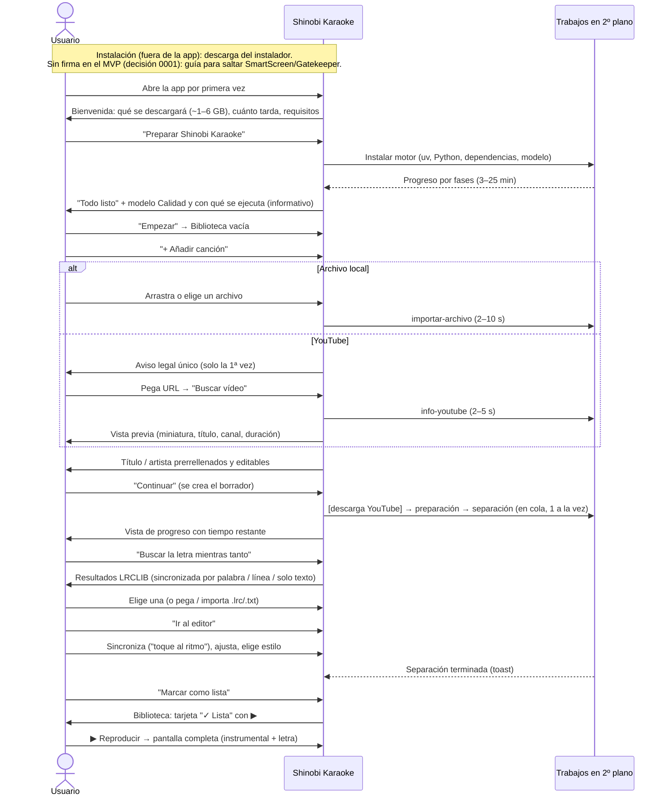

### Puntos de salida y retorno
- **En cualquier momento** se puede volver a la Biblioteca (`‹ Biblioteca` o Esc fuera de campos de texto en vistas del espacio de canción). Todo se autoguarda (ADR 0006); no hay diálogo de "cambios sin guardar".
- Los trabajos (descarga, separación) **siguen en segundo plano** al salir de la vista. Se ven en la tarjeta de la canción y en el indicador de actividad.
- **Cerrar la app** con trabajos en curso → diálogo de confirmación (spec 04). Al reabrir, el paso queda **interrumpido** con "Reintentar".

## 5. Primer arranque y aviso legal (resumen)
- **Primer arranque** (spec 01): obligatorio y con conexión. Tres fases visibles: *Preparando el motor de audio* → *Instalando componentes* → *Descargando el modelo de separación*. Reanudable; si se cierra, al volver a abrir continúa. Errores de conexión y espacio con acción clara. Antes, fuera de la app, la **guía de instalación** cubre los avisos de SmartScreen/Gatekeeper (instaladores sin firmar en el MVP, decisión del usuario en la [pregunta 0001](../preguntas/0001-firma-de-codigo-instaladores.md)).
- **Aviso legal de YouTube** (spec 03): se muestra **una sola vez**, en línea dentro de la opción "Enlace de YouTube", la primera vez que el usuario la abre; no se puede usar YouTube sin aceptarlo; la aceptación queda en `config.json` (`aviso_youtube_aceptado`) y se puede volver a leer en Ajustes → Acerca de.

## 6. Atajos globales
| Atajo | Acción | Disponible en |
|-------|--------|---------------|
| Ctrl/Cmd + N | Añadir canción | Biblioteca, espacio de canción |
| Ctrl/Cmd + F | Buscar en la biblioteca | Biblioteca |
| Esc | Cerrar diálogo/menú; si no hay, volver a la Biblioteca (espacio de canción) o salir del reproductor | Todas |
| Ctrl/Cmd + , | Ajustes | Todas salvo primer arranque y reproductor |
| F1 / ? | Atajos de teclado | Editor, Reproductor |
| Ctrl/Cmd + + / − / 0 | Zoom de la interfaz | Todas salvo reproductor |
| Alt + ↑ / ↓ · Alt + Inicio / Fin · Supr | Mover una pendiente una posición · al principio / al final · quitarla (0.2.0, fase 4) | Panel de la cola (fila enfocada) |
| Mayús + N | Siguiente canción de la cola (0.2.0, fase 4) | Ventana secundaria |
| Ctrl/Cmd + W | Cerrar el reproductor (con confirmación si hay pendientes) (0.2.0, fase 4) | Ventana secundaria |

En la ventana secundaria, **Esc** no sale: pasa de pantalla completa a ventana (spec 07 · Fase 4). En la principal, ninguna acción de la sesión tiene atajo de una sola tecla.

## 7. Índice de textos de error
Los códigos estables de `arquitectura.md §3` se traducen así (detalle y acciones en cada spec):
| Código | Spec | Título visible |
|--------|------|---------------|
| `SIN_CONEXION` | 01, 03, 04, 05 | "Sin conexión a internet" |
| `SIN_ESPACIO` | 01, 03, 04 | "No queda espacio en el disco" |
| `FORMATO_NO_SOPORTADO` | 03 | "No podemos leer este archivo" |
| `AUDIO_DEMASIADO_CORTO` | 03 | "El audio es demasiado corto" |
| `URL_NO_VALIDA` | 03 | "Este enlace no es de un vídeo de YouTube" |
| `URL_NO_SOPORTADA` | 03 | "Las listas y los directos no se pueden usar" |
| `VIDEO_NO_DISPONIBLE` | 03 | "Este vídeo no está disponible" |
| `YOUTUBE_BLOQUEADO` | 03, 04 | "YouTube no permite la descarga ahora mismo" |
| `MEMORIA_INSUFICIENTE` | 04 | "Tu equipo se quedó sin memoria" |
| `MODELO_NO_DISPONIBLE` | 04 | "Falta el modelo de separación" |
| `RUNTIME_NO_DISPONIBLE` | 01, 04 | "Hay que reparar el motor de audio" (acción [Reparar el motor de audio] en la vista de progreso; la tarjeta ofrece [Ver]) |
| `interrumpido` (estado) | 02, 03, 04 | "Se interrumpió" |
| `LETRA_NO_ENCONTRADA` | 05 | "No encontramos la letra" |
| `INSTRUMENTAL` | 05 | "Esta canción es instrumental" |
| `SERVICIO_NO_DISPONIBLE` | 05 | "El servicio de letras no responde" |
| canción dañada | 02 | "No se puede abrir esta canción" |
| fuente del sistema no instalada | — (no aplica en el MVP: solo fuentes incluidas, ver respuesta a 0004) | — |
| Cualquier código desconocido | todas | "Algo salió mal" + "Copiar detalles" |

| `CONFIRMACION_OBSOLETA` | 02, 06, 08 | Aviso en el diálogo: «Mientras confirmabas cambió qué canciones usan este tema…» (`tema.obsoleto`) |
| `TEMA_NOMBRE_DUPLICADO` | 06, 08 | «Ya tienes un tema con ese nombre.» (en el campo) |
| `TEMA_NO_ENCONTRADO` | 02, 06, 08 | «Este tema ya no existe…» (`tema.error.noExiste`) |
| `TEMAS_SOLO_LECTURA` | 02, 06, 08 | «Tus temas se guardaron con una versión más nueva…» |
| `BORRADO_PENDIENTE` | 02, 06, 08 | «La eliminación de este tema quedó a medias…» |
| sesión activa (bloqueo) | 02, 04, 06 | «No se puede editar mientras el reproductor está abierto en otra ventana» (`edi.bloqueo.titulo`) |
| no se pudo abrir la secundaria | 02 | «No se pudo abrir el reproductor en esa pantalla…» (`ses.error.abrir`) |
| entrada de la cola no disponible | 02, 07 | Principal: «No se puede reproducir «{título}»» + causa (`cola.causa.*`); público: «Esta canción no se puede reproducir ahora.» |
| secundaria caída / sin respuesta | 02 | «El reproductor se cerró de forma inesperada…» · «El reproductor no responde.» |
| pantalla desconectada | 02 | «Se desconectó «{pantalla}»…» |

Códigos estables en el [ADR 0017](../adr/0017-ventana-secundaria-sesion-en-vivo-y-cola-de-reproduccion.md) §11: `EDICION_BLOQUEADA`, `SESION_EN_CURSO`, `GUARDADO_PENDIENTE`, `PANTALLA_NO_DISPONIBLE`, `CANCION_NO_DISPONIBLE`, `ENTRADA_NO_ENCONTRADA`, `COLA_LLENA` (texto `cola.llena`, spec 02) y `CONFIRMACION_OBSOLETA` (al confirmar el cierre: el diálogo se actualiza y pide confirmar otra vez).

Todo «Copiar detalles» termina con la línea de versión común `Versión: {identificador}` (número de compilación, canal y commit): [08 · Fase 10](08-ajustes-y-acerca.md#línea-de-versión-en-los-detalles-copiados) (0.2.0).

Tono del microcopy: tuteo, frases cortas, sin jerga técnica (no se dice "worker", "modelo ONNX", "venv"); cada error dice **qué pasó** y **qué puede hacer** el usuario.
