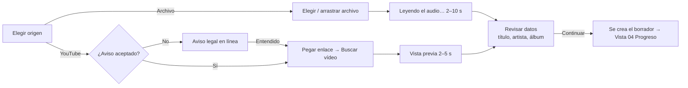
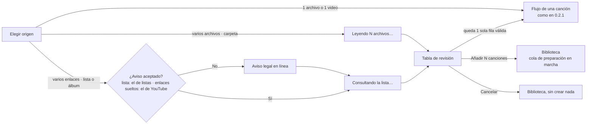

# 03 — Añadir canción (fuente: archivo local o YouTube)

- Paso del pipeline: 1 (Fuente)
- ADRs: [0003](../adr/0003-fuente-de-audio.md), [0006](../adr/0006-persistencia-y-modelo-de-datos.md)
- Restricciones: [arquitectura.md "Restricciones e implicaciones para UX" §2–§4, §7](../arquitectura.md)
- Preguntas: [0013](../preguntas/0013-huecos-ux-de-la-fase-2.md) §1, §4, §5, [0005](../preguntas/0005-viabilidad-detalles-ux-fase-0.md) §3 y §12, [0006](../preguntas/0006-ajustes-specs-ux-tras-0005.md) §3 (respondidas)
- 0.2.2 (2026-11-21): datos de la canción propuestos con su procedencia, autocompletado y unificación ([Feature 6](#022--feature-6--datos-de-la-canción-automáticos)); varios archivos, una carpeta, varios enlaces o una lista de YouTube con tabla de revisión ([Feature 7](#022--feature-7--importación-por-lotes)).

## Objetivo
Conseguir el audio de una canción desde un **archivo del equipo** o un **enlace de YouTube** y confirmar su **título y artista** (que la heurística suele acertar a medias), para lanzar la separación y la búsqueda de letra.

Usuario/tarea principal: "Tengo esta canción (archivo o vídeo) y quiero convertirla en karaoke".

## Flujo

**Momento de creación del borrador**: la canción aparece en la biblioteca cuando el usuario pulsa **Continuar** en "Revisar datos" (YouTube: la descarga empieza entonces). Para archivos locales, la importación (copia + decodificación) ocurre antes, durante "Leyendo el audio…", en una carpeta de preparación oculta (`biblioteca/.importando/<id>/`, que la biblioteca no muestra); al pulsar Continuar la canción aparece completa de una vez (ADR 0006). Si el usuario cancela, vuelve a la Biblioteca o cierra la app antes de Continuar, no queda ningún borrador ni archivo (la carpeta se borra, y al arrancar se vacía por si acaso). YouTube no crea nada antes de Continuar.

**El archivo del usuario no se toca**: la app lo lee y guarda su propia copia del audio (`fuente/mezcla.flac`); el original (que puede ser un vídeo) ni se mueve ni se modifica ni se copia entero. Del original solo se guarda su nombre, para mostrarlo en el resumen.

## Wireframes

**A — Elegir origen** (dentro del espacio de canción; stepper con "Nueva canción" y paso 1 actual)
```
┌──────────────────────────────────────────────────────────────────────────┐
│ ‹ Biblioteca │ Nueva canción                                              │
│   (1)● Fuente ──── (2)○ Separación ──── (3)○ Letra ──── (4)○ Editor       │
├──────────────────────────────────────────────────────────────────────────┤
│   ¿De dónde sale la canción?                                             │
│   [ 📁 Archivo de tu equipo ] [ 🔗 Enlace de YouTube ]  (control segmentado)│
│                                                                          │
│   ┌ ─ ─ ─ ─ ─ ─ ─ ─ ─ ─ ─ ─ ─ ─ ─ ─ ─ ─ ─ ─ ─ ─ ─ ─ ─ ─ ─ ─ ─ ┐        │
│          Arrastra aquí un archivo de audio o vídeo                       │
│   │                        o                                    │        │
│                    [ Elegir archivo… ]  (primario)                       │
│   │  MP3, M4A, FLAC, WAV, OGG/Opus, WebM · vídeo MP4, MKV, MOV   │        │
│   └ ─ ─ ─ ─ ─ ─ ─ ─ ─ ─ ─ ─ ─ ─ ─ ─ ─ ─ ─ ─ ─ ─ ─ ─ ─ ─ ─ ─ ─ ┘        │
└──────────────────────────────────────────────────────────────────────────┘
```
Columna central de 640 px. La zona de arrastre: borde discontinuo 2 px `borde-control`, alto 240 px; al arrastrar encima, borde `info` y fondo `info-tenue`, texto "Suelta para añadir".

**B — YouTube, primera vez: aviso legal en línea** (sustituye el contenido de la pestaña)
```
│   ┌──────────────────────────────────────────────────────────────────┐   │
│   │ ⓘ Antes de usar YouTube                                          │   │
│   │                                                                  │   │
│   │ Shinobi Karaoke puede descargar el audio de un vídeo de YouTube   │   │
│   │ para que hagas tu karaoke en tu ordenador.                       │   │
│   │                                                                  │   │
│   │ • Usa solo contenido que tengas derecho a descargar (por ejemplo, │   │
│   │   tus propias canciones o música con licencia que lo permita).   │   │
│   │ • Las condiciones de YouTube no permiten descargar la mayoría de  │   │
│   │   los vídeos sin su permiso.                                     │   │
│   │ • Lo que hagas es solo para uso personal y es tu responsabilidad.│   │
│   │   Shinobi Karaoke no comparte ni sube nada.                      │   │
│   │                                                                  │   │
│   │ Solo te lo mostraremos esta vez. Puedes releerlo en Ajustes.     │   │
│   │                                                                  │   │
│   │      [ Usar un archivo en su lugar ] (fantasma) [ Entendido ] (primario)│
│   └──────────────────────────────────────────────────────────────────┘   │
```

**C — YouTube: enlace y vista previa**
```
│   Enlace del vídeo                                                       │
│   [ https://www.youtube.com/watch?v=…                    ] [ Buscar vídeo ]│
│   Pega el enlace de un vídeo (no de una lista ni de un directo).         │
│                                                                          │
│   ┌──────────────┬───────────────────────────────────────────────────┐   │
│   │ [miniatura   │ Queen – Bohemian Rhapsody (Official Video)        │   │
│   │  160×90]     │ Queen Official · 5:59                             │   │
│   └──────────────┴───────────────────────────────────────────────────┘   │
│   (debajo, el formulario D)                                              │
```

**C1 — Buscando, con actualización automática del descargador** (tras un `YOUTUBE_BLOQUEADO` en la consulta; 10–30 s más)
```
│   Enlace del vídeo                                                       │
│   [ https://www.youtube.com/watch?v=dQw4…  (solo lectura) ] [ Cancelar ] │
│   ⟳ Actualizando el descargador de YouTube y volviendo a buscar…         │
│     Puede tardar hasta medio minuto.                                     │
```

**C2 — Vista previa sin miniatura**
```
│   ┌──────────────┬───────────────────────────────────────────────────┐   │
│   │      ♪       │ Queen – Bohemian Rhapsody (Official Video)        │   │
│   │  (160×90,    │ Queen Official · 5:59                             │   │
│   │   fondo-2)   │                                                   │   │
│   └──────────────┴───────────────────────────────────────────────────┘   │
```

**E — Paso 1 de una canción de YouTube con la fuente pendiente** (descarga cancelada; "Continuar" desde la Biblioteca o stepper)
```
│   ┌──────────────┬───────────────────────────────────────────────────┐   │
│   │ [miniatura]  │ youtube.com/watch?v=fJ9rUzIMcZQ                   │   │
│   │              │ 5:59                                              │   │
│   └──────────────┴───────────────────────────────────────────────────┘   │
│   ┌──────────────────────────────────────────────────────────────────┐   │
│   │ ⓘ Falta descargar el audio.                                      │   │
│   │   Cancelaste la descarga antes de que terminara.                 │   │
│   │   [ Descargar ahora ] (primario)  [ Usar otro enlace ] (fantasma)│   │
│   └──────────────────────────────────────────────────────────────────┘   │
│   Título *   [ Bohemian Rhapsody                                    ]    │
│   Artista    [ Queen                                                ]    │
│   Álbum      [                                                      ]    │
```

**D — Revisar datos** (común a archivo y YouTube)
```
│   ✓ Audio leído: bohemian.mp3 · 5:55            (archivo)                │
│                                                                          │
│   Revisa los datos de la canción                                         │
│   Los usaremos para buscar la letra. Puedes cambiarlos después.          │
│   Título *   [ Bohemian Rhapsody                                    ]    │
│   Artista    [ Queen                                                ]    │
│   Álbum      [                                                      ]    │
│              (opcional, ayuda a encontrar la letra exacta)               │
│                                                                          │
│   ⚠ Esta canción dura 12:40. Separarla tardará más de lo normal           │
│     (unos 15 minutos en tu equipo).                    (solo si > 10 min)│
│                                                                          │
│                       [ Cancelar ] (fantasma)   [ Continuar ] (primario) │
```
En YouTube el botón primario dice **"Descargar y continuar"**.

## Componentes e interacciones
| Elemento | Comportamiento |
|----------|----------------|
| Selector de origen | Control segmentado. Por defecto "Archivo de tu equipo" (no requiere conexión). Recuerda la última elección durante la sesión. Si el módulo de YouTube está desactivado en la build (ADR 0003, mitigación 5), el selector no se muestra. |
| Zona de arrastre / "Elegir archivo…" | Diálogo nativo con filtro "Audio y vídeo" (extensiones anunciadas) + "Todos los archivos". Un solo archivo; si se arrastran varios: aviso "Añade las canciones de una en una." y se usa el primero. |
| Leyendo el audio | Al elegir el archivo, la zona de arrastre se sustituye por: nombre del archivo, barra indeterminada, "Leyendo el audio…" y botón "Cancelar". 2–10 s. |
| Aviso legal | Bloque en línea (no modal) que aparece la primera vez que se selecciona "Enlace de YouTube" si `config.aviso_youtube_aceptado` es nulo. "Entendido" registra la fecha y muestra C con el foco en el campo de enlace. "Usar un archivo en su lugar" vuelve a la pestaña Archivo sin registrar nada. El aviso se volverá a mostrar mientras no se acepte. |
| Campo de enlace | Al pegar (Ctrl/Cmd+V) una URL válida se lanza automáticamente la búsqueda; Intro o "Buscar vídeo" también. Validación local inmediata (sin red) de formato `youtube.com/watch`, `youtu.be`, `music.youtube.com`, `/shorts/`; si no coincide → error `URL_NO_VALIDA` bajo el campo, sin llamada. |
| Buscar vídeo | Botón en estado cargando ("Buscando…") 2–5 s; cancelable con Esc o con el botón "Cancelar" que sustituye a "Buscar vídeo" mientras carga. Mientras busca, el campo queda en solo lectura. |
| Actualización automática durante la búsqueda (C1) | Si la consulta termina en `YOUTUBE_BLOQUEADO` por primera vez, main actualiza yt-dlp y repite la consulta **una vez**, sin preguntar ([0013](../preguntas/0013-huecos-ux-de-la-fase-2.md) §1). Debajo del campo (en el sitio de la ayuda `add.url.ayuda`, que se oculta) aparece `add.reintento.ytdlp` en `texto-2` con icono ⟳ `info` y `role="status"` (se anuncia una vez); el botón sigue siendo "Cancelar" y Esc cancela. Cancelar devuelve el campo a editable con el enlace y no muestra error; la actualización en sí puede terminar en segundo plano sin que se vea (ver [0014](../preguntas/0014-interrupcion-de-la-actualizacion-de-yt-dlp-y-plataformas-emuladas.md)). Si la segunda consulta también falla → `add.error.YOUTUBE_BLOQUEADO`. Si al buscar ya hay una actualización (p. ej. la semanal) en marcha, se muestra el mismo texto mientras espera. |
| Vista previa | Miniatura, título original del vídeo, canal y duración. Debajo, formulario D prerrellenado con la heurística de ADR 0003. |
| Sin miniatura (C2) | Si `info-youtube` no trae miniatura, o la imagen no carga (también `shinobi-media://…/miniatura.jpg` ausente en el resumen del paso 1): rectángulo de 160 × 90 con fondo `fondo-2`, radio `r-s`, icono Lucide `Music` de 32 px en `texto-3`, centrado; sin texto y `aria-hidden` (la información está en el título). No es un error ni muestra aviso. |
| Formulario D | Título obligatorio (si se vacía: "Escribe un título."); artista y álbum opcionales. Recorta espacios. Máx. 200 caracteres. Foco inicial en Título con el texto seleccionado (para corregir rápido). |
| Aviso de duración | Si la duración > 10 min, banner `aviso` con estimación según perfil de separación. No bloquea. |
| Continuar / Descargar y continuar | Crea el borrador con los metadatos, encola la descarga (YouTube) y/o la separación, y navega a la vista 04. Intro en el último campo = Continuar. |
| Cancelar | Vuelve a la Biblioteca sin crear nada (si había una lectura/búsqueda en curso, se cancela). |
| Paso 1 ya completado (al volver por el stepper) | Muestra el resumen: origen (nombre de archivo o enlace + miniatura), duración, y el formulario D para editar título/artista/álbum (autoguardado al salir del campo; mensaje "Guardado"). Nota `texto-3`: "Para usar otro audio, añade una canción nueva." |
| Paso 1 en error / interrumpido (al volver por el stepper o "Continuar") | Banner con el error y "Reintentar" (repite la descarga con el mismo enlace) o, si no es reintentable, "Usar otro enlace" / "Elegir otro archivo" (vuelve a A conservando los metadatos). |
| Paso 1 pendiente sin trabajo vivo (YouTube, descarga cancelada; wireframe E) | Resumen (miniatura o C2, enlace, duración), banner `info` `add.pendiente.*` y el formulario D editable con autoguardado. "Descargar ahora" (foco inicial) encola la descarga con el mismo enlace y navega a la vista 04. "Usar otro enlace" vuelve a C con los metadatos conservados (como en error no reintentable); confirmar otro enlace actualiza la fuente de **esta** canción (no crea otra ni deja un borrador duplicado), porque aún no tiene audio; lo mismo vale para "Usar otro enlace" / "Elegir otro archivo" en un error no reintentable (viabilidad: [0014](../preguntas/0014-interrupcion-de-la-actualizacion-de-yt-dlp-y-plataformas-emuladas.md) §3). No se muestra la nota `add.resumen.nota`. |

## Estados
| Estado | Presentación |
|--------|--------------|
| Vacío | A, con la zona de arrastre o el campo de enlace vacío. |
| Cargando | "Leyendo el audio…" (archivo) / "Buscando…" (YouTube) con Cancelar. |
| Error | Bajo el campo (errores de URL) o como banner en la zona de arrastre / vista previa (resto). El foco va al mensaje (`role="alert"`). |
| Éxito | Formulario D con "✓ Audio leído: {nombre} · {duración}" o vista previa del vídeo. |
| Borrador | El borrador existe desde "Continuar"; volver a esta vista muestra el resumen editable. |
| Sin conexión (YouTube) | Banner `SIN_CONEXION` y enlace "Usar un archivo de tu equipo". |
| Reintentando (YouTube) | C1: "Cancelar" + `add.reintento.ytdlp`. |
| Pendiente (YouTube, descarga cancelada) | Wireframe E. |

## Microcopy
| Clave | Texto |
|-------|-------|
| `add.titulo` | Nueva canción |
| `add.pregunta` | ¿De dónde sale la canción? |
| `add.origen.archivo` | Archivo de tu equipo |
| `add.origen.youtube` | Enlace de YouTube |
| `add.arrastre` | Arrastra aquí un archivo de audio o vídeo |
| `add.arrastre.soltar` | Suelta para añadir |
| `add.boton.elegir` | Elegir archivo… |
| `add.formatos` | MP3, M4A, FLAC, WAV, OGG/Opus, WebM · vídeo MP4, MKV, MOV |
| `add.varios` | Añade las canciones de una en una. |
| `add.leyendo` | Leyendo el audio… |
| `add.leido` | Audio leído: {nombre} · {duración} |
| `add.legal.titulo` | Antes de usar YouTube |
| `add.legal.cuerpo` | (texto del wireframe B, literal) |
| `add.legal.aceptar` | Entendido |
| `add.legal.rechazar` | Usar un archivo en su lugar |
| `add.url.etiqueta` | Enlace del vídeo |
| `add.url.ayuda` | Pega el enlace de un vídeo (no de una lista ni de un directo). |
| `add.boton.buscar` | Buscar vídeo |
| `add.buscando` | Buscando… |
| `add.reintento.ytdlp` | Actualizando el descargador de YouTube y volviendo a buscar… Puede tardar hasta medio minuto. |
| `add.pendiente.titulo` | Falta descargar el audio. |
| `add.pendiente.cuerpo` | Cancelaste la descarga antes de que terminara. |
| `add.boton.descargar.ahora` | Descargar ahora |
| `add.boton.otro.enlace` | Usar otro enlace |
| `add.datos.titulo` | Revisa los datos de la canción |
| `add.datos.ayuda` | Los usaremos para buscar la letra. Puedes cambiarlos después. |
| `add.campo.titulo` / `artista` / `album` | Título · Artista · Álbum |
| `add.campo.album.ayuda` | Opcional, ayuda a encontrar la letra exacta |
| `add.error.titulo.vacio` | Escribe un título. |
| `add.aviso.larga` | Esta canción dura {duración}. Separarla tardará más de lo normal (unos {n} minutos en tu equipo). |
| `add.boton.continuar` | Continuar |
| `add.boton.descargar` | Descargar y continuar |
| `add.boton.cancelar` | Cancelar |
| `add.resumen.nota` | Para usar otro audio, añade una canción nueva. |
| `add.error.FORMATO_NO_SOPORTADO` | **No podemos leer este archivo.** Puede estar dañado o no tener sonido. Prueba con otro archivo. |
| `add.error.AUDIO_DEMASIADO_CORTO` | **El audio es demasiado corto.** Tiene que durar al menos 10 segundos. |
| `add.error.URL_NO_VALIDA` | **Este enlace no es de un vídeo de YouTube.** Cópialo desde la barra de direcciones del vídeo o desde «Compartir». |
| `add.error.URL_NO_SOPORTADA` | **Las listas y los directos no se pueden usar.** Abre el vídeo concreto y copia su enlace. |
| `add.error.VIDEO_NO_DISPONIBLE` | **Este vídeo no está disponible.** Puede ser privado, haberse eliminado o tener restricción de edad o de país. Prueba con otro vídeo o usa un archivo. |
| `add.error.YOUTUBE_BLOQUEADO` | **YouTube no permite la descarga ahora mismo.** Ya hemos probado a actualizar el descargador. Inténtalo más tarde o usa un archivo de tu equipo. |
| `add.error.SIN_CONEXION` | **Sin conexión a internet.** YouTube necesita conexión. Puedes usar un archivo de tu equipo. |
| `add.error.SIN_ESPACIO` | **No queda espacio en el disco.** Cada canción ocupa unos 100 MB. Libera espacio y vuelve a intentarlo. |
| `add.error.generico` | **Algo salió mal.** Vuelve a intentarlo. [Copiar detalles] |
| `add.interrumpido` | **La descarga se interrumpió** porque se cerró la aplicación. [Reintentar] |

## Criterios de aceptación
1. La vista abre con "Archivo de tu equipo" seleccionado y el foco en "Elegir archivo…".
2. Elegir o soltar un archivo muestra "Leyendo el audio…" con Cancelar y, al terminar, el formulario de datos con "✓ Audio leído: {nombre} · {duración}" y título/artista prerrellenados.
3. Soltar varios archivos usa el primero y muestra "Añade las canciones de una en una.".
4. La primera vez que se selecciona "Enlace de YouTube" (sin aceptación previa en `config.json`) se muestra el aviso legal en línea; hasta pulsar "Entendido" no se muestra el campo de enlace ni se puede usar YouTube.
5. "Entendido" guarda la fecha en `aviso_youtube_aceptado`; el aviso no vuelve a aparecer en ninguna sesión posterior. "Usar un archivo en su lugar" no guarda nada.
6. Una URL que no coincide con los formatos de vídeo de YouTube muestra `URL_NO_VALIDA` sin llamar a la red; las listas y directos muestran `URL_NO_SOPORTADA`.
7. Pegar una URL válida lanza la búsqueda automáticamente; la vista previa (miniatura, título, canal, duración) aparece con el formulario prerrellenado.
8. Cada código de error de fuente muestra su texto de la tabla de microcopy con `role="alert"` y una acción de salida (reintentar, otro archivo/enlace o archivo local).
9. Si la duración supera 10 min se muestra el aviso con estimación y se puede continuar.
10. El título es obligatorio; con el título vacío, "Continuar" no avanza y muestra "Escribe un título." asociado al campo.
11. "Continuar"/"Descargar y continuar" crea el borrador, que aparece en la biblioteca, y navega a la vista 04; abandonar antes (Cancelar, ‹ Biblioteca, Esc o cerrar la app) no deja ningún borrador visible ni archivos en `biblioteca/` (salvo la carpeta oculta `.importando/`, que se vacía al arrancar). El archivo original del usuario queda intacto en su ubicación.
12. Volver al paso 1 de una canción existente muestra el resumen de la fuente y permite editar título/artista/álbum con autoguardado; no permite cambiar el audio.
13. Un paso de fuente `error` o `interrumpido` muestra su banner con "Reintentar" que repite el trabajo con la misma fuente.
14. Toda la vista se opera con teclado; Esc cancela la operación en curso o, si no hay, vuelve a la Biblioteca.
15. Si la consulta de un vídeo recibe `YOUTUBE_BLOQUEADO` por primera vez, la vista sigue en "Buscando" (botón "Cancelar", Esc activo) y muestra `add.reintento.ytdlp` bajo el campo, anunciado una vez; nunca se pregunta al usuario si quiere actualizar. Cancelar vuelve al campo editable sin error; un segundo bloqueo muestra `add.error.YOUTUBE_BLOQUEADO`.
16. Una vista previa sin miniatura, o con una imagen que no carga, muestra el marcador de 160 × 90 (`fondo-2`, `r-s`, icono `Music` 32 px en `texto-3`) y ningún aviso; lo mismo en el resumen del paso 1.
17. Una canción de YouTube con la fuente `pendiente` y sin trabajo vivo abre en el paso 1 el wireframe E; "Descargar ahora" encola la descarga con el mismo enlace y navega a la vista 04; "Usar otro enlace" permite buscar otro vídeo para la misma canción conservando título, artista y álbum.

## 0.2.2 · Feature 6 — Datos de la canción automáticos

Origen: [plan 0.2.2, feature 6](../versiones/0.2.2/plan-4.md) y [propuesta 024](../propuestas/024-datos-de-la-cancion-automaticos.md). Identidad de artista y álbum: [ADR 0016](../adr/0016-catalogo-de-temas-e-identidad-de-artista-y-album.md). Contratos pendientes: [0153](../preguntas/0153-contratos-de-las-features-4-a-7-para-las-specs.md). Decisiones provisionales: [0154](../preguntas/0154-decisiones-provisionales-de-ux-de-las-features-4-a-7.md). Esta sección **amplía** el formulario «Revisar datos» (wireframe D) y el diálogo «Editar datos» de la Biblioteca; lo no mencionado sigue igual.

**Por qué importa**: título, artista y álbum deciden dos cosas automáticas: qué letra se encuentra y qué tema hereda la canción. Con lotes (feature 7), revisar estos datos es el único trabajo manual que queda por canción.

**Se puede hacer sola**: fuentes del archivo y de YouTube, autocompletado, unificación e «intercambiar» no dependen de nada. «Completar con LRCLIB» solo necesita que la canción reciba una letra de LRCLIB (a mano o con la feature 5). La feature 7 usa todo esto en su tabla.

**Sustituye**: `add.datos.ayuda`, la fila «Formulario D» (se añaden procedencia, sugerencias e intercambio) y el criterio 2 en lo que toca a cómo se prerrellenan los campos.

### De dónde sale cada dato

Para cada campo se usa la **primera** fuente que da un valor. La heurística vive en main (0153 §8); la spec fija el orden y lo que ve el usuario.

| Campo | Archivo del equipo | YouTube |
|---|---|---|
| **Título** | 1. Etiqueta de título del archivo · 2. Nombre del archivo, con sus patrones (abajo) · 3. Nombre del archivo sin extensión | 1. Campo de pista del video (videos de YouTube Music) · 2. Título del video, limpio de añadidos («(Official Video)», «[Lyrics]», «ft. …») y partido por « - » |
| **Artista** | 1. Etiqueta de artista · 2. Nombre del archivo («Artista - Título») · 3. Nombre de la carpeta, solo en un lote desde carpeta («Artista - Álbum») | 1. Campo de artista del video · 2. Parte del título antes de « - » · 3. Nombre del canal, limpio de « - Topic», «VEVO» y «Official» (**dudoso**) |
| **Álbum** | 1. Etiqueta de álbum · 2. Nombre de la carpeta, solo en un lote desde carpeta | 1. Campo de álbum del video · 2. Título de la lista, solo en un lote desde una lista que es un álbum |

Patrones de nombre de archivo reconocidos (con guiones bajos tratados como espacios): `Artista - Título`, `NN - Título`, `NN. Título`, `NN Artista - Título`, `Artista - Álbum - NN - Título`. El número de pista se descarta.

**Qué cuenta como número de pista** (respuesta a [0231](../preguntas/0231-numero-inicial-del-nombre-que-es-parte-del-artista.md)): un número inicial solo se descarta si **va seguido de puntuación** («03 -», «3.», «3)», «03_») **o tiene dos o más cifras con cero a la izquierda** («03 Artista - Título»). Un número sin cero a la izquierda y separado solo por un espacio **forma parte del nombre**: «3 Doors Down - Kryptonite» da artista «3 Doors Down»; «50 Cent - …», «50 Cent»; «21 Guns», título «21 Guns». Si alguna vez se descarta un número separado solo por espacio (caso «03 Artista - Título»), el campo que empieza tras él es **dudoso**.

Después, sobre el valor propuesto:

1. **Como en tu biblioteca.** Si el artista o el álbum propuestos coinciden con uno que ya existe sin contar mayúsculas, tildes, puntuación ni espacios («Querido...» y «Querido…»), se propone **la grafía de la biblioteca**, para no partir el grupo ni perder el tema heredado. **Incluye la diferencia solo de mayúsculas** («grupo uno» → «Grupo Uno», con `add.dato.origen.biblioteca`): el grupo no se parte, pero así no cambia el nombre que la Biblioteca muestra del grupo (que es el de la canción más reciente, ADR 0016) por una grafía que nadie eligió (respuesta a [0232](../preguntas/0232-grafia-de-la-biblioteca-cuando-solo-difieren-las-mayusculas.md)). Esta regla es para **propuestas de la app**; lo que escribe el usuario solo recibe la sugerencia de «Unificar» (abajo), que no salta por mayúsculas.
2. **Título y artista al revés.** Si al partir por « - » la parte derecha coincide con un artista de la biblioteca o con el canal, y la izquierda no, se proponen ya intercambiados.
3. **Nunca se sobrescribe lo que el usuario escribió.** Todo son propuestas en campos editables.

### Formulario «Revisar datos» (wireframe D ampliado)

```
│   ✓ Audio leído: 03 - bohemian.mp3 · 5:55                                │
│                                                                          │
│   Revisa los datos de la canción                                         │
│   Los hemos rellenado por ti. Con ellos buscamos la letra y elegimos     │
│   el tema. Puedes cambiarlos después.                                    │
│   Título *   [ Bohemian Rhapsody                                    ]    │
│              Del nombre del archivo                                      │
│   Artista    [ Queen                                              ▾ ]    │
│              Como en tu biblioteca              [ ⇄ Intercambiar título  │
│                                                     y artista ]          │
│   Álbum      [ A Night at the Opera                               ▾ ]    │
│              De las etiquetas del archivo                                │
│                                                                          │
│   ⓘ Al continuar buscaremos la letra en LRCLIB con estos datos.          │
│     Cambiar en Ajustes                                                   │
│                       [ Cancelar ] (fantasma)   [ Continuar ] (primario) │
```

**Dato dudoso y dato que falta**
```
│   Artista    [ QueenVEVO                                          ▾ ]    │
│              ⚠ Del nombre del canal: compruébalo                         │
│   Artista    [                                                    ▾ ]    │
│              ⓘ Sin artista es más difícil encontrar la letra.            │
```

**Sugerencia de unificar** (mientras se escribe, al dejar de teclear)
```
│   Álbum      [ Querido...                                         ▾ ]    │
│              ¿Te refieres a «Querido…», que ya está en tu biblioteca?    │
│              [ Usar «Querido…» ]  [ Dejarlo así ]                        │
```

**Autocompletado** (al escribir o con ↓)
```
│   Artista    [ que|                                               ▾ ]    │
│              ┌──────────────────────────────────────────────────────┐    │
│              │ Queen                                   7 canciones  │    │
│              │ Queens of the Stone Age                 2 canciones  │    │
│              └──────────────────────────────────────────────────────┘    │
```

| Elemento | Comportamiento |
|---|---|
| **Línea de procedencia** | Bajo cada campo prerrellenado, en `t-pequeno` `texto-3`: `add.dato.origen.*`. Un dato **dudoso** la muestra con icono `triangle-alert` en `aviso` y «: compruébalo». En cuanto el usuario cambia el campo, la línea desaparece (el dato ya es suyo). Enlazada al campo con `aria-describedby`. |
| **Datos dudosos** | Artista sacado del nombre del canal; título que es el nombre del archivo tal cual (sin etiqueta ni patrón); título que todavía contiene paréntesis, corchetes, « - » o «\|» después de limpiarlo; título y artista intercambiados automáticamente (regla 2). |
| **Dato que falta** | Título: no puede faltar (se usa el nombre del archivo o el título del video); vacío sigue mostrando «Escribe un título.». Artista vacío: `add.dato.sinArtista` (informativo, no bloquea). Álbum vacío: la ayuda de siempre (`add.campo.album.ayuda`). |
| **Autocompletado de Artista y Álbum** | Campo con lista (`role="combobox"`): al escribir 1 o más caracteres, o con ↓ o el botón ▾, muestra hasta 8 valores de la biblioteca que contienen lo escrito (sin distinguir mayúsculas ni tildes), con su número de canciones, ordenados por número de canciones. En Álbum, primero los álbumes del artista escrito. Intro o clic elige; Esc cierra la lista (un segundo Esc cancela la vista, como hoy); seguir escribiendo un valor nuevo es siempre válido. Sin canciones en la biblioteca no hay lista ni botón ▾. |
| **Unificar** | **Cuándo se calcula** (respuesta a [0230](../preguntas/0230-sugerencia-de-unificar-aparece-despues-de-salir-del-campo.md)): mientras el foco sigue en el campo, 400 ms después de la última tecla, al elegir de la lista y al cerrarla; **no** al salir del campo. Así, cuando el usuario pulsa Tab la sugerencia ya está y Tab lleva a [Usar «…»]. Al salir del campo no aparece nada nuevo ni se mueve el foco. Si el valor tiene una diferencia con uno existente solo en tildes, puntuación, comillas, guiones o espacios, aparece `add.dato.unificar` bajo el campo y **encima de su línea de ayuda** con [Usar «…»] (sustituye el valor y deja el foco en el campo) y [Dejarlo así] (oculta la sugerencia para ese valor). No bloquea «Continuar». Una diferencia solo de mayúsculas no la provoca (ya es el mismo grupo, ADR 0016). |
| **⇄ Intercambiar título y artista** | Botón fantasma junto al campo Artista, visible cuando los dos campos tienen valor. Intercambia los dos valores, quita sus líneas de procedencia y deja el foco en el botón. Se anuncia con `add.dato.intercambiado`. Solo recalcula la sugerencia de unificar del **Artista** (su valor cambió); la del **Álbum** se conserva. |
| **Lista abierta y otros controles** | Mientras la lista de autocompletado está abierta tapa lo que hay debajo (p. ej. «Intercambiar…»); es lo esperado de una lista flotante. Se cierra con Esc, Tab, Intro, al elegir, al hacer clic fuera, y **sola cuando el valor escrito coincide exactamente con la única opción**. |
| **Aviso de búsqueda** | `add.dato.lrclib` con el enlace «Cambiar en Ajustes» (abre Ajustes en «Letras y preparación automática», spec 08; al volver, el formulario conserva lo escrito). Solo con la feature 5 y su interruptor activado; desactivado, no se muestra. |
| **Foco inicial** | Sin cambios: Título con el texto seleccionado. |

### Completar con LRCLIB (después de añadir)

Cuando la canción recibe una letra de LRCLIB (elegida por el usuario o por la preparación automática), el registro trae título, artista y álbum normalizados:

| Caso | Qué pasa |
|---|---|
| La canción **no tiene álbum** y el registro sí | El álbum se **rellena solo** y se recuerda su procedencia. La canción pasa a su grupo de álbum y hereda su tema como con «Editar datos» (sin toast si ocurre durante una preparación desatendida). **(Decisión provisional: rellenar un campo vacío no es sobrescribir.)** |
| La canción ya tiene álbum | No se toca. |
| El título o el artista del registro difieren de los de la canción | No se tocan. En el resumen del paso 1 y en «Editar datos» aparece la sugerencia `add.dato.lrclib.sugerencia` con [Usar estos datos]. |

En el resumen del paso 1 y en «Editar datos», un álbum rellenado así muestra `add.dato.origen.lrclib` con [Quitar] (vacía el campo y no se vuelve a rellenar solo).

No se consulta ningún otro servicio de datos musicales en 0.2.2 **(decisión provisional)**.

### «Editar datos» de la Biblioteca y resumen del paso 1

El diálogo «Editar datos» ([02](02-biblioteca.md)) y el formulario del resumen del paso 1 usan los mismos campos: autocompletado en Artista y Álbum, sugerencia de unificar, «Intercambiar título y artista», la procedencia de LRCLIB y su sugerencia. No muestran las demás líneas de procedencia (solo existen mientras se añade la canción). La edición de varias canciones a la vez es de la feature 8, que puede reutilizar el autocompletado.

### Estados (0.2.2 · feature 6)

| Estado | Presentación |
|---|---|
| Vacío (el archivo no trae etiquetas ni un nombre reconocible) | Título con el nombre del archivo y procedencia dudosa; Artista y Álbum vacíos con sus ayudas. |
| Cargando | No hay espera propia: los datos llegan con «Leyendo el audio…» o con la vista previa del video. La lista de autocompletado no tiene estado de carga (sale de la biblioteca ya cargada). |
| Error | No hay errores propios: si una fuente falla, se usa la siguiente. Un fallo al guardar el álbum de LRCLIB no se muestra (la letra se guarda igual). |
| Sin red | Las fuentes locales, el autocompletado y la unificación funcionan igual. «Completar con LRCLIB» simplemente no ocurre. |
| Éxito | Campos prerrellenados con su procedencia. |

### Teclado y accesibilidad

- Los campos con lista siguen el patrón de *combobox* editable: `aria-expanded`, `aria-controls`, `aria-activedescendant`; ↑/↓ recorren, Intro elige, Esc cierra la lista sin salir de la vista, Tab acepta lo escrito y sigue. Con la lista abierta y ninguna opción activa, ↓ activa la primera y ↑ **la última**.
- La región `role="status"` de la sugerencia de unificar existe vacía desde que se pinta el campo; al aparecer la sugerencia se rellena (así se anuncia).
- Cada opción se lee «{nombre}, {n} canciones».
- La sugerencia de unificar aparece en una región `role="status"` enlazada al campo; sus botones son las dos paradas de tabulación siguientes al campo.
- Los avisos de dato dudoso llevan icono y texto; no dependen del color.
- «Intercambiar título y artista» es un botón con nombre completo; sin atajo.

### Microcopy (0.2.2 · feature 6)

| Clave | Texto |
|---|---|
| `add.datos.ayuda` | Los hemos rellenado por ti. Con ellos buscamos la letra y elegimos el tema. Puedes cambiarlos después. |
| `add.dato.origen.etiquetas` | De las etiquetas del archivo |
| `add.dato.origen.nombre` | Del nombre del archivo |
| `add.dato.origen.carpeta` | Del nombre de la carpeta |
| `add.dato.origen.video` | Del título del video |
| `add.dato.origen.pista` | De los datos de la canción en YouTube |
| `add.dato.origen.canal` | Del nombre del canal: compruébalo |
| `add.dato.origen.lista` | Del nombre de la lista |
| `add.dato.origen.biblioteca` | Como en tu biblioteca |
| `add.dato.origen.lrclib` | Tomado de LRCLIB — [Quitar] |
| `add.dato.dudoso` | {procedencia}: compruébalo |
| `add.dato.dudoso.invertido` | Hemos intercambiado título y artista: compruébalo |
| `add.dato.sinArtista` | Sin artista es más difícil encontrar la letra. |
| `add.dato.sugerencias` | {n} canciones · (n = 1) 1 canción |
| `add.dato.unificar` | ¿Te refieres a «{valor}», que ya está en tu biblioteca? — [Usar «{valor}»] [Dejarlo así] |
| `add.dato.intercambiar` | Intercambiar título y artista |
| `add.dato.intercambiado` | Título y artista intercambiados. |
| `add.dato.lrclib` | Al continuar buscaremos la letra en LRCLIB con estos datos. — Cambiar en Ajustes |
| `add.dato.lrclib.sugerencia` | LRCLIB la llama «{título}», de «{artista}». — [Usar estos datos] |

### Criterios de aceptación (0.2.2 · feature 6)

- F6-N1. Un MP3 con etiquetas de título, artista y álbum prerrellena los tres campos con `add.dato.origen.etiquetas`. Sin etiquetas y con el nombre `Queen - Bohemian Rhapsody.mp3`: título «Bohemian Rhapsody», artista «Queen», `add.dato.origen.nombre`. Con `03 - Bohemian Rhapsody.flac`: título «Bohemian Rhapsody» y artista vacío con `add.dato.sinArtista`. Con `audio_final2.wav`: título «audio final2» marcado como dudoso (tests unitarios de la heurística con estos y con `Artista - Álbum - 03 - Título.mp3`).
- F6-N2. Un video con campos de pista, artista y álbum (doble de YouTube) prerrellena los tres con `add.dato.origen.pista`. Un video titulado «Queen – Bohemian Rhapsody (Official Video)» del canal «Queen Official» da título «Bohemian Rhapsody» y artista «Queen». Un video titulado «Bohemian Rhapsody» del canal «QueenVEVO» da artista «Queen» marcado como dudoso con `add.dato.origen.canal`.
- F6-N3. Con «Querido…» ya en la biblioteca como álbum, una propuesta «Querido...» se prerrellena como «Querido…» con `add.dato.origen.biblioteca`; con «Grupo Uno» en la biblioteca, una propuesta «grupo uno» se prerrellena como «Grupo Uno» con la misma procedencia. Escrita a mano por el usuario, «Querido...» muestra `add.dato.unificar` 400 ms después de la última tecla, con el foco aún en el campo, y el Tab siguiente lleva a [Usar «Querido…»] (con «grupo uno» escrito a mano no aparece); [Usar «Querido…»] sustituye el valor; [Dejarlo así] oculta la sugerencia y permite continuar con «Querido...».
- F6-N4. Los campos Artista y Álbum muestran al escribir hasta 8 valores de la biblioteca que contienen el texto, con su número de canciones; en Álbum salen primero los del artista escrito; con la biblioteca vacía no hay lista. Se manejan con teclado según el patrón de *combobox* y Esc cierra la lista sin salir de la vista.
- F6-N5. «Intercambiar título y artista» intercambia los valores, quita sus líneas de procedencia y se anuncia; solo es visible con los dos campos rellenos.
- F6-N6. Al cambiar el usuario un campo, su línea de procedencia desaparece; nada de lo que escribe se sustituye después sin su acción (test: tras aplicar una letra de LRCLIB con otro título, el título de la canción no cambia).
- F6-N7. Al aplicar una letra de LRCLIB a una canción sin álbum, el álbum queda con el del registro; el resumen del paso 1 y «Editar datos» muestran `add.dato.origen.lrclib` con [Quitar]; tras quitarlo no se vuelve a rellenar. Con álbum previo, no cambia. Si el título o el artista difieren, aparece `add.dato.lrclib.sugerencia` y [Usar estos datos] los aplica.
- F6-N8. Con «Buscar la letra automáticamente» activado, el formulario muestra `add.dato.lrclib` con el enlace a Ajustes; desactivado, no lo muestra. Volver de Ajustes conserva lo escrito.
- F6-N9. «Editar datos» de la Biblioteca ofrece el mismo autocompletado, la sugerencia de unificar y el intercambio.
- F6-N12. Nombres de archivo (test de la función): «3 Doors Down - Kryptonite» → artista «3 Doors Down», título «Kryptonite»; «50 Cent - In Da Club» → artista «50 Cent»; «21 Guns» → título «21 Guns»; «03 - Título», «3. Título», «03_Título» → título «Título»; «03 Artista - Título» → artista «Artista» marcado como dudoso. «Intercambiar» no borra la sugerencia de unificar del Álbum. Con la lista abierta por escribir y ninguna opción activa, ↑ activa la última.
- F6-N10. Sin conexión, todo lo anterior salvo F6-N7 funciona igual.
- F6-N11. Capturas en `docs/ux/revisiones/0.2.2-feature-6/`, nombre `anadir-1280x800-100-{estado}.png`: `datos-con-procedencia`, `dato-dudoso`, `autocompletado`, `unificar`, `editar-datos-lrclib`.

**Verificación manual** (guía de `docs/Test-manuales/0.2.2/`): añadir 10 videos reales variados (oficiales, con letra, de canal «Topic», con «ft.») y 10 archivos propios, y anotar en cuántos hay que corregir algún campo; comprobar que el álbum de las canciones del artista más repetido de la biblioteca sale escrito como el que ya existe y que la canción hereda el tema del álbum sin tocar nada.

## 0.2.2 · Feature 7 — Importación por lotes

Origen: [plan 0.2.2, feature 7](../versiones/0.2.2/plan-4.md) y [propuesta 021](../propuestas/021-importacion-por-lotes.md). Cola, progreso global, pausar, cancelar, reintentar y resumen: [04 · 0.2.2 · Feature 7](04-progreso-pipeline.md#022--feature-7--cola-de-preparación-de-un-lote). Biblioteca: [02 · 0.2.2 · Feature 7](02-biblioteca.md#022--feature-7--lotes-en-la-biblioteca). Mapa: [00 · 0.2.2 · Features 4 a 7](00-mapa-de-vistas.md#022--features-4-a-7--flujo-de-entrada). Revisión del [ADR 0003](../adr/0003-fuente-de-audio.md) (listas) y contratos: [0153](../preguntas/0153-contratos-de-las-features-4-a-7-para-las-specs.md). Decisiones provisionales: [0154](../preguntas/0154-decisiones-provisionales-de-ux-de-las-features-4-a-7.md).

**Depende de** la feature 6 (sin ella la tabla habría que corregirla fila a fila). **Funciona sin** la feature 5, pero entonces deja borradores sin letra y lo avisa. Con las features 4, 5 y 6 el flujo completo es: «añado un álbum y vuelvo cuando está listo para revisar».

**Sustituye**: `add.pregunta`, `add.origen.*`, `add.arrastre`, `add.boton.elegir`, `add.url.etiqueta`, `add.url.ayuda`, `add.varios` (deja de usarse), `add.error.URL_NO_SOPORTADA`, `add.legal.cuerpo` (un punto más), la fila «Zona de arrastre» y «Campo de enlace», y los criterios 3 y 6 (en lo que toca a varias fuentes y a las listas).

### Flujo



Nada se crea en la biblioteca hasta pulsar «Añadir {n} canciones». Los archivos del usuario no se tocan.

### Wireframes

**A — Elegir origen** (textos nuevos; el aviso legal B no cambia de sitio)
```
│   ¿Qué quieres añadir?                                                   │
│   [ 📁 Archivos de tu equipo ] [ 🔗 Enlaces de YouTube ]                  │
│                                                                          │
│   ┌ ─ ─ ─ ─ ─ ─ ─ ─ ─ ─ ─ ─ ─ ─ ─ ─ ─ ─ ─ ─ ─ ─ ─ ─ ─ ─ ─ ─ ─ ┐        │
│        Arrastra aquí un archivo, varios o una carpeta entera             │
│   │                        o                                    │        │
│          [ Elegir archivos… ] (primario)  [ Elegir carpeta… ]            │
│   │  MP3, M4A, FLAC, WAV, OGG/Opus, WebM · vídeo MP4, MKV, MOV   │        │
│   └ ─ ─ ─ ─ ─ ─ ─ ─ ─ ─ ─ ─ ─ ─ ─ ─ ─ ─ ─ ─ ─ ─ ─ ─ ─ ─ ─ ─ ─ ┘        │
│   ¿Tienes un paquete de Shinobi Karaoke?  Importar paquete…  (feature 9) │
```

**C — YouTube: uno o varios enlaces**
```
│   Enlaces de YouTube                                                     │
│   ┌──────────────────────────────────────────────────────┐              │
│   │ https://www.youtube.com/playlist?list=OLAK5uy_…      │ [ Buscar ]   │
│   │                                                      │              │
│   └──────────────────────────────────────────────────────┘              │
│   Pega el enlace de un video, varios enlaces (uno por renglón) o el de   │
│   una lista de reproducción o un álbum.                                  │
```

**C — Un video que además está en una lista** (bajo la vista previa del video)
```
│   ⓘ Este video está en una lista de 12 videos.   [ Añadir la lista entera ]│
```

**L1 — Leyendo** (sustituye a la zona de arrastre o al campo)
```
│   Leyendo 12 de 34 archivos…                              [ Cancelar ]   │
│   ████████████░░░░░░░░░░░░░░░░░░░░░░                                     │
│   (YouTube:) Consultando la lista…  ░░▓▓▓░░░               [ Cancelar ]   │
```

**L2 — Tabla de revisión** (columna central de hasta 960 px)
```
┌──────────────────────────────────────────────────────────────────────────────────────┐
│ ‹ Biblioteca │ Nuevas canciones                                                       │
├──────────────────────────────────────────────────────────────────────────────────────┤
│  Añadir 12 canciones                                                                  │  h1 (cambia con las marcadas)
│  De la lista «Querido Album» · 13 videos                                              │  origen (texto-2)
│  ⓘ Hemos puesto «Querido Album» como álbum y «Artista» como artista de todas.         │
│     Cámbialos si no es así.                                                          │
│  [ Artista para todas… ]  [ Álbum para todas… ]        [ ☐ Solo las que hay que comprobar (2) ] │
│  ┌───┬─────────────────────────────────┬──────────────────┬──────────────────┬───────┐│
│  │ ☑ │ Título                          │ Artista          │ Álbum            │ Dura  ││
│  ├───┼─────────────────────────────────┼──────────────────┼──────────────────┼───────┤│
│  │ ☑ │ [ Arrópame                    ] │ [ Artista     ▾] │ [ Querido Al… ▾] │ 3:12  ││
│  │ ☑ │ [ A Pesar de Mí               ] │ [ Artista     ▾] │ [ Querido Al… ▾] │ 4:40  ││
│  │ ☑ │ [ Tragedia Termina (Visuali…  ] │ [ Artista     ▾] │ [ Querido Al… ▾] │ 3:55  ││
│  │   │ ⚠ El título puede llevar texto de más: compruébalo                          ││
│  │ ☐ │ [ Valiente                    ] │ [ Artista     ▾] │ [ Querido Al… ▾] │ 3:30  ││
│  │   │ ⓘ Ya está en tu biblioteca                                                   ││
│  │ ▨ │   [Video privado]                 —                  —                  —     ││
│  │   │ ✕ No disponible: no se puede añadir                                          ││
│  │ … │                                                                              ││
│  └───┴─────────────────────────────────┴──────────────────┴──────────────────┴───────┘│
│  12 canciones · unos 1,1 GB · unos 8 minutos en tu equipo                             │  resumen
│  Cada canción se separará, buscará su letra y quedará lista para revisar.             │
│  ⓘ Recuerda: descarga solo contenido que tengas derecho a descargar.  Leer el aviso   │  solo YouTube
│                         [ Cancelar ] (fantasma)  [ Descargar y añadir 12 canciones ]  │
└──────────────────────────────────────────────────────────────────────────────────────┘
```
Con archivos locales, el origen dice «De la carpeta «Querido Album» · 13 archivos» o «13 archivos», y el botón primario es «Añadir 12 canciones».

### Entrada del lote

| Elemento | Comportamiento |
|---|---|
| **Zona de arrastre / Elegir archivos… / Elegir carpeta…** | El diálogo de archivos admite selección múltiple; «Elegir carpeta…» abre el selector de carpetas. Soltar o elegir **1 archivo** sigue el flujo de una canción. **2 o más**, o una carpeta, pasan a L1 y L2. De una carpeta se toman los archivos de audio y video reconocidos, también los de sus subcarpetas (hasta 3 niveles); los demás se ignoran y se cuentan en `add.lote.ignorados`. Los paquetes `.shinobi` no entran (`add.lote.paqueteIgnorado`). |
| **Campo de enlaces** | Área de texto de una línea que crece hasta 6 renglones. Intro o «Buscar» consultan; **Mayús + Intro** añade un renglón; pegar varios renglones los conserva y consulta sola, como hoy con uno. Validación local renglón a renglón: los que no son enlaces de YouTube se ignoran y se cuentan en `add.lote.enlacesIgnorados` (si ninguno es válido, `add.error.URL_NO_VALIDA`). |
| **Qué se considera lote** | Dos o más enlaces de video distintos; un enlace de lista de reproducción o de álbum; una mezcla de ambos. Un único enlace de video: flujo de una canción. |
| **Video que está en una lista** | Un enlace de video con una lista dentro se trata como **ese video**. Bajo su vista previa aparece `add.lote.ofertaLista` con [Añadir la lista entera], que consulta la lista y pasa a L2 (los datos ya escritos del video se conservan en su fila). La lista no se consulta hasta pulsarlo. |
| **Lo que no se admite** | Directos, canales enteros y las mezclas automáticas de YouTube (listas que YouTube genera y no tienen fin): `add.error.URL_NO_SOPORTADA` con su texto nuevo. |
| **Aviso legal** | La **primera** lista o álbum de YouTube muestra el aviso legal con su punto sobre listas y pide aceptarlo (se guarda aparte del aviso de YouTube). Después no se vuelve a pedir. Si el aviso de YouTube tampoco se había aceptado, **un solo diálogo** acepta los dos. Varios enlaces sueltos no lo piden: usan el aviso de siempre ([ADR 0026](../adr/0026-importacion-por-lotes-y-acciones-por-lotes-en-la-biblioteca.md) §3, respuesta a [0260](../preguntas/0260-aviso-legal-de-las-listas-adr-0026-frente-a-la-spec-03.md); provisional para el usuario en 0159 fila 4). La tabla de un lote de YouTube muestra siempre el recordatorio `add.lote.legal` con «Leer el aviso» (abre el diálogo de solo lectura de la spec 08). |
| **L1 · archivos** | Solo se leen las etiquetas y la duración (rápido); el audio se prepara después, en la cola. Barra determinada «{i} de {n}». [Cancelar] vuelve a A sin crear nada. Las filas van apareciendo debajo según se leen. |
| **L1 · YouTube** | Consulta rápida de la lista (títulos, duraciones, canal), sin descargar nada ni consultar video a video. Barra indeterminada. Con varios enlaces sueltos, «Consultando {i} de {n} enlaces…». Si YouTube bloquea la consulta, la actualización automática del descargador de siempre (C1). [Cancelar] o Esc vuelven al campo con lo pegado. |
| **Una sola fila válida** | Si tras leer queda una única canción añadible, se pasa al flujo de una canción (formulario D) con sus datos. |

### Tabla de revisión

| Elemento | Comportamiento |
|---|---|
| **Filas** | Una por canción, en el orden de la lista o por nombre de archivo (con su carpeta). Los enlaces o archivos **repetidos dentro del lote** se funden en una fila (`add.lote.repetidas`). |
| **Casilla** | Marca qué se añade. La casilla de la cabecera es tri-estado y actúa sobre las filas que se pueden marcar. |
| **Título, Artista, Álbum** | Campos editables en la celda, prerrellenados por la feature 6. Artista y Álbum con su autocompletado. Título vacío en una fila marcada: `add.error.titulo.vacio` bajo la fila y el botón primario inactivo hasta corregirlo o desmarcarla. Máximo 200 caracteres. |
| **Duración** | m:ss, o «—» si la consulta rápida no la trae. |
| **Línea de estado de la fila** | Bajo la fila, solo si hay algo que decir, con icono y texto (tabla siguiente). Una fila sin línea está lista para añadirse. |
| **Aviso de datos comunes** | Si el artista o el álbum se pusieron a todas las filas por el nombre de la lista, de la carpeta o del canal, un único aviso arriba (`add.lote.comunes`) en vez de marcar cada fila como dudosa. |
| **Artista para todas… / Álbum para todas…** | Abren un popover con un campo (con autocompletado) y [Aplicar a las {n} marcadas]. Sustituye el valor en las filas marcadas; se deshace con Ctrl/Cmd + Z mientras el foco siga en la tabla. |
| **Solo las que hay que comprobar ({k})** | Casilla que deja a la vista solo las filas con un dato dudoso. Con 0 no se muestra. No cambia qué filas están marcadas. |
| **Resumen** | `add.lote.resumen`: canciones marcadas, espacio aproximado (100 MB por canción de 4 minutos, proporcional a la duración) y tiempo aproximado (duración total × el factor de separación medido en este equipo, más las descargas). Con duraciones desconocidas: «al menos». Se recalcula al marcar y desmarcar. Datos (respuesta a [0261](../preguntas/0261-datos-que-el-modo-lote-necesita-y-el-contrato-de-lectura-no-trae.md)): la lectura trae `libreBytes` y `factorMinutos`, y el renderer calcula con `estimarEspacioLote` y `estimarTiempoLote` (las mismas funciones que main). **Sin factor medido** (`factorMinutos: null`, equipo que aún no ha separado nada): el resumen omite el tiempo (`add.lote.resumen.sinTiempo`). **Sin espacio libre conocido** (`libreBytes: null`): no se avisa de espacio en la tabla; si al pulsar «Añadir» main responde `SIN_ESPACIO`, se muestra entonces `add.lote.sinEspacio` con su `{k}` (`detalles.caben`) y no se crea nada. |
| **Qué pasará después** | Con la búsqueda automática activada: `add.lote.despues`. Desactivada (o sin la feature 5): `add.lote.despues.sinLetra` con el enlace «Activar en Ajustes». |
| **Botón primario** | «Añadir {n} canciones» o «Descargar y añadir {n} canciones» (YouTube). Inactivo con 0 marcadas, con un título vacío o sin espacio. Al pulsarlo: «Añadiendo… {i} de {n}», se crean los borradores en el orden de la tabla, entran en la cola y se abre la Biblioteca (spec 02, feature 7). |
| **Cancelar / Esc / ‹ Biblioteca** | Sin cambios en la tabla: vuelve a la Biblioteca. Con algún campo editado o alguna casilla cambiada: diálogo `add.lote.descartar` (foco en «Seguir revisando»). |

**Línea de estado de una fila**

| Situación | Casilla | Texto |
|---|---|---|
| Dato dudoso (feature 6) | Marcada | ⚠ `add.lote.fila.dudoso.*` |
| Ya está en la biblioteca (mismo video; en archivos, mismo nombre de archivo y misma duración, o mismo título, artista y duración) | **Desmarcada**; se puede marcar | ⓘ `add.lote.fila.duplicada`; al marcarla, `add.lote.fila.duplicada.marcada` |
| Dura más de 10 minutos | Marcada | ⚠ `add.lote.fila.larga` |
| Video privado, eliminado o restringido (`problema: "no_disponible"`) | No se puede marcar | ✕ `add.lote.fila.noDisponible` |
| Directo o directo programado (`problema: "directo"`) | No se puede marcar | ✕ `add.lote.fila.directo` |
| Archivo de audio que no se puede leer (`problema: "ilegible"`) | No se puede marcar | ✕ `add.lote.fila.ilegible`. La fila muestra el título sacado del nombre del archivo (sin editar: campos de solo lectura) y la duración «—». |
| Dura menos de 10 segundos (`problema: "corta"`) | No se puede marcar | ✕ `add.lote.fila.corta` |

En las filas con ✕ los campos son de solo lectura (texto en `texto-2`), no se cuentan en el resumen ni en el límite de 50, y la casilla es `aria-disabled` con el motivo en su descripción. Una entrada de lista no disponible muestra el título que trae la lista (p. ej. «[Video privado]») tal cual.
| Fuera del límite del lote | Desmarcada | ⓘ `add.lote.fila.limite` |

### Límite, espacio y duplicados

- **Límite: 50 canciones por lote** **(decisión provisional)**. Si la lista o la carpeta trae más, la tabla las muestra todas (hasta 500; si la lectura llega `recortada` —lista— o `truncada` —archivos o carpeta: más de 500 audios, o se dejó de buscar tras 5 000 entradas—, aviso `add.lote.demasiadas` en su variante, sobre la tabla, en `info`) con las **50 primeras añadibles marcadas** y el aviso `add.lote.limite`. Marcar una más con 50 marcadas no hace nada y muestra `add.lote.limite.tope` junto a la casilla. Como los duplicados salen desmarcados, repetir la misma lista en otra tanda marca solas las 50 siguientes.
- **Espacio**: si el espacio libre no alcanza para las marcadas (con un margen de 1 GB), el resumen pasa a `error` con `add.lote.sinEspacio` y el botón primario queda inactivo hasta desmarcar o liberar espacio (se vuelve a comprobar al marcar, al desmarcar y al volver a la ventana).
- **Duplicados**: nunca se añaden sin querer (salen desmarcados), y nunca se impiden (se pueden marcar).
- Un lote se puede añadir con la cola de preparación ya en marcha: se pone detrás (spec 04).

### Estados (0.2.2 · feature 7)

| Estado | Presentación |
|---|---|
| Vacío | A con los textos nuevos. |
| Cargando | L1 con [Cancelar]. |
| Carpeta sin audio | Banner `add.lote.error.carpetaVacia` en la zona de arrastre. |
| Lista vacía, privada o inexistente | Banner `add.lote.error.LISTA_NO_DISPONIBLE` bajo el campo. |
| Sin conexión (YouTube) | Banner `add.error.SIN_CONEXION` con «Usar archivos de tu equipo». Los lotes de archivos no necesitan conexión para añadirse (la letra quedará pendiente). |
| YouTube bloquea la consulta | C1 y, si persiste, `add.error.YOUTUBE_BLOQUEADO`. |
| Error parcial | Las filas que fallan salen con su línea ✕ y sin casilla; el resto se puede añadir. |
| Todas las filas no añadibles o duplicadas | Tabla con el resumen `add.lote.nada` y el primario inactivo. |
| Sin espacio | Resumen en `error` y primario inactivo. |
| Éxito | Biblioteca con el aviso `bib.import.anadidas`. |
| Borrador | No hay borrador del lote: salir lo descarta (con confirmación si se editó). Los borradores de las canciones existen desde «Añadir». |

### Teclado y accesibilidad

- La tabla es una `<table>` con `caption` (`add.lote.titulo`) y cabeceras de columna; cada campo tiene nombre accesible «{columna} de «{título de la fila}»». La línea de estado de cada fila está en su `aria-describedby`.
- Tab recorre casilla, título, artista y álbum de cada fila. **↑ / ↓** dentro de un campo pasan al mismo campo de la fila anterior o siguiente (con la lista de autocompletado abierta, recorren la lista). **Espacio** alterna la casilla. **Ctrl/Cmd + Intro** = botón primario. **Esc** cierra la lista o el popover abiertos y, si no hay, cancela (con confirmación si se editó). **Ctrl/Cmd + Z** deshace la última edición de la tabla.
- Foco inicial en L2: el título de la tabla (`h1`, `tabindex="-1"`), que se lee con el recuento; el primer Tab va a «Artista para todas…».
- L1 anuncia el progreso cada 10 elementos y el final («Leídos 34 archivos; 2 no se pueden añadir»). Los cambios del resumen se anuncian con 500 ms de espera.
- Las filas que no se pueden marcar conservan su texto legible y su motivo; la casilla es `aria-disabled`.
- A 1024 px la tabla no produce scroll horizontal: Título flexible (mínimo 240 px), Artista y Álbum 180 px, Duración 56 px. Hasta 12 filas visibles con scroll propio y cabecera fija; el resumen y los botones quedan siempre a la vista.

### Microcopy (0.2.2 · feature 7)

| Clave | Texto |
|---|---|
| `add.pregunta` | ¿Qué quieres añadir? |
| `add.origen.archivo` | Archivos de tu equipo |
| `add.origen.youtube` | Enlaces de YouTube |
| `add.arrastre` | Arrastra aquí un archivo, varios o una carpeta entera |
| `add.arrastre.soltar` | Suelta para añadir · (varios) Suelta para añadir {n} canciones |
| `add.boton.elegir` | Elegir archivos… |
| `add.boton.carpeta` | Elegir carpeta… |
| `add.paquete.enlace` | ¿Tienes un paquete de Shinobi Karaoke? — Importar paquete… |
| `add.url.etiqueta` | Enlaces de YouTube |
| `add.url.ayuda` | Pega el enlace de un video, varios enlaces (uno por renglón) o el de una lista de reproducción o un álbum. |
| `add.boton.buscar` | Buscar |
| `add.error.URL_NO_SOPORTADA` | **Este enlace no se puede usar.** Los directos, los canales y las mezclas automáticas de YouTube no se pueden añadir. Usa el enlace de un video, de una lista o de un álbum. |
| `add.legal.cuerpo` | (texto del wireframe B, más el punto:) • Esto vale también para las listas de reproducción y los álbumes: revisa qué canciones vas a descargar. |
| `add.lote.ofertaLista` | Este video está en una lista de {n} videos. — [Añadir la lista entera] |
| `add.lote.leyendo` | Leyendo {i} de {n} archivos… |
| `add.lote.consultando` | Consultando la lista… · Consultando {i} de {n} enlaces… |
| `add.lote.cabecera` | Nuevas canciones |
| `add.lote.titulo` | Añadir {n} canciones · (n = 1) Añadir 1 canción · (n = 0) Añadir canciones |
| `add.lote.origen.lista` | De la lista «{nombre}» · {n} videos |
| `add.lote.origen.carpeta` | De la carpeta «{nombre}» · {n} archivos |
| `add.lote.origen.archivos` | {n} archivos |
| `add.lote.origen.enlaces` | {n} enlaces |
| `add.lote.comunes` | Hemos puesto «{álbum}» como álbum y «{artista}» como artista de todas. Cámbialos si no es así. · (solo álbum) Hemos puesto «{álbum}» como álbum de todas. Cámbialo si no es así. |
| `add.lote.todas.artista` / `.album` | Artista para todas… · Álbum para todas… |
| `add.lote.todas.aplicar` | Aplicar a las {n} marcadas |
| `add.lote.soloDudosas` | Solo las que hay que comprobar ({k}) |
| `add.lote.columna` | Título · Artista · Álbum · Duración |
| `add.lote.marcarTodas` | Marcar todas |
| `add.lote.fila.dudoso.titulo` | El título puede llevar texto de más: compruébalo |
| `add.lote.fila.dudoso.artista` | El artista sale del nombre del canal: compruébalo |
| `add.lote.fila.dudoso.nombre` | El título es el nombre del archivo: compruébalo |
| `add.lote.fila.duplicada` | Ya está en tu biblioteca |
| `add.lote.fila.duplicada.marcada` | Ya está en tu biblioteca: se añadirá otra copia |
| `add.lote.fila.larga` | Dura {duración}: tardará más en separarse |
| `add.lote.fila.noDisponible` | No disponible: no se puede añadir |
| `add.lote.fila.directo` | Es un directo: no se puede añadir |
| `add.lote.fila.ilegible` | No podemos leer este archivo |
| `add.lote.fila.corta` | Dura menos de 10 segundos |
| `add.lote.fila.limite` | Fuera del límite de este lote |
| `add.lote.repetidas` | {n} estaban repetidas y se han unido. · (n = 1) 1 estaba repetida y se ha unido. |
| `add.lote.ignorados` | No se han tenido en cuenta {n} archivos que no son de audio ni de video o que están en la carpeta de datos de Shinobi Karaoke. · (n = 1) … 1 archivo que no es de audio ni de video o que está en la carpeta de datos. — `{n}` = `rechazadas` menos los que pasan de 500 (esos los cuenta `add.lote.demasiadas`); con `{n}` = 0 no se muestra. |
| `add.lote.enlacesIgnorados` | {n} renglones no son enlaces de YouTube y se han ignorado. · (n = 1) 1 renglón no es un enlace de YouTube y se ha ignorado. |
| `add.lote.paqueteIgnorado` | Los paquetes de Shinobi Karaoke no se añaden aquí. Impórtalos desde «Importar paquete…». |
| `add.lote.limite` | Se pueden añadir hasta 50 canciones de una vez. Hemos marcado las 50 primeras; añade el resto en otra tanda. |
| `add.lote.limite.tope` | Ya hay 50 marcadas. Desmarca alguna para marcar esta. |
| `add.lote.demasiadas` | Esta lista tiene más de 500 elementos. Mostramos los 500 primeros. · (archivos o carpeta) Hay más de 500 archivos de audio. Mostramos los 500 primeros; añade el resto desde otra carpeta. · (carpeta enorme, corte por 5 000 entradas) Esta carpeta es muy grande: mostramos lo que hemos encontrado hasta ahora. Elige una carpeta más concreta para ver el resto. |
| `add.lote.resumen` | {n} canciones · unos {tamaño} · unos {t} minutos en tu equipo · (duraciones desconocidas) {n} canciones · al menos {tamaño} · al menos {t} minutos en tu equipo |
| `add.lote.resumen.sinTiempo` | {n} canciones · unos {tamaño} · (duraciones desconocidas) {n} canciones · al menos {tamaño} |
| `add.lote.despues` | Cada canción se separará, buscará su letra y quedará lista para revisar. |
| `add.lote.despues.sinLetra` | Cada canción se separará. La búsqueda automática de letra está desactivada: quedarán como borradores sin letra. — Activar en Ajustes |
| `add.lote.legal` | Recuerda: descarga solo contenido que tengas derecho a descargar. — Leer el aviso |
| `add.lote.sinEspacio` | **No hay espacio para todas.** Caben unas {k}. Desmarca algunas o libera espacio en el disco. |
| `add.lote.nada` | No hay ninguna canción que añadir. |
| `add.lote.boton` | Añadir {n} canciones · Descargar y añadir {n} canciones · (n = 1) Añadir 1 canción · Descargar y añadir 1 canción |
| `add.lote.anadiendo` | Añadiendo… {i} de {n} |
| `add.lote.descartar` | **¿Descartar este lote?** Perderás los cambios que has hecho en la tabla. No se ha añadido nada todavía. — [Seguir revisando] [Descartar] |
| `add.lote.error.carpetaVacia` | **En esa carpeta no hay archivos de audio ni de video.** Elige otra carpeta o arrastra los archivos. |
| `add.lote.error.LISTA_NO_DISPONIBLE` | **No podemos abrir esta lista.** Puede ser privada, estar vacía o haberse eliminado. Comprueba el enlace o pega los enlaces de los videos. |
| `add.lote.error.generico` | **No se pudieron añadir {k} canciones.** Las demás ya están en tu biblioteca. — [Copiar detalles] |

`add.varios` deja de usarse.

### Criterios de aceptación (0.2.2 · feature 7)

- F7-N1. Elegir o soltar 1 archivo, o pegar 1 enlace de video, se comporta como en 0.2.1 (criterios 2 y 7). Elegir o soltar 3 archivos, o una carpeta con 3, muestra L1 y luego la tabla con 3 filas marcadas; no aparece «Añade las canciones de una en una.».
- F7-N2. «Elegir carpeta…» con una carpeta que contiene 4 audios, una subcarpeta con 2 y 3 imágenes produce 6 filas y `add.lote.ignorados` con 3; una carpeta sin audio muestra `add.lote.error.carpetaVacia`.
- F7-N3. Pegar el enlace de una lista de 12 videos (doble de YouTube) muestra «Consultando la lista…» y la tabla con 12 filas sin descargar nada (0 descargas en el doble); pegar 3 enlaces en 3 renglones produce 3 filas; un renglón que no es de YouTube se ignora con `add.lote.enlacesIgnorados`; Mayús + Intro añade un renglón e Intro consulta.
- F7-N4. Un enlace de video que incluye una lista abre el flujo de una canción con `add.lote.ofertaLista`; la lista no se consulta hasta pulsar [Añadir la lista entera]. Un directo, un canal o una mezcla automática muestran `add.error.URL_NO_SOPORTADA` con el texto nuevo.
- F7-N5. Pegar una lista por primera vez muestra el aviso (con su punto sobre listas) **aunque el de YouTube ya estuviera aceptado**; sin ninguno aceptado, un solo diálogo acepta los dos. Aceptado una vez, no se vuelve a pedir, y la tabla muestra `add.lote.legal` con «Leer el aviso». Varios enlaces sueltos con el aviso de YouTube aceptado no lo piden.
- F7-N6. Las filas llegan con título, artista y álbum propuestos por la feature 6; una lista que es un álbum pone su nombre como álbum de todas con el aviso único `add.lote.comunes`; «Álbum para todas…» cambia el álbum de las marcadas y Ctrl/Cmd + Z lo deshace.
- F7-N7. Un video cuyo identificador ya está en la biblioteca sale desmarcado con `add.lote.fila.duplicada` y se puede marcar (`.marcada`); dos enlaces iguales en el mismo lote dan una sola fila y `add.lote.repetidas`; un video privado sale sin casilla con `add.lote.fila.noDisponible`.
- F7-N8. Con una lista de 80 videos, la tabla muestra los 80 con los 50 primeros añadibles marcados y `add.lote.limite`; marcar el 51 no cambia nada y muestra `add.lote.limite.tope`. Tras añadir esos 50, repetir la misma lista marca los 30 restantes.
- F7-N9. El resumen muestra el número de marcadas, el tamaño y el tiempo aproximados (los mismos valores que `estimarEspacioLote` y `estimarTiempoLote`), y se recalcula al marcar y desmarcar; con espacio libre insuficiente (simulado) muestra `add.lote.sinEspacio` antes de pulsar y el primario queda inactivo; al volver a la ventana se vuelve a pedir el espacio libre. Con `factorMinutos: null` sale `add.lote.resumen.sinTiempo`; con `libreBytes: null` no hay aviso previo y un `SIN_ESPACIO` de main al pulsar muestra `add.lote.sinEspacio` sin crear nada.
- F7-N17. Una carpeta con un audio ilegible y uno de 5 s da dos filas sin casilla con `add.lote.fila.ilegible` (duración «—») y `add.lote.fila.corta`; una lista con un vídeo privado y un directo da filas con `add.lote.fila.noDisponible` y `add.lote.fila.directo`; ninguna cuenta en el resumen ni en el límite. Una lectura `truncada` o `recortada` muestra `add.lote.demasiadas` en su variante.
- F7-N10. «Añadir {n} canciones» crea exactamente las `n` marcadas, con los datos de la tabla y en su orden, las encola y abre la Biblioteca; cancelar o Esc no crea ninguna canción ni deja archivos; con cambios en la tabla pide `add.lote.descartar` con el foco en «Seguir revisando».
- F7-N11. Con la búsqueda automática desactivada, la tabla muestra `add.lote.despues.sinLetra` y las canciones terminan como «Falta la letra»; activada, `add.lote.despues` y terminan según la feature 5.
- F7-N12. Una fila marcada con el título vacío muestra «Escribe un título.» y bloquea el primario; desmarcarla lo desbloquea.
- F7-N13. La tabla se opera entera con teclado (Tab, ↑/↓ entre filas, Espacio, Ctrl/Cmd + Intro, Esc); cada campo tiene nombre accesible con su columna y su fila; el progreso de L1 y los cambios del resumen se anuncian; a 1024 × 640 no hay scroll horizontal y el resumen y los botones siguen visibles.
- F7-N14. Si la lectura deja una sola fila añadible, se abre el formulario D de una canción con sus datos.
- F7-N15. El enlace «Importar paquete…» abre el diálogo de importación de la feature 9 (si esa feature no está, el enlace no se muestra).
- F7-N16. Capturas en `docs/ux/revisiones/0.2.2-feature-7/`, nombre `anadir-1280x800-100-{estado}.png`: `origen-archivos`, `origen-enlaces`, `leyendo`, `tabla-lista`, `tabla-carpeta`, `tabla-duplicados`, `tabla-limite`, `tabla-sin-espacio`, `oferta-lista`, `descartar`, y `anadir-1024x640-100-tabla`.

**Verificación manual** (guía de `docs/Test-manuales/0.2.2/`): añadir un álbum real desde su lista de YouTube y otro desde una carpeta de archivos propios; contar cuántas celdas hay que corregir antes de pulsar «Añadir»; comparar el tamaño y el tiempo estimados con los reales; volver cuando termine y comprobar cuántas canciones están «Lista para revisar» sin haber tocado nada (el flujo completo de las features 4 a 7).
