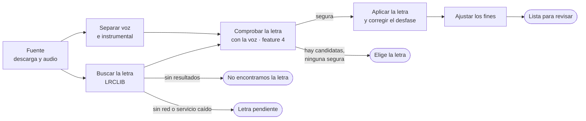

# 04 — Progreso del pipeline (descarga, preparación y separación)

- Paso del pipeline: 1 (descarga YouTube) y 2 (Separación)
- ADRs: [0003](../adr/0003-fuente-de-audio.md), [0004](../adr/0004-separacion-voz-instrumental.md), [0006](../adr/0006-persistencia-y-modelo-de-datos.md)
- Restricciones: [arquitectura.md §6 y "Restricciones e implicaciones para UX" §2–§3](../arquitectura.md)
- Preguntas respondidas: [0013](../preguntas/0013-huecos-ux-de-la-fase-2.md) §1, §4 (cancelar la descarga, fuente pendiente, cola de descargas); [0003](../preguntas/0003-elegir-calidad-o-rapidez-separacion.md) (modo informativo); [0019](../preguntas/0019-calidad-por-defecto-y-rapido-con-consentimiento.md) (modelo Calidad en todos los equipos; oferta del modelo Rápido con consentimiento tras un fallo de separación); [0020](../preguntas/0020-huecos-ux-de-la-separacion-fase-3.md) (reintentos, descarga del modelo dentro del trabajo, muerte por memoria)

## Objetivo
Que el usuario entienda que la separación **tarda minutos**, sepa **cuánto falta**, pueda **cancelar** y, sobre todo, **no tenga que esperar**: puede buscar la letra, sincronizar o volver a la biblioteca mientras tanto. Nada se pierde al salir.

Usuario/tarea principal: "He añadido una canción: ¿qué está pasando y qué puedo hacer ahora?"

Esta spec define tres piezas:
1. **Vista de progreso** (paso 2 del espacio de canción).
2. **Panel de actividad** global (barra superior).
3. **Comportamiento de cierre, interrupción y notificaciones**.
La línea de progreso de la tarjeta está en la spec 02.

## 1. Vista de progreso

### Wireframe
```
┌──────────────────────────────────────────────────────────────────────────┐
│ ‹ Biblioteca │ «Bohemian Rhapsody» · Queen           ✎ Borrador · guardado│
│   (1)✓ Fuente ──── (2)● Separación ──── (3)○ Letra ──── (4)○ Editor       │
├──────────────────────────────────────────────────────────────────────────┤
│                                                                          │
│   Separando la voz de la música                                          │
│   Puedes seguir trabajando: esto continúa aunque cambies de pantalla.    │
│                                                                          │
│   ✓  Descargar de YouTube                                     5,8 MB     │
│   ✓  Preparar el audio                                                   │
│   ⟳  Separar voz e instrumental                                          │
│        Separando… 42 %                    quedan unos 3 minutos          │
│        ████████████████░░░░░░░░░░░░░░░░░░░░░░░                           │
│        Modelo Calidad · ⓘ                                                │
│                                                                          │
│   ┌──────────────────────────────────────────────────────────────────┐   │
│   │ Mientras tanto…                                                  │   │
│   │ Busca la letra y empieza a sincronizarla con la canción original.│   │
│   │ [ Buscar la letra mientras tanto ] (primario)                    │   │
│   │ [ Volver a la biblioteca ] (secundario)                          │   │
│   └──────────────────────────────────────────────────────────────────┘   │
│                                                                          │
│   [ Cancelar separación ] (fantasma)                                     │
└──────────────────────────────────────────────────────────────────────────┘
```
Si la canción viene de un archivo local, la fila "Descargar de YouTube" no aparece.

**Terminado** (la vista sigue abierta al acabar)
```
│   ✓  Separar voz e instrumental                    1 min 48 s            │
│   Escucha el resultado:  [▶ Voz]  [▶ Instrumental]                       │
│   ┌──────────────────────────────────────────────────────────────────┐   │
│   │ [ Buscar la letra ] (primario)        (o "Ir al editor" si ya hay letra)│
│   └──────────────────────────────────────────────────────────────────┘   │
```

**Descarga pendiente** (YouTube, tras cancelar la descarga; o al llegar por el stepper con la fuente `pendiente` sin trabajo vivo)
```
│   Separando la voz de la música                                          │
│   ○  Descargar de YouTube                                                │
│   ○  Preparar el audio                                                   │
│   ○  Separar voz e instrumental                                          │
│   ┌──────────────────────────────────────────────────────────────────┐   │
│   │ ⓘ Falta descargar el audio.                                      │   │
│   │   Cancelaste la descarga antes de que terminara. La canción sigue│   │
│   │   en tu biblioteca como borrador.                                │   │
│   │   [ Descargar ahora ] (primario)                                 │   │
│   └──────────────────────────────────────────────────────────────────┘   │
│   [ Volver a la biblioteca ] (secundario)                                │
```
Sin bloque "Mientras tanto…" ni "Cancelar …". Para usar otro vídeo: paso 1 (wireframe E de la spec 03).

**Error de separación con oferta del modelo Rápido** (solo si el trabajo terminó en `MEMORIA_INSUFICIENTE` tras los reintentos automáticos o en `MODELO_NO_DISPONIBLE` (salvo que la causa sea `SIN_CONEXION`: Rápido también fallaría), **y** se separaba con el modelo Calidad; [0019](../preguntas/0019-calidad-por-defecto-y-rapido-con-consentimiento.md))
```
│   ✓  Preparar el audio                                                   │
│   ✕  Separar voz e instrumental                                          │
│   ┌──────────────────────────────────────────────────────────────────┐   │
│   │ ✕ Tu equipo no tiene memoria suficiente para el modelo Calidad   │   │
│   │   Ya lo intentamos por partes más pequeñas. Cierra otros programas  │   │
│   │   y vuelve a intentarlo.                                         │   │
│   │                                                                  │   │
│   │   Si sigue fallando, hay otra opción: el modelo Rápido, más      │   │
│   │   ligero. Antes de usarlo, lee el aviso.                         │   │
│   │   [ Reintentar ] (primario)  [ Usar el modelo Rápido… ]          │   │
│   └──────────────────────────────────────────────────────────────────┘   │
│   [ Volver a la biblioteca ] (secundario)                                │
```
- "Usar el modelo Rápido…" abre el diálogo de consentimiento compartido `aviso-rapido` (spec 01, "Diálogo de consentimiento del modelo Rápido") con el motivo `rapido.motivo.memoria` o `rapido.motivo.descarga`. La línea de la oferta es `rapido.oferta.separacion`.
- Al aceptar: `aceptarYUsarRapido('separacion')`; el subpaso vuelve a ⟳ con `prog.fase.modelo.rapido` ("Descargando el modelo Rápido… {n} %", solo si falta) y después relanza la separación con Rápido (fases normales). El indicador pasa a "Modelo Rápido · ⓘ". Si la descarga falla o se cancela, el subpaso muestra el error de la descarga sin oferta (el consentimiento queda guardado; "Reintentar" vuelve a intentarlo con Rápido).
- Cancelar el diálogo deja el banner tal cual. El toast y la notificación de error (§3) **no** incluyen la oferta: el usuario debe leer el aviso completo en esta vista ([Ver]).
- Si la separación ya era con Rápido, los mismos errores se muestran sin oferta (`prog.error.MEMORIA_INSUFICIENTE.rapido`, `prog.error.MODELO_NO_DISPONIBLE`).

### Subpasos y fases
| Subpaso | Fases técnicas (worker) | Progreso mostrado |
|---------|-------------------------|-------------------|
| Descargar de YouTube | `descargando` | % + "X MB de Y MB" + tiempo restante |
| Preparar el audio | `importar-archivo` | indeterminado, "Preparando el audio…" (2–10 s) |
| Separar voz e instrumental | (`descargando_modelo`, solo si falta el modelo) → `cargando_modelo` → `separando` → `guardando` | (`prog.fase.modelo` / `prog.fase.modelo.rapido`: barra determinada con "X MB de Y MB"; el main vuelve a descargar automáticamente el modelo del modo vigente si falta, ADR 0004 Revisiones 2026-11-05 bis, y descarga Rápido tras aceptarlo; "Cancelar separación" sigue disponible con su diálogo; la tarjeta y el panel de actividad: los detalla la respuesta a [0020](../preguntas/0020-huecos-ux-de-la-separacion-fase-3.md)) → "Preparando la separación…" (indeterminado, 5–20 s) → "Separando… N %" + tiempo → "Guardando las pistas…" (indeterminado) |
| En cola (separación) | — | `prog.cola`: "En cola: se separará cuando termine «{otra canción}»." (sin barra; posición si hay > 1: "2.ª en la cola") |
| En cola (descarga) | — | `prog.cola.descarga`: "En cola: se descargará cuando termine «{otra canción}»." Si lo que ocupa la cola `ligera` es la actualización de yt-dlp (trabajo sin canción): `prog.cola.descarga.mantenimiento`. Misma regla de posición. |
| Reintento tras bloqueo | `actualizando` | Barra indeterminada + `prog.reintento.ytdlp` en el subpaso "Descargar de YouTube" (no es error). |

### Componentes e interacciones
| Elemento | Comportamiento |
|----------|----------------|
| Lista de subpasos | Icono de estado (○ ⟳ ✓ ✕ ⚠ ⏸) + nombre + dato a la derecha (tamaño o duración real al terminar). |
| Barra de progreso | Determinada en descarga y separación; indeterminada en preparación, carga del modelo y guardado. Nunca retrocede visualmente (el main ya suaviza). |
| Tiempo restante | No se muestra durante los primeros 15 s de la fase determinada ("Calculando tiempo…"). Después: "quedan unos N minutos" (N ≥ 2, redondeado), "queda 1 minuto aprox.", "menos de 1 minuto". Si la estimación sube más de un 50 % se muestra igualmente (no se oculta), sin animar el cambio. Antes de empezar (en cola o cargando), se muestra una estimación previa basada en duración × perfil: "Tardará unos N minutos". |
| Modelo · ⓘ | Texto "Modelo Calidad" / "Modelo Rápido" (el modelo **realmente usado** por este trabajo). Botón ⓘ con popover (se abre con clic, Intro o Espacio; Esc lo cierra y devuelve el foco): con Calidad, `prog.modo.ayuda.calidad` con `{dispositivo}` = "tu tarjeta gráfica NVIDIA" / "el procesador", sin enlace (no hay nada que cambiar); con Rápido, `prog.modo.ayuda.rapido` y enlace "Ir a Ajustes" (spec 08, "Volver a Calidad"). |
| Buscar la letra mientras tanto | Navega a la vista 05. La separación continúa. |
| Volver a la biblioteca | Navega a la Biblioteca. La separación continúa. |
| Cancelar separación | Disponible también durante `descargando_modelo` y durante los reintentos automáticos (el trabajo está vivo). Diálogo `prog.dialogo.cancelar`, foco en "Seguir separando"; si se cancela en `descargando_modelo`, lo descargado se conserva y la próxima vez continúa. Al confirmar, el paso vuelve a `pendiente` y la vista muestra el estado "Pendiente". |
| Cancelar descarga | Visible con la descarga en curso (fases `descargando`, `actualizando` o `preparando`, **y también durante la espera de un reintento de red**: cuenta como en curso, con el mismo diálogo) o en cola. En cola: retira sin diálogo. En curso: diálogo `prog.dialogo.cancelar.descarga`, foco en "Seguir descargando"; "Cancelar descarga" es destructivo. Al confirmar (o retirar de la cola), el paso `fuente` queda `pendiente`, **se conserva el borrador** con sus datos (y la letra, si ya se buscó) y la vista muestra "Descarga pendiente". No se elimina la canción: para quitarla está "Eliminar…" en la Biblioteca. El mismo diálogo se usa desde [✕] del panel de actividad y "Cancelar trabajo" del menú de la tarjeta. |
| Descargar ahora (descarga pendiente) | Encola la descarga con el mismo enlace; la vista pasa a "En cola" o "Descargando". Foco inicial en este botón. |
| Estado "Pendiente" (tras cancelar) | "La separación está pendiente." + primario "Separar ahora" + estimación previa. |
| Reparar el motor de audio (error `RUNTIME_NO_DISPONIBLE`) | Abre Primer arranque (spec 01) en la variante B5 "Hay que reparar el motor de audio", a mitad de sesión igual que al arrancar (sin acceso a otras vistas hasta terminar). Si hay otros trabajos en curso o en cola (p. ej. una descarga), antes muestra `prog.dialogo.reparar` con el foco en "Seguir trabajando"; "Reparar ahora" los cancela (quedan `pendiente`, como al cancelarlos a mano) y abre B5. Al terminar la reparación, B3 → "Empezar" vuelve a la Biblioteca; la canción conserva su error. Al volver a esta vista con el motor ya reparado (`runtime.estado()` = `completa`), el banner de este código cambia a `prog.error.RUNTIME_NO_DISPONIBLE.reparado` con [Reintentar] (primario), para no dar un bucle de "reparar". |
| Escuchar Voz / Instrumental | Reproductor mínimo en línea (▶/❚❚ + barra de posición). Solo uno suena a la vez. Permite comprobar el resultado antes de seguir. |
| Teclado | Foco inicial en "Buscar la letra mientras tanto" (o "Buscar la letra" al terminar). Esc = volver a la Biblioteca (no cancela). |
| Lector de pantalla | Anuncios: inicio de cada subpaso, 25/50/75 %, terminado, error. |

### Estados
| Estado | Presentación |
|--------|--------------|
| Vacío | No aplica (la vista solo existe si hay fuente). |
| En cola | Subpaso con ⏸ y texto de cola; botón "Cancelar" retira de la cola (sin diálogo). |
| Pendiente (fuente de YouTube) | Wireframe "Descarga pendiente": banner `info` (no `aviso`: lo decidió el usuario, no es un fallo). |
| Procesando | Wireframe principal. |
| Éxito | Wireframe "Terminado"; toast si el usuario está en otra vista (ver §3). |
| Error | El subpaso muestra ✕ y debajo un banner `error` con título, explicación y acciones (tabla de microcopy). Con `MEMORIA_INSUFICIENTE` o `MODELO_NO_DISPONIBLE` usando Calidad, el banner añade la oferta del modelo Rápido (wireframe "Error de separación con oferta"). Los reintentos automáticos (memoria, yt-dlp, red) **no** se muestran como error: el subpaso dice `prog.reintento.memoria` / "Actualizando el descargador y reintentando…" / "Reintentando en {n} s…". |
| Interrumpido | ⚠ + banner `aviso`: "La separación se interrumpió porque se cerró la aplicación. Hay que empezarla de nuevo." [Reintentar]. |
| Borrador | Siempre es borrador mientras se está en esta vista; la cabecera muestra "✎ Borrador · guardado". |

## 2. Panel de actividad (global)
Botón en la barra superior, visible solo si hay trabajos en curso o en cola: spinner `info` + "1 en curso" o "1 en curso · 2 en cola". Al pulsarlo se abre un panel desplegable (360 px):
```
┌──────────────────────────────────────────┐
│ Actividad                                │
│ ⟳ Bohemian Rhapsody — Separando 42 %     │
│   ███████░░░░░ quedan unos 3 min   [Ir] [✕]│
│ ⟳ La flaca — Descargando 80 %            │
│   █████████░░ menos de 1 min       [Ir] [✕]│
│ ⏸ Despacito — En cola para separar  [Ir] [✕]│
│ ⟳ Vivir mi vida — Actualizando el        │
│   descargador…  ░░▓▓▓░░░        [Ir] [✕]│
└──────────────────────────────────────────┘
```
- Textos de fase en el panel (0020 §2, §4): "{título} — Descargando el modelo 34 %" (barra determinada), "{título} — Reintentando la separación…" (indeterminada), "{título} — Reintentando en {n} s…" (sin barra, cuenta atrás). Mismos textos que la tarjeta (`bib.paso.modelo`, `bib.paso.reintento.*`).
- [Ir] abre la vista de progreso de esa canción. [✕] = cancelar (con el mismo diálogo de confirmación salvo para elementos en cola).
- Se cierra con Esc o clic fuera; el foco vuelve al botón. Navegable con flechas.
- Al terminar todos los trabajos, el botón muestra "✓ Terminado" 4 s y desaparece.

## 3. Cierre, interrupción y avisos
| Situación | Comportamiento |
|-----------|----------------|
| Un trabajo termina y el usuario está en otra vista de la app | Toast: "«{título}»: voz e instrumental separadas." [Abrir]. Si la canción ya cumple las condiciones para estar lista: "«{título}» ya se puede marcar como lista." [Abrir editor]. |
| Un trabajo termina o falla con la ventana sin foco o minimizada | **Windows y Linux**: notificación del sistema con el mismo texto que el toast (clic en ella = traer la ventana y abrir la canción) + parpadeo del botón en la barra de tareas. Si el escritorio no tiene servicio de notificaciones, solo el parpadeo. **macOS** (app sin firmar: las notificaciones nativas no funcionan): rebote del icono del Dock (una vez, informativo) + insignia numérica en el Dock con el número de avisos pendientes. En todos los SO, al volver a la ventana se muestra el toast y se borran la insignia y el parpadeo ([0005](../preguntas/0005-viabilidad-detalles-ux-fase-0.md) §9). |
| Un trabajo falla en segundo plano | Toast `error` persistente (no se cierra solo): "«{título}»: {título del error}." [Ver]. |
| Cerrar la app con trabajos activos o en cola | Diálogo modal: título "¿Cerrar Shinobi Karaoke?", texto "Hay {n} trabajo(s) sin terminar ({lista breve}). Si cierras ahora, se cancelarán y tendrás que repetirlos. Tu letra y tu estilo están guardados." [Seguir trabajando] (primario, con foco) [Cerrar de todos modos] (destructivo). |
| Reabrir tras cierre o fallo | Los pasos que estaban `en_curso` aparecen `interrumpido` en la tarjeta y en esta vista, con "Reintentar". No se reintenta automáticamente. |

## Microcopy
| Clave | Texto |
|-------|-------|
| `prog.titulo` | Separando la voz de la música |
| `prog.subtitulo` | Puedes seguir trabajando: esto continúa aunque cambies de pantalla. |
| `prog.sub.descargar` | Descargar de YouTube |
| `prog.sub.preparar` | Preparar el audio |
| `prog.sub.separar` | Separar voz e instrumental |
| `prog.fase.cargando` | Preparando la separación… |
| `prog.fase.separando` | Separando… {n} % |
| `prog.fase.guardando` | Guardando las pistas… |
| `prog.fase.descargando` | Descargando… {n} % · {x} MB de {y} MB |
| `prog.cola` | En cola: se separará cuando termine «{otra}». |
| `prog.cola.descarga` | En cola: se descargará cuando termine «{otra}». |
| `prog.cola.descarga.mantenimiento` | En cola: el descargador de YouTube se está actualizando. Empezará enseguida. |
| `prog.eta.calculando` | Calculando tiempo… |
| `prog.eta` | quedan unos {n} minutos · queda 1 minuto aprox. · menos de 1 minuto |
| `prog.eta.previa` | Tardará unos {n} minutos |
| `prog.modo.calidad` / `rapido` | Modelo Calidad · Modelo Rápido |
| `prog.modo.ayuda.calidad` | Shinobi Karaoke separa la voz con el modelo Calidad, que deja poca voz de fondo. En tu equipo se ejecuta con {dispositivo}. |
| `prog.modo.ayuda.rapido` | Estás usando el modelo Rápido, que aceptaste usar bajo tu responsabilidad porque el modelo Calidad no funcionó. Sus autores no han declarado licencia. Puedes volver al modelo Calidad en Ajustes. — Ir a Ajustes |
| `prog.fase.modelo` | Descargando el modelo Calidad… {n} % · {x} MB de {y} MB |
| `prog.fase.modelo.rapido` | Descargando el modelo Rápido… {n} % · {x} MB de {y} MB |
| `prog.mientras.titulo` | Mientras tanto… |
| `prog.mientras.cuerpo` | Busca la letra y empieza a sincronizarla con la canción original. |
| `prog.boton.letra` | Buscar la letra mientras tanto |
| `prog.boton.letra.fin` | Buscar la letra |
| `prog.boton.editor` | Ir al editor |
| `prog.boton.biblioteca` | Volver a la biblioteca |
| `prog.boton.cancelar` | Cancelar separación · Cancelar descarga |
| `prog.dialogo.cancelar` | ¿Cancelar la separación? Tendrás que volver a empezarla más tarde. La letra y lo que hayas sincronizado se conservan. — [Seguir separando] [Cancelar separación] |
| `prog.pendiente` | La separación está pendiente. — [Separar ahora] |
| `prog.dialogo.cancelar.descarga` | **¿Cancelar la descarga?** «{título}» se quedará en tu biblioteca como borrador, sin audio. Podrás descargarla de nuevo cuando quieras. — [Seguir descargando] [Cancelar descarga] |
| `prog.pendiente.descarga` | **Falta descargar el audio.** Cancelaste la descarga antes de que terminara. La canción sigue en tu biblioteca como borrador. — [Descargar ahora] |
| `prog.boton.descargar.ahora` | Descargar ahora |
| `prog.escuchar` | Escucha el resultado: Voz · Instrumental |
| `prog.reintento.memoria` | Reintentando por partes más pequeñas… · (tercer intento, de la tarjeta NVIDIA al procesador) Reintentando con el procesador… Tardará más. |
| `prog.reintento.ytdlp` | Actualizando el descargador de YouTube y reintentando… |
| `prog.reintento.red` | Reintentando en {n} s… |
| `prog.error.SIN_CONEXION` | **Sin conexión a internet.** La descarga se detuvo. Comprueba tu conexión. — [Reintentar] |
| `prog.error.SIN_ESPACIO` | **No queda espacio en el disco.** Libera espacio y vuelve a intentarlo. — [Reintentar] |
| `prog.error.MEMORIA_INSUFICIENTE` | **Tu equipo no tiene memoria suficiente para el modelo Calidad.** Ya lo intentamos por partes más pequeñas. Cierra otros programas y vuelve a intentarlo. + `rapido.oferta.separacion` — [Reintentar] [Usar el modelo Rápido…] |
| `prog.error.MEMORIA_INSUFICIENTE.rapido` | **Tu equipo se quedó sin memoria.** Ya lo intentamos por partes más pequeñas. Cierra otros programas y vuelve a intentarlo. — [Reintentar] |
| `prog.error.MODELO_NO_DISPONIBLE` | **No hemos podido descargar el modelo de separación.** Hace falta para separar. Comprueba tu conexión y vuelve a intentarlo. — [Reintentar] (con Calidad y una causa distinta de `SIN_CONEXION`, además `rapido.oferta.separacion` y [Usar el modelo Rápido…]). El main ya intentó descargarlo solo, así que el botón es "Reintentar" (vuelve a intentar descarga y separación), no "Descargar y reintentar". |
| `rapido.oferta.separacion` | Si sigue fallando, hay otra opción: el modelo Rápido, más ligero. Antes de usarlo, lee el aviso. |
| `prog.error.YOUTUBE_BLOQUEADO` | **YouTube no permite la descarga ahora mismo.** Inténtalo más tarde o usa un archivo de tu equipo. — [Reintentar] [Añadir desde un archivo] |
| `prog.error.RUNTIME_NO_DISPONIBLE` | **Hay que reparar el motor de audio.** Falta una parte del motor que separa la voz de la música. Al repararlo se descarga de nuevo lo que falta; después, vuelve a separar esta canción. — [Reparar el motor de audio] (primario, foco) [Copiar detalles] (secundario). Sin [Reintentar] (fallaría igual) y sin oferta de Rápido. Ver "Reparar el motor de audio" en Componentes ([0032](../preguntas/0032-textos-de-motor-de-audio-incompleto.md)). |
| `prog.error.RUNTIME_NO_DISPONIBLE.reparado` | **El motor de audio ya está reparado.** Vuelve a separar esta canción. — [Reintentar] (primario, foco) |
| `prog.dialogo.reparar` | **¿Reparar el motor de audio ahora?** Hay {n} trabajo(s) sin terminar ({lista}). Si reparas ahora, se cancelarán y tendrás que repetirlos. Tu letra y tu estilo están guardados. — [Seguir trabajando] (foco) [Reparar ahora] |
| `prog.error.generico` | **Algo salió mal al separar.** Vuelve a intentarlo. — [Reintentar] [Copiar detalles] |
| `prog.interrumpido` | La separación se interrumpió porque se cerró la aplicación. Hay que empezarla de nuevo. — [Reintentar] |
| `prog.toast.ok` | «{título}»: voz e instrumental separadas. — [Abrir] |
| `prog.toast.lista` | «{título}» ya se puede marcar como lista. — [Abrir editor] |
| `prog.toast.error` | «{título}»: {título del error}. — [Ver] |
| `act.boton` | {n} en curso · {m} en cola |
| `act.titulo` | Actividad |
| `act.terminado` | Terminado |
| `cierre.titulo` | ¿Cerrar Shinobi Karaoke? |
| `cierre.cuerpo` | Hay {n} trabajo(s) sin terminar ({lista}). Si cierras ahora, se cancelarán y tendrás que repetirlos. Tu letra y tu estilo están guardados. |
| `cierre.seguir` / `cierre.cerrar` | Seguir trabajando · Cerrar de todos modos |

## Criterios de aceptación
1. Tras confirmar la fuente se muestra esta vista con los subpasos aplicables (sin "Descargar de YouTube" en archivos locales) y su estado.
2. Las fases indeterminadas (preparar, cargar modelo, guardar) usan barra indeterminada con su texto; las determinadas muestran porcentaje y barra que nunca retrocede.
3. El tiempo restante muestra "Calculando tiempo…" los primeros 15 s de cada fase determinada y luego el texto redondeado de `prog.eta`; antes de empezar se muestra la estimación previa.
4. Con otra separación en marcha, la canción aparece "En cola" con el nombre de la canción que se está separando.
5. "Buscar la letra mientras tanto" y "Volver a la biblioteca" navegan sin interrumpir el trabajo; al volver a la vista, el progreso está actualizado.
6. "Cancelar" pide confirmación (salvo en cola); al confirmar, el paso queda "Pendiente" con "Separar ahora", y la letra/estilo de la canción no cambian.
7. Los reintentos automáticos se muestran como texto en el subpaso, no como error; solo el fallo definitivo muestra el banner de error con sus acciones.
8. Cada código de error (`SIN_CONEXION`, `SIN_ESPACIO`, `MEMORIA_INSUFICIENTE`, `MODELO_NO_DISPONIBLE`, `YOUTUBE_BLOQUEADO`, desconocido) muestra su texto y acciones de la tabla.
8b. Con `MEMORIA_INSUFICIENTE` (tras los reintentos automáticos) o `MODELO_NO_DISPONIBLE` (causa distinta de `SIN_CONEXION`) separando con Calidad, el banner incluye `rapido.oferta.separacion` y "Usar el modelo Rápido…" (secundario; "Reintentar" primario y con foco). Separando con Rápido, o con cualquier otro código (incluido `RUNTIME_NO_DISPONIBLE`), no hay oferta. El toast y la notificación de error nunca incluyen la oferta.
8c. "Usar el modelo Rápido…" abre el diálogo `aviso-rapido` de la spec 01 con el motivo de este error; Cancelar no cambia nada. Al aceptar, el subpaso vuelve a ⟳, muestra `prog.fase.modelo.rapido` si hay que descargar Rápido y relanza la separación con Rápido; el indicador pasa a "Modelo Rápido". Si esa descarga falla o se cancela, se muestra el error sin oferta y el modo no cambia.
9. Al terminar, la vista muestra la duración real y permite escuchar voz e instrumental; el primario pasa a "Buscar la letra" o "Ir al editor" si ya hay letra.
10. Si el usuario está en otra vista al terminar o fallar un trabajo, aparece el toast correspondiente; los de error no se cierran solos.
10b. Con la ventana sin foco, al terminar o fallar un trabajo: en Windows/Linux se intenta la notificación del sistema y la barra de tareas parpadea; en macOS el icono del Dock rebota una vez y muestra una insignia con el número de avisos pendientes. Al volver a la ventana aparece el toast y la insignia/parpadeo desaparecen. Si la notificación falla, no se muestra ningún error al usuario.
11. El panel de actividad aparece solo con trabajos activos o en cola, lista cada trabajo con progreso, "Ir" y "Cancelar", y es navegable con teclado.
12. Cerrar la app con trabajos pendientes muestra el diálogo de cierre con el foco en "Seguir trabajando"; al reabrir, esos pasos aparecen como "Interrumpido" con "Reintentar".
13. La vista muestra el modelo usado por el trabajo ("Modelo Calidad" / "Modelo Rápido") con su ⓘ: con Calidad, `prog.modo.ayuda.calidad` con el dispositivo real y sin enlace; con Rápido, `prog.modo.ayuda.rapido` con "Ir a Ajustes". Ningún texto dice que el usuario puede elegir modelo en Ajustes.
14. Los lectores de pantalla reciben anuncios al iniciar cada subpaso, al 25/50/75 %, al terminar y en error.
15. "Cancelar descarga" con la descarga en curso abre `prog.dialogo.cancelar.descarga` con el foco en "Seguir descargando"; en cola retira sin diálogo. Al confirmar, la canción sigue en la Biblioteca como borrador con el paso `fuente` `pendiente`, sin audio, y la vista muestra "Descarga pendiente" con "Descargar ahora", que vuelve a encolar la descarga con el mismo enlace.
16. Una descarga que espera en la cola `ligera` muestra `prog.cola.descarga` con el título de la canción que se está descargando, o `prog.cola.descarga.mantenimiento` si espera a la actualización de yt-dlp.
17. Durante la actualización automática de yt-dlp tras un bloqueo, el subpaso "Descargar de YouTube" muestra `prog.reintento.ytdlp` con barra indeterminada, "Cancelar descarga" sigue disponible y el panel de actividad muestra "Actualizando el descargador…"; no se muestra ningún error ni se pregunta nada.
18. Durante la fase `descargando_modelo`, el subpaso "Separar voz e instrumental" muestra `prog.fase.modelo` (o `.rapido`) con barra determinada y "X MB de Y MB"; "Cancelar separación" está disponible con su diálogo. La tarjeta y el panel muestran "Descargando el modelo {n} %".
19. Durante la espera de un reintento de red de una descarga de YouTube, el subpaso, la tarjeta y el panel muestran "Reintentando en {n} s…" con cuenta atrás; "Cancelar descarga" abre el mismo diálogo que con la descarga en curso.
20. Un proceso de separación terminado por el sistema por falta de memoria (Linux) se comporta exactamente como `MEMORIA_INSUFICIENTE`: mismos reintentos automáticos, mismos textos y misma oferta del modelo Rápido; no hay texto propio.
21. Con `RUNTIME_NO_DISPONIBLE` y la instalación `dañada`, el banner muestra `prog.error.RUNTIME_NO_DISPONIBLE` con [Reparar el motor de audio] (primario, con foco) y [Copiar detalles]; no hay [Reintentar] ni oferta de Rápido. El toast y la línea de la tarjeta dicen «Hay que reparar el motor de audio»; la tarjeta ofrece [Ver] (no [Reintentar]).
22. [Reparar el motor de audio] abre B5 "Hay que reparar el motor de audio" (spec 01) a mitad de sesión; con otros trabajos en curso o en cola, antes pide confirmación con `prog.dialogo.reparar` (foco en "Seguir trabajando"; "Seguir trabajando" no cambia nada). Al terminar la reparación, "Empezar" vuelve a la Biblioteca.
23. Con el motor ya reparado (`completa`), la vista de esa canción muestra `prog.error.RUNTIME_NO_DISPONIBLE.reparado` con [Reintentar], que relanza la separación.

## 0.2.2 · Feature 5 — Preparación desatendida

Origen: [plan 0.2.2, feature 5](../versiones/0.2.2/plan-4.md), [propuesta 020](../propuestas/020-preparacion-desatendida.md) y la idea rectora del usuario: automatizar al máximo la creación del karaoke. Letra: [05 · 0.2.2 · Feature 5](05-letra.md#022--feature-5--preparación-desatendida-la-vista-letra). Tarjeta, bandeja y «Preparar»: [02 · 0.2.2 · Feature 5](02-biblioteca.md#022--feature-5--lista-para-revisar-y-bandeja-de-pendientes). Interruptor de privacidad: [08 · 0.2.2 · Feature 5](08-ajustes-y-acerca.md#022--feature-5--letras-y-preparación-automática). Editor: [06 · 0.2.2 · Feature 5](06-editor.md#022--feature-5--preparación-desatendida-lo-que-el-editor-cuenta). Contratos pendientes: [0153](../preguntas/0153-contratos-de-las-features-4-a-7-para-las-specs.md). Decisiones provisionales: [0154](../preguntas/0154-decisiones-provisionales-de-ux-de-las-features-4-a-7.md).

**Depende de** la feature 4 (comprobar la letra) para elegir sin preguntar. Sin ella, la cadena funciona pero nunca elige sola: toda canción con candidatas queda en «Elige la letra».

**Sustituye**: el título y el bloque «Mientras tanto…» de la vista de progreso, el wireframe «Terminado», la fila «Reabrir tras cierre o fallo» de §3, el texto de `cierre.cuerpo`, los toasts `prog.toast.ok` y `prog.toast.lista` cuando hay preparación, y los criterios 9 y 12.

### La cadena

Tras confirmar la fuente, la canción sigue sola hasta donde pueda:



| Paso | Cuándo empieza | Qué hace | Duración típica |
|---|---|---|---|
| **Buscar la letra** | Al completarse la fuente (hace falta la duración real), **en paralelo** con la separación. | La búsqueda de siempre (ADR 0005), sin que el usuario entre en Letra. Envía título, artista, álbum y duración a LRCLIB. Solo si «Buscar la letra automáticamente» está activado (spec 08) o si el usuario pulsó «Preparar». | < 2 s (máx. 10 s) |
| **Comprobar la letra con la voz** | Al terminar la separación y estar lista la forma de onda de la voz. | Comprueba cada candidata con tiempos (feature 4). | < 2 s |
| **Aplicar** | Si hay una candidata **segura**. | Guarda la letra (con el desfase ya corregido si era `desfasada`). | instantáneo |
| **Ajustar los fines** | Tras aplicar la letra. | Con la feature 10 disponible, su alineación (la define su spec). Sin ella, «Ajustar los silencios» en versión prudente: solo fija el fin de las líneas con **fin automático**, nunca cambia un fin que traía la letra ni activa la cuenta 3·2·1 **(decisión provisional)**. | < 2 s |

**Candidata segura** (todas a la vez; **decisión provisional**, umbral estricto de la propuesta):
1. es la coincidencia exacta de LRCLIB (título, artista y duración a 2 s o menos);
2. está sincronizada (tiene tiempos);
3. su comprobación es `coincide` o `desfasada`.

Si no hay ninguna segura pero hay candidatas, la canción queda en **«Elige la letra»** con el motivo (`let.prep.motivo.*`, spec 05). La app **nunca** marca una canción como Lista ni como Letra lista: prepara, y el usuario confirma.

**Lo que la preparación no toca nunca**: una letra que ya existe (solo la comprueba), un tiempo editado por el usuario, el estilo o el tema (se heredan como siempre), el estado Lista o Letra lista.

**Reintento de la búsqueda**: si falla por `SIN_CONEXION` o `SERVICIO_NO_DISPONIBLE`, se reintenta **una vez** a los 60 s. Si vuelve a fallar, la canción queda en «Letra pendiente» y se reintenta sola una vez en el siguiente arranque de la app, al pulsar [Reintentar] o al entrar en Letra. Las búsquedas de varias canciones van **en serie** con la pausa que pide LRCLIB (ADR 0005).

### Vista de progreso

```
┌──────────────────────────────────────────────────────────────────────────┐
│ ‹ Biblioteca │ «Bohemian Rhapsody» · Queen           ✎ Borrador · guardado│
│   (1)✓ Fuente ──── (2)● Separación 42 % ──── (3)⟳ Letra ──── (4)○ Editor  │
├──────────────────────────────────────────────────────────────────────────┤
│   Preparando tu canción                                                  │
│   No hace falta que esperes: te avisaremos cuando esté lista para        │
│   revisar.                                                               │
│                                                                          │
│   ✓  Descargar de YouTube                                     5,8 MB     │
│   ✓  Preparar el audio                                                   │
│   ⟳  Separar voz e instrumental                                          │
│        Separando… 42 %                    quedan unos 3 minutos          │
│        ████████████████░░░░░░░░░░░░░░░░░░░░░░░                           │
│        Modelo Calidad · ⓘ                                                │
│   ✓  Buscar la letra                              3 candidatas en LRCLIB │
│   ○  Comprobar la letra con la voz                                       │
│   ○  Ajustar los fines de línea                                          │
│                                                                          │
│   [ Volver a la biblioteca ] (primario)   [ Ver la letra ] (secundario)  │
│   [ Cancelar separación ] (fantasma)                                     │
└──────────────────────────────────────────────────────────────────────────┘
```

**Resultado** (sustituye al bloque «Terminado»; «Escucha el resultado: [▶ Voz] [▶ Instrumental]» se mantiene encima)

```
R1 · Lista para revisar
│   ┌──────────────────────────────────────────────────────────────────┐   │
│   │ ✓ Lista para revisar                                             │   │
│   │   · Letra de LRCLIB, coincidencia exacta.                        │   │
│   │   · Desfase corregido: toda la letra 0,8 s más tarde.            │   │
│   │   · Fin de 31 líneas ajustado con la voz.                        │   │
│   │   Escúchala, corrige lo que no coincida y márcala como lista.    │   │
│   │   [ Revisar ] (primario)   [ ▶ Probar ] (secundario)             │   │
│   └──────────────────────────────────────────────────────────────────┘   │

R2 · Elige la letra
│   │ ⓘ Elige la letra                                                 │   │
│   │   Hay 3 candidatas. No la elegimos por ti porque no está claro   │   │
│   │   que coincida con tu audio.                                     │   │
│   │   [ Elegir la letra ] (primario)                                 │   │

R3 · No encontramos la letra            (o «Esta canción es instrumental, según LRCLIB»)
│   │ ⓘ No encontramos la letra                                        │   │
│   │   Revisa el título y el artista, o pega la letra tú.             │   │
│   │   [ Añadir la letra ] (primario)                                 │   │

R4 · Letra pendiente
│   │ ⚠ No pudimos buscar la letra: sin conexión a internet.           │   │
│   │   Lo intentaremos de nuevo la próxima vez que abras la app.      │   │
│   │   [ Reintentar ] (primario)   [ Añadir la letra ] (secundario)   │   │
```

| Elemento | Comportamiento |
|---|---|
| **Título y subtítulo** | `prog.prep.titulo` y `prog.prep.subtitulo` cuando la canción tiene preparación (interruptor activado o «Preparar»). Con el interruptor desactivado y sin «Preparar», la vista es la de 0.2.1 (título `prog.titulo`, bloque «Mientras tanto…»). |
| **Subpasos nuevos** | «Buscar la letra», «Comprobar la letra con la voz» y «Ajustar los fines de línea», bajo «Separar voz e instrumental», con los iconos de siempre (○ ⟳ ✓ ✕ ⚠). A la derecha, su resultado en `texto-2`: `prog.prep.res.*`. Un paso que no se va a hacer muestra «—» y su motivo (`prog.prep.omitido.*`): por ejemplo, con una letra ya elegida por el usuario, «Buscar la letra — Ya tiene letra». |
| **Volver a la biblioteca** (primario, foco inicial) | Sustituye a «Buscar la letra mientras tanto» como acción principal: lo esperado es irse. |
| **Ver la letra** (secundario) | Abre la vista Letra. Si la búsqueda ya terminó, muestra sus candidatas sin consultar la red; el usuario puede elegir antes de que acabe la separación (la preparación respeta su elección y solo comprueba). |
| **Revisar** (R1) | Abre el editor (con la feature 11, en su revisión guiada). |
| **▶ Probar** (R1) | Abre el reproductor en modo prueba (spec 02, feature 5). |
| **Elegir la letra** (R2) · **Añadir la letra** (R3, R4) | Abren la vista Letra en el estado de la spec 05, feature 5. |
| **Reintentar** (R4) | Repite la búsqueda ahora; el subpaso vuelve a ⟳. |
| **Stepper** | El paso 3 (Letra) muestra ⟳ mientras se busca o se comprueba y **!** (icono `circle-alert`, `aviso`, nombre accesible «necesita tu atención») en R2, R3 y R4. Sigue siendo navegable con las reglas de siempre. |
| **Cancelar separación / descarga** | Sin cambios. Cancelar no borra las candidatas ya encontradas; la cadena se detiene y la tarjeta dice lo que falta. |
| **Lector de pantalla** | Se anuncian el inicio y el resultado de cada subpaso nuevo, y el resultado final. |

### Avisos, cierre y reanudación (sustituye filas de §3)

| Situación | Comportamiento |
|---|---|
| La preparación de **una** canción termina y el usuario está en otra vista | Toast según el resultado: `prog.toast.revisar` [Revisar] · `prog.toast.elige` [Elegir la letra] · `prog.toast.sinLetra` [Añadir la letra]. «Letra pendiente» no da toast (se reintenta sola). Con la ventana sin foco, la notificación de siempre con el mismo texto. Dentro de una cola de varias canciones no hay toasts por canción: hay un resumen (feature 7). |
| Cerrar la app con trabajos activos o en cola | El mismo diálogo, con el texto nuevo `cierre.cuerpo` (los trabajos **continúan solos** al reabrir). |
| Reabrir tras un cierre | Los trabajos que quedaron en curso o en cola **se retoman solos** (los que estaban a medias empiezan su paso de nuevo). La Biblioteca muestra el aviso `bib.prep.retomando` con [Detener] (spec 02). **Excepción**: un trabajo que quedó a medias en **dos** arranques seguidos no se retoma; queda «Interrumpido» con [Reintentar], como hasta ahora (evita un bucle si ese trabajo cierra la app). |
| Reabrir tras un fallo con error | Sin cambios: los pasos en `error` no se reintentan solos. |

### Estados (0.2.2 · feature 5, progreso)

| Estado | Presentación |
|---|---|
| Vacío | No aplica. |
| Cargando / procesando | Subpasos con ⟳; «Buscar la letra» con barra indeterminada y `prog.prep.buscando`. |
| En espera de la separación | «Comprobar la letra con la voz» en ○ con `prog.prep.esperaSeparacion`. |
| Éxito | R1. |
| Necesita al usuario | R2 o R3 (`info`: no son fallos). |
| Sin red / servicio caído | El subpaso «Buscar la letra» muestra ⚠ y `prog.prep.res.sinConexion` o `.servicio`; durante la espera del reintento, `prog.reintento.red`. Resultado R4. La separación no se ve afectada. |
| Error de separación | Como en 0.2.1; los subpasos de letra ya hechos conservan su ✓ y la cadena sigue al reintentar. |
| Búsqueda automática desactivada | Vista de 0.2.1, con «Buscar la letra» como acción al terminar. |
| Sesión en otra pantalla | La preparación no se bloquea (no edita nada que suene); «Revisar», «Elegir la letra» y «Añadir la letra» abren el diálogo `edi.bloqueo` como cualquier entrada a Letra o al Editor. |

### Microcopy (0.2.2 · feature 5, progreso)

| Clave | Texto |
|---|---|
| `prog.prep.titulo` | Preparando tu canción |
| `prog.prep.subtitulo` | No hace falta que esperes: te avisaremos cuando esté lista para revisar. |
| `prog.sub.letra` | Buscar la letra |
| `prog.sub.comprobar` | Comprobar la letra con la voz |
| `prog.sub.fines` | Ajustar los fines de línea |
| `prog.prep.buscando` | Buscando la letra en LRCLIB… |
| `prog.prep.comprobando` | Comprobando la letra con la voz… |
| `prog.prep.ajustando` | Ajustando los fines… |
| `prog.prep.esperaSeparacion` | Empezará al terminar la separación. |
| `prog.prep.res.candidatas` | {n} candidatas en LRCLIB · (n = 1) 1 candidata en LRCLIB |
| `prog.prep.res.noEncontrada` | No encontrada |
| `prog.prep.res.instrumental` | Instrumental, según LRCLIB |
| `prog.prep.res.sinConexion` | Sin conexión |
| `prog.prep.res.servicio` | El servicio de letras no responde |
| `prog.prep.res.coincide` | Coincide |
| `prog.prep.res.corregida` | Desfase corregido: {d} s |
| `prog.prep.res.duda` | No está claro |
| `prog.prep.res.fines` | {n} fines ajustados · (n = 0) Nada que ajustar |
| `prog.prep.omitido.yaTieneLetra` | Ya tiene letra |
| `prog.prep.omitido.sinLetra` | Falta la letra |
| `prog.prep.omitido.desactivada` | Búsqueda automática desactivada |
| `prog.boton.verLetra` | Ver la letra |
| `prog.prep.r1.titulo` | Lista para revisar |
| `prog.prep.r1.letra` | Letra de LRCLIB, coincidencia exacta. |
| `prog.prep.r1.pie` | Escúchala, corrige lo que no coincida y márcala como lista. |
| `prog.boton.revisar` | Revisar |
| `prog.boton.probar` | Probar |
| `prog.prep.r2.titulo` | Elige la letra |
| `prog.prep.r2.cuerpo` | Hay {n} candidatas. No la elegimos por ti porque {motivo}. · (n = 1) Hay 1 candidata. … |
| `prog.boton.elegirLetra` | Elegir la letra |
| `prog.prep.r3.titulo` | No encontramos la letra · (instrumental) Esta canción es instrumental, según LRCLIB |
| `prog.prep.r3.cuerpo` | Revisa el título y el artista, o pega la letra tú. · (instrumental) Si tiene letra, pégala o impórtala. |
| `prog.boton.anadirLetra` | Añadir la letra |
| `prog.prep.r4.titulo` | No pudimos buscar la letra: sin conexión a internet. · No pudimos buscar la letra: el servicio de letras no responde. |
| `prog.prep.r4.cuerpo` | Lo intentaremos de nuevo la próxima vez que abras la app. |
| `prog.toast.revisar` | «{título}» está lista para revisar. — [Revisar] |
| `prog.toast.elige` | «{título}»: elige la letra. — [Elegir la letra] |
| `prog.toast.sinLetra` | «{título}»: no encontramos la letra. — [Añadir la letra] |
| `paso.estado.atencion` | necesita tu atención |
| `cierre.cuerpo` | Hay {n} trabajo(s) sin terminar ({lista}). Si cierras ahora, se pararán y seguirán solos la próxima vez que abras Shinobi Karaoke. Tu letra y tu estilo están guardados. |

### Criterios de aceptación (0.2.2 · feature 5, progreso)

- F5-P1. Con «Buscar la letra automáticamente» activado, tras confirmar la fuente la vista muestra `prog.prep.titulo` y los subpasos «Buscar la letra», «Comprobar la letra con la voz» y «Ajustar los fines de línea»; el foco inicial está en «Volver a la biblioteca».
- F5-P2. La búsqueda se lanza al completarse la fuente, sin entrar en Letra y en paralelo con la separación (doble de LRCLIB: una búsqueda con título, artista, álbum y duración real; ninguna cabecera ni dato más que los del ADR 0005). Con el interruptor desactivado, no hay ninguna petición.
- F5-P3. Con una coincidencia exacta sincronizada que `coincide` (dobles), la canción termina sin intervención con la letra guardada, `pasos.letra` completado y el bloque R1; con la misma letra movida 800 ms, además el desfase corregido y `prog.prep.res.corregida`. El estado guardado sigue siendo borrador.
- F5-P4. Sin coincidencia exacta, con solo letras de texto, con comprobación `dudosa`, `no_coincide` o `no_disponible`, la canción no recibe letra y muestra R2 con su motivo; sin candidatas, R3; con solo instrumentales, R3 en su variante.
- F5-P5. Con la red caída (doble), «Buscar la letra» muestra ⚠, se reintenta una vez a los 60 s (reloj simulado) y, si falla, queda R4; [Reintentar] repite la búsqueda; la separación termina con normalidad.
- F5-P6. El paso «Ajustar los fines» solo fija fines de líneas con fin automático: una letra con fines fijados de LRCLIB los conserva idénticos; no cambia los indicadores de espera de la canción.
- F5-P7. Si el usuario elige una letra en la vista Letra antes de que termine la separación, la preparación no la sustituye: «Buscar la letra» muestra «— Ya tiene letra» y solo se comprueba.
- F5-P8. Al terminar la preparación de una canción con el usuario en otra vista aparece el toast del resultado con su acción; en una cola de varias canciones no aparece ningún toast por canción.
- F5-P9. El stepper muestra ⟳ en Letra mientras se busca o se comprueba y el indicador de atención en R2, R3 y R4, con su nombre accesible.
- F5-P10. Cerrar la app con una separación en curso y dos en cola, y reabrirla, retoma las tres sin intervención y muestra `bib.prep.retomando`; [Detener] las deja en pausa. Un trabajo que quedó a medias en dos arranques seguidos queda «Interrumpido» con [Reintentar] y no se retoma.
- F5-P11. La app no cambia nunca por sí sola el estado de una canción a Lista o Letra lista (test: tras preparar 3 canciones con dobles, las 3 siguen en borrador).
- F5-P12. Capturas en `docs/ux/revisiones/0.2.2-feature-5/`, nombre `progreso-1280x800-100-{estado}.png`: `preparando`, `lista-para-revisar`, `elige-la-letra`, `no-encontrada`, `letra-pendiente`.

**Verificación manual** (guía de `docs/Test-manuales/0.2.2/`): añadir tres canciones reales conocidas y no tocar nada; comprobar que llegan solas a «Lista para revisar» y que la letra elegida es la correcta al cantarlas; añadir una versión en directo o una canción poco conocida y comprobar que queda en «Elige la letra» o «No encontramos la letra» y no con una letra equivocada; desconectar la red al añadir y comprobar «Letra pendiente»; cerrar la app a mitad de una separación y comprobar que se retoma.

## 0.2.2 · Feature 7 — Cola de preparación de un lote

Origen: [plan 0.2.2, feature 7](../versiones/0.2.2/plan-4.md) y [propuesta 021](../propuestas/021-importacion-por-lotes.md). Entrada del lote, tabla, duplicados, límite y aviso de YouTube: [03 · 0.2.2 · Feature 7](03-anadir-cancion.md#022--feature-7--importación-por-lotes). Biblioteca: [02 · 0.2.2 · Feature 7](02-biblioteca.md#022--feature-7--lotes-en-la-biblioteca). Esta sección define **cómo avanza la cola sin nadie delante**: progreso global, pausar, cancelar, reintentar y resumen.

**Depende de**: las colas que ya existen (descargas y separación, de una en una). Con la feature 5, cada canción sigue sola hasta «Lista para revisar»; sin ella, la cola termina en la separación y el resumen lo dice. **Sustituye**: el texto del botón de actividad con varias canciones, la cabecera del panel de actividad y la regla de «un toast por trabajo».

### Conceptos

- **Cola de preparación**: todas las canciones con un trabajo de preparación en curso o en cola (descarga, audio, separación, letra). Da igual si llegaron en un lote o de una en una.
- **Tanda**: lo que entra en la cola desde que pasa de vacía a tener trabajo hasta que vuelve a vaciarse. El progreso global y el resumen final hablan de la tanda. Con **una sola canción** nada cambia respecto a la feature 5: no hay cabecera de cola ni resumen.
- El orden es el de la tabla del lote; un lote nuevo se pone detrás de lo que ya había.

**Coordinación con la feature 8** (acciones por lotes de la Biblioteca, otro diseñador; [02 · 0.2.2 · Feature 8](02-biblioteca.md#022--feature-8--acciones-por-lotes-en-la-biblioteca)): «Preparar» sobre varias canciones **entra en esta misma cola** y usa esta cabecera, estas paradas automáticas y este resumen final. Para la preparación hay, por tanto, **un solo componente y un solo resumen**: los de esta sección (claves `act.cola.*`); la feature 8 ya remite aquí en su tabla «Seguimiento y resultado de los trabajos largos». Las exportaciones por lotes (video y paquete) tienen su propio seguimiento en las specs 10 y 02, porque no son pasos de preparación ni pasan por esta cola. La nota de esa spec sobre los fines hechos con «Ajustar los silencios» cuando falta el modelo de la feature 10 va en la fila de resultado de aquí.

### Panel de actividad con cola

```
┌────────────────────────────────────────────────┐
│ Actividad                                      │
│ Cola de preparación · 5 de 12 canciones        │  h3 + recuento de terminadas
│ █████████░░░░░░░░░░░░  quedan unos 6 min       │  progreso global
│ [❚❚ Pausar]   [Cancelar lo que falta…]          │
│ ────────────────────────────────────────────── │
│ ⟳ Arrópame — Separando 42 %                    │
│   ███████░░░░░ quedan unos 20 s      [Ir] [✕]  │
│ ⟳ A Pesar de Mí — Descargando 80 %             │
│   █████████░░ menos de 1 min         [Ir] [✕]  │
│ ▸ 🕒 En cola (5)                                │  plegable, cerrado por defecto
│ ▸ ✕ Con error (1)    [Reintentar las fallidas] │  plegable, abierto si hay
│ ▸ ✓ Terminadas (5)                             │  plegable, cerrado
└────────────────────────────────────────────────┘
```

**En pausa**
```
│ Cola de preparación · en pausa · 5 de 12       │
│ █████████░░░░░░░░░░░░                          │
│ [▶ Reanudar]  [Cancelar lo que falta…]          │
│ ⓘ La canción en curso termina su paso; las     │
│   demás esperan.                               │
```

| Elemento | Comportamiento |
|---|---|
| **Botón de la barra superior** | Con una tanda de 2 o más canciones: `act.cola.boton` («Preparando 5 de 12»); en pausa, `act.cola.boton.pausa` con icono ⏸ (`pause`); con la cola parada por un problema, icono ⚠ `aviso` y `act.cola.boton.parada`. Las exportaciones siguen contando aparte en su texto de siempre. |
| **Progreso global** | Barra = canciones terminadas más la fracción de las que están en curso, sobre el total de la tanda. «Terminada» = llegó a un resultado (lista para revisar, elige la letra, sin letra, letra pendiente, error o cancelada). Tiempo restante: suma de las estimaciones de cada canción (duración × factor medido, más descarga); `prog.eta.calculando` los primeros 15 s; mismo formato que `prog.eta`. La barra nunca retrocede; si se añade otro lote a la tanda, el recuento pasa a «5 de 20» y la barra se recalcula sin animación. |
| **Pausar** | No empieza ningún trabajo nuevo. Los que están en curso **terminan su paso** (una separación a medias no se puede detener sin perderla). Para parar ya la canción en curso está su [✕]. El botón pasa a [Reanudar]. La pausa **se conserva al cerrar la app**: al reabrir, la cola sigue en pausa y la Biblioteca lo avisa (`bib.prep.enPausa`, spec 02). |
| **Reanudar** | Vuelve a arrancar la cola en el mismo orden. |
| **Cancelar lo que falta…** | Diálogo `act.cola.cancelar` (foco en «Seguir preparando»). Al confirmar: los trabajos en cola se retiran y los que están en curso se cancelan. Las canciones **se quedan en la biblioteca como borradores** con lo que falte («Falta descargar el audio», «Falta separar las pistas»…), igual que al cancelar una a una. Las ya terminadas no cambian. Para quitarlas de la biblioteca está «Eliminar…» (una a una o por lotes, feature 8). |
| **Grupos** | «En cola», «Con error» y «Terminadas» son secciones plegables (`aria-expanded`). Cada fila conserva [Ir] y, si procede, [✕] o [Reintentar]. «Terminadas» muestra el resultado de cada una con icono y texto (`act.cola.res.*`). |
| **Reintentar las fallidas** | Relanza todos los trabajos con error **reintentable** de la tanda, que vuelven al final de la cola. Los no reintentables (video no disponible, archivo ilegible, motor por reparar) se quedan en «Con error» con [Ver]. |
| **[✕] de una fila** | Como en 0.2.1: en cola retira sin diálogo; en curso pide confirmación. |
| **Teclado** | El panel sigue siendo navegable con flechas; los encabezados plegables son botones; Esc cierra el panel. Sin atajos de una tecla para pausar ni cancelar. |
| **Lectores de pantalla** | Se anuncia (`role="status"`) cada vez que termina una canción de la tanda con el formato `act.cola.anuncio` («5 de 12: «Arrópame», lista para revisar»), como máximo una vez cada 10 s (los intermedios se agrupan), y siempre la pausa, la reanudación, las paradas automáticas y el resumen final. |

### Paradas automáticas

La cola se protege sola de fallos que se repetirían en todas las canciones. En cada caso el panel muestra un aviso arriba y el botón de la barra superior pasa a ⚠.

| Causa | Qué se para | Aviso y salida |
|---|---|---|
| `YOUTUBE_BLOQUEADO` en una descarga (después de la actualización y el reintento automáticos de siempre) | **Solo las descargas** que faltan. Las separaciones, los archivos locales y las letras siguen. | `act.cola.youtube` + [Reintentar las descargas]. Las descargas paradas quedan «En cola» sin gastar intentos. |
| `SIN_CONEXION` en una descarga | Solo las descargas. | `act.cola.sinConexion`. Se comprueba la conexión cada 60 s y **se reanudan solas** al volver; también con [Reintentar ahora]. |
| `SIN_ESPACIO` | Toda la cola. | `act.cola.espacio` + [Reanudar] (vuelve a comprobar el espacio). |
| `RUNTIME_NO_DISPONIBLE` | Toda la cola. | `act.cola.motor` + [Reparar el motor de audio] (flujo de la spec 01; ya no pide confirmación por los trabajos, porque están parados). |
| Tres canciones seguidas fallan con el mismo error | Toda la cola. | `act.cola.repetido` con el título del error + [Reanudar] y [Ver la primera]. |

Una parada automática no es una pausa del usuario: al resolverse la causa, la cola sigue. «Cancelar lo que falta…» sigue disponible.

### Resumen final

Al vaciarse una tanda de 2 o más canciones:

- **Toast** persistente `act.cola.fin` con el recuento por resultado y [Ver resultado]. Con la ventana sin foco, la notificación del sistema (o el Dock) con el mismo texto, **una sola vez por tanda**.
- **Diálogo «Resultado de la preparación»** (560 px, patrón de «Aplicar tema»):

```
┌ Resultado de la preparación ────────────────────────────┐
│ 12 canciones: 9 listas para revisar · 2 esperan letra · │
│ 1 con error.                                            │
│ ┌──────────────────────────────────────────────────────┐│
│ │ ✓ Arrópame — Lista para revisar                      ││
│ │ ✓ A Pesar de Mí — Lista para revisar                 ││
│ │ ◔ ¿Y Ahora Qué? — Elige la letra                     ││
│ │ – Cursiva la Letra — No encontramos la letra         ││
│ │ ✕ Tragedia Termina — YouTube no permite la descarga  ││
│ │                                   [Copiar detalles]  ││
│ └──────────────────────────────────────────────────────┘│
│        [Reintentar las fallidas] [Ver en la biblioteca] │
│                                              [Cerrar]   │
└─────────────────────────────────────────────────────────┘
```
  - Cada fila con icono y texto (✓ `exito`, ◔ `info`, – `texto-3`, ✕ `error`). La lista ocupa hasta 320 px con scroll propio, en el orden de la cola.
  - **Acción por fila** (a la derecha; cierra el diálogo y navega): [Revisar] en las listas para revisar, [Elegir la letra] en «Elige la letra», [Añadir la letra] en «No encontramos la letra», [Copiar detalles] en los errores. Con la feature 11, la fila de una lista para revisar añade su número de líneas dudosas (texto de esa feature).
  - **Disponibilidad**: el resultado se conserva mientras la app siga abierta. Se reabre desde el toast y desde la cabecera de la cola en el panel de actividad, que al terminar queda como `act.cola.titulo.fin` con [Ver resultado] hasta que empiece otra tanda o se cierre el resultado. No se guarda entre reinicios.
  - **[Ver en la biblioteca]** cierra y abre la Biblioteca con el filtro de la bandeja «Listas para revisar» (o «Todas» si no hay ninguna), agrupada como estuviera.
  - **[Reintentar las fallidas]** solo si hay errores reintentables; cierra el diálogo y empieza una tanda nueva con ellas.
  - Foco inicial en «Ver en la biblioteca» (o en «Reintentar las fallidas» si todo falló). Esc = Cerrar.
- Después de cerrar el toast, el resultado sigue a la vista en la **bandeja de pendientes** de la Biblioteca (spec 02): no hace falta guardar el diálogo.
- Sin la feature 5 (o con la búsqueda automática desactivada), las canciones terminan como «Falta la letra» y el resumen lo cuenta así (`act.cola.res.sinBuscar`).

### Vista de progreso de una canción en cola

La vista de la spec no cambia; el texto de cola dice la posición en la tanda: `prog.cola.posicion` («En cola: 4.ª de 9. Empezará cuando terminen las anteriores.»). Con la cola en pausa: `prog.cola.pausa` + [Reanudar la cola].

### Cierre de la app y sesión en otra pantalla

- **Cerrar** con la cola en marcha: el diálogo de cierre con `cierre.cuerpo.cola` (dice cuántas canciones faltan y que seguirán solas). Al reabrir se retoma (feature 5) y la tanda continúa con su recuento.
- **Sesión en otra pantalla** abierta con la cola en marcha: nada se bloquea. El panel muestra la nota `act.cola.sesion` **(decisión provisional: no se pausa sola; separar usa mucho el equipo y el usuario decide)**.

### Estados (0.2.2 · feature 7, progreso)

| Estado | Presentación |
|---|---|
| Vacío (sin cola) | El panel y el botón de 0.2.1. |
| Cargando / procesando | Cabecera con progreso global y filas en curso. |
| En pausa | Cabecera «en pausa», [Reanudar], botón superior con ⏸. |
| Parada automática | Aviso con su causa y su salida; botón superior con ⚠. |
| Sin red | `act.cola.sinConexion`; las descargas esperan y lo demás sigue; las letras quedan «Letra pendiente». |
| Error de una canción | Fila en «Con error»; la cola sigue con la siguiente. |
| Éxito | Toast `act.cola.fin` y diálogo de resultado. |

### Microcopy (0.2.2 · feature 7, progreso)

| Clave | Texto |
|---|---|
| `act.cola.titulo` | Cola de preparación · {i} de {n} canciones |
| `act.cola.titulo.pausa` | Cola de preparación · en pausa · {i} de {n} |
| `act.cola.titulo.fin` | Preparación terminada · {n} canciones — [Ver resultado] |
| `act.cola.boton` | Preparando {i} de {n} |
| `act.cola.boton.pausa` | En pausa · faltan {m} |
| `act.cola.boton.parada` | Cola parada · faltan {m} |
| `act.cola.pausar` / `act.cola.reanudar` | Pausar · Reanudar |
| `act.cola.pausa.ayuda` | La canción en curso termina su paso; las demás esperan. |
| `act.cola.cancelarBoton` | Cancelar lo que falta… |
| `act.cola.cancelar` | **¿Cancelar las {m} canciones que faltan?** Se quedarán en tu biblioteca como borradores sin terminar. Podrás prepararlas más tarde o eliminarlas. Las que ya están preparadas no cambian. — [Seguir preparando] [Cancelar lo que falta] · (m = 1) ¿Cancelar la canción que falta? Se quedará… |
| `act.cola.grupo.cola` / `.error` / `.terminadas` | En cola ({n}) · Con error ({n}) · Terminadas ({n}) |
| `act.cola.reintentar` | Reintentar las fallidas |
| `act.cola.res.revisar` | Lista para revisar |
| `act.cola.res.elige` | Elige la letra |
| `act.cola.res.sinLetra` | No encontramos la letra |
| `act.cola.res.pendiente` | Letra pendiente: sin conexión |
| `act.cola.res.sinBuscar` | Falta la letra |
| `act.cola.res.cancelada` | Cancelada |
| `act.cola.anuncio` | {i} de {n}: «{título}», {resultado}. |
| `act.cola.youtube` | **YouTube no permite descargas ahora mismo.** Hemos parado las {k} descargas que faltaban para no empeorarlo. Lo demás sigue. Inténtalo más tarde. — [Reintentar las descargas] |
| `act.cola.sinConexion` | **Sin conexión a internet.** Las {k} descargas que faltan seguirán solas cuando vuelva. — [Reintentar ahora] |
| `act.cola.espacio` | **No queda espacio en el disco.** La cola está parada. Libera espacio y reanúdala. — [Reanudar] |
| `act.cola.motor` | **Hay que reparar el motor de audio.** La cola está parada hasta entonces. — [Reparar el motor de audio] |
| `act.cola.repetido` | **Tres canciones seguidas han fallado: {título del error}.** Hemos parado la cola. — [Reanudar] [Ver la primera] |
| `act.cola.sesion` | El reproductor está abierto en otra pantalla. Si notas cortes en el sonido, pausa la cola. |
| `act.cola.fin` | {n} canciones preparadas: {a} listas para revisar · {b} esperan letra · {c} con error. — [Ver resultado] (se omiten las partes con 0; si todo son listas: «{n} canciones listas para revisar.») |
| `act.cola.resultado.titulo` | Resultado de la preparación |
| `act.cola.resultado.ver` | Ver en la biblioteca |
| `prog.cola.posicion` | En cola: {k}.ª de {n}. Empezará cuando terminen las anteriores. |
| `prog.cola.pausa` | La cola está en pausa. — [Reanudar la cola] |
| `cierre.cuerpo.cola` | Faltan {m} canciones por preparar. Si cierras ahora, se pararán y seguirán solas la próxima vez que abras Shinobi Karaoke. Tu letra y tu estilo están guardados. |

### Criterios de aceptación (0.2.2 · feature 7, progreso)

- F7-P1. Con un lote de 5 canciones (dobles), el botón superior dice «Preparando {i} de 5», el panel muestra la cabecera con la barra global, el tiempo restante y los grupos plegables, y las descargas y separaciones van de una en una como en 0.2.1.
- F7-P2. «Pausar» deja terminar el paso en curso y no empieza ninguno más; el botón pasa a «Reanudar» y el superior muestra ⏸; «Reanudar» continúa en el mismo orden. Cerrar y reabrir con la cola en pausa la mantiene en pausa.
- F7-P3. «Cancelar lo que falta…» pide confirmación con el foco en «Seguir preparando»; al confirmar, las canciones no terminadas quedan en la biblioteca como borradores con su «Falta…» y las terminadas no cambian.
- F7-P4. Una canción que falla pasa a «Con error» y la cola sigue con la siguiente; «Reintentar las fallidas» relanza solo las reintentables.
- F7-P5. Un `YOUTUBE_BLOQUEADO` definitivo para solo las descargas pendientes (no se intentan: 0 llamadas al doble de YouTube tras la parada) y muestra `act.cola.youtube`; las separaciones en cola siguen. `SIN_CONEXION` para las descargas y las reanuda al volver la red (reloj y red simulados). `SIN_ESPACIO` y tres errores iguales seguidos paran toda la cola con su aviso.
- F7-P6. Durante una tanda de 2 o más canciones no aparece ningún toast ni notificación por canción; al terminar aparece una sola vez `act.cola.fin` con los recuentos correctos, y [Ver resultado] abre el diálogo con una fila por canción en el orden de la cola.
- F7-P7. [Ver en la biblioteca] abre la Biblioteca con el filtro «Listas para revisar» de la bandeja; con 0 listas para revisar, en «Todas».
- F7-P8. Añadir un segundo lote con la cola en marcha lo pone detrás, sube el total de la tanda y no reinicia la barra hacia atrás.
- F7-P9. El progreso se anuncia a lectores de pantalla como máximo una vez cada 10 s; la pausa, las paradas y el resumen se anuncian siempre. El panel entero se opera con teclado.
- F7-P10. La vista de progreso de una canción en cola muestra `prog.cola.posicion`; con la cola en pausa, `prog.cola.pausa` con [Reanudar la cola].
- F7-P11. Cerrar la app con la cola en marcha muestra `cierre.cuerpo.cola`; al reabrir, la tanda se retoma y su resumen final cuenta todas las canciones de la tanda.
- F7-P12. Capturas en `docs/ux/revisiones/0.2.2-feature-7/`, nombre `actividad-1280x800-100-{estado}.png`: `cola`, `cola-en-pausa`, `cola-youtube-parada`, `cola-con-errores`, `resultado`, `dialogo-cancelar`.

**Verificación manual** (guía de `docs/Test-manuales/0.2.2/`): añadir una lista real de 8 a 12 canciones y dejar la app sola; anotar el tiempo total frente al estimado, cuántas llegan a «Lista para revisar» y si YouTube bloquea alguna descarga; pausar y reanudar a mitad; cerrar la app a mitad y comprobar que retoma; hacerlo también con el reproductor abierto en otra pantalla y anotar si hay cortes de sonido.

## 0.2.2 · Feature 10 — Sincronizar con la voz en la preparación

Origen: [plan 0.2.2, feature 10](../versiones/0.2.2/plan-4.md) y [propuesta 019](../propuestas/019-sincronia-automatica-por-alineacion-forzada.md). La función, sus reglas y sus conceptos (confianza, palabras automáticas, idioma): [06 · 0.2.2 · Feature 10](06-editor.md#022--feature-10--sincronizar-con-la-voz-etapa-1). Modelos e interruptor: [08 · 0.2.2 · Feature 10](08-ajustes-y-acerca.md#022--feature-10--sincronía-automática-modelos-por-idioma). Contratos pendientes: [0157](../preguntas/0157-contratos-de-las-features-8-a-11-para-las-specs.md). **Condición**: solo existe si la prueba técnica de la feature cumple su criterio (spec 06); si no, el paso «Ajustar los fines» queda como lo define la feature 5.

Esta sección concreta el paso **«Ajustar los fines»** de [la cadena de la feature 5](#la-cadena) cuando la sincronía automática está disponible. No añade subpasos ni cambia el orden.

### Cuándo se usa la sincronía automática y cuándo no

Se usa si se cumplen **todas**; si falla alguna, el paso hace lo que define la feature 5 («Ajustar los silencios» en versión prudente) y el resultado dice por qué:

| Condición | Si no se cumple, el resultado dice |
|---|---|
| El motor de alineación está disponible en este equipo | Nada (es lo normal en ese equipo): `prog.prep.res.fines`. |
| «Usarla al preparar canciones automáticamente» está marcada (Ajustes) | Nada: `prog.prep.res.fines`. |
| El idioma de la letra se detecta con seguridad y está admitido | `prog.prep.res.alin.idioma` |
| El modelo de ese idioma está **ya instalado** (la preparación nunca descarga modelos por su cuenta) | `prog.prep.res.alin.sinModelo` |
| El análisis termina sin error | `prog.prep.res.alin.error` (no es un error de la canción: la cadena sigue) |
| Al menos la mitad de las líneas salen con confianza Alta o Media | `prog.prep.res.alin.pocaConfianza` |

### Qué hace sin que nadie lo vea

No hay vista previa, así que aplica la versión **más prudente** de la función (**decisión provisional**):

- Solo cambia el fin de las líneas con **fin automático**. Nunca un fin que traía la letra (el criterio F5-P6 sigue valiendo).
- Añade tiempos por palabra automáticos solo en las líneas de confianza **Alta**.
- Las líneas de confianza **Baja** no se tocan y quedan **señaladas para revisar** (feature 11).
- No cambia inicios, ni el estilo, ni la cuenta 3·2·1.
- Todo lo que hace queda anotado para el bloque «Preparación automática» del editor, con su [Quitar la sincronía automática] (spec 06).

### En la vista de progreso

```
│   ✓  Comprobar la letra con la voz                          Coincide     │
│   ⟳  Ajustar los fines de línea                                          │
│        Sincronizando con la voz… línea 18 de 52     quedan unos 20 s     │
│        ████████████░░░░░░░░░░░░░░░░░░░                                   │
```

| Elemento | Comportamiento |
|---|---|
| Nombre del subpaso | No cambia: `prog.sub.fines`. |
| Fases | `prog.prep.alin.cargando` (indeterminada, carga del modelo) → `prog.prep.alin.escuchando` (determinada, por líneas, con tiempo restante según las reglas de esta spec). Con el respaldo, `prog.prep.ajustando` (feature 5). |
| Resultado a la derecha | `prog.prep.res.alin` («31 fines y 38 líneas con palabras · 5 para revisar») o el motivo del respaldo seguido de `prog.prep.res.fines`. |
| Bloque R1 «Lista para revisar» | El renglón de fines es `prog.prep.r1.alin` (o el de la feature 5 con la nota del respaldo). Con `prog.prep.res.alin.sinModelo`, el bloque añade el enlace [Descargar el modelo en Ajustes]. |
| Cancelar | No hay botón propio: dura segundos. «Cancelar lo que falta…» de la cola (feature 7) lo detiene; la canción queda con su letra y sus fines como estaban (y, al tener todas las líneas con inicio, como «Lista para revisar»). |
| Tarjeta y panel de actividad | La línea de la feature 5: «⟳ Ajustando los fines…» (`bib.paso.letra.fines`). Sin texto propio. |
| Tiempo estimado de la tanda | La estimación por canción de la feature 7 añade la de este paso cuando se va a usar (factor medido en el equipo; el arquitecto fija el de referencia, 0157). |
| Lector de pantalla | Se anuncian el inicio y el resultado del subpaso, como los demás. |

### Estados (0.2.2 · feature 10, progreso)

| Estado | Presentación |
|---|---|
| Vacío | No aplica. |
| Cargando / procesando | ⟳ con `prog.prep.alin.cargando` o `.escuchando`. |
| Éxito | ✓ con `prog.prep.res.alin`. |
| Respaldo (sin modelo, idioma, poca confianza, error del análisis) | ✓ con el motivo y lo que hizo «Ajustar los silencios». Nunca ✕: la canción no queda en error por este paso. |
| Sin red | No aplica: no usa la red (no descarga modelos aquí). |
| No disponible / desactivada | El paso de la feature 5, sin mención a la sincronía automática. |

### Microcopy (0.2.2 · feature 10, progreso)

| Clave | Texto |
|---|---|
| `prog.prep.alin.cargando` | Preparando la escucha… |
| `prog.prep.alin.escuchando` | Sincronizando con la voz… línea {i} de {n} |
| `prog.prep.res.alin` | {a} fines y {b} líneas con palabras[ · {j} para revisar] |
| `prog.prep.res.alin.sinModelo` | Sin el modelo de {idioma}: |
| `prog.prep.res.alin.idioma` | Idioma no admitido: |
| `prog.prep.res.alin.pocaConfianza` | No reconocimos bien la voz: |
| `prog.prep.res.alin.error` | No se pudo escuchar la voz: |
| `prog.prep.r1.alin` | Fin de {a} líneas y palabras de {b} ajustados con la voz.[ {j} líneas para revisar.] |
| `prog.prep.r1.alin.sinModelo` | Fines ajustados con «Ajustar los silencios»: falta el modelo de {idioma}. — [Descargar el modelo en Ajustes] |

### Criterios de aceptación (0.2.2 · feature 10, progreso)

- F10-P1. Con el motor disponible, la casilla de Ajustes marcada, el idioma admitido y su modelo instalado (dobles), el paso «Ajustar los fines de línea» muestra `prog.prep.alin.escuchando` con barra determinada y termina con `prog.prep.res.alin`; la canción queda «Lista para revisar» con los fines automáticos sustituidos, palabras automáticas solo en las líneas de confianza Alta y las de confianza Baja señaladas.
- F10-P2. En cada caso de la tabla de condiciones (modelo sin instalar, idioma no admitido, casilla desmarcada, motor no disponible, error del análisis, más de la mitad de líneas con confianza Baja) el paso usa «Ajustar los silencios» en versión prudente, termina en ✓ con su motivo y la canción llega igualmente a «Lista para revisar». En ningún caso se inicia una descarga de modelo.
- F10-P3. Una letra con fines fijados por LRCLIB los conserva idénticos tras la preparación; ningún inicio cambia; los indicadores de espera de la canción no cambian.
- F10-P4. Con el modelo sin instalar, el bloque R1 muestra `prog.prep.r1.alin.sinModelo` y su enlace abre Ajustes en «Sincronía automática».
- F10-P5. La tarjeta y el panel de actividad muestran «Ajustando los fines…» durante el paso; el resumen de la tanda no cuenta ningún error por un respaldo.
- F10-P6. Captura `docs/ux/revisiones/0.2.2-feature-10/progreso-1280x800-100-{sincronizando|respaldo-sin-modelo}.png`.
