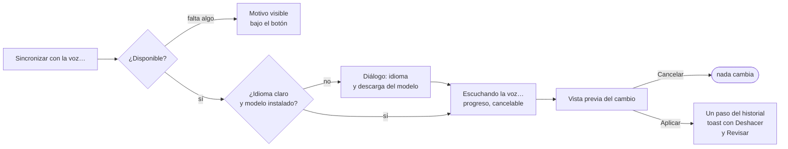

# 06 — Editor (sincronía + estilo + vista previa)

- Paso del pipeline: 4 (Editor) y 5 (Guardado: borrador / lista)
- ADRs: [0005](../adr/0005-letras-y-formato-de-sincronia.md) (formato, `finEfectivo`, toque al ritmo), [0006](../adr/0006-persistencia-y-modelo-de-datos.md) (`cancion.json`, estados, invariantes de la letra, `moverInicioLinea` / `borrarTiemposLinea`, formato del estilo), [0010](../adr/0010-editor-motor-de-audio-reloj-y-guardado.md) (motor de audio, reloj, `marcarInicioLinea`, API de guardado)
- Restricciones: [arquitectura.md §7 y "Restricciones e implicaciones para UX" §5–§6](../arquitectura.md)
- Sistema visual: [sistema-visual.md §6–§10](sistema-visual.md) (componentes, foco, estilo predeterminado, reglas de contraste, valores fijos de render)
- Preguntas: [0002](../preguntas/0002-sincronia-por-palabra-en-mvp.md) (usuario: **sincronía solo por línea** en el MVP), [0004](../preguntas/0004-fuentes-tipograficas-incluidas-y-del-sistema.md) (solo fuentes incluidas), [0005](../preguntas/0005-viabilidad-detalles-ux-fase-0.md) y [0006](../preguntas/0006-ajustes-specs-ux-tras-0005.md) (pausas, fin automático, precisión del toque, lista incompleta), [0024](../preguntas/0024-stepper-letra-actual-y-volver-a-letra-desde-el-editor.md) (stepper y volver a Letra), [0025](../preguntas/0025-detalles-tecnicos-del-editor-fase-5.md) (detalles técnicos de la Fase 5; respondida: pantalla completa en la Fase 6, desplazamiento ±30 s, el tono baja con la velocidad, un solo volumen, API de guardado), [0026](../preguntas/0026-textos-pendientes-del-editor-fase-5.md) (letra recargada y regla de "color más claro"; respondida)
- Revisión: 2026-11-05, puesta al día para la Fase 5; 2026-11-06, "Probar a pantalla completa" para la Fase 6 (ver "Cambios de esta revisión" al final); 2026-11-08, layout adaptable y paneles de la [subfase 2.1 de 0.2.0](#subfase-21--layout-adaptable-y-paneles); 2026-11-09, temas en el panel Estilo de la [fase 3 de 0.2.0](#fase-3-de-020--temas-y-biblioteca); 2026-11-11, bloqueo de edición durante la sesión en otra pantalla de la [fase 4 de 0.2.0](#fase-4-de-020--ventana-secundaria-y-cola); 2026-11-20, degradados, indicadores de espera, Letra lista y «Ajustar los silencios» de la [fase 5 de 0.2.0](#fase-5-de-020--estilo-espera-y-letra-lista); 2026-11-20, «Exportar video…» de la [fase 6 de 0.2.0](#fase-6-de-020--exportación); 2026-11-21, sincronía y editor más simples de la [fase 8 de 0.2.1](#fase-8-de-021--sincronía-y-editor-más-simples) (sin tiempos por palabra importados, sin S, doble clic en la línea de tiempo, sin desplazamiento de toda la letra, pestaña «Funciones», «Hecho» y «Marcar como …» en las dos modalidades) y editor preciso de línea de la [fase 9 de 0.2.1](#fase-9-de-021--editor-preciso-de-línea).

## Objetivo
Dejar la letra **a tiempo** con la música y darle un **estilo** propio con las opciones mínimas del MVP (fondo, color de letra, color de lo ya cantado, fuente), viendo el resultado en todo momento, y marcar la canción como **lista**.

Usuario/tarea principal: "Sincronizar la letra en una pasada, retocar lo que quede mal, ponerla bonita y legible, y dejarla lista para cantar".

Qué **no** hace el editor (MVP): no edita el texto de la letra (eso es la vista Letra, spec 05), no sincroniza palabra a palabra ([0002](../preguntas/0002-sincronia-por-palabra-en-mvp.md)), no cambia tamaño, posición, sombra ni contorno de la letra (valores fijos de [sistema-visual §10](sistema-visual.md)), no arrastra tiempos sobre la línea de tiempo.

## Datos que usa (resumen para implementar)
- Todo vive en `cancion.json` (ADR 0006): `letra.lineas[]` (elementos `tipo: "linea"` o `"pausa"`, `inicio_ms`, `fin_ms`, `palabras`), `letra.offset_ms`, `estilo`, `estado`, `pasos`. No existe `letra.json`.
- **Tiempo mostrado** = `inicio_ms + offset_ms` (mínimo 0): la lista, el panel y la vista previa enseñan *cuándo suena* cada línea con el desplazamiento aplicado. Al marcar o fijar un tiempo en la posición `t` del audio se guarda `t − offset_ms` (mínimo 0). Así "lo que ves es lo que oyes" con cualquier desplazamiento.
- Fin de cada línea: `finEfectivo` (ADR 0005). `fin_ms: null` = **automático**; número = **fijado**.
- Mover un inicio usa siempre `moverInicioLinea` (sus palabras se mueven con ella; las que no caben se descartan; los fines fijados que dejan de ser válidos pasan a automáticos). Borrar tiempos usa `borrarTiemposLinea` (borra también las palabras).
- Límites de un inicio: **estrictamente** posterior al del elemento anterior con tiempo y anterior al del siguiente con tiempo, **contando las pausas con tiempo** (invariantes de ADR 0006). Las líneas sin tiempo intermedias no limitan.

## Wireframes

> Desde la subfase 2.1 de 0.2.0, la distribución, los anchos de columna y el comportamiento en ventanas pequeñas de A y B los define [Subfase 2.1 · Layout adaptable y paneles](#subfase-21--layout-adaptable-y-paneles). A y B se conservan como referencia del contenido de cada zona; B solo se usa por debajo del mínimo de diseño.

### A — Editor (≥ 1280 px)
```
┌────────────────────────────────────────────────────────────────────────────────┐
│ ‹ Biblioteca │ «Bohemian Rhapsody» · Queen   [✎ Borrador] ✓ Guardado  [⟲][⟳][⋯] │
│   (1)✓ Fuente ── (2)⟳ Separación 42 % ── (3)✓ Letra ── (4)● Editor              │
│                                                          ▔▔▔▔▔▔ (paso actual)   │
├───────────────────────────┬────────────────────────────────┬───────────────────┤
│ LÍNEAS   48/52 sincronizadas│   VISTA PREVIA (16:9)          │[Sincronía][Estilo•]│
│ ┌───────────────────────┐ │ ┌────────────────────────────┐ │                   │
│ │ 00:00.50 Is this the  │ │ │                            │ │ (panel derecho,   │
│ │          real life? ◆ │ │ │   Is this the real life?   │ │  ver C y D)       │
│ │▶00:04.20 Is this just │ │ │   ▔▔▔▔▔▔▔▔▔▔ (barrido)     │ │                   │
│ │          fantasy?     │ │ │                            │ │                   │
│ │ ♪ pausa               │ │ │   Is this just fantasy?    │ │                   │
│ │ --:--.-- Caught in a ⓘ│ │ │                            │ │                   │
│ │          landslide    │ │ └────────────────────────────┘ │                   │
│ │ …                     │ │ [⛶ Probar a pantalla completa] │                   │
│ └───────────────────────┘ │                                │                   │
│ Corregir la letra         │                                │                   │
├───────────────────────────┴────────────────────────────────┴───────────────────┤
│ [⏮][ ▶ ] 01:12.4 / 05:55  ━━━━━━━●━━┃━━━┃━━━━━┃━━━━━━━━━━━━━━━━━━━━━━━━━━━━━   │
│ Escuchar: [Original][Voz][Instrumental]   Velocidad: [0,5×][0,75×][1×]  🔊━━━   │
│ [ ◉ Sincronizar al ritmo (S) ]                         [ Marcar como lista ]    │
└────────────────────────────────────────────────────────────────────────────────┘
```
- Columnas: Líneas 320 px · Vista previa flexible · Panel derecho 320 px. El transporte es una franja fija al pie (`fondo-1`, borde superior `borde`).
- Ticks ┃ finos en la barra de tiempo (1 px, `texto-3`) en el tiempo mostrado de cada línea con inicio: dejan ver huecos y zonas sin sincronizar.
- ● en la pestaña "Estilo•" = punto `aviso` cuando hay un aviso de contraste (visible desde la pestaña Sincronía).
- `ⓘ` en la fila = icono "falta" (`circle-dashed` 16 px, `texto-3`) de una línea sin inicio; ◆ = línea con tiempos por palabra.

### B — Editor (< 1280 px, mínimo 1024 × 640)
```
┌──────────────────────────────────────────────────────────────────────────┐
│ (cabecera igual que en A)                                                │
├───────────────────────────────────┬──────────────────────────────────────┤
│ [Sincronía] [Estilo•]             │   VISTA PREVIA (16:9)                │
│ LÍNEAS     48/52 sincronizadas    │ ┌──────────────────────────────────┐ │
│ ┌───────────────────────────────┐ │ │                                  │ │
│ │ (lista, ocupa el alto libre)  │ │ │                                  │ │
│ └───────────────────────────────┘ │ └──────────────────────────────────┘ │
│ Corregir la letra                 │ [⛶ Probar a pantalla completa]       │
│ ───────────────────────────────── │                                      │
│ (detalle de la línea seleccionada │                                      │
│  y desplazamiento global, C)      │                                      │
├───────────────────────────────────┴──────────────────────────────────────┤
│ (transporte igual que en A, en dos filas)                                │
└──────────────────────────────────────────────────────────────────────────┘
```
- Una sola columna izquierda de 360 px con pestañas **Sincronía / Estilo**. En "Sincronía": la lista arriba (alto flexible, mínimo 5 filas) y debajo el detalle de C (sin el título "Línea n de total" repetido). En "Estilo": el panel D completo con desplazamiento vertical.
- En modo "Sincronizar al ritmo" la pestaña Estilo no se puede abrir (ver E).

### C — Panel "Sincronía" (línea seleccionada)
```
│ Línea 2 de 52                                   │
│ «Is this just fantasy?»                ◆ por palabra │
│ Inicio [ 00:04.20 ] [−0,1][−0,01][+0,01][+0,1]  │
│        [Fijar inicio aquí (I)]                   │
│ Fin    [ 00:07.85 ] (automático)                 │
│        [−0,1][−0,01][+0,01][+0,1]                │
│        [Fijar fin aquí (O)]  (fijado: [Usar fin automático]) │
│ [▶ Escuchar desde esta línea (L)]                │
│ [Borrar tiempos de esta línea (Supr)]            │
│ ☑ Escuchar al ajustar                            │
│ ───────────────────────────────────────          │
│ Desplazamiento de toda la letra                  │
│ [−0,1 s] [ +0,00 s ] [+0,1 s]  [Restablecer]     │
│ Úsalo si toda la letra va adelantada o atrasada  │
│ respecto a la música. (+ = la letra sale más tarde) │
│ (ⓘ nota Bluetooth, cerrable, ver Estados)        │
```
Línea sin inicio: Inicio `[ --:--.-- ]`, botones ± inactivos, "Fijar inicio aquí (I)" activo; la sección Fin queda inactiva con la ayuda `edi.fin.sininicio`. Sin línea seleccionada (no ocurre al entrar; ver "Foco inicial"): texto `edi.sinseleccion`.

### D — Panel "Estilo"
> Desde la fase 3 de 0.2.0, el panel empieza por la sección «Tema» y los dos botones finales de este wireframe se retiran. Ver [Fase 3 · Temas y biblioteca](#fase-3-de-020--temas-y-biblioteca).

```
│ Fondo                                          │
│ [ Sólido | Degradado ]                         │
│ (Degradado) Ángulo [135] ° ◐ (dial)            │
│ Colores  [■ #1B1033] [■ #5A1E6E] [✕]           │
│          [+ Añadir color]          (2 a 4)     │
│ Sugeridos ■■■■■■■■                             │
│ (Sólido) Color [■ #1B1033]  Sugeridos ■■■■■■■■ │
│ ─────────────────────────────────────          │
│ Letra                                          │
│ Fuente  [ Atkinson Hyperlegible Next      ▾ ]  │
│         (cada opción: «¿Cantamos? Ñandú» en su fuente) │
│ Color de la letra        [■ #FFFFFF]           │
│ Color de lo ya cantado   [■ #FFD400]           │
│ Sugeridos ■■■■■■■■ (bajo cada selector)        │
│ ─────────────────────────────────────          │
│ ✓ Buen contraste                               │
│ (o ⚠ Difícil de leer: la letra y el fondo se   │
│  parecen demasiado. [Usar letra blanca])       │
│ ─────────────────────────────────────          │
│ [Restablecer estilo predeterminado]            │
│ [Usar este estilo en canciones nuevas]         │
```

### E — Banner del modo "Sincronizar al ritmo"
Sustituye a la tercera fila del transporte mientras dura el modo:
```
┌ ◉ Sincronizando al ritmo ───────────────────────────────────────────────┐
│ Pulsa Intro cuando empiece cada línea. Mantenla pulsada mientras se     │
│ canta si quieres marcar también el final.                               │
│ Siguiente: «Caught in a landslide» · línea 3 de 52                      │
│ [ MARCAR (Intro) ]  [↶ Deshacer (Retroceso)] [❚❚ Pausa (Espacio)] [Terminar (Esc)] │
└──────────────────────────────────────────────────────────────────────────┘
```
Antes de empezar a sonar, la vista previa muestra la cuenta atrás "3 · 2 · 1" (números `t-display` × 2 en `letra.color` sobre el fondo del estilo, con la sombra de §10).

## Componentes e interacciones

### Entrada y foco inicial
| Caso | Comportamiento |
|------|----------------|
| Se llega desde | "Ir al editor" (Letra), stepper, "Continuar" (borrador con letra), "Editar" del menú ⋯ (Lista), toast "Abrir editor" (spec 04). |
| Requisitos | Fuente completada (existe `fuente/mezcla.flac`) y ≥ 1 línea. Si no, el paso no es navegable (motivos `paso.motivo.*`, spec 00 §2). Si aun así se llega (estado cambiado entre medias): sin letra → `edi.sinletra` con [Buscar la letra] (abre Letra); sin audio → estado "Error de audio". |
| Línea seleccionada al entrar | La primera línea sin inicio; si todas tienen, la primera línea. La lista se desplaza hasta ella. |
| Foco inicial | Sin ninguna línea sincronizada: el botón "Sincronizar al ritmo" (con el banner `edi.banner.sinsync`). Con alguna: la lista de líneas (en la seleccionada). |
| Posición del audio | 0, en pausa. La pista de escucha por defecto: **Voz** si existe, si no **Original**. |

### Cabecera
| Elemento | Comportamiento |
|----------|----------------|
| ‹ Biblioteca | Vuelve a la Biblioteca tras vaciar el guardado pendiente (§"Guardado"). Nunca pide confirmación salvo si el último guardado ha fallado. |
| Título · artista | Como en el resto del espacio de canción. |
| Insignia de estado | "✎ Borrador" (`aviso`) · "✓ Lista" (`exito`) · "✓ Lista · ⚠ Faltan {n} líneas" (`edi.lista.incompleta`; la parte de aviso en `aviso`). Se actualiza en vivo. |
| Indicador de guardado | Separado de la insignia, `role="status"`: "✓ Guardado" (`texto-2`) · "Guardando…" (`texto-2`, spinner 14 px) · "⚠ No se pudo guardar" (`error`). |
| ⟲ ⟳ | Botones icono Deshacer / Rehacer, con tooltip con atajo (`edi.deshacer` / `edi.rehacer`). `disabled` si la pila está vacía. |
| ⋯ | Menú: "Atajos de teclado (F1)" siempre; "Volver a borrador…" solo si es Lista (diálogo `bib.dialogo.borrador` de spec 02; al confirmar se queda en el editor, la insignia pasa a Borrador y el primario a "Marcar como lista"). |
| Stepper | El de spec 00 §2: Editor ● (o ✓ si la canción es Lista), Letra ✓ navegable; Separación con su estado en vivo. Ir a otro paso vacía antes el guardado pendiente. |

### Lista de líneas
| Elemento | Comportamiento |
|----------|----------------|
| Fila de línea | Tiempo mostrado (`mm:ss.cc`, `t-tiempo` tabular) + texto (`t-cuerpo`, hasta 2 renglones, luego "…" con el texto completo en `title`). Sin inicio: `--:--.--` en `texto-3` + icono "falta". Fila **actual** (la que suena): marcador ▶ y fondo `fondo-2`. Fila **seleccionada**: borde izquierdo 3 px `acento-texto` + fondo `fondo-2`. Con tiempos por palabra: ◆ 14 px `texto-2` al final, tooltip `edi.palabras.tooltip`. Con fin fijado: nada en la fila (se ve en el panel). |
| Fila "♪ pausa" | Elemento `tipo: "pausa"` (ya normalizado: nunca dos seguidas ni al principio/final). En `texto-3`, sin tiempo; si trae tiempo (LRC), se muestra en `texto-3`, solo lectura, con tooltip `edi.pausa.tiempo`. No se selecciona, no se sincroniza desde el editor, no cuenta en el contador ni bloquea "Marcar como lista"; ↑/↓ la saltan. |
| Contador | `edi.contador` "{a}/{b} sincronizadas" (solo líneas, nunca pausas); con todas: "{b}/{b} sincronizadas ✓" en `exito`. Es un botón si falta alguna: clic → selecciona la primera sin inicio y la desplaza a la vista. |
| Clic en fila | Selecciona la línea (panel C con sus datos). **Doble clic** = escuchar desde 2 s antes de su tiempo mostrado. |
| Seguimiento | Durante la reproducción, la lista se desplaza para mantener visible la línea actual, salvo si el usuario ha desplazado la lista a mano en los últimos 5 s. La selección **no** sigue a la reproducción (solo el marcador ▶), salvo en el modo de E. |
| Pie: "Corregir la letra" | Enlace (`acento-texto`) que abre la vista Letra en C (spec 05) tras vaciar el guardado. Al volver, las líneas no modificadas conservan tiempos y palabras (diff de spec 05). |
| Rendimiento | La lista admite hasta 5000 elementos (límite de la letra) con desplazamiento fluido (virtualizada si hace falta). |

### Transporte y audio
| Elemento | Comportamiento |
|----------|----------------|
| ▶ / ❚❚ | Reproduce / pausa. **Espacio**. |
| ⏮ | Ir al principio. **Inicio**. |
| Tiempo | "01:12.4 / 05:55" (posición con décimas / duración), tabular. |
| Barra de tiempo | Clic o arrastre para buscar. Con el foco en ella: ←/→ ±5 s. `role="slider"` con `aria-valuetext` "1 minuto 12 segundos de 5 minutos 55". |
| Escuchar: Original / Voz / Instrumental | Control segmentado. "Original" = `fuente/mezcla.flac` (siempre disponible). "Voz"/"Instrumental" solo con la separación completada; si no, opción no disponible con tooltip: en curso `edi.no.disponible.pista` ("Disponible cuando termine la separación ({n} %)"), en cola `edi.no.disponible.cola`, pendiente/error/interrumpida `edi.no.disponible.separar`. Cambiar de pista **mantiene la posición** y el estado de reproducción; si la pista aún se está cargando, su opción muestra un spinner y sigue sonando la anterior hasta que esté lista. Si la separación termina mientras se está en el editor, las opciones se activan en vivo (sin cambiar lo que suena) y sale el toast de spec 04. La elección dura lo que la visita (no se guarda). |
| Velocidad 0,5× / 0,75× / 1× | Control segmentado, por defecto 1×. Afecta a la reproducción y al modo de E; los tiempos se guardan siempre en tiempo real de la canción. Por debajo de 1× el tono también baja (no se conserva el tono en el MVP; [0025](../preguntas/0025-detalles-tecnicos-del-editor-fase-5.md) §5); el tooltip `edi.velocidad.tooltip` lo avisa. Dura lo que la visita. |
| Volumen | Deslizador + botón silenciar; ↑/↓ ±5 % con el foco en él. Es **el único volumen de la app** (`config.reproductor.volumen` / `silenciado`, el mismo que el reproductor; [0025](../preguntas/0025-detalles-tecnicos-del-editor-fase-5.md) §8): el editor parte de él y lo guarda (como mucho una escritura cada 500 ms mientras se arrastra). |

### Modo "Sincronizar al ritmo" (toque por línea)
Estado especial del editor para marcar los inicios en una pasada (wireframe E).

| Acción | Comportamiento |
|--------|----------------|
| Entrar | Botón "Sincronizar al ritmo" o **S**. "Siguiente" = la línea seleccionada (o la primera sin inicio). Cuenta atrás visual "3 · 2 · 1" (3 s, en silencio; Esc la cancela) y después suena desde `máx(0, tiempo mostrado del elemento anterior con tiempo − 2 s)`, o desde 0 si no lo hay. Anuncio a lectores de pantalla: `edi.sync.titulo` + `edi.sync.siguiente`. |
| **Intro** (pulsar) | Marca el inicio de "Siguiente" en el instante de la pulsación (marca de tiempo del evento, compensando la latencia de salida; ADR 0005) y "Siguiente" avanza a la próxima línea (saltando pausas). Botón grande "MARCAR" equivalente para ratón (marca en el `pointerdown`). Repeticiones automáticas del teclado: ignoradas. |
| Reglas de una marca en `t` | 1) Si `t` ≤ tiempo del elemento anterior con tiempo (se pulsó antes de que empiece la línea previa): **no se marca**, la línea sigue como "Siguiente" y se muestra 2 s en el banner `edi.sync.pronto`. 2) Los elementos **posteriores** a "Siguiente" cuyo tiempo sea ≤ `t` pierden su tiempo (líneas: `borrarTiemposLinea`, también sus palabras; pausas: su inicio pasa a vacío): la pasada manda y esas líneas se volverán a marcar al llegar a ellas. 3) Se aplica la marca con la regla de `moverInicioLinea` (palabras que se mueven o se descartan; fines fijados que pasan a automáticos). 4) Cada marca, con todo lo anterior, es **un** paso de deshacer. Detalle técnico: función pura `marcarInicioLinea` ([0025](../preguntas/0025-detalles-tecnicos-del-editor-fase-5.md) §2, ADR 0010); una pausa que pierde su tiempo pierde inicio y fin. |
| Línea ya sincronizada | Se sobrescribe con la nueva marca (regla anterior). |
| **Intro** (mantener ≥ 300 ms) | Al soltar, fija el fin de la línea marcada en ese instante, limitado al tiempo del siguiente elemento con tiempo. Si se suelta antes de 300 ms, el fin queda **automático**. |
| **Retroceso** / "Deshacer" | Deshace la última marca de esta pasada (y lo que borró la regla 2): "Siguiente" vuelve a esa línea y la reproducción salta a 3 s antes del instante de la marca deshecha (mínimo 0) y sigue sonando. Sin marcas en la pasada: el botón está `disabled` y la tecla no hace nada. |
| **Espacio** | Pausa / reanuda sin salir del modo. |
| Clic en una fila | Esa línea pasa a ser "Siguiente" y la reproducción salta como al entrar (sin cuenta atrás). |
| Barra de tiempo, 1/2/3, velocidad, volumen | Siguen funcionando; "Siguiente" no cambia. |
| La ventana pierde el foco | Pausa automática (las pulsaciones ya no llegarían); al volver, sigue en pausa dentro del modo. |
| **Esc** / "Terminar" | Sale del modo y pausa. Lo marcado se queda (autoguardado). Queda seleccionada la línea que era "Siguiente". |
| Fin de la letra | Al marcar la última línea, el banner muestra `edi.sync.fin` y el modo sigue (para fijar el fin manteniendo Intro) hasta Esc o el final de la canción, donde sale solo. |
| Durante el modo | La vista previa muestra la letra con resaltado en vivo; la lista resalta "Siguiente" (borde `acento-texto`) y la sigue. La pestaña y el panel Estilo, el ajuste fino (C), Supr, I/O/L, ↑/↓, Alt/Ctrl+flechas y "Probar a pantalla completa" quedan inactivos. |

### Fin automático de una línea
`fin_ms: null`, calculado al dibujar con `finEfectivo` (ADR 0005), en este orden: palabras con tiempo → fin de la última palabra; le sigue una pausa con tiempo → inicio de esa pausa; le sigue una línea con inicio a ≤ 8 s → inicio de la siguiente; pausa sin tiempo o hueco > 8 s → `inicio + mín(hueco, máx(2 s, 0,4 s × nº de palabras))`; última línea (o sin siguiente con tiempo) → +5 s sin pasar del final de la canción.
- En el panel C, el fin automático se muestra en `texto-2` seguido de "(automático)"; un fin fijado (a mano o traído por la letra) en `texto-1`, sin etiqueta, con el botón "Usar fin automático" (vuelve a `null`).
- Un fin fijado cumple `inicio < fin ≤ tiempo del siguiente elemento con tiempo` (y ≤ duración en la última línea).

### Ajuste fino (panel C)
| Acción | Ratón | Teclado (fuera de campos de texto) |
|--------|-------|------------------------------------|
| Seleccionar línea | Clic | ↑ / ↓ (saltan pausas) |
| Inicio −/+ 10 ms · 100 ms | [−0,01][+0,01] · [−0,1][+0,1] | Alt + ← / → · Alt + Mayús + ← / → |
| Fin −/+ 10 ms · 100 ms | Ídem en Fin | Ctrl/Cmd + ← / → · Ctrl/Cmd + Mayús + ← / → |
| Escribir un tiempo | Campos Inicio / Fin (`mm:ss.cc`; Intro o salir del campo aplica; Esc lo restaura) | — |
| Fijar inicio en la posición actual | "Fijar inicio aquí" | **I** |
| Fijar fin en la posición actual | "Fijar fin aquí" | **O** |
| Escuchar desde la línea | "Escuchar desde esta línea" / doble clic | **L** (desde 2 s antes de su tiempo; sin inicio, desde el elemento anterior con tiempo, o desde 0) |
| Borrar tiempos de la línea | Botón | **Supr** o **Retroceso** |
| Usar fin automático | Botón (solo con fin fijado) | — |

- **Límites**: un inicio no puede igualar ni pasar el del elemento anterior o siguiente con tiempo (pausas con tiempo incluidas). El ajuste se detiene en el último valor válido y muestra 2 s un tooltip junto al campo: `edi.limite.anterior` / `edi.limite.siguiente` (con "pausa" en lugar de "línea" si el vecino es una pausa). I, un tiempo escrito o "Fijar inicio aquí" fuera de límites no cambian nada y muestran el mismo tooltip. Un fin fuera de `inicio < fin ≤ siguiente` se trata igual (`edi.limite.fin.inicio` / `edi.limite.fin.siguiente`).
- Ajustar el **fin automático** con ± lo fija partiendo de su valor efectivo.
- **Consecuencias de mover un inicio** (`moverInicioLinea`): si se descartan palabras o un fin fijado pasa a automático, toast `edi.toast.palabras` y/o `edi.toast.finauto` con [Deshacer]. Ningún aviso si no ocurre nada de eso.
- **Escucha de comprobación**: con la reproducción en pausa y "Escuchar al ajustar" activada (por defecto; dura la visita), tras cada ajuste de inicio suena desde 1 s antes del nuevo tiempo hasta 2 s después; tras un ajuste de fin, desde 2 s antes hasta 1 s después. Ajustes seguidos (< 400 ms entre ellos) reinician una sola escucha. Al terminar vuelve a la posición previa, en pausa.
- **Borrar tiempos** deja la línea sin inicio, sin fin fijado y sin palabras. En una canción Lista la deja **incompleta** (insignia en vivo).

### Desplazamiento de toda la letra (`letra.offset_ms`)
- Botones −0,1 s / +0,1 s, campo editable en segundos con signo y dos decimales ("+0,25") y "Restablecer" (a 0; inactivo si ya es 0). Teclas **,** / **.** (−/+ 100 ms), las mismas que en la vista previa del reproductor (spec 07).
- Rango −30,00 s … +30,00 s (confirmado en [0025](../preguntas/0025-detalles-tecnicos-del-editor-fase-5.md) §3; el main lo valida al guardar); fuera de rango el valor se limita y el campo muestra `edi.offset.rango`.
- Signo: **+** = la letra sale **más tarde**. Se aplica al instante a la lista (tiempos mostrados), a los ticks y a la vista previa.
- Las letras importadas llegan con `offset_ms: 0` (el `[offset:]` de un LRC ya se aplicó a los tiempos, ADR 0005).

### Deshacer y rehacer
- Cubre, en la visita actual: marcas, ajustes de inicio y fin, fijar/usar fin automático, borrar tiempos, desplazamiento global y cambios de estilo. No cubre "Usar este estilo en canciones nuevas" (es de la configuración) ni "Volver a borrador" (tiene su propio diálogo).
- Un arrastre (selector de color nativo, dial de ángulo) o una ráfaga de ajustes sobre el mismo valor en < 1 s cuenta como un paso. Hasta 200 pasos.
- Atajos: Ctrl/Cmd + Z y Ctrl/Cmd + Mayús + Z (también Ctrl + Y en Windows y Linux). Dentro de un campo de texto, deshacen el texto del campo, no el editor.
- La pila se vacía al salir del editor (no persiste). Cada deshacer/rehacer se autoguarda.

### Estilo (panel D)
| Elemento | Comportamiento |
|----------|----------------|
| Sólido / Degradado | Control segmentado. Pasar a degradado parte del color sólido + un segundo color, la **variante de luminosidad** del primero (ver "Variante de luminosidad" bajo esta tabla); pasar a sólido usa el primer color del degradado. Un solo paso de deshacer. |
| Ángulo | Campo numérico 0–359 (fuera de rango se ajusta: 360 → 0) + dial circular arrastrable; ←/→ ±15° con el dial enfocado (Mayús: ±1°). |
| Colores del degradado | 2 a 4 paradas, **siempre ordenadas** y repartidas por igual (0 · 1; 0 · ½ · 1; 0 · ⅓ · ⅔ · 1). "+ Añadir color" (hasta 4) añade al final la variante de luminosidad del último color; ✕ (solo con > 2) quita esa parada. Las posiciones se recalculan. |
| Selector de color | Componente de sistema visual §6: muestra 32 px + hex editable (`#RRGGBB`; con un valor no válido, borde `error` y "Usa el formato #RRGGBB", sin aplicar) + selector nativo + 8 sugeridos de §8 (de fondo o de letra según el selector). |
| Fuente | Selector con las 8 familias incluidas (Atkinson Hyperlegible Next, Nunito, Montserrat, Oswald, Lora, Playfair Display, Bangers, Noto Sans); cada opción con su nombre y "¿Cantamos? Ñandú" en su propia fuente. Las fuentes van con la app: no hay carga ni red. Los caracteres que una fuente no tenga se ven con la fuente de respaldo (sin aviso en el MVP). |
| Aviso de contraste | Reglas de [sistema-visual §9](sistema-visual.md), evaluadas en cada cambio (y al entrar). Ver tabla siguiente. **Nunca bloquea** ni impide marcar como lista. `role="status"`; se anuncia solo cuando cambia de nivel. Punto `aviso` en la pestaña "Estilo" mientras haya algún ⚠. |
| Restablecer estilo predeterminado | Aplica `config.estilo_predeterminado` a la canción (deshacible). |
| Usar este estilo en canciones nuevas | Guarda el estilo actual como `config.estilo_predeterminado`. Toast `edi.estilo.predet.toast`. Inactivo si el estilo ya es igual al predeterminado. |
| Portada en la Biblioteca | Consecuencia, sin aviso: una canción de YouTube deja de mostrar su miniatura en cuanto su estilo difiere del predeterminado (de fábrica o del usuario) (spec 02, criterio 15). |

**Variante de luminosidad** (segundo color al pasar a degradado y color de "+ Añadir color"; [0026](../preguntas/0026-textos-pendientes-del-editor-fase-5.md) §2): en HSL se conservan tono (H) y saturación (S) y se cambia la luminosidad (L, 0–100) en **30 puntos**: si L ≤ 70, **L + 30** (más claro); si L > 70, **L − 30** (más oscuro), para que la nueva parada siempre se distinga y nunca acabe en un blanco igual al anterior. Se calcula sin redondear L y se redondea cada canal al entero más próximo. Ejemplos (±1 por canal): `#1B1033` → `#5935A7`; `#000000` → `#4D4D4D`; `#FFFFFF` → `#B3B3B3`. El aviso de contraste se reevalúa con el nuevo degradado como con cualquier otro cambio.

**Niveles del aviso de contraste** (peor caso sobre 11 muestras del degradado):
| Condición | Se muestra | Acciones rápidas |
|-----------|-----------|------------------|
| Letra < 3:1 | ⚠ `edi.contraste.letra` (`aviso`) | "Usar letra blanca" (`#FFFFFF`) y/o "Usar letra negra" (`#111111`): se ofrece la que dé más contraste y la otra solo si supera 3:1. Si ninguna supera 3:1, se ofrecen ambas y se añade `edi.contraste.fondo`. |
| Resaltado < 3:1 | ⚠ `edi.contraste.resaltado` | "Sugerir un color de resaltado": el sugerido de §8 con mayor contraste con el fondo entre los que tienen ΔE ≥ 25 respecto a la letra (si ninguno, el de mayor contraste). |
| Resaltado vs letra ΔE < 25 | ⚠ `edi.contraste.diferencia` | "Sugerir un color de resaltado" (misma regla). |
| Letra o resaltado entre 3:1 y 4,5:1 (sin ningún ⚠) | ⓘ `edi.contraste.justo` (`info`) | — |
| Todo ≥ 4,5:1 y ΔE ≥ 25 | ✓ `edi.contraste.ok` (`exito`) | — |
Si hay varios ⚠ se muestran todos, en el orden de la tabla. Cada acción rápida es un paso de deshacer.

### Vista previa
- Área 16:9 con el motor de render compartido con el reproductor y los valores fijos de [sistema-visual §10](sistema-visual.md) escalados a su alto; fondo y fuente del estilo actual. Se actualiza en < 100 ms tras cada cambio de estilo, tiempo o desplazamiento.
- **Reproduciendo**: dibuja lo que vería el reproductor en esa posición (línea actual y siguiente, barrido o resaltado por palabra, indicador de entrada `●●●`, pantalla de título antes de la primera línea; `●●●` siempre antes de la primera línea, desde la Fase 6, sistema-visual §10). Sin el silencio previo del reproductor, que solo existe a pantalla completa. Las líneas sin inicio se omiten; las pausas no se dibujan. No muestra el aviso `rep.incompleta`.
- **En pausa**: muestra la línea seleccionada (aunque no tenga tiempo) con la **mitad resaltada** y la siguiente línea debajo, para juzgar ambos colores. Si no hay selección, la primera línea.
- Es decorativa para lectores de pantalla (`aria-hidden`), con una descripción `edi.previa.aria` en la región.

### Guardado, borrador y lista
| Elemento | Comportamiento |
|----------|----------------|
| Autoguardado | Cada cambio se guarda tras ~1 s sin cambios (como máximo 2 s desde el cambio) mediante el proceso principal: tiempos y desplazamiento con `letras.guardarTiempos`, estilo con `biblioteca.guardarEstilo` ([0025](../preguntas/0025-detalles-tecnicos-del-editor-fase-5.md) §4, ADR 0010). Indicador: "Guardando…" mientras hay cambios pendientes o en vuelo; "✓ Guardado" al terminar. |
| Fallo al guardar | Indicador "⚠ No se pudo guardar" + reintento automático cada 5 s + un toast por racha de fallos: `edi.toast.errorguardar` con [Copiar detalles]. Al recuperarse, vuelve a "✓ Guardado" sin toast. |
| Letra cambiada fuera del editor | Red de seguridad: si el main rechaza el guardado de tiempos con `LETRA_DESACTUALIZADA` (la letra guardada ya no tiene las mismas líneas), el editor recarga la canción desde disco y descarta los tiempos pendientes y el historial de deshacer/rehacer (⟲ ⟳ quedan `disabled`). Conserva la selección si la línea sigue existiendo (si no, la primera sin inicio), la pista, la velocidad y la posición, en pausa (y sale del modo sincronizar si estaba en él). Toast `aviso` persistente `edi.toast.recargada`. No es un fallo de guardado: no reintenta ni muestra "⚠ No se pudo guardar"; el indicador pasa a "✓ Guardado". El estilo se guarda aparte y no se ve afectado. |
| Salir del editor | ‹ Biblioteca, logotipo, Esc, otro paso del stepper, "Corregir la letra", Ctrl/Cmd + N, Ctrl/Cmd + , y (desde la Fase 6) "Probar a pantalla completa": primero se vacía el guardado pendiente (sin esperar el *debounce*) y luego se navega. Si ese guardado falla, diálogo `edi.dialogo.salir` [Quedarme en el editor] (foco inicial) [Salir sin guardarlos] (destructivo). Es la **única** confirmación de salida. Cerrar la ventana también vacía el guardado (tope de 2 s; si hay trabajos en curso, antes sale el diálogo de cierre de la tarea 0073) ([0025](../preguntas/0025-detalles-tecnicos-del-editor-fase-5.md) §4). |
| Volver a la Biblioteca siendo borrador | Si en esta visita hubo algún cambio guardado, la Biblioteca muestra el toast `edi.toast.borrador`. Sin cambios, ningún toast. |
| **Marcar como lista** (primario, solo en borrador) | Disponible si la separación está completada (existen voz e instrumental), hay ≥ 1 línea y **todas** las líneas (no pausas) tienen inicio (ADR 0006). Al pulsar: vacía el guardado, cambia `estado` a `lista` y vuelve a la Biblioteca (ver "Volver a la Biblioteca"). |
| Marcar como lista no disponible | Botón con `aria-disabled="true"` (sigue enfocable). Al pulsarlo o enfocarlo con teclado, popover `edi.falta.titulo` con un renglón por motivo y su acción: separación en curso `edi.falta.separando` (sin acción) · en cola `edi.falta.cola` (sin acción) · pendiente/error/interrumpida `edi.falta.separar` [Ir a Separación] · líneas sin inicio `edi.falta.lineas` [Ir a la primera] (selecciona la primera sin inicio, la desplaza a la vista y pone el foco en la lista). El popover se actualiza en vivo y se cierra con Esc o al hacer clic fuera (el foco vuelve al botón). |
| Canción Lista: "Hecho" (primario) | Vuelve a la Biblioteca con la tarjeta enfocada, sin resalte ni toast. Si está **incompleta**, la primera pulsación de la visita muestra el popover `edi.hecho.incompleta` con [Sincronizar ahora] (cierra el popover y selecciona la primera línea sin inicio) y [Salir igualmente]; la segunda pulsación sale directamente. El estado guardado no cambia. |
| Volver a borrador | Menú ⋯ de la cabecera (solo Lista), ver "Cabecera". |

### Volver a la Biblioteca tras "Marcar como lista"
1. La Biblioteca se abre con el filtro de la sesión; si es *Borradores* (ocultaría la canción), pasa a *Todas*. La búsqueda ya está vacía (spec 02).
2. La tarjeta de la canción se desplaza hasta quedar visible, recibe el foco y se resalta 2 s con borde 2 px `exito` (aparece y desaparece con 200 ms de fundido; sin fundido con movimiento reducido).
3. Toast `bib.toast.lista` "«{título}» está lista para cantar." con [▶ Reproducir], que abre el reproductor (spec 07) como el botón de la tarjeta y cierra el toast (desde la Fase 6; en la Fase 5 salía sin acción, [0025](../preguntas/0025-detalles-tecnicos-del-editor-fase-5.md) §1). Como tiene acción, no desaparece solo a los 6 s (sistema-visual §6).

### Probar a pantalla completa
Llega con la Fase 6 ([0025](../preguntas/0025-detalles-tecnicos-del-editor-fase-5.md) §1). Detalle del lado del reproductor en spec 07 §"Prueba desde el editor".
- Botón secundario con icono ⛶ bajo la vista previa (ancho de la vista previa en A, alineado a la izquierda en B) o **F**. Vacía el guardado pendiente (como al salir; si falla, `edi.dialogo.salir` con "Quedarme en el editor" y "Salir sin guardarlos" = abrir igualmente) y abre el reproductor **encima** del editor, que se queda montado: no se pierden el historial de deshacer, la selección, la pista ni la velocidad.
- Usa la letra, el estilo y el desplazamiento **en memoria** del editor. Empieza en `máx(0, tiempo mostrado de la línea seleccionada − 3 s)`, o en la posición actual si la línea no tiene inicio. Siempre a 1×.
- Suena el instrumental si la separación está completada; si no, la mezcla original con la etiqueta `rep.original` siempre visible.
- **Disponibilidad**: inactivo (como el resto) durante el modo sincronizar y en el estado "Error de audio". Sin ninguna línea con inicio: `aria-disabled="true"`, sigue enfocable y muestra el tooltip `edi.probar.sinlineas`; F no hace nada. Mientras carga el audio del editor sí se puede pulsar (el reproductor muestra su propio "Cargando…").
- **, / .** en el reproductor cambian el desplazamiento; cada cambio pasa al estado del editor (se autoguarda igual) y todos los de una misma prueba son **un** paso de deshacer.
- **Al volver** (Esc, ✕ o pantalla final del reproductor): en pausa, con el cabezal en la posición en que estaba el reproductor; la línea seleccionada pasa a ser la que sonaba (o la última que había empezado) y la lista se desplaza hasta ella (si no había empezado ninguna, la selección no cambia); misma pista y velocidad que antes; foco en "Probar a pantalla completa".

## Atajos de teclado
Diálogo "Atajos de teclado" con **F1** o **?** (y desde ⋯). Los atajos de una tecla no actúan con el foco en un campo de texto (tiempos, hex, ángulo, desplazamiento). Las flechas **sin modificador** las usa el control enfocado si las necesita (barra de tiempo, volumen, dial, controles segmentados, selector de fuente); con Alt, Ctrl/Cmd o Mayús son siempre del editor salvo en campos de texto. Todos llaman a `preventDefault` para que el sistema no los use (p. ej. Alt + ← no navega).

| Tecla | Acción |
|-------|--------|
| Espacio | Reproducir / pausa (también en el modo sincronizar) |
| Inicio | Ir al principio |
| ← / → (en la barra de tiempo) | −/+ 5 s |
| S | Entrar en "Sincronizar al ritmo" |
| Intro | (Modo sincronizar) marcar inicio; mantener ≥ 300 ms = marcar también el fin |
| Retroceso | (Modo sincronizar) deshacer la última marca · (fuera del modo) borrar tiempos de la línea |
| Supr | Borrar tiempos de la línea seleccionada |
| Esc | Cancelar la cuenta atrás / salir del modo sincronizar / cerrar popover o diálogo / volver a la Biblioteca |
| ↑ / ↓ | Línea anterior / siguiente (saltan pausas) |
| Alt + ← / → | Inicio −/+ 10 ms (con Mayús: 100 ms) |
| Ctrl/Cmd + ← / → | Fin −/+ 10 ms (con Mayús: 100 ms) |
| I / O | Fijar inicio / fin en la posición actual |
| L | Escuchar desde la línea seleccionada |
| , / . | Desplazamiento de toda la letra −/+ 100 ms |
| 1 / 2 / 3 | Escuchar Original / Voz / Instrumental |
| Ctrl/Cmd + Z · Ctrl/Cmd + Mayús + Z (Ctrl + Y) | Deshacer · Rehacer |
| F | Probar a pantalla completa |
| F1 / ? | Atajos de teclado |

Notas: el fin usa Ctrl/Cmd y no Ctrl + Alt porque Ctrl + Alt + flechas gira la pantalla con algunos controladores gráficos de Windows. Los corchetes `[ ]` de la versión anterior se sustituyen por `, .` porque en el teclado español exigen AltGr.

## Estados
| Estado | Presentación |
|--------|--------------|
| Sin letra | No se puede entrar (stepper no navegable). Si se llega igualmente: `edi.sinletra` + [Buscar la letra] (abre Letra). |
| Sin sincronizar (ninguna línea con inicio) | Todas las filas `--:--.--`; banner `info` sobre la lista `edi.banner.sinsync`, foco en "Sincronizar al ritmo". El banner desaparece con la primera marca. |
| Sincronizada en parte | Sin banner; el contador indica lo que falta. |
| Ya sincronizada al entrar (todas con inicio, canción en borrador) | Banner `info` cerrable `edi.banner.yasync`. Se cierra con ✕ o con el primer cambio de tiempos; no se guarda (en otra visita vuelve a salir mientras siga en borrador). |
| Cargando audio | Transporte inactivo con "Cargando audio…"; normal < 1 s; si pasa de 3 s, barra indeterminada. La lista, el estilo y la vista previa en pausa ya funcionan. |
| Separación en curso / en cola | Stepper en vivo; Voz e Instrumental no disponibles con su tooltip; "Marcar como lista" no disponible con el motivo. Toast al terminar (spec 04). |
| Separación pendiente, con error o interrumpida | Igual, con el motivo `edi.falta.separar` y [Ir a Separación]. |
| Error de audio (no se puede leer `mezcla.flac`) | Banner `error` `edi.error.audio` + [Ver en Biblioteca]; transporte y modo sincronizar inactivos; el estilo se puede seguir editando. |
| Guardando / guardado / error de guardado | Indicador de la cabecera (§"Guardado"). |
| Borrador | Insignia "✎ Borrador"; primario "Marcar como lista". |
| Lista | Insignia "✓ Lista"; primario "Hecho"; ⋯ con "Volver a borrador…". |
| Lista incompleta | Insignia `edi.lista.incompleta`; "Hecho" muestra `edi.hecho.incompleta` una vez por visita. |
| Modo sincronizar | Banner E, cuenta atrás al entrar, controles inactivos según la tabla del modo. |
| Ayuda Bluetooth | Al salir del modo sincronizar por primera vez en la sesión de la app, nota `info` cerrable bajo el desplazamiento: `edi.ayuda.bluetooth`. Cerrada, no vuelve a salir en la sesión. |
| Contraste bajo | Aviso en el panel Estilo + punto `aviso` en la pestaña "Estilo". |

## Accesibilidad
- *Landmarks*: cabecera `banner`; lista y panel C en una región "Sincronía"; panel D `complementary` "Estilo"; vista previa región "Vista previa"; transporte región "Reproducción". Enlace "Saltar al contenido" (a la lista).
- Lista con `role="listbox"` y *roving tabindex*; cada línea es una opción con nombre accesible `edi.aria.linea` ("Línea 2, 00:04.20, Is this just fantasy?" o "…, sin sincronizar"); las pausas son `role="separator"` con nombre "pausa". La línea que suena lleva `aria-current="true"`.
- Anuncios (`aria-live="polite"`), solo en hitos: entrar y salir del modo, deshacer una marca, `edi.sync.fin`, cambio de nivel de contraste, error de guardado, popovers. No se anuncia cada marca ni el tiempo que avanza.
- Anillo de foco doble (§7) sobre la vista previa y el banner del modo.
- El estado nunca depende solo del color: ◆, iconos "falta", ✓/⚠ e insignias llevan icono y texto o nombre accesible.
- Todos los objetivos ≥ 32 × 32 px; el botón "MARCAR" del modo, 44 px de alto como mínimo.
- Funciona a 1024 × 640 y con zoom de la interfaz hasta 150 % (a partir de ahí, desplazamiento vertical del panel, nunca contenido cortado). *Sustituido en 0.2.0 por la [subfase 2.1](#subfase-21--layout-adaptable-y-paneles): mínimo de diseño 1024 × 576 px CSS sin scroll de página; por debajo, solo scroll vertical de página.*

## Microcopy
| Clave | Texto |
|-------|-------|
| `edi.lineas` | Líneas |
| `edi.contador` | {a}/{b} sincronizadas |
| `edi.pausa` | ♪ pausa |
| `edi.pausa.tiempo` | Esta pausa viene con tiempo en la letra importada. |
| `edi.palabras.tooltip` | Esta línea trae tiempos por palabra: se resaltará palabra a palabra. Si mueves la línea, sus palabras se mueven con ella. |
| `edi.falta.tooltip` | Sin sincronizar |
| `edi.corregir` | Corregir la letra |
| `edi.sinseleccion` | Elige una línea de la lista para ajustar sus tiempos. |
| `edi.escuchar` | Escuchar: Original · Voz · Instrumental |
| `edi.no.disponible.pista` | Disponible cuando termine la separación ({n} %) |
| `edi.no.disponible.cola` | Disponible cuando termine la separación (en cola) |
| `edi.no.disponible.separar` | Disponible cuando se separen las pistas |
| `edi.velocidad` | Velocidad |
| `edi.velocidad.tooltip` | A menor velocidad, el tono también baja. Los tiempos que marques valen igual a cualquier velocidad. |
| `edi.volumen` | Volumen · Silenciar · Activar sonido |
| `edi.cargando` | Cargando audio… |
| `edi.boton.sync` | Sincronizar al ritmo |
| `edi.sync.titulo` | Sincronizando al ritmo |
| `edi.sync.ayuda` | Pulsa Intro cuando empiece cada línea. Mantenla pulsada mientras se canta si quieres marcar también el final. |
| `edi.sync.siguiente` | Siguiente: «{texto}» · línea {n} de {total} |
| `edi.sync.marcar` | Marcar (Intro) |
| `edi.sync.deshacer` | Deshacer (Retroceso) |
| `edi.sync.pausa` | Pausa (Espacio) · Seguir (Espacio) |
| `edi.sync.terminar` | Terminar (Esc) |
| `edi.sync.pronto` | Demasiado pronto: aún no ha empezado la línea anterior. |
| `edi.sync.fin` | ¡Todas las líneas tienen tiempo! Revisa con ▶ y ajusta lo que haga falta. |
| `edi.banner.sinsync` | Empieza por sincronizar: pulsa Sincronizar al ritmo (o la tecla S) y marca cada línea al oírla. |
| `edi.banner.yasync` | Esta letra ya viene sincronizada. Escúchala y, si va adelantada o atrasada, usa el desplazamiento de toda la letra. |
| `edi.linea.n` | Línea {n} de {total} |
| `edi.palabras.etiqueta` | por palabra |
| `edi.inicio` / `edi.fin` | Inicio · Fin |
| `edi.fin.auto` | (automático) |
| `edi.fin.usarauto` | Usar fin automático |
| `edi.fin.sininicio` | Primero fija el inicio de esta línea. |
| `edi.tiempo.formato` | Usa el formato mm:ss.cc, por ejemplo 01:04.20. |
| `edi.boton.fijarinicio` | Fijar inicio aquí |
| `edi.boton.fijarfin` | Fijar fin aquí |
| `edi.boton.escucharlinea` | Escuchar desde esta línea |
| `edi.boton.borrartiempos` | Borrar tiempos de esta línea |
| `edi.limite.anterior` | No puede ir antes de la línea anterior · (vecino pausa) No puede ir antes de la pausa anterior |
| `edi.limite.siguiente` | No puede pasar de la línea siguiente · (vecino pausa) No puede pasar de la pausa siguiente |
| `edi.limite.fin.inicio` | El fin tiene que ir después del inicio. |
| `edi.limite.fin.siguiente` | El fin no puede pasar del inicio de la línea siguiente. |
| `edi.escuchar.ajustar` | Escuchar al ajustar |
| `edi.toast.palabras` | La línea {n} ya no se resaltará palabra a palabra: sus tiempos no cabían. — [Deshacer] |
| `edi.toast.finauto` | El fin de la línea {n} vuelve a ser automático. — [Deshacer] |
| `edi.offset.titulo` | Desplazamiento de toda la letra |
| `edi.offset.ayuda` | Úsalo si toda la letra va adelantada o atrasada respecto a la música. Con + la letra sale más tarde. |
| `edi.offset.rango` | Máximo 30 segundos hacia cada lado. |
| `edi.boton.restablecer` | Restablecer |
| `edi.ayuda.bluetooth` | ¿Usas auriculares o altavoces Bluetooth? Si toda la letra queda atrasada, usa el desplazamiento de toda la letra. |
| `edi.estilo.fondo` | Fondo |
| `edi.estilo.tipo` | Sólido · Degradado |
| `edi.estilo.angulo` | Ángulo |
| `edi.estilo.color` | Color |
| `edi.estilo.colores` | Colores |
| `edi.estilo.anadircolor` | Añadir color |
| `edi.estilo.quitarcolor` | Quitar este color |
| `edi.estilo.hex.error` | Usa el formato #RRGGBB. |
| `edi.estilo.letra` | Letra |
| `edi.estilo.fuente` | Fuente |
| `edi.estilo.colorletra` | Color de la letra |
| `edi.estilo.resaltado` | Color de lo ya cantado |
| `edi.estilo.sugeridos` | Sugeridos |
| `edi.estilo.muestra` | ¿Cantamos? Ñandú |
| `edi.contraste.ok` | Buen contraste |
| `edi.contraste.justo` | Legible en pantallas grandes; puede costar en proyectores o con mucha luz. |
| `edi.contraste.letra` | Difícil de leer: la letra y el fondo se parecen demasiado. |
| `edi.contraste.resaltado` | Difícil de leer: lo ya cantado se confunde con el fondo. |
| `edi.contraste.diferencia` | El resaltado apenas se distingue de la letra: no se notará qué parte ya se ha cantado. |
| `edi.contraste.fondo` | Prueba también con un fondo más oscuro o más claro. |
| `edi.contraste.blanca` / `edi.contraste.negra` | Usar letra blanca · Usar letra negra |
| `edi.contraste.sugerir` | Sugerir un color de resaltado |
| `edi.estilo.reset` | Restablecer estilo predeterminado |
| `edi.estilo.predet` | Usar este estilo en canciones nuevas |
| `edi.estilo.predet.toast` | Las canciones nuevas usarán este estilo. |
| `edi.previa` | Vista previa |
| `edi.previa.aria` | Vista previa de la letra con el estilo actual. |
| `edi.deshacer` / `edi.rehacer` | Deshacer (Ctrl+Z / ⌘Z) · Rehacer (Ctrl+Mayús+Z / ⌘⇧Z) |
| `edi.menu.atajos` | Atajos de teclado (F1) |
| `edi.menu.borrador` | Volver a borrador… |
| `edi.guardado` | Guardado · Guardando… · No se pudo guardar |
| `edi.toast.errorguardar` | No se pudieron guardar los cambios de «{título}». Lo seguimos intentando. — [Copiar detalles] |
| `edi.dialogo.salir` | Título: No se pudieron guardar los últimos cambios. Texto: Si sales ahora, perderás lo que has cambiado en los últimos segundos. — [Quedarme en el editor] [Salir sin guardarlos] |
| `edi.toast.recargada` | La letra ha cambiado fuera del editor y la hemos vuelto a cargar. Puede que tus últimos ajustes de tiempos no se hayan guardado: revísalos. |
| `edi.toast.borrador` | Borrador guardado. |
| `edi.boton.lista` | Marcar como lista |
| `edi.boton.hecho` | Hecho |
| `edi.falta.titulo` | Para marcarla como lista falta: |
| `edi.falta.separando` | La separación de pistas ({n} %, quedan unos {m} min) · (sin estimación) La separación de pistas ({n} %) |
| `edi.falta.cola` | La separación de pistas (en cola) |
| `edi.falta.separar` | Separar las pistas — [Ir a Separación] |
| `edi.falta.lineas` | Sincronizar {n} líneas — [Ir a la primera] · (n = 1) Sincronizar 1 línea — [Ir a ella] |
| `edi.lista.incompleta` | Lista · ⚠ Faltan {n} líneas · (n = 1) Lista · ⚠ Falta 1 línea |
| `edi.hecho.incompleta` | Esta canción está lista, pero faltan {n} líneas por sincronizar. Al cantarla no aparecerán. — [Sincronizar ahora] [Salir igualmente] · (n = 1) …pero falta 1 línea por sincronizar. Al cantarla no aparecerá. |
| `edi.boton.probar` | Probar a pantalla completa |
| `edi.probar.original` | Sustituida por `rep.original` (spec 07): «Vista previa con la canción original: aún no hay pista instrumental.» |
| `edi.probar.sinlineas` | Sincroniza al menos una línea para probarla. |
| `edi.probar.tooltip` | Probar a pantalla completa (F) |
| `edi.error.audio` | No se puede reproducir el audio de esta canción. — [Ver en Biblioteca] |
| `edi.sinletra` | Esta canción aún no tiene letra. — [Buscar la letra] |
| `edi.aria.linea` | Línea {n}, {tiempo}, {texto} · (sin inicio) Línea {n}, sin sincronizar, {texto} |
| `edi.atajos.titulo` | Atajos de teclado |

Formato de números: coma decimal ("0,5×", "+0,25 s"), tiempos `mm:ss.cc` con punto (convención de karaoke/LRC, igual que en la vista Letra).

## Criterios de aceptación

**Estructura y navegación**
1. El editor muestra la cabecera del espacio de canción (‹ Biblioteca, título · artista, insignia, indicador de guardado, ⟲ ⟳, ⋯ y stepper), la lista de líneas, la vista previa, el panel Sincronía/Estilo y el transporte; en < 1280 px usa el wireframe B y nada queda cortado a 1024 × 640.
2. En el stepper, Editor muestra ● en un borrador y ✓ en una canción Lista, con el subrayado del paso actual; Letra muestra ✓ y es navegable ([0024](../preguntas/0024-stepper-letra-actual-y-volver-a-letra-desde-el-editor.md)).
3. "Corregir la letra" abre la vista Letra en C; al volver, las líneas no modificadas conservan inicio, fin y palabras.
4. Al entrar se selecciona la primera línea sin inicio (o la primera línea), el audio está en 0 y en pausa, la pista es Voz si existe (si no, Original) y el foco está en "Sincronizar al ritmo" si ninguna línea tiene inicio, o en la lista si alguna lo tiene.

**Lista y transporte**
5. Cada fila muestra el tiempo mostrado (`inicio_ms + offset_ms`, mínimo 0) o `--:--.--` con el icono de "falta"; las filas con palabras muestran ◆ con su tooltip; las pausas se muestran como "♪ pausa" (con su tiempo en `texto-3` solo si lo traen), no se pueden seleccionar, ↑/↓ las saltan y no cuentan en el contador.
6. El contador muestra "{a}/{b} sincronizadas" contando solo líneas; al pulsarlo con líneas pendientes se selecciona la primera sin inicio.
7. Espacio reproduce/pausa; la línea que suena lleva ▶ y la lista la sigue salvo desplazamiento manual en los últimos 5 s; la selección no cambia sola fuera del modo sincronizar.
8. "Escuchar" cambia entre Original, Voz e Instrumental manteniendo la posición; Voz e Instrumental no están disponibles sin la separación completada y su tooltip dice el motivo (con el porcentaje en curso); si la separación termina con el editor abierto, se activan sin recargar.
9. La velocidad 0,5×/0,75×/1× cambia la reproducción y marcar el mismo punto del audio a 0,5× y a 1× guarda los mismos ms (test con marcas de tiempo simuladas).
10. La barra de tiempo muestra un tick por cada línea con inicio, en su tiempo mostrado, y se actualiza al marcar, ajustar o cambiar el desplazamiento.

**Modo "Sincronizar al ritmo"**
11. S o el botón entran en el modo con "Siguiente" = línea seleccionada (o primera sin inicio), cuenta atrás de 3 s en silencio y reproducción desde 2 s antes del elemento anterior con tiempo (o desde 0); Esc durante la cuenta atrás la cancela sin marcar nada.
12. Cada pulsación de Intro (o del botón "Marcar") fija el inicio de "Siguiente" con un error del sistema ≤ 20 ms respecto al instante de la pulsación con salida por cable o altavoces del equipo, a 0,5×, 0,75× y 1×, verificado con un test automático (marcas de tiempo simuladas) y una prueba manual con una pista de clics; las repeticiones del teclado se ignoran; "Siguiente" avanza saltando pausas.
13. Una pulsación en un instante ≤ al tiempo del elemento anterior con tiempo no marca nada y muestra `edi.sync.pronto`.
14. Marcar una línea en `t` borra el tiempo de los elementos posteriores con tiempo ≤ `t` (líneas con sus palabras; pausas, solo su inicio), y todo ello se deshace en un solo paso.
15. Mantener Intro ≥ 300 ms fija el fin de esa línea al soltar (limitado al siguiente elemento con tiempo); soltar antes deja el fin automático.
16. Retroceso deshace la última marca de la pasada, devuelve "Siguiente" a esa línea y salta a 3 s antes de la marca deshecha; sin marcas no hace nada.
17. Clic en una fila durante el modo la convierte en "Siguiente"; perder el foco de la ventana pausa; Esc sale conservando lo marcado y deja seleccionada la línea que era "Siguiente"; al final de la canción el modo termina solo.
18. Durante el modo, el panel Estilo, el ajuste fino, Supr, I/O/L, ↑/↓, "Probar a pantalla completa" y F no responden, y la vista previa resalta en vivo.
19. Con salida Bluetooth no se exige precisión: al salir del modo por primera vez en la sesión aparece `edi.ayuda.bluetooth`, cerrable y que no vuelve a salir en la sesión.

**Ajuste fino, fin y desplazamiento**
20. Los ajustes ±10/±100 ms de inicio y de fin funcionan con los botones y con Alt(+Mayús)+←/→ y Ctrl/Cmd(+Mayús)+←/→; los campos aceptan `mm:ss.cc` y rechazan otro formato con `edi.tiempo.formato`.
21. Ningún ajuste, tiempo escrito, I o "Fijar inicio aquí" deja un inicio igual o fuera de los inicios vecinos con tiempo (pausas incluidas): se detiene en el último valor válido y muestra el tooltip de límite correspondiente; lo mismo para el fin con `inicio < fin ≤ siguiente`.
22. El fin automático sigue `finEfectivo`, se muestra en `texto-2` con "(automático)"; ajustarlo lo fija; "Usar fin automático" lo devuelve a `null`.
23. Mover el inicio de una línea con palabras desplaza sus palabras lo mismo; si alguna línea pierde sus palabras o un fin fijado pasa a automático, aparece `edi.toast.palabras` / `edi.toast.finauto` con [Deshacer], que lo restaura todo.
24. Supr (o Retroceso fuera del modo) borra inicio, fin y palabras de la línea seleccionada; en una canción Lista la insignia pasa en vivo a `edi.lista.incompleta`.
25. Con "Escuchar al ajustar" activa y en pausa, cada ajuste reproduce el fragmento de comprobación indicado y vuelve a la posición previa.
26. El desplazamiento global cambia en pasos de 100 ms con los botones y con , / ., admite valores escritos entre −30 y +30 s, se ve con signo y coma decimal, mueve al instante tiempos mostrados, ticks y vista previa, y "Restablecer" lo deja en 0. Con un desplazamiento distinto de 0, marcar o pulsar I en la posición `t` guarda `t − offset_ms`.

**Deshacer**
27. Ctrl/Cmd+Z y Ctrl/Cmd+Mayús+Z (y Ctrl+Y en Windows/Linux) y los botones ⟲ ⟳ deshacen y rehacen marcas, ajustes, fines, borrados, desplazamiento y cambios de estilo de la visita; un arrastre de color o de ángulo es un solo paso; dentro de un campo de texto, Ctrl/Cmd+Z deshace el campo.

**Estilo y contraste**
28. El estilo permite fondo sólido o degradado lineal (ángulo 0–359°, 2–4 colores ordenados y repartidos por igual), color de letra, color de lo ya cantado y una de las 8 fuentes incluidas, mostradas cada una en su fuente con "¿Cantamos? Ñandú"; cada cambio se ve en la vista previa en < 100 ms.
29. Un hex no válido muestra "Usa el formato #RRGGBB." y no se aplica.
30. El aviso de contraste aplica sistema-visual §9 con el peor caso de 11 muestras del degradado: con letra o resaltado < 3:1, o ΔE < 25, muestra el ⚠ correspondiente con sus acciones rápidas; entre 3:1 y 4,5:1, el ⓘ; con todo ≥ 4,5:1 y ΔE ≥ 25, "Buen contraste". Ejemplos de prueba: estilo predeterminado → ✓; letra `#5A1E6E` sobre el predeterminado → ⚠ letra con "Usar letra blanca"; resaltado `#F2F3F7` con letra `#FFFFFF` → ⚠ diferencia.
31. Mientras haya un ⚠, la pestaña "Estilo" lleva el punto `aviso`; el aviso nunca impide guardar ni marcar como lista.
32. "Usar este estilo en canciones nuevas" guarda el estilo en `config.estilo_predeterminado` con su toast; "Restablecer estilo predeterminado" lo aplica a la canción y se puede deshacer.

**Vista previa**
33. En reproducción, la vista previa coincide con el render del reproductor en esa posición (mismo motor y valores de §10, escalados), omite líneas sin inicio y no muestra `rep.incompleta`; en pausa, muestra la línea seleccionada con la mitad resaltada y la siguiente debajo.

**Guardado y estados**
34. Todo cambio se escribe en `cancion.json` en ≤ 2 s; el indicador pasa por "Guardando…" a "✓ Guardado"; con un fallo de escritura muestra "⚠ No se pudo guardar", reintenta cada 5 s y saca un único toast por racha.
35. Salir del editor por cualquier vía vacía el guardado pendiente antes de navegar y no pide confirmación; solo si ese guardado falla aparece `edi.dialogo.salir`, con el foco en "Quedarme en el editor".
36. Al volver a la Biblioteca desde un borrador con cambios en la visita aparece `edi.toast.borrador`; sin cambios, ninguno.
37. "Marcar como lista" solo cambia el estado si la separación está completada, hay ≥ 1 línea y todas las líneas tienen inicio; si no, es `aria-disabled` y al pulsarlo o enfocarlo muestra el popover con cada motivo (en curso con %, en cola, separar con [Ir a Separación], líneas con [Ir a la primera]), actualizado en vivo.
38. Tras marcar como lista, la Biblioteca enfoca la tarjeta, la desplaza a la vista, la resalta 2 s con borde `exito`, pasa el filtro a *Todas* si era *Borradores* y muestra `bib.toast.lista` con [▶ Reproducir], que abre el reproductor (en la Fase 5 salía sin acción).
39. En una Lista, "Hecho" vuelve a la Biblioteca con la tarjeta enfocada; si está incompleta, la primera pulsación muestra `edi.hecho.incompleta` con sus dos acciones y el estado guardado no cambia.
40. "Volver a borrador…" del menú ⋯ (solo en Lista) pide la confirmación de spec 02 y deja la canción en borrador sin salir del editor ni cambiar letra o estilo.
41. Los estados de la tabla (sin sincronizar, ya sincronizada, cargando audio, separación en curso/pendiente, error de audio) se muestran con sus textos; el banner `edi.banner.yasync` se cierra con ✕ o con el primer cambio de tiempos.

**Pantalla completa y teclado**
42. (Fase 6.) "Probar a pantalla completa" (o F) vacía el guardado y abre el reproductor desde `máx(0, línea seleccionada − 3 s)` con la letra, el estilo y el desplazamiento en memoria, con el instrumental o la mezcla y la etiqueta `rep.original`; sin ninguna línea con inicio es `aria-disabled` con `edi.probar.sinlineas`; Esc vuelve al editor en pausa, con el cabezal en la posición del reproductor, la línea que sonaba seleccionada, la misma pista, velocidad e historial, y el foco en el botón; los cambios de , / . hechos en el reproductor se ven, se autoguardan y se deshacen en un paso (spec 07, criterios 27–30).
43. Todas las acciones son operables con teclado; F1 o ? abren el diálogo de atajos con la tabla de esta spec; los atajos de una tecla no actúan en campos de texto y Alt + ← no provoca navegación.
44. La lista expone a lectores de pantalla `edi.aria.linea` por línea, las pausas como separadores y solo se anuncian los hitos indicados en "Accesibilidad".
45. Con una letra de 1000 líneas la lista se desplaza con fluidez y marcar una línea actualiza fila, contador y vista previa sin retraso perceptible (< 100 ms).

**Añadidos tras 0025 y 0026**
46. Si `letras.guardarTiempos` responde `LETRA_DESACTUALIZADA`, el editor recarga la canción, vacía deshacer/rehacer (⟲ ⟳ `disabled`), queda en pausa en la misma posición (fuera del modo sincronizar), conserva la selección si la línea existe, muestra el toast `aviso` persistente `edi.toast.recargada` y el indicador queda en "✓ Guardado" sin reintentos (test con el error simulado).
47. "Sólido → Degradado" y "+ Añadir color" usan la variante de luminosidad (HSL, L ± 30 según L ≤ 70 o > 70, mismo H y S): `#1B1033` → `#5935A7`, `#000000` → `#4D4D4D`, `#FFFFFF` → `#B3B3B3` (±1 por canal; test unitario).
48. El tooltip de velocidad dice `edi.velocidad.tooltip` (una sola variante) y el volumen del editor es el mismo valor que `config.reproductor.volumen` / `silenciado`.

## Cambios de esta revisión (2026-11-05)
Respecto a la versión de la Fase 0, sin cambiar el alcance:
- Datos: la letra vive en `cancion.json`; tiempos mostrados con el desplazamiento aplicado y marcas guardadas como `t − offset_ms`; límites contando pausas con tiempo.
- Modo sincronizar: cuenta atrás en silencio y arranque 2 s antes; reglas de "demasiado pronto" y de borrado de tiempos posteriores al sobrescribir; pausa al perder el foco; clic en fila; fin al soltar limitado.
- Ajuste fino: campos de tiempo editables, "Fijar inicio aquí", límites con pausas, toasts de palabras descartadas y fines automáticos.
- Atajos: fin con Ctrl/Cmd + flechas (antes Ctrl/Cmd + Alt), desplazamiento con , / . (antes [ ]), Retroceso también borra tiempos fuera del modo, Ctrl + Y.
- Cabecera: indicador de guardado separado de la insignia, menú ⋯ (atajos, volver a borrador), stepper con ✓ en el paso actual completado (0024).
- Guardado: vaciado del pendiente al salir, diálogo solo si falla, toast "Borrador guardado." solo si hubo cambios; resalte de 2 s, cambio de filtro y toast al marcar como lista.
- Estilo: paradas siempre ordenadas, acciones de contraste cuando ni blanco ni negro bastan, "Usar este estilo…" inactivo si ya es el predeterminado.
- Criterios renumerados (1–45).
- Tras las respuestas a [0025](../preguntas/0025-detalles-tecnicos-del-editor-fase-5.md) y [0026](../preguntas/0026-textos-pendientes-del-editor-fase-5.md): "Probar a pantalla completa", la tecla F y la acción [▶ Reproducir] del toast pasan a la Fase 6; tooltip de velocidad con una sola variante (el tono baja); un solo volumen; API de guardado de ADR 0010; recarga por `LETRA_DESACTUALIZADA` con `edi.toast.recargada`; regla de la variante de luminosidad (L ± 30 en HSL). Criterios 46–48 añadidos.

### Revisión 2026-11-06 (Fase 6)
- "Probar a pantalla completa" y F activos: vaciado del guardado, reproductor encima del editor con la instantánea en memoria, disponibilidad (`edi.probar.sinlineas`), desplazamiento desde el reproductor como un paso de deshacer y vuelta con cabezal y selección en la línea que sonaba.
- `edi.probar.original` sustituida por `rep.original`; `bib.toast.lista` con [▶ Reproducir].
- La vista previa muestra `●●●` siempre antes de la primera línea (mismo cambio de render que el reproductor).
- Criterios 18, 38 y 42 actualizados.

### Revisión 2026-11-08 (0.2.0, subfase 2.1)
- Layout a alto completo con cabecera, tres columnas y dock; divisores accesibles, modos minimizados, prioridades de espacio, panel angosto corregido y persistencia global. Ver [Subfase 2.1](#subfase-21--layout-adaptable-y-paneles), con sus criterios 1–25. El seguimiento del cabezal sigue siendo manual a la espera de [0051](../preguntas/0051-seguimiento-automatico-del-cabezal.md).

### Revisión 2026-11-09 (0.2.0, fase 3)
- Sección «Tema» en el panel Estilo: «Temas definidos» con vínculo vivo y «Tema personalizado» con copia propia, procedencia, «Volver a heredar», edición de tema con confirmación de impacto, «Guardar como tema nuevo…», renombrar, duplicar, eliminar y tema de álbum o artista. Retira «Restablecer estilo predeterminado» y «Usar este estilo en canciones nuevas» (el predeterminado pasa a Ajustes). Ver [Fase 3](#fase-3-de-020--temas-y-biblioteca), con sus criterios T1–T30.

## Fuera del MVP — ampliación futura: sincronía por palabra
> Sustituida en 0.2.1 por el [editor preciso de línea](#fase-9-de-021--editor-preciso-de-línea). Desde la [fase 8 de 0.2.1](#81--tiempos-por-palabra-importados) las palabras importadas ya no se muestran ni se usan. Se conserva como registro.

Decisión del usuario ([0002](../preguntas/0002-sincronia-por-palabra-en-mvp.md)): el MVP solo ofrece herramientas **por línea**; las palabras con tiempos que lleguen de LRCLIB o de un LRC mejorado se **muestran** (◆ en la fila, resaltado por palabra en la vista previa) y se **conservan**, pero no se editan. Esta sección **no se implementa en el MVP**; describe cómo ampliar el diseño en una versión posterior sin rehacer la vista:

1. **Segunda pasada opcional**: en la lista, cada línea sincronizada ofrece "Sincronizar palabras" (tecla **W**). Se entra en el modo "Sincronizar al ritmo" **acotado a esa línea**: suena desde 1 s antes de su inicio, a 0,75× por defecto, y cada **Intro** marca el inicio de la siguiente palabra (la primera palabra hereda el inicio de la línea; el fin de cada palabra = inicio de la siguiente; la última termina en el fin de la línea). Retroceso deshace, Esc sale.
2. **Modo de toda la canción por palabras** (opcional, avanzado): el mismo modo "Sincronizar al ritmo" con un conmutador "Por línea / Por palabra"; en "Por palabra" la "Siguiente" muestra la línea con la palabra siguiente subrayada.
3. **Ajuste fino**: en el panel Sincronía, bajo Inicio/Fin de la línea, una fila de "fichas" de palabras; seleccionar una ficha permite ±10/±100 ms con los mismos atajos (Tab/Mayús+Tab cambia de ficha).
4. **Línea de tiempo**: al seleccionar una línea con palabras, la barra del transporte hace *zoom* a esa línea y muestra cada palabra como segmento arrastrable.
5. **Borrar**: "Borrar tiempos de palabras" vuelve la línea al barrido progresivo.
6. **Criterio de "Lista"**: no cambia (basta el inicio de cada línea); las palabras son una mejora opcional.
7. Riesgo de UX a validar: sincronizar por palabra multiplica el esfuerzo (una pulsación por palabra, varias pasadas); por eso se ofrece siempre **después** de la sincronía por línea y nunca como requisito.

## Alcance del editor en 0.2.0

La alfa amplía el editor del MVP con marcadores de inicio y fin arrastrables, zoom y escucha en bucle, temas guardables y degradados en movimiento. El [plan de la alfa](../versiones/0.2.0/plan-2.md) recoge las decisiones y las fases que actualizarán esta spec.

### Primera fase de 0.2.0 — Fin de línea y barrido

- En Sincronía, el campo **Fin** muestra el tiempo efectivo y la etiqueta «Fin automático» cuando usa el cálculo del MVP. Debajo, muestra «Fija el fin para dejar un silencio antes de la siguiente línea». Si la línea carece de inicio, el control queda inactivo y muestra «Fija primero el inicio».
- El campo Fin, «Fijar fin aquí» y **O** permiten fijar el fin. Se conserva «Usar fin automático» para volver al valor calculado. Cambiar el fin conserva el inicio siguiente, entra en el historial de deshacer y respeta los límites de la letra, incluidas las pausas con tiempo. Un valor fuera de límites conserva el anterior y anuncia el motivo con los mensajes existentes.
- En reproducción, la vista previa muestra la línea siguiente en espera durante el hueco. Debe coincidir con el reproductor en los instantes límite y con desplazamiento distinto de cero. El modo estático de edición conserva su comportamiento.
- Si el texto ocupa varios renglones, la vista previa llena cada renglón por orden de lectura y reparte el avance según sus anchos visibles. Comparte los criterios de redimensionamiento y tiempos de palabra de la [spec del reproductor](07-reproductor.md#primera-fase-de-020--fin-de-línea-y-barrido).
- Al abrir y reproducir una canción de 0.1.0, los tiempos efectivos y los huecos coinciden con los originales hasta que se editen sus marcas.

### Segunda fase de 0.2.0 — Línea de tiempo de sincronía

La línea de tiempo vive en Sincronía, debajo del transporte. El transporte conserva su barra de posición para buscar en toda la canción. La nueva regla muestra la escala visible y permite buscar dentro de ella. En el ancho reducido del editor, la zona de sincronía admite desplazamiento vertical y los controles se ajustan en varias filas. El documento mantiene sus secciones del MVP como referencia. Para esta fase se aplican las reglas siguientes.

#### Disposición e interacción

```text
Línea de tiempo   [−] [+] [Zoom a la línea] [Ver canción completa] [Centrar en el cabezal]
Regla             00:12         00:14         00:16         00:18
Voz                  ▂▅▇▅▃▂▁                  ▂▃▇▅▃▂
Líneas              [ Inicio │ verso seleccionado │ Fin ]    [ verso siguiente ··· ]
Vista general   ├───────────────[ intervalo visible ]──────────────────────────┤
```

- Regla, onda, regiones y cabezal comparten eje de audio. Los bordes representan los tiempos de letra con el desplazamiento aplicado. La pista recorta la representación a la duración audible. Un borde recortado se distingue de un tirador y puede seguir ajustándose por el campo del panel. Las marcas de pausa con tiempo se muestran como referencias sin selección propia.
- Clic en la regla busca al instante indicado. Clic en una región selecciona su línea y sincroniza panel y lista sin buscar. La lista sigue siendo la ruta de teclado para elegir cualquier línea, incluso las que carecen de inicio o quedan fuera de vista. Mostrar texto truncado si la región es estrecha y conservar el nombre completo al enfocarla o apuntarla.
- Solo la región seleccionada muestra los tiradores visibles «Inicio de la línea» y «Fin de la línea». El fin automático se distingue mediante contorno discontinuo y nombre accesible «Fin de la línea (automático)». Cuando los extremos casi coinciden, los objetivos de puntero se separan verticalmente o se escalonan. Los campos Inicio y Fin siguen disponibles como alternativa.
- Un arrastre captura el puntero, muestra el tiempo provisional y mantiene el último valor válido. Reutiliza límites, desplazamiento de tiempos importados y avisos del panel de Sincronía. Al soltar tras un cambio válido, guardar una sola edición, crear un paso de deshacer y mostrar los avisos correspondientes una sola vez. Un clic o un arrastre sin cambio conserva el fin automático. Un cambio válido del tirador de fin fija ese tiempo. Esc, pérdida de captura, cambio de selección o actualización externa cancelan el gesto y restauran sus valores previos sin crear un paso.
- Tab alcanza cada tirador disponible. Cada uno anuncia nombre, tiempo y límites como deslizador. Flechas izquierda/derecha ajustan ±10 ms, con Mayús ±100 ms. Conservar los atajos de Inicio y Fin de la tabla del editor, I/O/L y sus campos. Se retiran los botones ±0,01 y ±0,1 de ambos extremos cuando funcionen las alternativas accesibles. Los controles de desplazamiento global permanecen.
- Los mensajes de límite se muestran junto al control y se anuncian al entrar en el límite, sin repetirlos en cada movimiento. El cabezal, los picos y los valores transitorios de arrastre carecen de anuncios continuos. Las acciones que mueven la vista conservan el foco y no cambian la línea elegida.

#### Bloquear enunciado

- En el panel C, junto a «Escuchar al ajustar», añadir «Bloquear enunciado». Al marcar, guardar la posición anterior e iniciar un bucle desde el inicio audible de la línea seleccionada, con pista y velocidad actuales. Si falta inicio o el intervalo no intersecta la pista, mostrar el motivo junto a la casilla y mantenerla inactiva. La línea y los límites actualizados durante el arrastre se reflejan en el bucle. Si un ajuste deja el cabezal fuera de un intervalo aún válido, vuelve a su inicio audible. Si durante el arrastre el intervalo provisional deja de ser audible, pausar temporalmente y mantener el bucle armado. Si vuelve a ser audible o se cancela el gesto, restaurar la reproducción previa al tramo inaudible, incluido su estado de pausa, con los límites que correspondan. Si se confirma un intervalo inaudible, terminar el bucle, restaurar la posición previa en pausa y explicar el motivo.
- Espacio pausa o reanuda el bucle salvo cuando el control enfocado consume la tecla. Buscar dentro de la línea conserva el bucle. Buscar fuera lo desactiva y respeta el destino solicitado. Desmarcar la casilla, cambiar de línea o pulsar Esc fuera del gesto termina el bucle y restaura la posición previa en pausa. Esc primero cierra el diálogo o popover enfocado, restaura el campo si está editándose o cancela el arrastre. Solo después puede terminar el bucle o salir del editor.
- El modo al ritmo y «Probar a pantalla completa» usan su propio flujo de reproducción. Al iniciarlos, terminar el bucle antes de cambiar de modo. «Escuchar al ajustar» conserva su valor durante el bucle y muestra «Disponible al salir del bucle». Fuera del bucle y con reproducción en pausa, se aplica la escucha de comprobación una sola vez al confirmar el arrastre, con los fragmentos y restauración del MVP.

#### Zoom, vista general y picos de voz

- Ctrl/Cmd + rueda sobre el eje local acerca o aleja con ancla en el instante bajo el puntero, salvo al topar con un extremo. «Acercar» y «Alejar» ofrecen el mismo cambio de escala con teclado. «Zoom a la línea» encaja la porción audible de la selección con margen. «Ver canción completa» muestra toda la duración. «Centrar en el cabezal» mantiene la escala y desplaza la vista hasta el instante actual.
- El desplazamiento horizontal de la rueda o del trackpad y Mayús + rueda desplazan la ventana. El rectángulo de «Vista general» representa el intervalo visible. Arrastrarlo o usar flechas con su foco desplaza a escala constante. El control anuncia los tiempos inicial y final visibles. La vista general conserva regla y regiones aun sin forma de onda. El cabezal sigue el audio sin seguimiento automático de la ventana. Zoom, paneo y redimensionamiento conservan posición de audio, selección e historial.
- «Forma de onda de la voz» muestra siempre los picos de la pista separada, aunque se escuche Original o Instrumental. Con separación pendiente, explicar la disponibilidad. Tras separar, mostrar «Preparando forma de onda…» mientras se calculan los picos. Si falla, «Forma de onda no disponible» con «Reintentar» cuando haya pista de voz y sea recuperable. El reintento genera solo la forma de onda. Regla, regiones, marcadores y zoom siguen disponibles en estos estados. La onda y su equivalente en la vista general son decorativos para tecnologías de asistencia. La resolución de picos se adapta al zoom sin cambiar el reloj del audio.

#### Microcopy añadido

| Identificador | Texto |
|---|---|
| `edi.timeline.titulo` | Línea de tiempo |
| `edi.timeline.regla` | Posición en la línea de tiempo |
| `edi.timeline.inicio` | Inicio de la línea |
| `edi.timeline.fin` | Fin de la línea |
| `edi.timeline.fin.auto` | Fin de la línea (automático) |
| `edi.timeline.bucle` | Bloquear enunciado |
| `edi.timeline.bucle.sinInicio` | Fija primero el inicio de la línea. |
| `edi.timeline.bucle.fuera` | Esta línea queda fuera del audio. |
| `edi.timeline.escucha.ocupada` | Disponible al salir del bucle. |
| `edi.timeline.zoom.mas` | Acercar |
| `edi.timeline.zoom.menos` | Alejar |
| `edi.timeline.zoom.linea` | Zoom a la línea |
| `edi.timeline.zoom.sinInicio` | Fija el inicio para acercar esta línea. |
| `edi.timeline.zoom.todo` | Ver canción completa |
| `edi.timeline.zoom.cabezal` | Centrar en el cabezal |
| `edi.timeline.vistaGeneral` | Vista general |
| `edi.timeline.vistaGeneral.intervalo` | De {inicio} a {fin} visibles |
| `edi.timeline.voz` | Forma de onda de la voz |
| `edi.timeline.voz.pendiente` | Disponible cuando termine la separación. |
| `edi.timeline.voz.generando` | Preparando forma de onda… |
| `edi.timeline.voz.error` | Forma de onda no disponible. |
| `edi.timeline.voz.reintentar` | Reintentar |

#### Criterios de aceptación de fase 2

1. A 1024 × 640 y con zoom de interfaz al 150 %, se puede alcanzar el transporte, la línea de tiempo y el panel. Los dos tiradores son alcanzables con teclado y distinguibles al coincidir visualmente. La regla busca y las regiones seleccionan sin alterar el cabezal.
2. Ajustar ambos extremos con ratón, campos y teclado respeta las vecinas, pausas y offset. Probar borde fuera de pista, fin automático sin cambio y un arrastre cancelado. Un arrastre confirmado crea una edición deshacible y, cuando proceda, un único aviso por consecuencia.
3. Activar el bucle reproduce desde el inicio audible. Probar pausa, cambio de límites mientras suena, cabezal fuera del nuevo intervalo, intento con intervalo inaudible y salida por Esc, cambio de selección y búsqueda externa. Probar un arrastre que vuelve provisionalmente inaudible la región. Al cancelar, el bucle conserva los límites y el estado de reproducción anteriores. Al confirmar un intervalo inaudible, se desactiva y vuelve a la posición previa en pausa. Confirmar que la escucha de comprobación opera una sola vez por ajuste fuera del bucle.
4. El zoom conserva el tiempo bajo el puntero hasta topar con un extremo. Zoom a la línea, ver todo, centrar, paneo y rectángulo de vista general funcionan con teclado sin mover el cabezal. Al redimensionar mientras suena, la onda y regiones siguen alineadas con el eje.
5. Probar separación pendiente, generación, fallo y reintento de picos. Cambiar la pista de escucha no cambia la procedencia de la onda. Con una pista larga de prueba, interactuar con zoom y marcadores mientras suena y comprobar que conserva posición y que se redibuja la porción visible según el nivel de detalle.

### Subfase 2.1 · Layout adaptable y paneles

Origen: Bug 2 del [reporte de Windows](../versiones/0.2.0/reporte-editor-fase-2.md) y [plan, subfase 2.1](../versiones/0.2.0/plan-2.md#subfase-21--estabilización-del-editor). Esta sección **sustituye** a los wireframes A y B, a la nota de columnas de A, a la frase «En el ancho reducido del editor, la zona de sincronía admite desplazamiento vertical…» de la segunda fase y a la última viñeta de «Accesibilidad» (1024 × 640 y zoom 150 %). El resto de la spec no cambia: no se añade ninguna función de edición; solo se reorganiza el espacio y se añaden divisores, modos minimizados y su persistencia.

#### Unidades y tamaños de prueba

- Todas las medidas de esta sección son **píxeles CSS a zoom de interfaz 100 %** (1 rem = 16 px). Se implementan en `rem` para que escalen con el zoom de Electron.
- Los tamaños de ventana del reporte son el **área de contenido** de la ventana en píxeles físicos. El viewport CSS = físico ÷ escala de Windows:

| Ventana (físico) | Escala | Viewport CSS | Modo de altura |
|---|---|---|---|
| 1280 × 720 | 100 % | 1280 × 720 | Compacto |
| 1280 × 720 | 125 % | 1024 × 576 | Compacto |
| 1720 × 1440 | 100 % | 1720 × 1440 | Normal |
| 1720 × 1440 | 125 % | 1376 × 1152 | Normal |
| 1920 × 1080 | 100 % | 1920 × 1080 | Normal |
| 1920 × 1080 | 125 % | 1536 × 864 | Normal |

- **Modo compacto de altura**: viewport con alto < 800 px CSS (800 es el alto de referencia de sistema-visual §4). Es un punto de corte fijo, no depende de los tamaños guardados.
- **Mínimo de diseño**: 1024 × 576 px CSS. A partir de ahí el editor cabe completo y sin scroll de página. Ver «Por debajo del mínimo».

#### Distribución

El editor ocupa exactamente el alto que queda bajo la barra de la app (56 px): `alto del editor = 100vh − 56 px`. La página (`html`/`body` y el contenedor de la vista) **nunca** hace scroll, ni vertical ni horizontal. Solo tienen scroll interno la **lista de líneas** y el **contenido del panel** (Sincronía o Estilo).

```
┌ Barra de la app (56) ──────────────────────────────────────────────────────────────┐
├────────────────────────────────────────────────────────────────────────────────────┤
│ ‹ Biblioteca │ «Bohemian Rhapsody» · Queen  [✎ Borrador] ✓ Guardado      [⟲][⟳][⋯]  │ CABECERA
│   (1)✓ Fuente ── (2)✓ Separación ── (3)✓ Letra ── (4)● Editor                       │
├──────────────────────┬─┬────────────────────────────────┬─┬────────────────────────┤
│ Líneas 48/52 sinc. [«]│⋮│          Vista previa          │⋮│[Sincronía|Estilo•]  [»]│ ZONA
│ ┌──────────────────┐ │ │   ┌────────────────────────┐   │ │ ┌────────────────────┐ │ SUPERIOR
│ │ (scroll propio)  │ │ │   │          16:9          │   │ │ │  (scroll propio)   │ │
│ │                  │ │ │   └────────────────────────┘   │ │ │                    │ │
│ └──────────────────┘ │ │  [⛶ Probar a pantalla completa] │ │ └────────────────────┘ │
│ Corregir la letra    │ │                                │ │                        │
├──────────────────────┴─┴──────────────── ⋯ ─────────────┴─┴────────────────────────┤ divisor del dock
│ [⏮][▶] 01:12.4 / 05:55 ━━━━━●━━┃━━┃━━━━━━━━━━━━━━  Velocidad [0,5×|0,75×|1×] 🔊━━━ │ DOCK:
│ Escuchar [Original|Voz|Instrumental]        [◉ Sincronizar al ritmo (S)] [Marcar como lista] │ transporte
│ Línea de tiempo [−][+][Zoom a la línea][Ver canción completa][Centrar en el cabezal] [⌄] │ línea
│ Regla · Voz · Líneas · Vista general                                                 │ de tiempo
└────────────────────────────────────────────────────────────────────────────────────┘
```

**Márgenes del editor**: 16 px a izquierda y derecha; arriba 12 px (8 px en compacto); abajo 0 (el dock llega al borde de la ventana con su propio relleno). Es una excepción a los márgenes de vista de sistema-visual §4: el editor es una herramienta de trabajo a ventana llena.

**Cabecera**
- Normal: la cabecera actual en dos filas (≈ 96 px).
- Compacta (alto < 800): **una fila de 48 px**: ‹ Biblioteca · título · artista (con «…» y el texto completo en `title`) · insignia · indicador de guardado · stepper compacto · ⟲ ⟳ ⋯. El stepper compacto muestra los cuatro círculos de estado y solo la etiqueta del paso actual; las demás etiquetas siguen en su nombre accesible y en un tooltip. La navegación del stepper no cambia.

**Zona superior** (tres columnas en fila; el alto es el sobrante tras cabecera y dock)

| Columna | Ancho por defecto | Mínimo | Máximo | Contenido |
|---|---|---|---|---|
| Lista de líneas | 300 px (18,75 rem) | 256 px (16 rem) | 480 px (30 rem) | Fila de título (título, contador y botón «Minimizar», una sola fila, 32 px), banner (si lo hay) y filas dentro del **mismo** scroll, pie «Corregir la letra» (32 px). |
| Vista previa | El resto | 320 px (20 rem) | — | Encabezado «Vista previa» (en compacto, solo para lectores de pantalla), lienzo 16:9 y «Probar a pantalla completa». |
| Panel | 360 px (22,5 rem) | 300 px (18,75 rem) | 480 px (30 rem) | Fila de pestañas «Sincronía / Estilo» con el botón «Minimizar» (36 px) y el contenido de la pestaña con scroll propio. |

- **Vista previa**: el lienzo es el mayor rectángulo 16:9 que cabe en la columna descontando su encabezado (si es visible) y el botón; queda **centrado en horizontal y en vertical** dentro del hueco y el botón va justo debajo, centrado y con el ancho del lienzo (mínimo el de su texto). Fuera del lienzo solo hay fondo de la columna, sin bordes ni huecos vacíos fijos.
- El alto mínimo de la zona superior es **136 px** (8,5 rem): fila de título, al menos una fila de línea y el pie. El banner de la lista (`edi.banner.sinsync`, `edi.banner.yasync`) se desplaza con las filas: nunca reduce la lista por debajo de una fila visible.
- Entre columnas hay un **divisor** de 12 px (ver «Divisores»), en lugar del hueco actual de 16 px.

**Dock inferior** (`fondo-1`, borde superior `borde`, relleno 8 px; 4 px en compacto)
- **Transporte, siempre dos filas** desde 1024 px de ancho, sin partirse:
  - Fila 1: ⏮ · ▶/❚❚ · tiempo · barra de tiempo (ocupa el ancho libre, mínimo 240 px) · Velocidad · volumen.
  - Fila 2: Escuchar · (hueco flexible) · «Sincronizar al ritmo (S)» · primario («Marcar como lista» / «Hecho»).
  - «Cargando audio…» sustituye al tiempo de la fila 1 (sin fila extra).
  - Alto: 36 px por fila (96 px con relleno); en compacto, controles de 32 px (80 px). 32 px sigue siendo el objetivo mínimo de sistema-visual §4.
- **Línea de tiempo** (solo en la pestaña Sincronía, como hasta ahora): fila de controles en una línea (título, −, +, Zoom a la línea, Ver canción completa, Centrar en el cabezal y, a la derecha, «Minimizar»), regla 32 px, pista de voz y líneas, vista general 32 px.
  - Pista de voz y líneas: **76 px por defecto**, **48 px mínimo**. Es lo único que crece cuando el usuario agranda el dock.
  - Alto de la sección: 216 px por defecto (204 px en compacto); mínimo 188 px (176 px en compacto).
- En la pestaña **Estilo** no hay línea de tiempo: el dock es solo el transporte, no hay divisor del dock y la zona superior ocupa el resto. El alto guardado de la línea de tiempo no cambia y se vuelve a aplicar al regresar a Sincronía.
- **Modo «Sincronizar al ritmo»**: el banner E ocupa el lugar de la línea de tiempo (que en el modo está inactiva); durante el modo la línea de tiempo se muestra **minimizada** (minimapa y cabezal) bajo el banner y la fila 2 del transporte conserva solo «Escuchar». Si el dock es más bajo que lo que necesita el banner (≈ 140 px), crece temporalmente sin bajar la zona superior de 136 px. Al salir del modo vuelven el alto y el estado anteriores. Nada de esto se guarda como preferencia.

#### Qué cede primero cuando falta espacio

Las preferencias guardadas son **tamaños preferidos**; lo que se dibuja es el **tamaño efectivo**, calculado en cada redimensionado de la ventana en este orden, sin modificar la preferencia:

**Alto**
1. La zona superior (y con ella la vista previa) se reduce hasta 136 px.
2. La pista de voz se reduce desde su alto preferido hasta 48 px.
3. Con alto < 800 se aplica además el modo compacto (cabecera de una fila, controles de dock de 32 px, márgenes menores, encabezado de la vista previa solo para lectores).
4. Si aún no cabe, la línea de tiempo pasa a **minimizada por falta de espacio** (estado temporal, ver «Modos minimizados»).
5. Si con la línea de tiempo minimizada sigue sin caber, se aplica «Por debajo del mínimo».

Con los valores por defecto: a 1024 × 576 la zona superior mide ≈ 150 px y la línea de tiempo se ve completa; a 1280 × 720, ≈ 300 px; a 1536 × 864, ≈ 356 px.

**Ancho**
1. La vista previa se reduce hasta 320 px.
2. La lista se reduce hasta 256 px.
3. El panel se reduce hasta 300 px.
4. A 1024 px de ancho los tres mínimos y los divisores caben (256 + 320 + 300 + 24 + 32 de márgenes = 932 px). Un panel minimizado libera su ancho para la vista previa.

**Por debajo del mínimo** (viewport < 1024 px de ancho o alto insuficiente incluso con la línea de tiempo minimizada, ≈ < 400 px; solo ocurre con zoom de interfaz o escala ≥ 150 %):
- Por ancho: se usa la disposición B anterior (una columna izquierda con pestañas y la vista previa a la derecha), sin divisores entre columnas ni modos minimizados de lista y panel. El dock y su divisor se mantienen.
- Se permite **scroll vertical de la página**; nunca horizontal. Ningún control queda cortado ni superpuesto.
- Las preferencias guardadas no cambian.

#### Divisores

Tres divisores: **lista ↔ vista previa**, **vista previa ↔ panel** y **zona superior ↔ dock** (este último solo en Sincronía).

| Aspecto | Lista ↔ vista previa | Vista previa ↔ panel | Zona superior ↔ dock |
|---|---|---|---|
| Controla | Ancho de la lista | Ancho del panel | Alto de la línea de tiempo |
| `aria-orientation` | `vertical` | `vertical` | `horizontal` |
| Cursor | `col-resize` | `col-resize` | `row-resize` |
| Agrandar con | → | ← | ↑ |
| Reducir con | ← | → | ↓ |
| Por defecto | 300 px | 360 px | 216 px (204 en compacto) |
| Mínimo | 256 px | 300 px | 188 px (176 en compacto) |
| Máximo | mín(480 px, lo que deje 320 px a la vista previa) | mín(480 px, lo que deje 320 px a la vista previa) | lo que deje 136 px a la zona superior |

**Aspecto**: franja de 12 px (zona de agarre completa) con una línea centrada de 1 px `borde` y un agarre de puntos `⋮` (o `⋯` en el horizontal) de 16 px en `texto-3`, centrado, con objetivo de 24 × 24 px. *Hover*: línea de 2 px `borde-control`. Arrastrando: línea de 2 px `acento-texto`. Foco de teclado (`:focus-visible`): línea de 2 px `foco` y anillo estándar de sistema-visual §7 alrededor de la franja.

**Ratón**
- Arrastrar redimensiona en vivo (captura de puntero; durante el arrastre el cursor se mantiene en toda la ventana y no se selecciona texto). El tamaño se detiene en el mínimo y en el máximo efectivos; minimizar nunca ocurre por arrastre.
- **Esc** durante el arrastre lo cancela y devuelve el tamaño previo. Perder la captura confirma el último tamaño.
- **Doble clic**: restablece el tamaño por defecto de lo que controla y, si estaba minimizado, lo expande.
- Tooltip (a los 500 ms de *hover*): `edi.layout.divisor.tooltip`.

**Teclado** (patrón *Window Splitter* de WAI-ARIA)
- `role="separator"`, enfocable (`tabindex="0"`), en el orden de tabulación entre los dos elementos que separa. `aria-controls` = id de la columna o sección que controla. `aria-label` según «Microcopy».
- `aria-valuenow` = tamaño efectivo en px de lo que controla; `aria-valuemin` / `aria-valuemax` = mínimo y máximo efectivos actuales. `aria-valuetext` = `edi.layout.valor` («300 píxeles») o `edi.layout.valor.minimizado`.
- Flechas de su eje: ±16 px. **Mayús** + flecha: ±64 px. **Inicio**: mínimo. **Fin**: máximo efectivo. **Intro**: minimiza o expande lo que controla (alternar). Con el foco en el divisor, las cuatro flechas son del divisor: las del otro eje no hacen nada (en particular, ↑/↓ en un divisor vertical **no** cambian de línea). Espacio y el resto de atajos del editor siguen funcionando.
- Cada cambio por teclado se aplica al instante y lo anuncia el propio `aria-valuetext`; no hay anuncios extra.

**Restablecer todo**: menú ⋯ de la cabecera → `edi.layout.restablecer`. Devuelve los tres tamaños por defecto, expande todo y anuncia `edi.layout.anuncio.restablecida`. El foco vuelve al botón ⋯.

#### Modos minimizados

Minimizar **nunca oculta**: cada panel queda como una barra compacta con sus controles rápidos. Los modos son independientes y combinables.

**Lista minimizada** — riel vertical de **72 px** a la izquierda:
```
┌──────┐
│ [»]  │  Expandir lista de líneas
│  12  │  número de la línea seleccionada (t-subtitulo)
│ de 52│  (t-pequeno, texto-2)
│00:04.│  tiempo mostrado (t-tiempo; "--:--" sin inicio)
│  20  │
│ [↑]  │  Línea anterior (↑)
│ [↓]  │  Línea siguiente (↓)
│ [I]  │  Fijar inicio aquí (I)
└──────┘
```
- La línea mostrada es la **seleccionada** (la que edita el panel). El texto de la línea va en el tooltip y en el nombre accesible del indicador (`edi.layout.riel.linea`). Con ▶ (línea que suena) distinta de la seleccionada no se muestra nada extra: la vista previa ya la enseña.
- ↑/↓ y «I» hacen exactamente lo mismo que sus atajos (que siguen funcionando con el riel). «I» respeta los límites y muestra el tooltip de límite junto al botón.
- El contador, el banner y «Corregir la letra» no están en el riel: se recuperan al expandir.

**Panel minimizado** — riel vertical de **120 px** a la derecha:
```
┌──────────┐
│ [«]      │  Expandir panel
│ Inicio   │  (t-pequeno, texto-2)
│ 00:04.20 │  (t-tiempo, solo lectura)
│ Fin      │
│ 00:07.85 │  en texto-2 + "automático" debajo si es automático
│[Fijar fin│  Fijar fin aquí (O)
│   (O)]   │
│ ☐ Bloquear│ casilla "Bloquear enunciado" (etiqueta en dos renglones)
│ enunciado│
└──────────┘
```
- Los valores de Inicio/Fin son de **solo lectura**: para escribirlos hay que expandir. «Fijar fin (O)» y la casilla se comportan como en el panel completo (inactivos sin inicio, con el motivo `edi.timeline.bucle.sinInicio` / `edi.fin.sininicio` en tooltip; inactivos en el modo sincronizar).
- El riel siempre muestra los controles de Sincronía, aunque la última pestaña fuese Estilo. Al expandir, vuelve la pestaña que estaba activa. El punto `aviso` de contraste se muestra sobre el botón «Expandir panel» mientras haya algún ⚠ (con el nombre accesible `edi.layout.panel.expandir.aviso`).

**Línea de tiempo minimizada** — fila de **44 px** (40 en compacto) en el dock, bajo el transporte:
```
│ [⌃] Línea de tiempo  ├──────[▓ intervalo visible ▓]────┃──────────────────────┤ │
```
- Contiene el botón «Expandir línea de tiempo», la etiqueta «Línea de tiempo» y el **minimapa** de la vista general (mini regiones, rectángulo del intervalo visible y cabezal) a todo el ancho restante.
- El minimapa minimizado solo informa y busca: un clic busca a ese instante (como la barra del transporte); el rectángulo **no** se arrastra. Es `aria-hidden` porque la barra de tiempo del transporte es su equivalente accesible.
- El intervalo visible, el zoom y la selección se conservan al minimizar y expandir (expandir **no** centra en el cabezal).
- **Minimizada por falta de espacio** (paso 4 de «Qué cede primero»): la fila es la misma, el botón «Expandir línea de tiempo» queda `aria-disabled="true"` con el tooltip `edi.layout.timeline.sinEspacio`, y no se guarda como preferencia. Al haber espacio otra vez, vuelve sola al estado preferido. Si el foco estaba dentro de la línea de tiempo, pasa al botón «Expandir línea de tiempo» y se anuncia `edi.layout.anuncio.sinEspacio`.

**Cómo se minimiza y se expande**
- Botón icono en la cabecera de cada panel: lista `[«]` (`panel-left-close` / `panel-left-open`), panel `[»]` (`panel-right-close` / `panel-right-open`), línea de tiempo `[⌄]` / `[⌃]` (`chevron-down` / `chevron-up`). Los tres van en la **esquina superior derecha** de su panel, también el de la línea de tiempo (expandida y minimizada). Son 32 × 32 px, con tooltip y `aria-expanded` + `aria-controls`.
- **Intro** en el divisor correspondiente alterna el estado. Con el panel minimizado, su divisor sigue enfocable: Intro, una flecha que agrande o un arrastre lo expanden (arrastrando, el tamaño parte del mínimo y sigue al puntero).
- Doble clic en el divisor: expande con el tamaño por defecto.
- No hay atajo de una tecla para minimizar (evita choques con los atajos de sincronía).

**Foco al cambiar de modo**
- Con el botón del panel: el foco pasa al botón equivalente del otro modo («Minimizar» → «Expandir» del riel o la fila, y al revés), en la misma posición visual.
- Con Intro o doble clic en un divisor: el foco se queda en el divisor.
- Si el elemento enfocado deja de existir por otro motivo (p. ej. «Restablecer distribución» o falta de espacio), el foco va al botón «Expandir»/«Minimizar» del panel afectado; nunca queda en `body`.
- Lista minimizada: «Saltar al contenido» y el foco inicial de entrada (cuando correspondía a la lista) van al botón «Expandir lista de líneas».

**Anuncios** (`aria-live="polite"`, la región del editor ya existente, una vez por cambio): `edi.layout.anuncio.minimizado` / `edi.layout.anuncio.expandido` con el nombre del panel; `edi.layout.anuncio.sinEspacio`; `edi.layout.anuncio.restablecida`. Las regiones conservan su *landmark* y nombre añadiendo el estado: «Lista de líneas, minimizada», «Panel, minimizado», «Línea de tiempo, minimizada».

#### Panel angosto: «Desplazamiento de toda la letra»

Corrige el título duplicado y el salto de renglón del reporte:
```
│ Desplazamiento de toda la letra                    │  h3, una sola vez
│ [−0,1 s] [ +0,00 ] [+0,1 s] [↺]                    │  una sola fila, nunca se parte
│ Úsalo si toda la letra va adelantada o atrasada…   │
```
- El título visible aparece **una sola vez** (el `h3`). El grupo lleva `role="group"` con `aria-labelledby` al `h3`. El campo **no** tiene etiqueta visible propia; su nombre accesible es `edi.offset.campo` («Segundos de desplazamiento») y su ayuda (`aria-describedby`) es `edi.offset.ayuda`.
- Fila única: −0,1 s (botón) · campo de 5,5 rem (88 px) con la unidad implícita · +0,1 s · **Restablecer** como botón icono `rotate-ccw` 36 × 36 con tooltip y nombre `edi.offset.restablecer` (inactivo con 0). Total ≈ 264 px: cabe en el panel a su mínimo (300 px con scroll reservado). Ningún control de esta fila pasa a otra línea entre 300 y 480 px de ancho.
- Los mensajes de error y de límite del campo (`edi.offset.rango`) van debajo de la fila, sin moverla.
- Regla general del panel: en todo su rango de anchos (300–480 px) ningún encabezado se repite como etiqueta visible del control que encabeza, y las filas de botones del panel (Inicio, Fin, desplazamiento) no se parten salvo que el panel diga lo contrario.

#### Persistencia (preferencia global)

- Se guardan **para todas las canciones** (no en `cancion.json`): ancho preferido de la lista, ancho preferido del panel, alto preferido de la línea de tiempo y los tres estados minimizado/expandido. Dónde y cómo se escriben lo decide el arquitecto (p. ej. junto a `config.reproductor.volumen`).
- Valores por defecto: lista 300 px expandida, panel 360 px expandido, línea de tiempo 216 px expandida.
- Se guarda al **soltar** un arrastre, tras una ráfaga de teclado (≈ 500 ms sin cambios), al minimizar o expandir y al restablecer. Nunca durante el arrastre.
- Se guardan los **tamaños preferidos** (en px a zoom 100 %), no los efectivos. Si la preferencia no cabe en la ventana actual, se dibuja el tamaño efectivo recortado según «Qué cede primero» **sin sobrescribir** la preferencia; al agrandar la ventana se recupera el tamaño preferido. Solo una acción del usuario sobre ese divisor o panel cambia la preferencia (y entonces se guarda el valor que el usuario ve).
- El estado temporal «minimizada por falta de espacio», el dock del modo sincronizar y la disposición de «Por debajo del mínimo» **no** se guardan.
- Una preferencia ausente, ilegible o fuera de rango (menor que el mínimo o mayor que el máximo absoluto) se sustituye por el valor por defecto de ese campo, sin aviso.
- Ni minimizar ni redimensionar entran en el historial de deshacer ni marcan la canción como modificada.

#### Seguimiento del cabezal

Se mantiene la regla de la segunda fase: **el intervalo visible es independiente del audio**. Al reproducir, el cabezal avanza y puede salir de la vista; la vista solo se mueve con «Centrar en el cabezal», zoom, paneo o la vista general. Minimizar, expandir o redimensionar la línea de tiempo tampoco la mueve. Si se decide un seguimiento automático, lo recogerá esta spec tras la respuesta a [0051](../preguntas/0051-seguimiento-automatico-del-cabezal.md).

#### Microcopy añadido (subfase 2.1)

| Clave | Texto |
|---|---|
| `edi.layout.divisor.lista` | Ancho de la lista de líneas |
| `edi.layout.divisor.panel` | Ancho del panel |
| `edi.layout.divisor.dock` | Alto de la línea de tiempo |
| `edi.layout.divisor.tooltip` | Arrastra para cambiar el tamaño. Doble clic: tamaño original. |
| `edi.layout.valor` | {n} píxeles |
| `edi.layout.valor.minimizado` | Minimizado · (femenino: lista, línea de tiempo) Minimizada |
| `edi.layout.lista.minimizar` / `edi.layout.lista.expandir` | Minimizar lista de líneas · Expandir lista de líneas |
| `edi.layout.panel.minimizar` / `edi.layout.panel.expandir` | Minimizar panel · Expandir panel |
| `edi.layout.panel.expandir.aviso` | Expandir panel (hay avisos de contraste) |
| `edi.layout.timeline.minimizar` / `edi.layout.timeline.expandir` | Minimizar línea de tiempo · Expandir línea de tiempo |
| `edi.layout.timeline.sinEspacio` | No cabe en esta ventana. Agrándala para ver la línea de tiempo completa. |
| `edi.layout.riel.linea` | Línea {n} de {total}, {tiempo}: {texto} · (sin inicio) Línea {n} de {total}, sin sincronizar: {texto} |
| `edi.layout.riel.anterior` / `edi.layout.riel.siguiente` | Línea anterior (↑) · Línea siguiente (↓) |
| `edi.layout.riel.fijarinicio` | Fijar inicio aquí (I) |
| `edi.layout.riel.fijarfin` | Fijar fin (O) — nombre accesible: Fijar fin aquí (O) |
| `edi.layout.riel.auto` | automático |
| `edi.layout.restablecer` | Restablecer distribución de paneles |
| `edi.layout.anuncio.minimizado` | {Panel} minimizado · (femenino) {Panel} minimizada |
| `edi.layout.anuncio.expandido` | {Panel} expandido · (femenino) {Panel} expandida |
| `edi.layout.anuncio.sinEspacio` | La línea de tiempo se ha minimizado porque no cabe en la ventana. |
| `edi.layout.anuncio.restablecida` | Distribución de paneles restablecida. |
| `edi.layout.region.minimizada` | {Región}, minimizada · (masculino) {Región}, minimizado |
| `edi.offset.campo` | Segundos de desplazamiento |
| `edi.offset.restablecer` | Restablecer desplazamiento (0,00 s) |

Nombres de panel en anuncios y regiones: «Lista de líneas» (f.), «Panel» (m.), «Línea de tiempo» (f.).

#### Criterios de aceptación de la subfase 2.1

Matriz de verificación: los seis viewports de «Unidades y tamaños de prueba» (1280 × 720, 1720 × 1440 y 1920 × 1080, cada uno a escala 100 % y 125 %), en Electron, con una canción de prueba de ≥ 60 líneas, separación completada y picos listos, salvo que el criterio diga otra cosa.

**Distribución**
1. En los seis viewports, con los valores por defecto, en las pestañas Sincronía y Estilo, en pausa, reproduciendo 5 s y tras redimensionar la ventana (crecer y encoger): `document.documentElement.scrollHeight <= innerHeight` y `scrollWidth <= innerWidth`. Ningún elemento de la vista sobresale del viewport (`getBoundingClientRect()` dentro de `[0, innerWidth] × [0, innerHeight]`).
2. Cabecera, las tres columnas, el transporte (dos filas) y la línea de tiempo completa son visibles a la vez en los seis viewports sin minimizar nada. El título del panel y el campo Inicio se ven sin desplazar el panel.
3. Solo la lista de líneas y el contenido del panel tienen scroll propio; con 60 líneas, la lista hace scroll y la página no. Todo control del panel (Sincronía y Estilo) es visible o alcanzable con el scroll del panel.
4. El lienzo de la vista previa mantiene 16:9 (± 1 px) y está centrado en su hueco (diferencia entre márgenes izquierdo y derecho, y entre superior e inferior, ≤ 1 px); «Probar a pantalla completa» queda justo debajo del lienzo.
5. Con alto < 800 se aplica el modo compacto (cabecera de una fila de 48 px con el stepper compacto, controles del dock de 32 px). A 1280 × 720 y 1024 × 576 la zona superior mide ≥ 136 px y muestra al menos una fila de línea, el título de la lista y «Corregir la letra».
6. Las dos filas del transporte y la fila de controles de la línea de tiempo no se parten en ningún viewport de la matriz; la barra de tiempo mide ≥ 240 px.
7. En la pestaña Estilo no hay línea de tiempo ni divisor del dock y la zona superior ocupa el alto liberado; al volver a Sincronía se recupera el alto anterior de la línea de tiempo.
8. En el modo sincronizar, el banner E y la línea de tiempo minimizada caben en el dock sin scroll de página en los seis viewports; al salir vuelven el alto y el estado anteriores, sin cambiar la preferencia guardada.

**Divisores**
9. Arrastrar cada divisor cambia su tamaño en vivo y se detiene en los mínimos (lista 256, panel 300, línea de tiempo 188/176 px) y en los máximos efectivos (vista previa ≥ 320 px, zona superior ≥ 136 px, lista y panel ≤ 480 px). Esc durante el arrastre restaura el tamaño previo.
10. Cada divisor tiene `role="separator"`, `aria-orientation`, `aria-controls`, `aria-label` de «Microcopy» y `aria-valuenow`/`aria-valuemin`/`aria-valuemax` iguales a los px efectivos; `aria-valuetext` dice «{n} píxeles» o «Minimizado/Minimizada».
11. Con el foco en un divisor: las flechas de su eje cambian 16 px (64 px con Mayús) en el sentido de la tabla; Inicio y Fin llevan al mínimo y al máximo; Intro minimiza y expande; ↑/↓ en un divisor vertical no cambian la línea seleccionada; Espacio sigue reproduciendo/pausando.
12. Doble clic en un divisor devuelve el tamaño por defecto (y expande si estaba minimizado). «Restablecer distribución de paneles» del menú ⋯ devuelve los tres tamaños por defecto, expande todo, lo anuncia y deja el foco en ⋯.
13. Los divisores muestran cursor `col-resize`/`row-resize`, línea de *hover* y de arrastre, y anillo de foco visible solo con teclado; el objetivo de agarre mide ≥ 12 px en su eje.

**Modos minimizados**
14. La lista minimizada (riel de 72 px) muestra número, total y tiempo de la línea seleccionada; ↑/↓ del riel y de teclado cambian la selección saltando pausas; «I» del riel fija el inicio en la posición actual con los mismos límites y avisos que el atajo.
15. El panel minimizado (riel de 120 px) muestra Inicio y Fin de la línea seleccionada (Fin con «automático» si lo es), «Fijar fin (O)» fija el fin y la casilla «Bloquear enunciado» inicia y termina el bucle igual que en el panel; ambos quedan inactivos sin inicio o en el modo sincronizar, con su motivo. Con un aviso de contraste, el botón «Expandir panel» lleva el punto `aviso` y su nombre accesible lo dice.
16. La línea de tiempo minimizada (fila de 44/40 px) muestra minimapa, intervalo visible y cabezal en movimiento al reproducir; un clic en el minimapa busca. Expandirla conserva el intervalo visible, el zoom y la selección.
17. Minimizar y expandir funcionan con el botón de cada panel y con Intro en su divisor; el foco sigue las reglas de «Foco al cambiar de modo» (nunca queda en `body`) y cada cambio se anuncia una vez con `edi.layout.anuncio.*`.
18. Con una ventana en la que la línea de tiempo no cabe ni a su mínimo (p. ej. 1024 × 500 CSS), se minimiza sola, su botón queda `aria-disabled` con `edi.layout.timeline.sinEspacio`, se anuncia, y al agrandar la ventana vuelve expandida sin que la preferencia guardada haya cambiado.
19. Por debajo de 1024 px de ancho (zoom de interfaz 150 % en una ventana de 1280 × 720) se usa la disposición B, hay como mucho scroll vertical de página, nunca horizontal, y ningún control queda cortado.

**Panel angosto**
20. Con el panel a 300, 360 y 480 px, la fila del desplazamiento (−0,1 s · campo · +0,1 s · Restablecer) está en un solo renglón (mismo `top` para los cuatro controles), el texto «Desplazamiento de toda la letra» aparece una sola vez en pantalla, el campo tiene el nombre accesible `edi.offset.campo` y el grupo se anuncia con el título. Restablecer está inactivo con 0 y deja el valor en 0.

**Persistencia**
21. Tras cambiar los tres tamaños y minimizar dos paneles, cerrar y volver a abrir la app (y abrir otra canción) muestra los mismos tamaños y estados.
22. Con una preferencia guardada mayor que lo que cabe (p. ej. lista 480 y panel 480 a 1024 px de ancho, o línea de tiempo de 600 px a 1280 × 720), se dibuja recortada sin scroll de página; la preferencia guardada no cambia hasta que el usuario actúa sobre ese divisor, y al agrandar la ventana se recupera.
23. Una preferencia ausente, corrupta o fuera de rango arranca con los valores por defecto sin error visible. Redimensionar o minimizar no crea pasos de deshacer ni cambia el indicador de guardado de la canción.

**Sin regresiones**
24. El seguimiento de la línea que suena en la lista, la selección desde la línea de tiempo, los tiradores, el zoom, el bucle y los atajos de la tabla del editor funcionan igual con cualquier combinación de tamaños y modos; la vista de la línea de tiempo no sigue sola al cabezal.

**Capturas de revisión**
25. Se guardan en `docs/ux/revisiones/fase-2.1/` en PNG con el nombre `editor-{ancho}x{alto}-{escala}-{estado}.png` (tamaño físico, p. ej. `editor-1280x720-125-defecto.png`). Como mínimo, para los seis viewports: `defecto` (Sincronía) y `estilo`; y a 1280 × 720 al 100 % y al 125 %: `lista-min`, `panel-min`, `timeline-min`, `todo-min`, `sync` (modo sincronizar) y `foco-divisor`. Además, `panel-300` con la fila del desplazamiento y `bajo-minimo` (disposición B). Cada captura muestra la ventana completa, sin recortes.

## Fase 3 de 0.2.0 · Temas y biblioteca

Origen: [plan, fase 3, feature 5](../versiones/0.2.0/plan-2.md#5-temas-guardables--l) y decisión del usuario en [0047](../preguntas/0047-temas-asignados-edicion-y-borrado.md). Modelo de datos, resolución y escritura del catálogo: [ADR 0016](../adr/0016-catalogo-de-temas-e-identidad-de-artista-y-album.md). Detalles de interfaz acordados con el arquitecto: [0054](../preguntas/0054-detalles-de-interfaz-de-temas-y-biblioteca.md). Esta sección se ocupa del **panel Estilo**. La Biblioteca (agrupación, selección múltiple, tema de artista y álbum desde sus encabezados) está en [02 · Fase 3](02-biblioteca.md#fase-3-de-020--temas-y-biblioteca) y el tema predeterminado y la gestión del catálogo en [08 · Fase 3](08-ajustes-y-acerca.md#fase-3-de-020--temas-y-biblioteca).

**Sustituye**: los dos botones del final del wireframe D, las filas «Restablecer estilo predeterminado» y «Usar este estilo en canciones nuevas» de la tabla «Estilo (panel D)», la frase de «Deshacer y rehacer» sobre «Usar este estilo en canciones nuevas», el criterio 32 y las claves `edi.estilo.reset`, `edi.estilo.predet` y `edi.estilo.predet.toast`. «Volver a heredar» cumple el papel de «Restablecer» y el predeterminado se elige en Ajustes. El resto del panel (controles de fondo y letra, aviso de contraste y sus acciones rápidas) no cambia. **Respeta la [subfase 2.1](#subfase-21--layout-adaptable-y-paneles)**: todo vive dentro del contenido del panel, con su scroll propio, entre 300 y 480 px de ancho; nada añade scroll de página.

### Conceptos y procedencia

Una canción está en uno de dos **modos**:
- **Temas definidos** (vínculo vivo): su aspecto es el de un tema del catálogo. Si alguien edita ese tema y confirma, la canción cambia en la próxima reproducción.
- **Tema personalizado** (copia propia): su aspecto es un estilo guardado solo en la canción. Ningún tema lo cambia.

En «Temas definidos», el tema efectivo se resuelve en main con esta precedencia. La **procedencia** es el nivel que la da y siempre se muestra en texto:

| Nivel | Cuándo | Procedencia (`tema.origen.*`) | Corta (tarjeta, `tema.origen.corta.*`) |
|---|---|---|---|
| Canción | La canción tiene un tema asignado | Asignado a esta canción | propio |
| Álbum | Su álbum (de su artista) tiene tema | Del álbum «{álbum}» de {artista} | del álbum |
| Artista | Su artista tiene tema | Del artista {artista} | del artista |
| Al azar | Se creó sin predeterminado y recibió un tema al azar del catálogo | Elegido al azar al crear la canción | al azar |
| Predeterminado anterior | Seguía el tema predeterminado cuando se quitó en Ajustes («Ninguno…») y lo conserva, vinculado | Tema predeterminado anterior | predeterminado anterior |
| Estilo incluido | Se creó con el catálogo vacío | Estilo incluido de Shinobi Karaoke | incluido |
| Predeterminado | Hay tema predeterminado en Ajustes y la canción no tiene base fijada | Tema predeterminado | predeterminado |

Las tres filas «Al azar», «Predeterminado anterior» y «Estilo incluido» son la **base** fijada en la canción (ADR 0016 §2): están al mismo nivel y sustituyen al predeterminado global solo para esa canción. Sin base, se usa el predeterminado; sin base ni predeterminado, el estilo incluido (misma procedencia y texto que la fila «Estilo incluido»).

Correspondencia con las procedencias que entrega main (ADR 0016 §3): `cancion` → Canción · `album` → Álbum · `artista` → Artista · `aleatorio` → Al azar · `predeterminado_anterior` → Predeterminado anterior (`tema.origen.anterior`) · `incluido` → Estilo incluido · `predeterminado` → Predeterminado · `propio` → Tema personalizado · `respaldo` → Tema no disponible. El renderer no calcula procedencias: solo las traduce.

Dos casos más:
- **Tema personalizado**: procedencia `tema.origen.personalizado`. Es el caso de **todas las canciones de 0.1.0** al abrirlas por primera vez: conservan su estilo como copia propia y su aspecto no cambia (plan: «la herencia se activa por decisión explícita»).
- **Tema no disponible** (procedencia `respaldo`): la canción apunta a un tema que no está en el catálogo (carpeta copiada de otro equipo, catálogo restaurado de una copia anterior, catálogo apartado por ilegible, o su tema «al azar» o «predeterminado anterior» ya no existe) o el catálogo está en solo lectura. Se muestra con el aspecto de respaldo guardado en la canción. No es un borrado: si el tema vuelve a aparecer en el catálogo, la canción lo vuelve a usar sin hacer nada. Un tema **borrado** desde la app nunca deja canciones en este estado (se convierten antes en «Tema personalizado», ver «Eliminar tema»).

«Al azar» y «Estilo incluido» quedan fijados al crear la canción y no cambian al reabrirla. Al cambiar el predeterminado en Ajustes (decisión del usuario en [0052](../preguntas/0052-predeterminado-y-canciones-que-dependen-de-el.md): A1, B1, C1; detalle en [08 · Fase 3](08-ajustes-y-acerca.md#fase-3-de-020--temas-y-biblioteca)):
- de un tema a otro, las canciones con «Tema predeterminado» pasan al nuevo;
- de un tema a «Ninguno…», esas canciones **conservan** el tema que usaban, siguen vinculadas a él (editarlo las cambia) y su procedencia pasa a «Tema predeterminado anterior». Su aspecto y su portada no cambian;
- elegir un predeterminado nuevo **no** cambia las canciones con base fijada («al azar», «predeterminado anterior» o «estilo incluido»).

«Volver a heredar», «Temas definidos» y elegir un tema conservan la base: una canción con «predeterminado anterior» a la que se asigna y luego se quita un tema vuelve a «Tema predeterminado anterior». Para cambiar de golpe varias de estas canciones está «Aplicar tema…» en la Biblioteca.

### Wireframes del panel Estilo

**D1 — Temas definidos** (estado más habitual)
```
│ Tema                                              │  h3
│ ◉ Temas definidos                                 │  grupo de radio vertical
│   Usa un tema y recibe sus cambios.               │  (t-pequeno, texto-2)
│ ○ Tema personalizado                              │
│   Estilo propio solo para esta canción.           │
│ ───────────────────────────────────────────       │
│ [▣ Noche ninja                              ▾ ]   │  selector de tema (muestra + nombre)
│ Del álbum «A Night at the Opera» de Queen         │  procedencia (t-pequeno, texto-2)
│ Lo usan 12 canciones.                             │  (t-pequeno, texto-3)
│ [Personalizar]  [Editar tema]  [⋯]                │  una fila; ⋯ = «Más acciones del tema»
│ ───────────────────────────────────────────       │
│ Fondo   ▰▰▰ Degradado · 135°                      │  resumen de solo lectura
│ Letra   Atkinson Hyperlegible Next                │
│         ■ Letra #FFFFFF   ■ Lo ya cantado #FFD400 │
│ ───────────────────────────────────────────       │
│ ✓ Buen contraste                                  │
```
Con el tema **asignado a esta canción**, la procedencia es «Asignado a esta canción» y debajo aparece:
```
│ Asignado a esta canción                           │
│ [Volver a heredar]                                │
│ Usará «Neón», del artista Queen.                  │  `tema.heredar.destino`
```
Si el destino es `respaldo` (la base de la canción apunta a un tema que no está en el catálogo; [0056](../preguntas/0056-destino-respaldo-y-canciones-pendientes.md)):
```
│ Asignado a esta canción                           │
│ [Volver a heredar]                                │
│ ⚠ Su tema de origen no está en tus temas. Se verá │  `tema.heredar.destino.respaldo`
│ con el último aspecto guardado en esta canción    │  (⚠ en `aviso`, texto en `texto-2`)
│ («Tema no disponible»).                           │
```
Con el catálogo **vacío** (y procedencia «Estilo incluido»), en lugar del selector: `tema.catalogo.vacio` y solo [Personalizar].

**D2 — Tema personalizado**
```
│ Tema                                              │
│ ○ Temas definidos                                 │
│ ◉ Tema personalizado                              │
│ Estilo propio de esta canción. Los cambios no     │
│ afectan a ningún tema.                            │
│ [Guardar como tema nuevo…]                        │
│ ───────────────────────────────────────────       │
│ Fondo … Letra … (controles completos del wireframe D, sin los dos botones finales) │
│ aviso de contraste con sus acciones rápidas       │
```

**D3 — Editando un tema** (tras «Editar tema»)
```
│ ┌ ✎ Editando el tema «Noche ninja» ───────────┐   │  aviso en línea `info`
│ │ Lo usan 12 canciones. Los cambios se ven en   │   │
│ │ esta vista previa y no se aplican hasta que   │   │
│ │ los guardes.                                  │   │
│ └───────────────────────────────────────────────┘   │
│ Fondo … Letra … (controles completos)             │
│ aviso de contraste con sus acciones rápidas       │
│ ══════════════ pie fijo del panel ══════════════  │
│ [Guardar en el tema…]  [Descartar cambios]        │
│ [Guardar como tema nuevo…]                        │
```
- El grupo «Temas definidos / Tema personalizado», el selector y ⋯ quedan inactivos (`inert`) mientras dura la edición; el banner explica por qué.
- El pie es fijo dentro del panel (no se desplaza con el contenido) mientras el contenido del panel mida ≥ 200 px de alto; por debajo (disposición «Por debajo del mínimo»), el pie va al final del contenido y se alcanza con el scroll del panel. Dos filas de 36 px; los botones no se parten.

**D4 — Tema no disponible**
```
│ ┌ ⚠ Tema no disponible ─────────────────────────┐ │  aviso en línea `aviso`
│ │ Esta canción usaba «Atardecer», que no está en │ │
│ │ tus temas (quizá viene de otro equipo o de una │ │
│ │ copia). Se ve con el aspecto que tenía.        │ │
│ │ [Guardar como tema nuevo…]                     │ │
│ │ [Usar como tema personalizado]                 │ │
│ └────────────────────────────────────────────────┘ │
│ [▣ «Atardecer» (no disponible)              ▾ ]   │  elegir otro tema lo sustituye
│ Fondo … Letra … (resumen de solo lectura)         │
```
Si la canción no guarda el nombre del tema, el texto usa `tema.noDisponible.sinNombre`.

### Componentes e interacciones

| Elemento | Comportamiento |
|---|---|
| **Modo** (grupo de radio «Temas definidos» / «Tema personalizado») | Vertical, con una descripción por opción (cabe a 300 px; un control segmentado no cabría). Flechas ↑/↓ cambian de opción como en cualquier grupo de radio. Pasar a **Tema personalizado** = «Personalizar». Pasar a **Temas definidos** desde personalizado: la canción vuelve a heredar (sin tema asignado) y se descarta su estilo propio; un paso de deshacer y toast `tema.toast.definidos` con [Deshacer]. Sin confirmación: se puede deshacer durante la visita. |
| **Selector de tema** | Lista desplegable con los temas del catálogo por orden alfabético (comparación del idioma, sin distinguir mayúsculas ni tildes). Cada opción: muestra 16:9 de 48 × 27 px (fondo del tema con «Aa» en su fuente y color de letra, ver sistema visual) + nombre + etiqueta «Predeterminado» si lo es. Elegir un tema lo **asigna a esta canción** (vínculo vivo), sin confirmación (solo afecta a esta canción): vista previa en < 100 ms, autoguardado y un paso de deshacer. Elegir el tema que ya resuelve por herencia también lo asigna (la procedencia pasa a «Asignado a esta canción»). Búsqueda por tecleo como un `select`. |
| **Procedencia** | Texto `tema.origen.*` bajo el selector, con nombres de álbum y artista tal como se ven en la Biblioteca. Se actualiza en vivo si cambian la asignación de álbum o artista, el predeterminado o los metadatos de la canción. Va en el nombre accesible del selector (`aria-describedby`). |
| **Usos** | `tema.usos` con el recuento efectivo de canciones que hoy resuelven a ese tema (main; excluye personalizadas y las que usan otro tema por mayor precedencia). Se actualiza en vivo. |
| **Volver a heredar** | Solo con «Asignado a esta canción». Quita la asignación y conserva la base: la canción usa lo que dé su álbum, su artista, su base («al azar», «predeterminado anterior», «estilo incluido»), el predeterminado o el respaldo. Debajo, `tema.heredar.destino` dice qué tema usará antes de pulsarlo (con `alHeredar` del resumen vivo; ADR 0016 §3). Un paso de deshacer. Foco tras pulsarlo: el selector. **Destino `respaldo`** ([0056](../preguntas/0056-destino-respaldo-y-canciones-pendientes.md)): el botón sigue activo y sin confirmación (se deshace con Ctrl/Cmd + Z), pero la línea pasa a `tema.heredar.destino.respaldo`, con ⚠ en color `aviso`. No se nombra ningún tema: con esta procedencia se ignora `alHeredar.temaNombre`. Tras pulsarlo, el panel pasa a D4 y se anuncia `tema.anuncio.heredar.respaldo`; el foco va al selector de D4. |
| **Personalizar** | Copia el estilo **efectivo** actual a la canción y pasa a «Tema personalizado» (D2). El aspecto no cambia. Ningún tema cambia. Un paso de deshacer. Anuncio `tema.anuncio.personalizado`. Foco: el radio «Tema personalizado». Disponible también con el catálogo vacío y en «Tema no disponible» (`tema.noDisponible.personalizar`, mismo efecto). |
| **Editar tema** | Entra en D3 sobre el tema efectivo (no disponible si la procedencia es «Estilo incluido» o «Tema no disponible»: no hay tema que editar). Los controles parten del tema guardado. Los cambios forman un **borrador de tema en memoria**: se ven en la vista previa y en «Probar a pantalla completa», no se escriben en ningún sitio y la canción sigue vinculada al tema. Foco: el banner (`tabindex="-1"`), que se anuncia. |
| **Guardar en el tema…** (D3) | Abre la confirmación de impacto `tema.dialogo.guardar` (ver «Diálogos»). Al confirmar, se escribe el tema y el editor sale de D3 en «Temas definidos» con el aspecto nuevo. Toast `tema.toast.guardado`. |
| **Descartar cambios** (D3) | Sin confirmación si el borrador no tiene cambios; con cambios, `tema.dialogo.descartar`. Vuelve a D1 con el tema sin tocar. Foco: «Editar tema». |
| **Guardar como tema nuevo…** | En D2, D3 y D4. Abre `tema.dialogo.nuevo` (pide el nombre). Crea un tema con el estilo visible (D2: el estilo propio; D3: el borrador; D4: el aspecto de respaldo). **No cambia la canción**: en D3 el editor sale de la edición, descarta el borrador y la canción sigue con el tema original; en D2 sigue personalizada; en D4 sigue igual. Tras crear, aparece el aviso en línea `tema.nuevo.creado` con [Usar «{nuevo}» en esta canción], que es el **paso explícito** para aplicarlo (asigna el tema a la canción, un paso de deshacer). El foco va a ese botón. El aviso se cierra con ✕, al cambiar de modo o de tema, o al salir del editor. |
| **⋯ Más acciones del tema** (D1) | Menú contextual: «Renombrar tema…», «Duplicar tema…», separador, «Tema del álbum…», «Tema del artista…», separador, «Administrar temas…», separador, «Eliminar tema…» (destructivo, al final). Las tres primeras actúan sobre el tema efectivo; con «Estilo incluido» o «Tema no disponible» solo quedan las de álbum, artista y administrar. |
| **Renombrar tema…** | `tema.dialogo.renombrar`. No cambia el aspecto de ninguna canción, así que no pide confirmación de impacto. Toast `tema.toast.renombrado`. |
| **Duplicar tema…** | `tema.dialogo.duplicar` (nombre propuesto `tema.nombre.copia`). Crea una copia sin usos. Mismo aviso en línea `tema.nuevo.creado` que «Guardar como tema nuevo…». |
| **Eliminar tema…** | `tema.dialogo.eliminar` (ver «Diálogos»). Si la canción abierta estaba entre las afectadas, al terminar pasa a D2 con su aspecto de siempre; foco en el radio «Tema personalizado» y anuncio `tema.anuncio.eliminado.esta`. Si no, foco en el selector. |
| **Tema del álbum… / Tema del artista…** | Abre el diálogo de asignación de grupo, el mismo de la Biblioteca ([02 · Fase 3](02-biblioteca.md#tema-de-un-artista-o-de-un-álbum)), para el álbum o el artista de esta canción. Sin álbum (o sin artista): opción `aria-disabled` con el motivo `tema.grupo.sinAlbum` / `tema.grupo.sinArtista` en tooltip. Un álbum sin artista tampoco admite tema (`tema.grupo.albumSinArtista`). |
| **Administrar temas…** | Va a Ajustes, sección Temas ([08 · Fase 3](08-ajustes-y-acerca.md#fase-3-de-020--temas-y-biblioteca)), tras vaciar el guardado como cualquier salida. Desde ahí «‹ Volver al editor» regresa a esta canción. |
| **Resumen de solo lectura** (D1, D4) | «Fondo»: muestra del fondo (48 × 27) + «Sólido» o «Degradado · {ángulo}°». «Letra»: nombre de la fuente en su propia fuente + dos muestras de 16 px con su nombre y hex. Texto seleccionable, no son controles. |
| **Aviso de contraste en D1 y D4** | Se evalúa igual que siempre y conserva el punto `aviso` en la pestaña. Las acciones rápidas («Usar letra blanca», «Sugerir un color de resaltado») cambiarían el estilo, así que en D1/D4 se sustituyen por `tema.contraste.ayuda` con [Personalizar] y (en D1) [Editar tema]. En D2 y D3 las acciones rápidas funcionan como antes (en D3 cambian el borrador). |
| **Portada en la Biblioteca** | Consecuencia sin aviso: ver [02 · Fase 3](02-biblioteca.md#tarjeta-tema-y-portada) (sustituye a la fila «Portada en la Biblioteca» de la tabla del panel D). |

**Deshacer y rehacer**
- Entran en el historial de la visita (un paso cada uno): elegir tema, «Volver a heredar», «Personalizar», volver a «Temas definidos», «Usar «{nuevo}» en esta canción», «Usar como tema personalizado» y, **dentro de D3**, cada cambio del borrador.
- **No** entran (como antes «Usar este estilo en canciones nuevas»): guardar en el tema, crear, renombrar, duplicar y eliminar temas, el tema de álbum o artista. Todos pasan por diálogo.
- Al salir de D3 (guardar, descartar o guardar como nuevo), los pasos del borrador se retiran del historial: Ctrl/Cmd + Z ya no los rehace ni deshace.
- Si un tema deja de existir (eliminado desde este editor), se retiran del historial los pasos que lo asignarían. Ctrl/Cmd + Z nunca vuelve a vincular la canción a un tema borrado. El resto del historial se conserva.

**Salir con un borrador de tema**
- Cualquier salida del editor (‹ Biblioteca, Esc, stepper, «Corregir la letra», «Marcar como lista», «Hecho», «Administrar temas…», Ctrl/Cmd + , o N) con D3 abierto y cambios en el borrador muestra `tema.dialogo.salir`: [Seguir editando] (foco inicial, = Esc) · [Descartar cambios del tema] · [Guardar en el tema…] (abre la confirmación de impacto; al confirmar, se sale). Es la **segunda** confirmación de salida del editor, junto a `edi.dialogo.salir`; si ambas aplican, primero esta.
- «Probar a pantalla completa» no sale del editor: usa el borrador sin preguntar.
- Cerrar la ventana con un borrador de tema muestra el mismo diálogo (viable según ADR 0016 §10: el renderer declara guardado pendiente mientras el borrador tenga cambios y main espera la confirmación). «Descartar cambios del tema» cierra la app; «Guardar en el tema…» confirma, guarda y cierra; «Seguir editando» cancela el cierre. Un cierre forzado por el sistema pierde el borrador.

**Instantánea de reproducción**: un tema guardado se aplica a las reproducciones que **empiezan** después. Una reproducción ya en marcha (y, en fases posteriores, una exportación o una sesión en otra ventana) conserva el aspecto con el que empezó hasta terminar esa canción. La confirmación de impacto lo dice cuando main informa de una sesión en marcha (`tema.dialogo.guardar.sesion`).

### Diálogos

Todos con el componente «Diálogo modal» de sistema-visual §6: atrapan el foco, Esc = cancelar y devuelven el foco al disparador salvo que se indique otra cosa.

**Confirmar impacto — `tema.dialogo.guardar`** (también lo usan «Tema del álbum/artista…» y el cambio de predeterminado con su propio texto)
```
┌ ¿Guardar los cambios en «Noche ninja»? ───────────────┐
│ Cambiará el aspecto de 12 canciones, incluida esta.   │
│ · 3 lo tienen asignado                                │
│ · 7 lo heredan de su álbum o artista                  │
│ · 2 lo usan como tema predeterminado                  │
│ (si hay) · 1 lo recibió al azar                       │
│ (si hay) · 4 lo conservan como predeterminado anterior│
│ [▸ Ver las canciones]                                 │  revelador: lista de «título — artista»
│ No cambian las canciones con tema personalizado ni    │
│ las que usan otro tema.                               │
│ (si hay sesión) Lo que ya se está reproduciendo       │
│ seguirá con el aspecto anterior hasta que termine.    │
│        [Cancelar] [Guardar como tema nuevo…] [Guardar en «Noche ninja»] │
└───────────────────────────────────────────────────────┘
```
- Recuento y desglose los calcula main al abrir el diálogo (`temas.previsualizar`, `ImpactoIpc.desglose`). Correspondencia de líneas, en este orden: `cancion` → «lo tienen asignado»; `album` + `artista` → «lo heredan de su álbum o artista» (una sola línea, suma de los dos); `predeterminado` → «lo usan como tema predeterminado»; `aleatorio` → «lo recibieron al azar»; `predeterminadoAnterior` → «lo conservan como predeterminado anterior» (línea propia, no se suma a la del predeterminado). Las líneas con 0 no se muestran. Si queda una sola línea, se muestra igual (el usuario ve por qué cuenta). Los campos `propio`, `respaldo` e `incluido` del desglose no aparecen en este diálogo (no pueden resolver a un tema que se edita); los usa la Biblioteca.
- **Foco inicial en «Cancelar»** (cambio masivo; el usuario pidió protegerse de guardar por error). «Guardar como tema nuevo…» cierra este diálogo y abre el del nombre.
- Lista revelable: hasta 8 filas visibles con scroll propio, ordenadas por título. Es `role="list"`; el botón revelador lleva `aria-expanded`.
- **Confirmación obsoleta**: el diálogo se abre con `temas.previsualizar` y confirma con `temas.ejecutar` (ADR 0016 §7). Si main responde `CONFIRMACION_OBSOLETA` (p. ej. terminó de crearse una canción que hereda el tema, o se editaron datos), no se ha guardado nada: el diálogo toma el impacto nuevo que viene con el error, actualiza recuento y desglose y muestra arriba el aviso `error`/alerta `tema.obsoleto`. El foco se queda en el botón pulsado. Hay que confirmar otra vez.
- **Error de escritura**: el diálogo se cierra, el borrador sigue en D3 intacto y aparece el toast `tema.toast.error` con [Reintentar] (vuelve a abrir la confirmación) y [Copiar detalles]. El tema y las canciones no cambian.
- **El tema ya no existe**: `tema.error.noExiste` en el diálogo con [Guardar como tema nuevo…] y [Cancelar].

**Nombre del tema — `tema.dialogo.nuevo` / `tema.dialogo.duplicar` / `tema.dialogo.renombrar`**
```
┌ Guardar como tema nuevo ─────────────────────────────┐
│ Nombre del tema                                       │
│ [ Noche ninja (copia)                             ]   │  texto preseleccionado
│ Se creará un tema nuevo. «Noche ninja» y las          │  ayuda según origen
│ canciones que lo usan no cambian.                     │
│                              [Cancelar] [Crear tema]  │
└───────────────────────────────────────────────────────┘
```
- Propuesta: D3 y duplicar `tema.nombre.copia`; D2 `tema.nombre.cancion`; D4 el nombre guardado del tema no disponible (o `tema.nombre.cancion`). Si la propuesta ya existe se añade « 2», « 3»… hasta que sea única.
- Validación al confirmar y en vivo tras el primer intento: vacío → `tema.nombre.vacio`; repetido (misma identidad: NFC, espacios colapsados y sin distinguir mayúsculas, **conservando tildes**) → `tema.nombre.repetido`. Máximo 60 caracteres (`maxlength`, contador solo a partir de 50). Intro confirma. Error con borde `error` y `aria-describedby`.
- Renombrar: título `tema.dialogo.renombrar`, botón «Renombrar», sin ayuda de impacto; si el nombre no cambia, el botón cierra sin escribir.
- La comprobación en vivo es orientativa; la autoridad es main. Si al confirmar responde `TEMA_NOMBRE_DUPLICADO` (también al renombrar, o porque el nombre pasó a estar repetido entre abrir y confirmar), el diálogo sigue abierto, muestra `tema.nombre.repetido` en el campo y devuelve el foco al campo con el texto seleccionado. Nombres de 1 a 60 caracteres tras recortar espacios.

**Eliminar tema — `tema.dialogo.eliminar`**
```
┌ ¿Eliminar el tema «Noche ninja»? ─────────────────────┐
│ 12 canciones lo usan. Conservarán su aspecto actual   │
│ como tema personalizado y dejarán de estar vinculadas │
│ a «Noche ninja».                                      │
│ [▸ Ver las canciones]                                 │
│ También se quitará de 1 artista y 2 álbumes.          │  si los hay
│ (si es el predeterminado) Las canciones nuevas        │
│ recibirán un tema al azar hasta que elijas otro tema  │
│ predeterminado en Ajustes.                            │
│ No se puede deshacer.                                 │
│                          [Cancelar] [Eliminar tema]   │  destructivo; foco en Cancelar
└───────────────────────────────────────────────────────┘
```
- El recuento es **efectivo** (las canciones que hoy resuelven a ese tema por cualquier nivel); las que tienen tema personalizado u otro tema de mayor precedencia no cuentan y no cambian. Con 0: `tema.eliminar.cero`.
- Mientras se aplica: el botón pasa a «Eliminando…» (cargando) y, si hay más de 5 canciones, se muestra bajo el texto `tema.eliminar.progreso` («Guardando el aspecto de 4 de 12 canciones…»), con `{i}`/`{n}` del evento `temas:progreso` (`hechas`/`total` de la ficha del diálogo; ADR 0016 §7). `total` puede superar al recuento del diálogo porque incluye canciones que solo pierden su base sin cambiar de aspecto: se muestra el `total` del evento. Región `role="status"` que se anuncia al empezar y al terminar, no en cada paso. No se puede cancelar a medias.
- **Éxito**: se cierra y toast `tema.toast.eliminado`. Foco según dónde se lanzó (editor: ver la tabla; Ajustes: ver 08).
- **Escritura interrumpida**: el tema **sigue en el catálogo** en «borrado pendiente» (ADR 0016 §8) y el diálogo muestra `tema.eliminar.parcial` con la **lista de lo que falta** (ver «Lista de canciones tras un fallo a mitad», abajo), [Reintentar] (`temas.reanudarBorrado`: repite solo lo pendiente y luego retira el tema), [Cancelar el borrado] (`temas.cancelarBorrado`: el tema vuelve a estar disponible; las ya convertidas siguen como «Tema personalizado» con el mismo aspecto; toast `tema.toast.borradoCancelado`) y [Cerrar] (deja el borrado pendiente; se retoma desde Ajustes › Temas, ver [08](08-ajustes-y-acerca.md#fase-3-de-020--temas-y-biblioteca)). Las canciones ya convertidas quedan como «Tema personalizado» con su mismo aspecto: no hay cambio visible.
- **Confirmación obsoleta**: como en `tema.dialogo.guardar` (`tema.obsoleto`).

**Lista de canciones tras un fallo a mitad** ([0056](../preguntas/0056-destino-respaldo-y-canciones-pendientes.md)). La usan `tema.eliminar.parcial` (eliminar desde el editor o desde Ajustes, y «Terminar de eliminar» / [Reintentar], que llaman a `temas.reanudarBorrado`) y `aj.temas.ninguno.parcial` (spec 08). Estas operaciones se detienen en el primer fallo, así que el resultado (ADR 0016 §7) trae una canción `error` y el resto `pendiente`.
```
┌ ¿Eliminar el tema «Noche ninja»? ─────────────────────┐
│ No se pudo terminar: falló al guardar «La flaca» y    │  `tema.eliminar.parcial` (role="alert")
│ el borrado se detuvo. Faltan 3 canciones por          │
│ conservar su aspecto. El tema no se eliminará hasta   │
│ que se guarden todas.                                 │
│ ✕ La flaca — Jarabe de Palo · No se pudo guardar.     │
│                                    [Copiar detalles]  │
│ – Lucía — Sin artista · Pendiente                     │  `texto-3`
│ – Vivir — Queen · Pendiente                           │
│ Las pendientes no se intentaron porque el proceso se  │  `tema.parcial.notaPendientes` (`texto-3`)
│ detuvo en el fallo. Reintentar las guarda todas.      │
│        [Reintentar] [Cancelar el borrado] [Cerrar]    │
└───────────────────────────────────────────────────────┘
```
- Se listan **solo** las canciones `error` y `pendiente`, en el orden del resultado (la que falló, primero). Las `aplicada` no se listan.
- Fila `error`: ✕ en `error` + «{título} — {artista}» + `tema.parcial.fila.error` + [Copiar detalles] (copia el `codigo` de esa canción, sin rutas, como el resto de «Copiar detalles»).
- Fila `pendiente`: – en `texto-3` + «{título} — {artista}» + `tema.parcial.fila.pendiente`, todo en `texto-3`. Sin [Copiar detalles]: no hay error que copiar.
- `tema.parcial.notaPendientes` solo aparece si hay al menos una `pendiente`.
- El texto principal usa `{f}` = número de filas de la lista (`error` + `pendiente`), no «{k} de {n}». Así el texto sigue siendo cierto en los reintentos, donde main recalcula el conjunto y `n` ya no es el del primer intento.
- La lista es `role="list"`. El nombre accesible de cada fila incluye su estado, porque los símbolos son decorativos (`aria-hidden`): «La flaca — Jarabe de Palo, no se pudo guardar», «Lucía — Sin artista, pendiente». Hasta 8 filas visibles con scroll propio.
- Al aparecer, el texto principal se anuncia una vez (`role="alert"`) y el foco va a [Reintentar]. Si [Reintentar] vuelve a fallar, la lista y el texto se sustituyen por los del intento nuevo.

**Descartar — `tema.dialogo.descartar`**: «¿Descartar los cambios del tema?» «Los cambios que has hecho en «{tema}» no se guardarán. El tema y las canciones que lo usan no cambian.» [Seguir editando] (foco) [Descartar cambios] (destructivo).

### Estados

| Estado | Presentación |
|---|---|
| Temas definidos, heredado | D1 con la procedencia del nivel. |
| Temas definidos, asignado | D1 con «Asignado a esta canción», [Volver a heredar] y `tema.heredar.destino`. |
| Tema personalizado | D2. Canciones de 0.1.0 al abrirlas por primera vez. |
| Editando tema | D3; punto `info` en la pestaña «Estilo» y en «Expandir panel» si está minimizado, con nombre accesible `tema.pestana.editando`. |
| Catálogo vacío | D1 sin selector: `tema.catalogo.vacio`; solo [Personalizar]. |
| Estilo incluido | D1 con procedencia «Estilo incluido de Shinobi Karaoke»; selector con el marcador «Estilo incluido» (no es una opción); sin «Editar tema». |
| Tema no disponible | D4. |
| Catálogo apartado por ilegible | Main lo aparta y empieza uno nuevo (ADR 0016 §1). Las canciones que apuntaban a temas perdidos se ven en D4. Sin aviso extra en el editor; el aviso está en Ajustes (`aj.temas.apartado`). |
| Catálogo en solo lectura (`TEMAS_SOLO_LECTURA`) | Aviso `aviso` en lugar del selector: `tema.soloLectura`. Las canciones con tema se ven con su respaldo (D4 sin acciones de catálogo). Se puede personalizar; «Editar tema», el selector, ⋯ y «Guardar como tema nuevo…» quedan inactivos con ese motivo. |
| Tema en borrado pendiente (`BORRADO_PENDIENTE`) | El tema sigue resolviendo, pero no se ofrece en el selector. Si es el efectivo de esta canción: D1 con aviso `tema.borradoPendiente` y «Administrar temas…»; «Editar tema», renombrar, duplicar y eliminar inactivos con ese motivo. |
| Guardando tema | Botón del diálogo en «cargando»; el indicador de guardado de la cabecera **no** cambia (es del archivo de la canción). |
| Bloqueado por modo sincronizar | Como hoy: el panel Estilo no se abre durante el modo. |

### Accesibilidad
- Sección con `h3` «Tema». El grupo de modo es `role="radiogroup"` con nombre «Modo del tema»; cada descripción va en `aria-describedby` de su radio.
- El selector de tema anuncia nombre del tema y procedencia; cada opción, «{nombre}, predeterminado» cuando aplique. Las muestras son decorativas (`aria-hidden`).
- Anuncios `aria-live="polite"` (región del editor) solo en hitos: asignar, heredar, personalizar, entrar y salir de D3, tema guardado, creado, renombrado y eliminado. El aviso `tema.obsoleto` es `role="alert"`.
- Foco tras acciones destructivas o que hacen desaparecer el control: definido en la tabla; nunca queda en `body`.
- Contraste: los textos nuevos usan `texto-2`/`texto-3` sobre `fondo-1` (≥ 4,5:1, sistema-visual §2).

### Microcopy (fase 3, editor)

| Clave | Texto |
|---|---|
| `tema.titulo` | Tema |
| `tema.modo` | Modo del tema |
| `tema.modo.definidos` | Temas definidos — Usa un tema y recibe sus cambios. |
| `tema.modo.personalizado` | Tema personalizado — Estilo propio solo para esta canción. |
| `tema.selector` | Tema |
| `tema.selector.predeterminado` | Predeterminado |
| `tema.origen.cancion` | Asignado a esta canción |
| `tema.origen.album` | Del álbum «{álbum}» de {artista} |
| `tema.origen.artista` | Del artista {artista} |
| `tema.origen.predeterminado` | Tema predeterminado |
| `tema.origen.azar` | Elegido al azar al crear la canción |
| `tema.origen.anterior` | Tema predeterminado anterior |
| `tema.origen.incluido` | Estilo incluido de Shinobi Karaoke |
| `tema.origen.personalizado` | Estilo propio de esta canción. Los cambios no afectan a ningún tema. |
| `tema.origen.corta.*` | propio · del álbum · del artista · predeterminado · al azar · predeterminado anterior · incluido · (respaldo) no disponible |
| `tema.usos` | Lo usan {n} canciones. · (n = 1) Lo usa 1 canción. · (n = 0) Ninguna canción lo usa. |
| `tema.heredar` | Volver a heredar |
| `tema.heredar.destino` | Usará «{tema}», {procedencia en minúscula}. · (predeterminado anterior) Usará «{tema}», el tema predeterminado anterior. · (estilo incluido) Usará el estilo incluido de Shinobi Karaoke. |
| `tema.heredar.destino.respaldo` | ⚠ Su tema de origen no está en tus temas. Se verá con el último aspecto guardado en esta canción («Tema no disponible»). |
| `tema.personalizar` | Personalizar |
| `tema.editar` | Editar tema |
| `tema.mas` | Más acciones del tema |
| `tema.editando.titulo` | Editando el tema «{tema}» |
| `tema.editando.cuerpo` | Lo usan {n} canciones. Los cambios se ven en esta vista previa y no se aplican hasta que los guardes. |
| `tema.guardarEn` | Guardar en el tema… |
| `tema.descartar` | Descartar cambios |
| `tema.guardarNuevo` | Guardar como tema nuevo… |
| `tema.renombrar` / `tema.duplicar` / `tema.eliminar` | Renombrar tema… · Duplicar tema… · Eliminar tema… |
| `tema.album` / `tema.artista` | Tema del álbum… · Tema del artista… |
| `tema.administrar` | Administrar temas… |
| `tema.grupo.sinAlbum` | Esta canción no tiene álbum. Puedes añadirlo con «Editar datos» en la Biblioteca. |
| `tema.grupo.sinArtista` | Esta canción no tiene artista. Puedes añadirlo con «Editar datos» en la Biblioteca. |
| `tema.grupo.albumSinArtista` | Para dar un tema a este álbum, añade antes su artista. |
| `tema.catalogo.vacio` | Aún no tienes temas. Personaliza esta canción y usa «Guardar como tema nuevo…» para crear el primero. |
| `tema.soloLectura` | Tus temas se guardaron con una versión más nueva de Shinobi Karaoke y aquí no se pueden usar ni cambiar. Las canciones se ven con el aspecto guardado en cada una. Puedes personalizar esta canción. |
| `tema.borradoPendiente` | La eliminación de este tema quedó a medias. Termínala o cancélala en Ajustes › Temas. — [Administrar temas…] |
| `tema.toast.borradoCancelado` | Eliminación de «{tema}» cancelada. El tema sigue disponible; {k} canciones ya conservan su aspecto como tema personalizado. |
| `tema.eliminar.cancelar` | Cancelar el borrado |
| `tema.noDisponible.titulo` | Tema no disponible |
| `tema.noDisponible.cuerpo` | Esta canción usaba «{tema}», que no está en tus temas (quizá viene de otro equipo o de una copia). Se ve con el aspecto que tenía. |
| `tema.noDisponible.sinNombre` | Esta canción usaba un tema que no está en tus temas (quizá viene de otro equipo o de una copia). Se ve con el aspecto que tenía. |
| `tema.noDisponible.opcion` | «{tema}» (no disponible) |
| `tema.noDisponible.personalizar` | Usar como tema personalizado |
| `tema.contraste.ayuda` | Para corregirlo, personaliza esta canción o edita el tema. · (sin «Editar tema») Para corregirlo, personaliza esta canción. |
| `tema.nuevo.creado` | Tema «{nuevo}» creado. Esta canción sigue usando «{tema}». · (personalizada) Tema «{nuevo}» creado. Esta canción sigue con su tema personalizado. — [Usar «{nuevo}» en esta canción] |
| `tema.dialogo.guardar` | Título: ¿Guardar los cambios en «{tema}»? · Cuerpo: Cambiará el aspecto de {n} canciones[, incluida esta]. · Desglose: {a} lo tienen asignado · {b} lo heredan de su álbum o artista · {c} lo usan como tema predeterminado · {d} lo recibieron al azar · {e} lo conservan como predeterminado anterior · (cada línea con 1) 1 lo tiene asignado · 1 lo hereda de su álbum o artista · 1 lo usa como tema predeterminado · 1 lo recibió al azar · 1 lo conserva como predeterminado anterior · Nota: No cambian las canciones con tema personalizado ni las que usan otro tema. — [Cancelar] [Guardar como tema nuevo…] [Guardar en «{tema}»] |
| `tema.dialogo.guardar.uno` | (n = 1) Cambiará el aspecto de 1 canción[, que es esta]. |
| `tema.dialogo.guardar.sesion` | Lo que ya se está reproduciendo seguirá con el aspecto anterior hasta que termine. |
| `tema.verCanciones` | Ver las canciones · Ocultar las canciones |
| `tema.obsoleto` | Mientras confirmabas cambió qué canciones usan este tema. Revisa el nuevo recuento y confirma otra vez. |
| `tema.error.noExiste` | Este tema ya no existe. Puedes guardar tus cambios como un tema nuevo. |
| `tema.toast.guardado` | Tema «{tema}» guardado. |
| `tema.toast.error` | No se pudo guardar el tema. Tus cambios siguen aquí. — [Reintentar] [Copiar detalles] |
| `tema.dialogo.nuevo` | Título: Guardar como tema nuevo · Campo: Nombre del tema · Ayuda (D3): Se creará un tema nuevo. «{tema}» y las canciones que lo usan no cambian. · Ayuda (D2/D4): Se creará un tema con el aspecto de esta canción. La canción no cambia. — [Cancelar] [Crear tema] |
| `tema.dialogo.duplicar` | Título: Duplicar tema · Ayuda: La copia empieza igual que «{tema}». Ninguna canción la usa todavía. — [Cancelar] [Duplicar] |
| `tema.dialogo.renombrar` | Título: Renombrar tema · Campo: Nombre del tema — [Cancelar] [Renombrar] |
| `tema.nombre.copia` | {tema} (copia) |
| `tema.nombre.cancion` | Tema de «{título}» |
| `tema.nombre.vacio` | Escribe un nombre. |
| `tema.nombre.repetido` | Ya tienes un tema con ese nombre. |
| `tema.toast.creado` | Tema «{nuevo}» creado. |
| `tema.toast.renombrado` | Tema renombrado: «{nuevo}». |
| `tema.dialogo.eliminar` | Título: ¿Eliminar el tema «{tema}»? · Cuerpo: {n} canciones lo usan. Conservarán su aspecto actual como tema personalizado y dejarán de estar vinculadas a «{tema}». · Grupos: También se quitará de {x} artistas y {y} álbumes. · Predeterminado: Las canciones nuevas recibirán un tema al azar hasta que elijas otro tema predeterminado en Ajustes. · Cierre: No se puede deshacer. — [Cancelar] [Eliminar tema] |
| `tema.eliminar.uno` | (n = 1) 1 canción lo usa. Conservará su aspecto actual como tema personalizado y dejará de estar vinculada a «{tema}». |
| `tema.eliminar.cero` | Ninguna canción lo usa. |
| `tema.eliminar.progreso` | Guardando el aspecto de {i} de {n} canciones… |
| `tema.eliminar.parcial` | No se pudo terminar: falló al guardar «{título}» y el borrado se detuvo. Faltan {f} canciones por conservar su aspecto. El tema no se eliminará hasta que se guarden todas. · (f = 1) No se pudo terminar: falló al guardar «{título}». Falta esa canción por conservar su aspecto. El tema no se eliminará hasta que se guarde. — [Reintentar] [Cancelar el borrado] [Cerrar] |
| `tema.parcial.fila.error` | No se pudo guardar. — [Copiar detalles] |
| `tema.parcial.fila.pendiente` | Pendiente |
| `tema.parcial.notaPendientes` | Las pendientes no se intentaron porque el proceso se detuvo en el fallo. Reintentar las guarda todas. |
| `tema.toast.eliminado` | Tema «{tema}» eliminado. {n} canciones conservan su aspecto como tema personalizado. · (n = 0) Tema «{tema}» eliminado. |
| `tema.dialogo.descartar` | Título: ¿Descartar los cambios del tema? · Cuerpo: Los cambios que has hecho en «{tema}» no se guardarán. El tema y las canciones que lo usan no cambian. — [Seguir editando] [Descartar cambios] |
| `tema.dialogo.salir` | Título: Tienes cambios sin guardar en el tema «{tema}» · Cuerpo: Si sales ahora se perderán. Las canciones que usan el tema no cambian. — [Seguir editando] [Descartar cambios del tema] [Guardar en el tema…] |
| `tema.toast.definidos` | Esta canción usa ahora «{tema}» ({procedencia corta}). · (estilo incluido) Esta canción usa ahora el estilo incluido de Shinobi Karaoke. · (respaldo) Su tema de origen no está en tus temas: esta canción se ve con el último aspecto guardado en ella. — [Deshacer] |
| `tema.anuncio.asignado` | Tema «{tema}» asignado a esta canción. |
| `tema.anuncio.heredar` | Esta canción vuelve a heredar: usa «{tema}». · (estilo incluido) Esta canción vuelve a heredar: usa el estilo incluido de Shinobi Karaoke. |
| `tema.anuncio.heredar.respaldo` | Esta canción vuelve a heredar, pero su tema de origen no está en tus temas. Se ve con el último aspecto guardado. |
| `tema.anuncio.personalizado` | Tema personalizado. Los cambios solo afectan a esta canción. |
| `tema.anuncio.editando` | Editando el tema «{tema}». Los cambios no se aplican hasta que los guardes. |
| `tema.anuncio.eliminado.esta` | Tema eliminado. Esta canción conserva su aspecto como tema personalizado. |
| `tema.pestana.editando` | Estilo (editando un tema sin guardar) · Expandir panel (editando un tema sin guardar) |

### Criterios de aceptación de la fase 3 (editor)

**Modo y procedencia**
- T1. Una canción de esquema 1 se abre en «Tema personalizado» con el mismo estilo que tenía (comparación campo a campo) y la procedencia `tema.origen.personalizado`; ningún archivo cambia hasta que el usuario actúa.
- T2. Con una canción heredando, la procedencia muestra el nivel correcto en los cuatro niveles de la resolución (canción, álbum, artista, predeterminado) y en «al azar», «Tema predeterminado anterior» y «estilo incluido». Quitar sucesivamente asignación de canción, álbum y artista cambia procedencia, selector, usos y vista previa en vivo.
- T2b. Con una canción en «Tema predeterminado» que usa «Noche ninja», quitar el predeterminado en Ajustes (Ninguno…) deja la canción con el mismo aspecto y la procedencia `tema.origen.anterior`; editar y guardar «Noche ninja» la cambia (el diálogo de impacto la cuenta en la línea «lo conservan como predeterminado anterior»); elegir después otro predeterminado no la cambia. Asignarle otro tema y pulsar «Volver a heredar» (con `tema.heredar.destino` «Usará «Noche ninja», el tema predeterminado anterior.») la devuelve a esa procedencia.
- T3. Elegir un tema en el selector lo asigna a la canción sin diálogo, la vista previa cambia en < 100 ms, se autoguarda y Ctrl/Cmd + Z lo revierte. «Volver a heredar» quita la asignación y `tema.heredar.destino` dijo antes qué tema usaría.
- T4. «Personalizar» conserva el aspecto, pasa a D2 y ninguna edición posterior en D2 cambia el tema de origen ni otra canción (comprobar el archivo del catálogo y otra canción que use el tema).
- T5. Volver a «Temas definidos» desde D2 hace que la canción herede, muestra `tema.toast.definidos` y [Deshacer] recupera el estilo propio exacto.
- T6. En D1 y D4 los controles de fondo y letra son un resumen de solo lectura; con contraste bajo se ve el aviso con `tema.contraste.ayuda` y sin acciones rápidas; en D2 y D3 las acciones rápidas funcionan.

**Editar y guardar en el tema**
- T7. «Editar tema» entra en D3: banner anunciado, modo, selector y ⋯ inertes, pie fijo con los tres botones en dos filas sin partir entre 300 y 480 px de ancho del panel. Los cambios se ven en la vista previa y en «Probar a pantalla completa», y no se escribe nada (catálogo y `cancion.json` intactos).
- T8. «Guardar en el tema…» abre la confirmación con el recuento efectivo y el desglose calculados por main; el foco inicial está en «Cancelar»; la lista revelable contiene exactamente las canciones contadas. Con un tema usado por una canción asignada, una que lo hereda del álbum, otra del artista, otra del predeterminado, una personalizada y una con otro tema asignado, el recuento es 4.
- T9. Al confirmar, el tema se guarda, las 4 canciones se ven con el aspecto nuevo al abrirlas o reproducirlas, las otras no cambian, y una reproducción que había empezado antes conserva el aspecto anterior hasta terminar.
- T10. Si entre abrir y confirmar cambia el conjunto afectado (prueba: crear una canción que herede el tema predeterminado mientras el diálogo está abierto), no se guarda nada, se muestra `tema.obsoleto` como alerta con el recuento nuevo y hace falta confirmar otra vez.
- T11. Con un fallo de escritura simulado, nada cambia, el borrador sigue en D3 y aparece `tema.toast.error` con [Reintentar].
- T12. Salir del editor con cambios en D3 muestra `tema.dialogo.salir` con el foco en «Seguir editando»; «Descartar cambios del tema» sale sin tocar el tema; «Guardar en el tema…» confirma y sale. Sin cambios en el borrador se sale sin diálogo.
- T13. Tras guardar, descartar o guardar como nuevo, Ctrl/Cmd + Z no deshace pasos del borrador.

**Guardar como, renombrar, duplicar**
- T14. «Guardar como tema nuevo…» pide el nombre con la propuesta preseleccionada, rechaza vacío y repetido (con «Noche Ninja» frente a «noche ninja» repetido, y «Canción» frente a «Cancion» distinto), crea el tema y **no** cambia la canción: desde D3 vuelve a D1 con el tema original intacto; desde D2 sigue personalizada.
- T15. Tras crear, el aviso `tema.nuevo.creado` tiene el foco en [Usar «{nuevo}» en esta canción]; pulsarlo asigna el tema nuevo (procedencia «Asignado a esta canción») y es deshacible.
- T16. Renombrar cambia el nombre en el selector, en la procedencia de otras canciones y en Ajustes sin cambiar ningún aspecto ni pedir confirmación de impacto. Duplicar crea una copia con 0 usos.

**Eliminar**
- T17. «Eliminar tema…» muestra el recuento efectivo, los grupos afectados y, si es el predeterminado, la frase de canciones nuevas; foco inicial en «Cancelar».
- T18. Al confirmar, todas las canciones afectadas (asignadas o que lo heredaban) quedan en «Tema personalizado» con el aspecto idéntico al anterior, el tema desaparece del selector y de Ajustes, y las asignaciones de artista y álbum que lo usaban se quitan. Si la canción abierta estaba afectada, el panel pasa a D2 con el foco en el radio «Tema personalizado» y se anuncia `tema.anuncio.eliminado.esta`.
- T19. Con una escritura interrumpida simulada en la tercera de cinco canciones, el tema sigue en el catálogo, el diálogo muestra `tema.eliminar.parcial` con las canciones pendientes, y [Reintentar] completa las copias y retira el tema. La lista muestra exactamente 3 filas: la tercera canción con ✕, `tema.parcial.fila.error` y [Copiar detalles] (que copia su código), y la cuarta y la quinta con –, «Pendiente» en `texto-3` y sin [Copiar detalles]; debajo se ve `tema.parcial.notaPendientes`; el texto dice «Faltan 3 canciones» y nombra la canción que falló; el foco está en [Reintentar]. Si el fallo es en la última, solo hay una fila, no aparece la nota y se usa la variante f = 1. Con un fallo simulado al reanudar desde Ajustes («Terminar de eliminar»), la lista y «Faltan {f}» corresponden al intento nuevo. En otra prueba, [Cancelar el borrado] deja el tema disponible y las dos ya convertidas como «Tema personalizado» con el mismo aspecto. Ninguna canción queda en «Tema no disponible».
- T20. Después de eliminar un tema asignado en esta visita, Ctrl/Cmd + Z nunca vuelve a vincular la canción a ese tema.

**Grupos, recuperación y errores**
- T21. «Tema del álbum…» y «Tema del artista…» abren el diálogo de grupo de la Biblioteca para el álbum o artista de la canción; sin álbum, sin artista o con álbum sin artista, la opción es `aria-disabled` con su motivo.
- T22. Una carpeta de canción copiada de otro equipo, que apunta a un tema inexistente, abre en D4 con el aspecto de respaldo; «Usar como tema personalizado» la pasa a D2 sin cambio visible; «Guardar como tema nuevo…» propone el nombre guardado; elegir otro tema lo asigna. Si se restaura el catálogo con ese tema, la canción vuelve a D1 sola al reabrirla.
- T22b. (Destino `respaldo`, [0056](../preguntas/0056-destino-respaldo-y-canciones-pendientes.md)) Con una canción cuya base («al azar» o «predeterminado anterior») apunta a un tema que no está en el catálogo y que tiene otro tema asignado, D1 muestra bajo [Volver a heredar] `tema.heredar.destino.respaldo` con ⚠ en `aviso` y sin nombre de tema. Pulsarlo, sin diálogo, pasa el panel a D4, anuncia `tema.anuncio.heredar.respaldo` y deja el foco en el selector; Ctrl/Cmd + Z devuelve el tema asignado. Pasar de D2 a «Temas definidos» con ese mismo destino muestra la variante (respaldo) de `tema.toast.definidos`.
- T23. Con un catálogo de esquema más nuevo (`TEMAS_SOLO_LECTURA`), el panel muestra `tema.soloLectura`, la vista previa usa el aspecto de respaldo, «Personalizar» funciona y ninguna acción escribe el catálogo. Con un tema en borrado pendiente, el selector no lo ofrece y, si es el efectivo, se ve `tema.borradoPendiente`. Cerrar la ventana con cambios en D3 muestra `tema.dialogo.salir` y «Seguir editando» cancela el cierre.
- T24. Con el catálogo vacío, D1 muestra `tema.catalogo.vacio` y solo [Personalizar].

**Accesibilidad y layout**
- T25. Todo el flujo (modo, selector, heredar, personalizar, editar, guardar, guardar como, renombrar, duplicar, eliminar, grupo) es operable solo con teclado; los anuncios de «Accesibilidad» suenan una vez por acción; tras cada diálogo el foco queda donde dice la tabla y nunca en `body`.
- T26. A 300, 360 y 480 px de ancho del panel y en los seis viewports de la subfase 2.1, D1, D2, D3 y D4 no producen scroll de página ni texto cortado; el grupo de modo y la fila [Personalizar] [Editar tema] [⋯] no se parten.
- T27. Con el panel minimizado en D3, «Expandir panel» lleva el punto `info` y el nombre `tema.pestana.editando`.
- T28. Las muestras de tema del selector y del resumen reproducen fondo, fuente y color de letra del tema (comparación visual en la captura).

**Capturas de revisión**
- T29. Se guardan en `docs/ux/revisiones/fase-3/` (ver su [README](revisiones/fase-3/README.md)) con el nombre `editor-{ancho}x{alto}-{escala}-{estado}.png` a 1280 × 720 al 100 % y al 125 %: `tema-definidos`, `tema-asignado`, `tema-personalizado`, `tema-editando`, `tema-no-disponible`, `tema-catalogo-vacio`, `dialogo-guardar-impacto` (con la lista revelada), `dialogo-guardar-obsoleto`, `dialogo-nuevo-nombre`, `dialogo-eliminar` y `dialogo-salir-borrador`.
- T30. Sin regresiones de la subfase 2.1: los criterios 1–7, 13 y 20 de la subfase se mantienen con la pestaña Estilo en cada estado D1–D4.

## Fase 4 de 0.2.0 — ventana secundaria y cola

Origen: [plan, fase 4, feature 10](../versiones/0.2.0/plan-2.md#10-ventana-secundaria--l) y decisión del usuario en [0048](../preguntas/0048-escucha-editor-durante-evento.md): mientras el reproductor está abierto en otra ventana **no se edita**; se avisa en lugar de permitir edición silenciosa. Sesión, cola y ventana secundaria: [02 · Fase 4](02-biblioteca.md#fase-4-de-020--ventana-secundaria-y-cola) y [07 · Fase 4](07-reproductor.md#fase-4-de-020--ventana-secundaria-y-cola). Límites de la sesión en main: [ADR 0017](../adr/0017-ventana-secundaria-sesion-en-vivo-y-cola-de-reproduccion.md) §9 (main rechaza con `EDICION_BLOQUEADA` y silencia la principal; la interfaz avisa antes de llamar). Respuesta de UX a los puntos de interfaz del arquitecto: [0058](../preguntas/0058-interfaz-de-la-sesion-en-vivo-y-la-cola.md). Esta sección **amplía** la spec; sin sesión, el editor no cambia.

### Alcance del bloqueo
- **Cuándo**: durante toda la sesión, desde que se pulsa «Abrir reproductor» hasta que la secundaria se cierra por cualquier causa. Incluye **pausa**, **cuenta entre canciones**, **en espera**, **fin de la cola**, **fallo de una entrada** y el diálogo de cierre abierto. Se libera en el momento en que termina la sesión (cerrar con o sin conservar la cola, caída de la secundaria); una cola conservada **sin** sesión no bloquea nada.
- **Qué se bloquea**: entrar en el **Editor** y en la vista **Letra** (las dos cambian el contenido de la canción; decisión del usuario en [0060](../preguntas/0060-letra-y-controles-de-sonido-durante-la-sesion.md) §1 A; main también rechaza su guardado, ADR 0017 §9), y cualquier escucha de la ventana principal que competiría con la secundaria: «Escuchar Voz / Instrumental» de la vista de progreso (spec 04) queda `aria-disabled` con el tooltip `edi.bloqueo.escucha`. El reproductor local no se puede abrir (spec 02).
- **Qué no se bloquea**: Biblioteca y cola, Añadir canción y la vista de progreso (sin la escucha), Editar datos, Aplicar tema y tema de grupo, Ajustes (incluida la gestión de temas). La entrada que suena conserva su aspecto; las pendientes usan el vigente al empezar (instantánea al consumir, ADR 0017 §5). Las reglas para eliminar o volver a borrador una canción en cola están en spec 02.

### Puntos de entrada bloqueados
Todos muestran el **mismo** diálogo `edi.bloqueo` y no navegan:

| Desde | Elemento |
|---|---|
| Biblioteca | «Editar» del ⋯ de una Lista; «Continuar» de un borrador cuyo paso actual es Letra o Editor; clic en la portada o Intro de ese borrador |
| Vista de progreso (spec 04) | «Buscar la letra mientras tanto», paso 3 y paso 4 del stepper |
| Añadir canción (spec 03) | Pasos 3 y 4 del stepper (si fueran navegables) |
| Toasts | «Abrir editor» del toast de separación terminada (spec 04) |
| Panel de actividad | Cualquier acción que abriría Letra o Editor |

Los elementos se pintan con `aria-disabled="true"` y un icono `lock` de 14 px junto al texto (o en el tooltip del paso), siguen enfocables y su nombre accesible añade `edi.bloqueo.aria`. En el stepper, el tooltip del paso es el motivo `paso.motivo.sesion` (spec 00 §2).

### Diálogo de bloqueo
```
┌ No se puede editar mientras el reproductor está abierto en otra ventana ┐
│ Puedes seguir usando la biblioteca y la cola. Cuando cierres el         │
│ reproductor podrás editar de nuevo.                                     │
│                                                                         │
│                          [Cerrar el reproductor…]  [Entendido]          │
└─────────────────────────────────────────────────────────────────────────┘
```
- Diálogo modal estándar (480 px). Título exactamente `edi.bloqueo.titulo`. Foco inicial y primario: «Entendido»; Esc = Entendido. Al cerrarse, el foco **vuelve al elemento que lo abrió**.
- «Cerrar el reproductor…» (secundario) cierra este diálogo y sigue la vía normal de cierre de la sesión: con pendientes, el diálogo `ses.cierre` de spec 02 (si el usuario cancela, no se abre nada); sin pendientes, cierra al momento. **No** abre el editor después: el usuario repite la acción (así nunca se edita por accidente al terminar una sesión).
- Si la sesión termina con el diálogo abierto, el diálogo sigue igual; «Entendido» lo cierra y la acción ya funciona.

### Si el editor está abierto al iniciar la sesión
La sesión **solo** se puede iniciar desde la Biblioteca (diálogo «Abrir el reproductor en otra pantalla», spec 02). Para llegar a ella desde el editor (‹ Biblioteca, logotipo, Esc o el indicador de sesión de la barra superior) se usa la **salida normal del editor** (§"Guardado, borrador y lista", fila «Salir del editor»), que resuelve todo antes de que la sesión pueda empezar:
1. Si hay un borrador de tema sin guardar (D3), primero `tema.dialogo.salir` (fase 3).
2. Si el modo «Sincronizar al ritmo» está activo, sale de él (lo marcado ya está guardado).
3. Se pausa el audio del editor y se **vacía el guardado pendiente** sin esperar el *debounce*. Si falla, `edi.dialogo.salir` con [Quedarme en el editor] y [Salir sin guardarlos], como siempre.
4. Se cierra el editor y su motor de audio se libera; el historial de deshacer se pierde como en cualquier salida.

Por eso al abrir la secundaria nunca hay un editor montado: el orden del [ADR 0017](../adr/0017-ventana-secundaria-sesion-en-vivo-y-cola-de-reproduccion.md) §9 (bloquear, vaciar, abrir; editor en solo lectura con su historial) no se usa en la interfaz, que no ofrece ningún inicio desde el editor. Si main aun así responde `GUARDADO_PENDIENTE` (un guardado que termina tarde), el diálogo de apertura muestra en línea `ses.error.guardando` (spec 02) y «Abrir reproductor» vuelve a estar disponible para reintentar. El reproductor local abierto encima del editor («Probar a pantalla completa») tampoco convive con una sesión: mientras está abierto no hay barra superior desde la que empezarla.

### Estados
| Estado | Presentación |
|---|---|
| Sesión activa, intento de entrar | Diálogo `edi.bloqueo`; no se navega. |
| Sesión activa, vista de progreso | Sin cambios salvo la escucha (`aria-disabled`, `edi.bloqueo.escucha`) y los pasos 3–4 del stepper con candado. |
| Sesión terminada | Todo vuelve a estar disponible al instante, sin aviso (el anuncio de cierre de la sesión ya lo dice). |

### Microcopy (fase 4, editor)
| Clave | Texto |
|---|---|
| `edi.bloqueo.titulo` | No se puede editar mientras el reproductor está abierto en otra ventana |
| `edi.bloqueo.cuerpo` | Puedes seguir usando la biblioteca y la cola. Cuando cierres el reproductor podrás editar de nuevo. |
| `edi.bloqueo.botones` | Cerrar el reproductor… · Entendido |
| `edi.bloqueo.aria` | (se añade al nombre) , no disponible mientras el reproductor está abierto en otra ventana |
| `edi.bloqueo.escucha` | No se puede escuchar mientras el reproductor está abierto en otra ventana. |
| `paso.motivo.sesion` | No se puede editar mientras el reproductor está abierto en otra ventana |

### Criterios de aceptación de la fase 4 (editor)
- E1. Con una sesión abierta, «Editar», «Continuar» hacia Letra o Editor, la portada de ese borrador, «Buscar la letra mientras tanto», los pasos 3–4 del stepper y «Abrir editor» del toast muestran `edi.bloqueo` con el título exacto, no navegan y, al pulsar «Entendido» o Esc, devuelven el foco al elemento de origen.
- E2. El bloqueo se mantiene con la secundaria en pausa, en la cuenta entre canciones, en espera, en el fin de la cola, en un fallo y con el diálogo de cierre abierto (una prueba por estado).
- E3. Al cerrar la sesión (conservando la cola, eliminándola o por caída de la secundaria) la misma acción abre el editor sin reiniciar la app; con una cola conservada y sin sesión, el editor se abre normalmente.
- E4. «Cerrar el reproductor…» del diálogo lleva a la confirmación de cierre si hay pendientes; al confirmar, la sesión termina y el editor **no** se abre solo.
- E5. Con el editor abierto, un cambio sin guardar y un borrador de tema, pulsar el indicador de sesión o ‹ Biblioteca muestra primero `tema.dialogo.salir`, después vacía el guardado (el archivo contiene el cambio) y solo entonces se puede abrir el reproductor; con un fallo de guardado simulado aparece `edi.dialogo.salir`.
- E6. Durante la sesión, la escucha de Voz / Instrumental de la vista de progreso está `aria-disabled` con `edi.bloqueo.escucha` y no suena nada en la principal.
- E7. Los elementos bloqueados conservan el foco con teclado, llevan el icono de candado y su nombre accesible incluye `edi.bloqueo.aria`.
- E8. Captura `docs/ux/revisiones/fase-4/editor-1280x800-100-dialogo-bloqueo.png`.

## Fase 5 de 0.2.0 — estilo, espera y Letra lista

Origen: [plan, fase 5, features 8, 9, 12 y 13](../versiones/0.2.0/plan-2.md#fase-5--estilo-espera-y-letra-lista); decisión del usuario sobre «Letra lista» en [0048](../preguntas/0048-escucha-editor-durante-evento.md) y sobre «Ajustar los silencios» del 2026-11-20 (en el plan); rondas [R2 UX](../versiones/0.2.0/discusion/r2-disenador-ux.md), [R2 arquitectura](../versiones/0.2.0/discusion/r2-arquitecto.md) y [R4 UX](../versiones/0.2.0/discusion/r4-disenador-ux.md#cierre--respuesta-ampliada). Contratos de datos (estilo ampliado, espera, reemplazo por canción, modalidad, preferencia del aviso y cálculo del ajuste): [ADR 0018](../adr/0018-estilo-ampliado-espera-letra-lista-y-ajuste-de-silencios.md), con los puntos de interfaz respondidos en [0101](../preguntas/0101-contratos-de-la-fase-5-para-las-specs.md). Lo que ve el público: [07 · Fase 5](07-reproductor.md#fase-5-de-020--estilo-espera-y-letra-lista). Tarjetas: [02 · Fase 5](02-biblioteca.md#fase-5-de-020--estilo-espera-y-letra-lista). Valores visuales: [sistema visual · fase 5](sistema-visual.md#020--estilo-espera-y-letra-lista-fase-5). Decisiones provisionales: [0100](../preguntas/0100-decisiones-provisionales-de-la-fase-5.md) (arquitecto → usuario: cuenta tras ajustar, «Probar» y cambio de modalidad) y [0110](../preguntas/0110-decisiones-provisionales-de-ux-de-la-fase-5.md) (UX → usuario: velocidades, sentido, aviso de contraste en Letra lista); lo marcado **(provisional)** puede cambiar con sus respuestas.

Esta sección **amplía** la spec. Respeta la [subfase 2.1](#subfase-21--layout-adaptable-y-paneles) (todo dentro del panel, con su scroll, entre 300 y 480 px; nada añade scroll de página) y los modos D1–D4 de la [fase 3](#fase-3-de-020--temas-y-biblioteca): en D2 (Tema personalizado) y D3 (editando un tema) los controles nuevos son editables; en D1 y D4 se ven como resumen de solo lectura, salvo los indicadores de espera, que admiten un cambio solo para la canción.

**Sustituye**: las filas «Sólido / Degradado» y «Ángulo» de la tabla «Estilo (panel D)» (se amplían con forma, centro y movimiento); la frase «peor caso sobre 11 muestras del degradado» de «Niveles del aviso de contraste» (ver G · Contraste); el criterio 28 (solo lineal); las filas «Insignia de estado» de «Cabecera» y «Marcar como lista» de «Guardado, borrador y lista» (se añaden «Letra lista» y su botón); la fila «Indicador de entrada» de sistema-visual §10 (ver [sistema visual · fase 5](sistema-visual.md#020--estilo-espera-y-letra-lista-fase-5)). Lo no mencionado no cambia.

| Feature | Dónde | Qué añade |
|---|---|---|
| 8 · Degradados y movimiento | Estilo › Fondo; bajo la vista previa | Forma lineal, radial o cónica; centro; movimiento opcional con velocidad; «Detener el movimiento» en la vista previa |
| 9 · Indicadores de espera | Estilo › Indicadores de espera | Puntos, barra y cuenta 3·2·1 combinables, primera entrada, silencio mínimo, cambio solo en la canción y ejemplo |
| 12 · Letra lista | Dock (fila 2); cabecera; menú ⋯ | «Marcar como letra lista», aviso de primera activación, insignia y cambio de modalidad |
| 13 · Ajustar los silencios | Fila de controles de la línea de tiempo; menú ⋯ | Botón con precondición, diálogo con recuentos y lista de líneas, resultado deshacible |

La elección de indicadores **hueco a hueco** no forma parte de esta fase: los indicadores se derivan de cada hueco con la configuración de la canción (ADR 0018 §3). Queda como [propuesta 015](../propuestas/015-comodin-de-espera-hueco-a-hueco.md).

### G · Degradados y movimiento (feature 8)

#### Wireframes

**Fondo en D2 y D3** (sustituye la parte «Fondo» del wireframe D)
```
│ Fondo                                             │  h3
│ [ Sólido | Degradado ]                            │
│ Forma  [ Lineal | Radial | Cónico ]               │  solo con Degradado
│                                                   │
│ (Lineal)  Ángulo [ 135 ] ° ◐                      │  como hasta ahora
│                                                   │
│ (Radial)  Centro  ┌────┬────┬────┐                │  cuadrícula 3 × 3
│                   │ ○  │ ○  │ ○  │                │  (celdas de 40 × 32 px)
│                   ├────┼────┼────┤                │
│                   │ ○  │ ●  │ ○  │                │
│                   ├────┼────┼────┤                │
│                   │ ○  │ ○  │ ○  │                │
│                   └────┴────┴────┘                │
│                                                   │
│ (Cónico)  Ángulo de inicio [ 0 ] ° ◐              │
│           Centro  (la misma cuadrícula)           │
│                                                   │
│ Colores  [■ #1B1033] [■ #5A1E6E] [✕]              │  como hasta ahora (2 a 4)
│          [+ Añadir color]                         │
│ Sugeridos ■■■■■■■■                                │
│                                                   │
│ ☐ Movimiento                                      │  casilla, desmarcada por defecto
│   Velocidad [ Lenta | Media | Rápida ]            │  solo con Movimiento (60 / 30 / 15 s por vuelta)
│   El degradado gira despacio. Se mueve con la     │  `edi.fondo.mov.ayuda.*` (t-pequeno, texto-2)
│   canción: en pausa se queda quieto.              │
│   (ⓘ Tu sistema pide reducir el movimiento: en    │  `edi.fondo.mov.reducido`, solo si aplica
│    este equipo el fondo se verá quieto.)          │
```

**Vista previa con movimiento** (sustituye la fila del botón bajo el lienzo)
```
│        ┌──────────────────────────────┐           │
│        │             16:9             │           │
│        └──────────────────────────────┘           │
│        [⛶ Probar a pantalla completa   ][❚❚]      │  ❚❚ = «Detener el movimiento del fondo»
```

**Resumen en D1 y D4** (fila «Fondo» del resumen de solo lectura)
```
│ Fondo   ▰▰▰ Degradado radial · centro · en movimiento (media) │
```

#### Componentes e interacciones

| Elemento | Comportamiento |
|---|---|
| **Forma** | Control segmentado «Lineal / Radial / Cónico», visible solo con «Degradado». Pasar de Sólido a Degradado empieza en **Lineal** (como hoy). Cambiar de forma conserva colores, ángulo, centro y movimiento (cada forma usa lo que necesita) y es un paso de deshacer; la vista previa cambia en < 100 ms. Los degradados existentes (canciones y temas anteriores) son **lineales sin movimiento** y se ven exactamente igual. |
| **Ángulo** (lineal) | Sin cambios: campo 0–359 + dial; ←/→ ±15° con el dial enfocado (Mayús: ±1°). |
| **Centro** (radial y cónico) | Cuadrícula 3 × 3 de posiciones (`role="radiogroup"`, nombre `edi.fondo.centro`); cada celda es un radio con nombre `edi.fondo.centro.pos.*` y un punto que se rellena en la elegida. ←/→/↑/↓ mueven la selección en dos dimensiones, sin dar la vuelta en los bordes; Inicio/Fin, primera y última. Por defecto, **Centro**. Se guarda como `centro` 0 / 0,5 / 1 en cada eje (ADR 0018 §1). En el radial, el primer color está en el centro elegido y el último llega a la esquina más lejana (círculo, `circle farthest-corner`). Un centro guardado fuera de las 9 posiciones (archivo editado a mano) se respeta: ninguna celda aparece elegida y la descripción del grupo dice `edi.fondo.centro.otro`. |
| **Ángulo de inicio** (cónico) | Mismo campo y dial que «Ángulo» (mismo dato, `angulo_grados`; en el radial no tiene efecto y se conserva). Indica dónde empieza el primer color; los colores avanzan en sentido horario y el último **se funde de nuevo con el primero** (cierre suave, ADR 0018 §2). Para que no quede costura, en el cónico las paradas se reparten en **i/n** (2 colores: 0 y ½; 3: 0, ⅓ y ⅔; 4: 0, ¼, ½ y ¾) y el tramo de cierre mide lo mismo que los demás; al volver a lineal o radial se reparten otra vez de 0 a 1. Una canción cuyo cónico tenga la última parada en 100 % (archivo editado a mano) se pinta con su costura sin aviso. |
| **Colores** | Sin cambios para las tres formas (2 a 4 paradas, ordenadas y repartidas por igual, salvo el reparto del cónico de la fila anterior; variante de luminosidad al añadir). |
| **Movimiento** | Casilla, **desmarcada** al empezar (también al crear un degradado o un tema). Al marcarla aparece «Velocidad» en **Media**. Qué se mueve (la paleta nunca cambia): **Lineal** y **cónico**, el ángulo gira una vuelta por ciclo; **Radial**, el centro recorre una órbita pequeña que pasa por la posición elegida (amplitud fija, 10 % del área). Sentido **horario**: el sentido no se ofrece en la interfaz; uno antihorario guardado (archivo editado a mano) se respeta y se conserva **(provisional, [0110](../preguntas/0110-decisiones-provisionales-de-ux-de-la-fase-5.md) §1)**. Desmarcar guarda `movimiento: null`. |
| **Velocidad** | Control segmentado «Lenta / Media / Rápida» = `periodo_s` **60 / 30 / 15** (una vuelta cada tantos segundos) **(provisional, 0110 §1)**. Cada cambio es un paso de deshacer. Un periodo guardado distinto (10–120 s) se muestra como cuarta opción «{n} s» seleccionada, que desaparece al elegir otra. |
| **Fase del movimiento** | Depende **solo de la posición de la canción** (tiempo de audio, sin el desplazamiento de la letra; ADR 0018 §2): en el mismo instante, la vista previa, el reproductor y el video muestran la misma fase. En pausa el fondo está quieto; al buscar, salta a la fase de ese instante. La **fase 0** es la geometría que muestran los controles (la que se ve en pausa en 0:00). |
| **Detener el movimiento del fondo** (vista previa) | Botón icono de 36 × 36 a la derecha de «Probar a pantalla completa», visible solo si el estilo efectivo tiene movimiento y el sistema no pide reducir el movimiento. `aria-pressed`; icono ❚❚ / ▶; tooltip y nombre `edi.fondo.mov.detener` / `edi.fondo.mov.reanudar`. Detenido, la vista previa muestra la **fase 0** (como con movimiento reducido). Solo afecta a la vista previa de esta visita: no se guarda, no entra en el historial y no cambia el reproductor ni «Probar a pantalla completa». El botón «Probar» se estrecha 44 px para dejarle sitio. |
| **Movimiento reducido** (`prefers-reduced-motion: reduce`) | La vista previa y el reproductor de este equipo muestran siempre la fase 0. La casilla «Movimiento» sigue editable (el estilo se guarda para otros equipos y para el video) y bajo ella aparece `edi.fondo.mov.reducido` (`info`). El botón «Detener» no aparece. |
| **Modo «Sincronizar al ritmo»** | La vista previa sigue moviendo el fondo mientras suena (el panel Estilo está inactivo como siempre). |
| **Temas** | Forma, centro, ángulo, movimiento y velocidad son parte del estilo: se guardan en temas, en «Personalizar», en «Guardar como tema nuevo…», en las copias al eliminar un tema y en «Aplicar tema…». Las muestras de tema (selector, resumen, Ajustes) son **estáticas en fase 0**. |
| **Resumen D1/D4** | `edi.fondo.resumen`: forma, ángulo o centro y, si hay movimiento, « · en movimiento ({velocidad})». |

#### Contraste
- Sustituye «peor caso sobre 11 muestras del degradado» por: **peor caso sobre todos los tramos del degradado**, con 9 muestras por tramo (extremos incluidos) entre paradas consecutivas y, en el **cónico**, también el **tramo de cierre** (del último color al primero) (ADR 0018 §4). El cambio de muestreo puede variar levemente el ratio de un degradado de 3 o 4 colores respecto a 0.1.0 (nunca a mejor en un tramo corto), pero no cambia ningún estilo.
- El movimiento solo desplaza la geometría: cualquier color del degradado puede quedar detrás de la letra en algún momento. Por eso la evaluación es **la misma con o sin movimiento** y no hay un aviso específico «durante el movimiento» (acuerdo de la [R2](../versiones/0.2.0/discusion/r2-arquitecto.md)).
- Niveles, textos, acciones rápidas, punto `aviso` de la pestaña y comportamiento en D1/D4 (`tema.contraste.ayuda`): sin cambios. Para Letra lista, ver LL · Contraste.

### IE · Indicadores de espera (feature 9)

#### Conceptos
- **Hueco**: intervalo entre el fin efectivo de una línea y el inicio de la siguiente línea con inicio (las pausas con tiempo ya limitan el fin efectivo; las líneas sin inicio cuentan como hueco, como hoy). La **primera entrada** dura siempre **4 s**: desde que desaparece el título (inicio de la primera línea − 4 s) hasta ese inicio, y no usa el umbral (ADR 0018 §3).
- **Indicadores** (combinables): **Puntos ●●●** (el indicador de entrada de siempre: tres puntos que se apagan uno por segundo en los 3 s previos), **Barra hasta la próxima línea** (se vacía a lo largo de todo el hueco y termina al entrar la línea) y **Cuenta 3·2·1** (los números ocupan los últimos 3 s disponibles). Cómo se dibujan: [07 · Fase 5](07-reproductor.md#indicadores-de-espera) y [sistema visual](sistema-visual.md#020--estilo-espera-y-letra-lista-fase-5).
- **Silencio mínimo** (umbral): entre líneas, los indicadores salen en huecos **iguales o mayores** que este valor. Es también el umbral de «silencio largo» de «Ajustar los silencios».
- **Antes de la primera línea** (casilla propia, `primera_entrada`): si está marcada, los indicadores elegidos salen en la primera entrada sea cual sea el umbral.
- **Valores por defecto y compatibilidad** (`ESPERA_LEGADA`): solo **Puntos**, «Antes de la primera línea» marcada y silencio mínimo **4,0 s**. Es exactamente el comportamiento de 0.1.0: canciones y temas anteriores se ven igual.
- **Dónde viven y quién manda**: los **indicadores propios de la canción** (bloque completo, cambio solo para la canción aunque siga un tema; `apariencia.reemplazos.espera`) y, si no hay, los del **estilo efectivo** (tema o tema personalizado). La procedencia la da main (`procedenciaEspera`).

#### Wireframes

**Sección en Estilo, D2 y D3** (después de «Letra» y antes del aviso de contraste)
```
│ Indicadores de espera                             │  h3
│ Avisan de cuándo vuelve la letra tras un silencio.│  t-pequeno, texto-2
│ ☑ Puntos ●●●                                      │
│ ☐ Barra hasta la próxima línea                    │
│ ☐ Cuenta 3·2·1                                    │
│ ☑ Antes de la primera línea                       │
│ Silencio mínimo  [−] [ 4,0 s ] [+]                │  spinbutton
│ Salen en silencios de 4,0 s o más y antes de la   │  `edi.espera.resumen` (t-pequeno, texto-3)
│ primera línea.                                    │
│ [▶ Ver un ejemplo]                                │  botón secundario
```

**Sección en D1 y D4** (tema vinculado; resumen)
```
│ Indicadores de espera                             │
│ Puntos ●●● · silencios de 4,0 s o más             │  `edi.espera.resumen.corto`
│ Del tema «Noche ninja»                            │  procedencia (t-pequeno, texto-2)
│ [Cambiar solo en esta canción]  [▶ Ver un ejemplo]│
```

**D1 y D4 con indicadores propios de la canción**
```
│ Indicadores de espera                             │
│ Propios de esta canción. El resto del aspecto     │  `edi.espera.propios`
│ sigue el tema «Noche ninja».                      │
│ ☑ Puntos ●●●  ☐ Barra …  ☑ Cuenta 3·2·1           │  controles editables (como D2)
│ Silencio mínimo  [−] [ 6,0 s ] [+]                │
│ [Usar los del tema]  [▶ Ver un ejemplo]           │
```

#### Componentes e interacciones

| Elemento | Comportamiento |
|---|---|
| **Casillas** (Puntos, Barra, Cuenta) | Cada cambio es un paso de deshacer y se ve en la vista previa en < 100 ms. Ninguna marcada = sin indicadores en ningún hueco. |
| **Antes de la primera línea** | Casilla (`primera_entrada`), marcada por defecto. Desmarcada, la primera entrada solo muestra el título y la línea en espera. Inactiva (con su valor) si no hay ninguno de los tres indicadores marcado. |
| **Silencio mínimo** | `role="spinbutton"` con nombre `edi.espera.umbral`, valor en segundos con un decimal y coma («4,5 s»). Rango **1,0–60,0 s** (`umbral_ms` 1000–60 000), paso **0,5 s**: botones [−]/[+] y ↑/↓ con el foco en el campo; Re Pág / Av Pág ±5 s. Acepta «4,5» y «4.5» y redondea a la décima; fuera de rango se limita y muestra `edi.espera.umbral.rango` debajo, sin mover la fila. Una ráfaga de cambios en < 1 s es un paso de deshacer. Siempre editable (aunque no haya casillas marcadas, porque también lo usa «Ajustar los silencios»). |
| **Resumen dinámico** | `edi.espera.resumen`: dice con qué umbral salen y si salen antes de la primera línea; sin casillas, `edi.espera.resumen.ninguno`. |
| **Ver un ejemplo** | Solo con el audio en pausa (en reproducción el botón pausa primero). La vista previa muestra un hueco **simulado de 6 s** con los indicadores efectivos de la canción: la línea seleccionada termina, pasa el hueco con sus indicadores y entra la siguiente con su resaltado; luego vuelve al estado de pausa. Una píldora `edi.espera.ejemplo.etiqueta` («Ejemplo») arriba a la izquierda del lienzo lo distingue. El botón pasa a «■ Detener el ejemplo»; Esc, cualquier tecla de transporte o un cambio de selección lo detienen. No suena audio, no mueve el cabezal ni entra en el historial. Respeta el movimiento reducido. Disponible también en D1/D4 (es solo una vista). |
| **Procedencia** (D1, D4) | `edi.espera.origen.*` a partir de `procedenciaEspera`: «Del tema «{tema}»» (o el estilo incluido, o el respaldo) o, con reemplazo, `edi.espera.propios`. |
| **Cambiar solo en esta canción** (D1, D4) | Copia el bloque completo de indicadores efectivo a la canción como **propio** (`reemplazos.espera`) y hace editable la sección; el resto del aspecto sigue vinculado al tema. Un paso de deshacer. Foco: la primera casilla. Anuncio `edi.espera.anuncio.propios`. |
| **Usar los del tema** | Quita los indicadores propios (`reemplazos: null`); la canción vuelve a usar los del tema. Un paso de deshacer, sin confirmación. Foco: «Cambiar solo en esta canción». |
| **Elegir otro tema, «Volver a heredar»** (fase 3) | Los indicadores propios **se conservan** (el reemplazo no depende del tema). |
| **Personalizar** (fase 3) | La copia del estilo incluye los indicadores efectivos (los propios, si los hay). En D2 los indicadores son parte del estilo propio y no hay «Cambiar solo en esta canción». |
| **Volver a «Temas definidos»** (fase 3) | El estilo propio se descarta con sus indicadores (como hoy; deshacible); la canción usa los del tema. |
| **Eliminar el tema** (fase 3) | La copia «Tema personalizado» guarda los indicadores que la canción veía (los propios, si los había). |
| **Editar tema (D3)** | La sección edita los indicadores **del tema**. Si la canción tiene indicadores propios, la vista previa de D3 muestra los del borrador del tema y bajo la sección aparece `edi.espera.d3.propios` (fuera de la edición, la canción seguirá con los suyos). |
| **Contraste** | Los indicadores se pintan con el color de lo ya cantado (Letra lista: color de la letra), así que los cubre el aviso de contraste existente; no hay avisos nuevos. |

### LL · Letra lista (feature 12)

#### Conceptos
- Una canción terminada puede ser **Lista** (karaoke: en el reproductor la línea se rellena con el barrido) o **Letra lista** (la letra aparece sincronizada por línea, **sin barrido ni color de progreso**, en el reproductor y en el video). Las dos tienen el mismo estado «lista»: se reproducen, se ponen en cola, se exportan y cuentan en el filtro *Listas*.
- Requisitos de «Marcar como letra lista»: **los mismos que «Marcar como lista»** (separación completada, al menos una línea y todas las líneas con inicio; el fin efectivo de cada línea es válido, incluidos los fines automáticos de una letra importada). Una letra de la API con todos sus tiempos se puede marcar sin tocar nada.
- El **editor siempre muestra el barrido** en la vista previa, para revisar la sincronía.

#### Wireframes

**Dock, fila 2** (borrador)
```
│ Escuchar [Original|Voz|Instrumental]   [◉ Sincronizar al ritmo (S)] [Marcar como letra lista] [Marcar como lista] │
```
«Marcar como letra lista» es **secundario**, a la izquierda del primario. En una canción Lista o Letra lista la fila tiene solo «Hecho» (primario), como hoy.

**Diálogo de primera activación** (480 px)
```
┌ ¿Marcar como letra lista? ──────────────────────────────┐
│ La letra aparecerá sincronizada por línea. Durante la   │
│ reproducción y en el video, el texto se mostrará sin    │
│ barrido ni cambio de color de progreso. Puedes seguir   │
│ revisando el barrido en el editor.                      │
│                                                         │
│ ☐ No volver a mostrar este aviso                        │
│                  [Cancelar] [Marcar como letra lista]   │
└─────────────────────────────────────────────────────────┘
```

**Cabecera**: insignias `✎ Borrador` · `✓ Lista` · **`✓ Letra lista`** (icono `captions`, `exito`) · `✓ Letra lista · ⚠ Faltan {n} líneas` (`edi.letraLista.incompleta`).

#### Componentes e interacciones

| Elemento | Comportamiento |
|---|---|
| **Marcar como letra lista** (borrador) | Mismas condiciones que «Marcar como lista». Si falta algo: `aria-disabled`, enfocable, y al pulsarlo o enfocarlo con teclado el popover de siempre con el título `edi.falta.titulo.letra` y los mismos renglones y acciones (`edi.falta.*`). El renglón de líneas sin inicio usa la lista del motivo `LINEAS_SIN_INICIO` para «Ir a la primera». Si se puede: si `config.editor.omitir_aviso_letra_lista` es `false`, abre el diálogo; si no, actúa directamente. Al confirmar: vacía el guardado, llama a `biblioteca.marcarLista` con `modalidad: "letra_lista"` y vuelve a la Biblioteca como «Marcar como lista» (filtro, foco, resalte de 2 s) con el toast `bib.toast.letraLista`. |
| **Diálogo** | Componente «Diálogo modal». Foco inicial en «Marcar como letra lista» (no es destructivo y se puede revertir). Esc = Cancelar. **Cancelar** no cambia la canción **ni** la preferencia (aunque la casilla estuviera marcada) y devuelve el foco al botón que lo abrió. **Confirmar con la casilla marcada** guarda `config.editor.omitir_aviso_letra_lista: true` (global, persiste al reiniciar) y el aviso no vuelve a salir en ninguna canción. Confirmar sin marcarla deja el aviso para la próxima vez. |
| **Menú ⋯ de la cabecera** | En **Lista**: se añade «Cambiar a «Letra lista»…» (antes de «Volver a borrador…»), que aplica la misma lógica del aviso y, al confirmar, cambia la modalidad **sin salir del editor**: insignia «✓ Letra lista» y toast `edi.letraLista.toast.cambio`. En **Letra lista**: «Cambiar a «Lista»», sin diálogo, insignia «✓ Lista» y toast `edi.letraLista.toast.karaoke`. Ninguno entra en el historial de deshacer (como «Volver a borrador»); se revierte con la opción contraria. Los dos usan `biblioteca.marcarLista` con la modalidad nueva (cambio directo, ADR 0018 §5). «Volver a borrador…» funciona igual en las dos modalidades y **olvida la modalidad**: al terminarla otra vez se elige de nuevo. **(provisional, [0100](../preguntas/0100-decisiones-provisionales-de-la-fase-5.md) §2 y [0110](../preguntas/0110-decisiones-provisionales-de-ux-de-la-fase-5.md) §3)** |
| **Letra lista incompleta** | Si se borran tiempos en una Letra lista, sigue siendo Letra lista (como una Lista incompleta): insignia `edi.letraLista.incompleta` y «Hecho» con `edi.hecho.incompleta`. |
| **Vista previa** | Siempre con barrido y color de lo ya cantado (decisión del usuario). |
| **Probar a pantalla completa** | Muestra lo que verá el público: en una canción **Letra lista**, sin barrido ([07 · Modo Letra lista](07-reproductor.md#modo-letra-lista)). En un borrador o una Lista, con barrido. **(provisional, [0100](../preguntas/0100-decisiones-provisionales-de-la-fase-5.md) §2)** |
| **Contraste en Letra lista** | El color de lo ya cantado solo se usa en el editor. La evaluación es la misma (ADR 0018 §4), pero los avisos «Resaltado < 3:1» y «Resaltado vs letra ΔE < 25» se **presentan** como `ⓘ` (`info`) con `edi.contraste.soloEditor` en lugar de `⚠`, y no encienden el punto `aviso` de la pestaña. El aviso de la **letra** sigue igual (es la legibilidad). En D3 (editar un tema) se mantienen como `⚠`, porque el tema lo usan otras canciones. **(provisional, [0110](../preguntas/0110-decisiones-provisionales-de-ux-de-la-fase-5.md) §2)** |

### AS · Ajustar los silencios (feature 13)

#### Wireframes

**Fila de controles de la línea de tiempo** (pestaña Sincronía)
```
│ Línea de tiempo [−][+][Zoom a la línea][Ver canción completa][Centrar en el cabezal]   [⌇ Ajustar los silencios] [⌄] │
```
- Botón secundario con icono `audio-waveform`, alineado a la derecha, justo antes de «Minimizar». Con la ventana por debajo de 1280 px de ancho se muestra **solo el icono** (36 × 36, tooltip y nombre accesible `edi.silencios.boton`) para que la fila no se parta (criterio 6 de la subfase 2.1).
- También en el menú ⋯ de la cabecera: «Ajustar los silencios…» (alcanzable con la línea de tiempo minimizada o desde la pestaña Estilo).

**No disponible** (popover al pulsar o enfocar con teclado, como «Marcar como lista»)
```
┌ Para ajustar los silencios falta: ───────────────────┐
│ · Sincronizar 3 líneas            [Ir a la primera]  │
│ · La forma de onda de la voz (se está preparando…)   │
└──────────────────────────────────────────────────────┘
```

**Diálogo** (480 px)
```
┌ ¿Ajustar los silencios? ─────────────────────────────────┐
│ Shinobi Karaoke buscará en la voz el primer silencio     │  `edi.silencios.explicacion`
│ después de cada línea y llevará su fin al último momento │
│ con voz. Las líneas sin silencio, las que tienen tiempos │
│ por palabra y las pausas no cambian.                     │
│                                                          │
│ · Cambiará el fin de 18 de 52 líneas.                    │  `edi.silencios.lineas`
│ · ⚠ 5 de ellas tenían un fin fijado (a mano o con la     │  `edi.silencios.manuales` (icono `aviso`)
│   letra). También se ajustarán.                          │
│ · Quedarán 3 silencios de 4,0 s o más. Se activará la    │  `edi.silencios.cuenta.activar`
│   cuenta 3·2·1 en esta canción: saldrá en ellos y en     │  (o `edi.silencios.cuenta.yaActiva`)
│   cualquier otro silencio de 4,0 s o más.                │
│ [▸ Ver las líneas]                                       │  revelador
│ Puedes deshacerlo de una vez con Ctrl+Z.                 │  `edi.silencios.deshacer` (⌘Z en macOS)
│                       [Cancelar] [Ajustar los silencios] │
└──────────────────────────────────────────────────────────┘
```
Lista revelada (hasta 8 filas visibles, scroll propio, orden de la letra; datos de `cambios`):
```
│ Línea 4 · «Is this the real life?»   00:15.80 → 00:14.92 · fijado │
│ Línea 9 · «Caught in a landslide»    00:41.10 → 00:39.65 · silencio largo │
```

**Resultado**: toast `edi.silencios.toast` con [Deshacer]; en la línea de tiempo, las regiones cambiadas se resaltan 2 s con su fin ya fijado (contorno continuo).

#### Componentes e interacciones

| Elemento | Comportamiento |
|---|---|
| **Precondición** | 1) **Todas las líneas tienen inicio** (la misma que «Letra lista»; las pausas no cuentan); 2) **picos de voz disponibles** (estado listo de la forma de onda, [ADR 0015](../adr/0015-linea-de-tiempo-y-picos-de-voz.md); no se decodifica otra vez). Si falla alguna: `aria-disabled`, enfocable, popover `edi.silencios.falta.titulo` con un renglón por motivo: líneas sin inicio `edi.falta.lineas` [Ir a la primera] (misma acción que en «Marcar como lista»); separación pendiente, en cola o en curso `edi.silencios.falta.separacion`; picos preparándose `edi.silencios.falta.preparando` (se actualiza en vivo y se cierra solo al estar listos); picos con error `edi.silencios.falta.error` [Reintentar] (el reintento de la forma de onda de la fase 2); picos no disponibles por otra causa `edi.silencios.falta.noDisponible`. Inactivo también durante el modo «Sincronizar al ritmo» (tooltip `edi.silencios.falta.ritmo`) y con un **borrador de tema abierto** (D3; renglón `edi.silencios.falta.tema`) (ADR 0018 §6.2). |
| **Pulsar** | Calcula la propuesta **sin aplicarla** (`proponerAjusteSilencios` con los picos de voz y los parámetros provisionales de ADR 0018 §6.4) y abre el diálogo con los recuentos. Si tarda más de 300 ms, el botón pasa a «Buscando silencios…» (cargando). Con el audio sonando, sigue sonando. |
| **Qué hace** (decisión del usuario; ADR 0018 §6.1) | Para cada línea con inicio y **sin tiempos por palabra**, entre su inicio y el inicio del siguiente elemento con tiempo, busca el **primer silencio** de la voz después de la primera voz; si lo hay, el fin de la línea pasa al **último instante con voz** más un pequeño margen y se guarda como fin fijado. Si no lo hay, la línea no cambia. Las líneas con palabras y las pausas no se tocan. Respeta `inicio < fin ≤ inicio del siguiente`. Los **fines fijados también se ajustan**. Si queda algún hueco **igual o mayor que el silencio mínimo** y la canción no tiene la cuenta activa, se activa la casilla **Cuenta 3·2·1 de la canción** (indicadores propios si sigue un tema; su estilo si es un tema personalizado); las demás casillas y el umbral no cambian. Como los indicadores se derivan de cada hueco, la cuenta sale en esos silencios y en cualquier otro hueco largo **(provisional, [0100](../preguntas/0100-decisiones-provisionales-de-la-fase-5.md) §1)**. |
| **Diálogo · recuentos** | `edi.silencios.lineas` (`lineasCambiadas` de las líneas totales). `edi.silencios.manuales` (`finesFijadosCambiados`): **solo aviso**, no impide nada; se omite con 0. Silencios largos (`huecosLargos`): si se activará la cuenta, `edi.silencios.cuenta.activar`; si la cuenta ya estaba activa, `edi.silencios.cuenta.yaActiva`; con 0, se omite. El umbral que se cita es el silencio mínimo efectivo de la canción. |
| **Diálogo · lista** | «Ver las líneas» (`aria-expanded`) muestra cada línea de `cambios` con su número, texto (truncado con «…»), fin anterior → fin nuevo, «fijado» si `eraFijado` y «silencio largo» si su hueco nuevo es ≥ umbral. `role="list"`; nombre accesible de cada fila `edi.silencios.aria.fila`. |
| **Diálogo · botones** | Foco inicial en «Ajustar los silencios» (primario; es deshacible en un paso). Esc = Cancelar (no cambia nada; foco al botón de origen). |
| **Nada que ajustar** | Con `lineasCambiadas = 0` no hay nada que aplicar ni paso de deshacer (ADR 0018 §6.2): no se abre el diálogo; toast `edi.silencios.nada` (`info`, se cierra solo) y anuncio. |
| **Aplicar** | **Una sola operación** del historial: fines y, si procede, la activación de la cuenta. Se autoguarda como cualquier ajuste de tiempos y de apariencia. Toast `edi.silencios.toast` con [Deshacer] (= Ctrl/Cmd + Z; restaura todos los fines y los indicadores anteriores en un paso). Foco: vuelve al botón «Ajustar los silencios». La selección, el cabezal, el zoom y el bucle no cambian (si el bucle está activo, adopta los límites nuevos de su línea como con cualquier ajuste). |
| **Cómo se ve después** | Lista: sin cambios visibles (los fines no se ven en la fila). Línea de tiempo: el fin de las líneas cambiadas pasa a **fijado** (contorno continuo; el automático era discontinuo), sus regiones se resaltan 2 s con borde `info` (sin fundido con movimiento reducido). Vista previa y reproductor: la línea sale al final de la voz y en los huecos largos aparecen los indicadores. Panel C de una línea cambiada: «Fin» en `texto-1` con «Usar fin automático» disponible. Estilo › Indicadores de espera: «Cuenta 3·2·1» marcada (y, si la canción seguía un tema, procedencia `edi.espera.propios`). |
| **Si cambia algo con el diálogo abierto** | Al confirmar, si los tiempos cambiaron desde el cálculo (p. ej. una recarga por `LETRA_DESACTUALIZADA`), se vuelve a calcular (ADR 0018 §6.2). Si los recuentos nuevos son iguales, se aplica; si cambian, no se aplica: el diálogo sigue abierto con los recuentos nuevos, el aviso `edi.silencios.obsoleto` arriba (`role="alert"`) y el foco en el botón pulsado. |
| **Teclado** | Sin atajo de una tecla (evita ajustes accidentales). Tab alcanza el botón en la fila de la línea de tiempo; el ítem del menú ⋯ es la alternativa. |

### Estados (fase 5, editor)
| Estado | Presentación |
|---|---|
| Degradado con movimiento, reproduciendo | Fondo moviéndose en la vista previa; botón «Detener el movimiento del fondo» visible. |
| Movimiento detenido en la vista previa | Fondo en fase 0; botón con `aria-pressed="true"`. |
| Sistema con movimiento reducido | Fase 0 siempre; nota `edi.fondo.mov.reducido`; sin botón «Detener». |
| Indicadores del tema / propios de la canción | D1/D4: resumen con procedencia / controles editables con «Usar los del tema». |
| Ejemplo de espera en curso | Píldora «Ejemplo» en la vista previa; botón «■ Detener el ejemplo». |
| Borrador listo para terminar | Dock con «Marcar como letra lista» y «Marcar como lista» activos. |
| Letra lista / Letra lista incompleta | Insignia `✓ Letra lista` / `edi.letraLista.incompleta`; «Hecho»; ⋯ con «Cambiar a «Lista»». |
| Ajustar no disponible | Botón `aria-disabled` con su popover de motivos. |
| Buscando silencios | Botón «Buscando silencios…» (cargando) si tarda > 300 ms. |
| Ajuste aplicado | Toast con [Deshacer]; regiones resaltadas 2 s. |

### Accesibilidad (fase 5, editor)
- **Forma** y **Velocidad** son `radiogroup` (control segmentado de §6). La cuadrícula de **Centro** es un `radiogroup` con navegación en dos dimensiones y nombres de posición; su punto es decorativo.
- «Movimiento», «Detener el movimiento del fondo» (`aria-pressed`) y las casillas de indicadores tienen nombre visible o accesible; «Silencio mínimo» es `spinbutton` con `aria-valuetext` «4,5 segundos».
- Anuncios (`aria-live="polite"`, región del editor), una vez por acción: indicadores propios activados o retirados, inicio y fin del ejemplo (`edi.espera.anuncio.ejemplo`), resultado del ajuste (el texto del toast), cambio de modalidad. El diálogo de Letra lista y el de ajuste son modales estándar. No se anuncia el movimiento del fondo ni el avance del ejemplo.
- El estado nunca depende solo del color: «Letra lista» lleva icono y texto; los fines fijados se distinguen por contorno (continuo/discontinuo) además del color.
- Los nuevos textos de interfaz usan `texto-1/2/3` sobre `fondo-1/2` (≥ 4,7:1). Objetivos ≥ 32 × 32 px (celdas de la cuadrícula 40 × 32).
- **Movimiento reducido**: fondo en fase 0, ejemplo sin fundidos ni escalas, resalte de regiones sin fundido. El vaciado de la barra y el barrido siguen siendo continuos (son contenido, sistema-visual §4).

### Microcopy (fase 5, editor)
| Clave | Texto |
|---|---|
| `edi.fondo.forma` | Forma |
| `edi.fondo.forma.opciones` | Lineal · Radial · Cónico |
| `edi.fondo.centro` | Centro del degradado (etiqueta visible: Centro) |
| `edi.fondo.centro.pos.*` | Arriba a la izquierda · Arriba · Arriba a la derecha · Izquierda · Centro · Derecha · Abajo a la izquierda · Abajo · Abajo a la derecha |
| `edi.fondo.anguloInicio` | Ángulo de inicio |
| `edi.fondo.mov` | Movimiento |
| `edi.fondo.mov.velocidad` | Velocidad |
| `edi.fondo.mov.velocidades` | Lenta · Media · Rápida |
| `edi.fondo.mov.ayuda.lineal` | El degradado gira despacio. Se mueve con la canción: en pausa se queda quieto. |
| `edi.fondo.mov.ayuda.radial` | El centro del degradado describe una órbita lenta. Se mueve con la canción: en pausa se queda quieto. |
| `edi.fondo.mov.periodo` | {n} s (cuarta opción de Velocidad, solo con un periodo guardado distinto de 60, 30 o 15 s) |
| `edi.fondo.centro.otro` | Centro en otra posición, guardada en esta canción. |
| `edi.fondo.mov.ayuda.conico` | El degradado gira alrededor de su centro. Se mueve con la canción: en pausa se queda quieto. |
| `edi.fondo.mov.reducido` | Tu sistema pide reducir el movimiento: en este equipo el fondo se verá quieto. |
| `edi.fondo.mov.detener` | Detener el movimiento del fondo (tooltip: Detener el movimiento del fondo · solo en esta vista previa) |
| `edi.fondo.mov.reanudar` | Mover el fondo (tooltip: Mover el fondo · solo en esta vista previa) |
| `edi.fondo.resumen` | Sólido · Degradado lineal · {ángulo}° · Degradado radial · {centro en minúscula} · Degradado cónico · {ángulo}° · {centro en minúscula} — con movimiento se añade: · en movimiento ({lenta/media/rápida}) |
| `edi.espera.titulo` | Indicadores de espera |
| `edi.espera.ayuda` | Avisan de cuándo vuelve la letra tras un silencio. |
| `edi.espera.puntos` | Puntos ●●● (nombre accesible: Puntos de espera) |
| `edi.espera.barra` | Barra hasta la próxima línea |
| `edi.espera.cuenta` | Cuenta 3·2·1 (nombre accesible: Cuenta tres, dos, uno) |
| `edi.espera.primera` | Antes de la primera línea |
| `edi.espera.umbral` | Silencio mínimo |
| `edi.espera.umbral.rango` | Entre 1 y 60 segundos. |
| `edi.espera.resumen` | Salen en silencios de {s} s o más y antes de la primera línea. · (sin primera entrada) Salen en silencios de {s} s o más. |
| `edi.espera.resumen.ninguno` | Sin indicadores: los silencios se verán solo con la línea siguiente en espera. |
| `edi.espera.resumen.corto` | {indicadores} · silencios de {s} s o más · (ninguno) Sin indicadores |
| `edi.espera.origen.tema` | Del tema «{tema}» · (estilo incluido) Del estilo incluido de Shinobi Karaoke · (respaldo) Del aspecto guardado en esta canción |
| `edi.espera.cambiar` | Cambiar solo en esta canción |
| `edi.espera.propios` | Propios de esta canción. El resto del aspecto sigue el tema «{tema}». |
| `edi.espera.usarTema` | Usar los del tema |
| `edi.espera.d3.propios` | Esta canción tiene indicadores propios: fuera de esta edición seguirá usándolos. |
| `edi.espera.ejemplo` | Ver un ejemplo · Detener el ejemplo |
| `edi.espera.ejemplo.etiqueta` | Ejemplo |
| `edi.espera.anuncio.propios` | Indicadores propios de esta canción. · (al retirarlos) Esta canción vuelve a usar los indicadores del tema. |
| `edi.espera.anuncio.ejemplo` | Mostrando un ejemplo de espera de 6 segundos en la vista previa. · (al terminar) Fin del ejemplo. |
| `edi.espera.indicadores` | Puntos ●●● · barra · cuenta 3·2·1 (unidos con «, » e «y»; el primero con mayúscula) |
| `edi.boton.letraLista` | Marcar como letra lista |
| `edi.falta.titulo.letra` | Para marcarla como letra lista falta: |
| `edi.letraLista.dialogo` | Título: ¿Marcar como letra lista? · Cuerpo: La letra aparecerá sincronizada por línea. Durante la reproducción y en el video, el texto se mostrará sin barrido ni cambio de color de progreso. Puedes seguir revisando el barrido en el editor. · Casilla: No volver a mostrar este aviso — [Cancelar] [Marcar como letra lista] |
| `edi.letraLista.dialogo.cambio` | (desde el menú ⋯) mismo título, cuerpo y casilla — [Cancelar] [Cambiar a «Letra lista»] |
| `edi.estado.letraLista` | Letra lista |
| `edi.letraLista.incompleta` | Letra lista · ⚠ Faltan {n} líneas · (n = 1) Letra lista · ⚠ Falta 1 línea |
| `edi.menu.aLetraLista` | Cambiar a «Letra lista»… |
| `edi.menu.aLista` | Cambiar a «Lista» |
| `edi.letraLista.toast.cambio` | Esta canción se reproducirá sin barrido (letra lista). |
| `edi.letraLista.toast.karaoke` | Esta canción se reproducirá con barrido (lista). |
| `edi.contraste.soloEditor` | Solo afecta al editor: esta canción se reproduce sin barrido. |
| `edi.silencios.boton` | Ajustar los silencios (en el menú ⋯: Ajustar los silencios…) |
| `edi.silencios.buscando` | Buscando silencios… |
| `edi.silencios.falta.titulo` | Para ajustar los silencios falta: |
| `edi.silencios.falta.separacion` | La forma de onda de la voz (disponible cuando termine la separación) |
| `edi.silencios.falta.preparando` | La forma de onda de la voz (se está preparando…) |
| `edi.silencios.falta.error` | La forma de onda de la voz (no se pudo preparar) — [Reintentar] |
| `edi.silencios.falta.noDisponible` | La forma de onda de la voz (no está disponible) |
| `edi.silencios.falta.ritmo` | No disponible mientras sincronizas al ritmo. |
| `edi.silencios.falta.tema` | Terminar de editar el tema (guarda o descarta sus cambios) |
| `edi.silencios.dialogo.titulo` | ¿Ajustar los silencios? |
| `edi.silencios.explicacion` | Shinobi Karaoke buscará en la voz el primer silencio después de cada línea y llevará su fin al último momento con voz. Las líneas sin silencio, las que tienen tiempos por palabra y las pausas no cambian. |
| `edi.silencios.lineas` | Cambiará el fin de {n} de {total} líneas. · (n = 1) Cambiará el fin de 1 de {total} líneas. · (n = 0) Ningún fin cambia. |
| `edi.silencios.manuales` | {m} de ellas tenían un fin fijado (a mano o con la letra). También se ajustarán. · (m = 1) 1 de ellas tenía un fin fijado (a mano o con la letra). También se ajustará. |
| `edi.silencios.cuenta.activar` | Quedarán {k} silencios de {umbral} s o más. Se activará la cuenta 3·2·1 en esta canción: saldrá en ellos y en cualquier otro silencio de {umbral} s o más. · (k = 1) Quedará 1 silencio de {umbral} s o más. Se activará la cuenta 3·2·1 en esta canción: saldrá en él y en cualquier otro silencio de {umbral} s o más. |
| `edi.silencios.cuenta.yaActiva` | Quedarán {k} silencios de {umbral} s o más, con la cuenta 3·2·1 que ya tiene esta canción. · (k = 1) Quedará 1 silencio de {umbral} s o más, con la cuenta 3·2·1 que ya tiene esta canción. |
| `edi.silencios.verLineas` | Ver las líneas · Ocultar las líneas |
| `edi.silencios.fila` | Línea {n} · «{texto}» {fin anterior} → {fin nuevo}[ · fijado][ · silencio largo] |
| `edi.silencios.aria.fila` | Línea {n}, {texto}: el fin pasa de {fin anterior} a {fin nuevo}[, tenía fin fijado][, deja un silencio largo] |
| `edi.silencios.deshacer` | Puedes deshacerlo de una vez con Ctrl+Z. · (macOS) Puedes deshacerlo de una vez con ⌘Z. |
| `edi.silencios.aplicar` | Ajustar los silencios |
| `edi.silencios.nada` | No hay silencios que ajustar: los fines ya coinciden con la voz. |
| `edi.silencios.toast` | Se ajustó el fin de {n} líneas.[ Se activó la cuenta 3·2·1 en esta canción.] — [Deshacer] · (n = 1) Se ajustó el fin de 1 línea.[ …] |
| `edi.silencios.obsoleto` | Los tiempos cambiaron mientras decidías. Revisa los nuevos recuentos y confirma otra vez. |
| `bib.toast.letraLista` | «{título}» tiene la letra lista para cantar. — [▶ Reproducir] (definido en spec 02) |

### Criterios de aceptación de la fase 5 (editor)

**Degradados y movimiento**
- G1. Con «Degradado», «Forma» ofrece Lineal, Radial y Cónico; Lineal muestra Ángulo; Radial, la cuadrícula Centro; Cónico, Ángulo de inicio y Centro. Cambiar de forma conserva colores, ángulo y centro, se ve en la vista previa en < 100 ms y se deshace en un paso.
- G2. Una canción y un tema de 0.1.0 o de la fase 3 con degradado se abren como Lineal sin movimiento y su vista previa es idéntica píxel a píxel a la anterior (comparación de captura).
- G3. La cuadrícula Centro se maneja con flechas en dos dimensiones sin dar la vuelta, cada celda anuncia su posición y la elegida se ve en la vista previa (radial: primer color en esa posición).
- G4. En el cónico las paradas se reparten en i/n (2 colores: 0 y 0,5; 4: 0, 0,25, 0,5 y 0,75; test unitario) y volver a lineal las reparte de 0 a 1; un cónico creado en el editor no tiene corte visible entre el último color y el primero (verificación manual con dos colores muy distintos).
- G5. «Movimiento» empieza desmarcada; al marcarla aparece «Velocidad» en Media (`periodo_s: 30`, `sentido: "horario"`); Lenta y Rápida guardan 60 y 15. Con Lineal 135°, Media, en 0:00 la vista previa coincide con el estático y en 0:07,5 el ángulo efectivo es 225° (test unitario de `geometriaFondoEn`). Radial: el centro orbita con la amplitud del ADR. Cónico: gira el ángulo de inicio. Un estilo con `periodo_s: 45` muestra la opción «45 s» seleccionada y uno antihorario se conserva al guardar otro cambio.
- G6. En pausa el fondo no se mueve; al buscar a un instante, la vista previa del editor y el reproductor muestran la misma fase (test unitario con la misma función y comparación E2E de la geometría calculada en ambos para t = 12,3 s).
- G7. «Detener el movimiento del fondo» aparece solo con movimiento; al pulsarlo la vista previa queda en fase 0 con `aria-pressed="true"`, no cambia el archivo ni el historial, y «Probar a pantalla completa» sigue con movimiento.
- G8. Con `prefers-reduced-motion: reduce` (emulado en E2E), la vista previa queda en fase 0, se ve `edi.fondo.mov.reducido`, no aparece «Detener» y la casilla sigue guardando el valor.
- G9. Forma, centro, ángulo, movimiento y velocidad se guardan en un tema («Guardar como tema nuevo…»), se reaplican al asignarlo a otra canción y sobreviven a eliminar el tema (copia «Tema personalizado» con los mismos valores).
- G10. El aviso de contraste evalúa el peor caso de todos los tramos y, en el cónico, también el de cierre (test unitario de `muestrasFondo`); con o sin movimiento el resultado es el mismo y no aparece ningún texto «durante el movimiento».
- G11. D1 y D4 muestran el resumen `edi.fondo.resumen` con forma y movimiento; los controles nuevos no aparecen editables.
- G12. (Verificación manual) En un equipo modesto, el fondo en movimiento a 1920 × 1080 se ve fluido en la vista previa mientras suena la canción y no retrasa el barrido.

**Indicadores de espera**
- IE1. Una canción y un tema anteriores (sin `espera`) muestran «Indicadores de espera» con solo Puntos, «Antes de la primera línea» y 4,0 s, y la vista previa y el reproductor siguen mostrando `●●●` antes de la primera línea y en huecos ≥ 4 s, como antes (test del modelo de render con datos de esquema 1); abrirlos no escribe nada.
- IE2. Las siete combinaciones de casillas (y ninguna) se guardan y se ven en la vista previa; sin casillas no sale nada; con «Antes de la primera línea» desmarcada, la primera entrada no muestra indicadores y los huecos largos sí.
- IE3. «Silencio mínimo» acepta 1,0–60,0 s en pasos de 0,5 con [−]/[+], ↑/↓ y escritura con coma o punto; fuera de rango se limita con `edi.espera.umbral.rango`; con 6,0 s, un hueco de 5,9 s no muestra indicadores y uno de 6,0 s sí; la primera entrada no depende del umbral.
- IE4. En D1, «Cambiar solo en esta canción» hace editable la sección sin desvincular el tema (procedencia del tema intacta, `tema.usos` igual) y la procedencia de la sección pasa a `edi.espera.propios`; editar un indicador no cambia el tema ni otra canción; «Usar los del tema» los retira; ambos se deshacen en un paso. Elegir otro tema o «Volver a heredar» conserva los indicadores propios.
- IE5. Editar los indicadores en D3 y guardar en el tema cambia las canciones que lo usan salvo las que tienen indicadores propios (comprobar una de cada).
- IE6. «Ver un ejemplo» muestra en la vista previa un hueco de 6 s con los indicadores efectivos y la píldora «Ejemplo», sin audio ni cambio de cabezal ni historial; Esc lo detiene; se anuncia al empezar y al terminar.
- IE7. A 300, 360 y 480 px de ancho del panel, la sección no produce scroll de página, no corta texto y la fila «Silencio mínimo» no se parte.

**Letra lista**
- LL1. En un borrador que cumple las condiciones, el dock muestra «Marcar como letra lista» (secundario) junto a «Marcar como lista» (primario) y la fila no se parte a 1024 × 576 ni a 1280 × 720.
- LL2. Con una letra importada de la API con todos los inicios y fines automáticos, «Marcar como letra lista» está disponible; con una línea sin inicio es `aria-disabled` y su popover muestra `edi.falta.titulo.letra` con «Sincronizar 1 línea — [Ir a ella]»; con la separación en curso, el motivo de separación.
- LL3. La primera vez aparece el diálogo con el texto exacto de `edi.letraLista.dialogo`, foco en «Marcar como letra lista». Cancelar (con o sin la casilla) no cambia ni la canción ni la preferencia. Confirmar sin la casilla marca la canción y el aviso vuelve a salir en otra; confirmar con la casilla lo silencia también tras reiniciar la app.
- LL4. Tras marcar, la Biblioteca enfoca y resalta la tarjeta con la insignia «Letra lista» y muestra `bib.toast.letraLista`; al reabrir la canción, la cabecera muestra «✓ Letra lista» y la vista previa sigue con barrido.
- LL5. Desde el ⋯ de una Lista, «Cambiar a «Letra lista»…» (con aviso si no está silenciado) cambia la modalidad sin salir del editor; desde una Letra lista, «Cambiar a «Lista»» la devuelve sin diálogo; ninguno entra en el historial y ambos persisten al reabrir.
- LL6. Borrar los tiempos de una línea en una Letra lista deja la insignia `edi.letraLista.incompleta` y «Hecho» muestra `edi.hecho.incompleta`; «Volver a borrador…» funciona igual que en una Lista.
- LL7. En una Letra lista con resaltado `#F2F3F7` y letra `#FFFFFF`, el aviso de diferencia sale como `ⓘ` con `edi.contraste.soloEditor` y la pestaña no lleva punto `aviso`; con letra `#5A1E6E` sobre el fondo predeterminado, el `⚠` de la letra sigue saliendo.
- LL8. «Probar a pantalla completa» en una Letra lista reproduce sin barrido; en un borrador o una Lista, con barrido.

**Ajustar los silencios**
- AS1. El botón está en la fila de controles de la línea de tiempo (solo icono por debajo de 1280 px, sin partir la fila en los seis viewports de la subfase 2.1) y en el menú ⋯ de la cabecera.
- AS2. Con una línea sin inicio, el botón es `aria-disabled` y su popover dice `edi.falta.lineas` con [Ir a la primera]; sin separación, con picos preparándose, no disponibles o con error, el renglón correspondiente (con [Reintentar] en el error); con un borrador de tema abierto, `edi.silencios.falta.tema`; durante el modo sincronizar, inactivo con su tooltip.
- AS3. Con audio generado de voz con silencios conocidos (tests sin red, datos inventados), el diálogo indica cuántas líneas cambian, cuántos fines fijados cambiarán y cuántos silencios largos quedan (con `edi.silencios.cuenta.activar` o `.yaActiva` según la canción), y la lista revelada muestra exactamente las líneas de `cambios` con fin anterior y nuevo.
- AS4. Al aplicar, el fin de cada línea con silencio queda al final de la voz (± 1 bloque de picos más el margen del ADR 0018) como fin fijado; las líneas sin silencio, las que tienen palabras y las pausas no cambian; ningún fin incumple `inicio < fin ≤ inicio del siguiente`; los fines fijados también se ajustan.
- AS5. Si queda un silencio igual o mayor que el silencio mínimo y la canción no tenía la cuenta, «Cuenta 3·2·1» queda marcada para la canción (indicadores propios si sigue un tema, sin tocar el tema; estilo propio si es personalizado), con las demás casillas y el umbral intactos, y la vista previa muestra la cuenta en los últimos 3 s de ese hueco.
- AS6. Un solo Ctrl/Cmd + Z (o [Deshacer] del toast) devuelve todos los fines, sus estados fijado/automático y los indicadores anteriores; Ctrl/Cmd + Mayús + Z lo rehace.
- AS7. Sin líneas que cambien, no hay diálogo ni paso de deshacer y sale `edi.silencios.nada`. Cancelar el diálogo no cambia nada y devuelve el foco al botón.
- AS8. Si los tiempos cambian con el diálogo abierto y los recuentos recalculados al confirmar difieren, no se aplica: el diálogo muestra los nuevos con `edi.silencios.obsoleto` y hay que confirmar otra vez.
- AS9. (Verificación manual) Con las 6 canciones de referencia sincronizadas a mano por el usuario (solo en su equipo), comparar los fines propuestos con los suyos y anotar en la guía manual cuántos difieren en más de 200 ms; el umbral se afina con esos datos (ver [propuesta 003](../propuestas/003-calibrar-el-ajuste-de-silencios-por-cancion.md)).

**Capturas de revisión**
- F5-1. En `docs/ux/revisiones/0.2.0-fase-5/` (la carpeta `revision-fase-5/` es de la fase 5 del MVP), nombre `editor-{ancho}x{alto}-{escala}-{estado}.png` a 1280 × 720 al 100 % y al 125 %: `fondo-radial`, `fondo-conico-movimiento`, `fondo-reducido`, `espera-d2`, `espera-d1-propios`, `espera-ejemplo`, `dock-letra-lista`, `dialogo-letra-lista`, `silencios-no-disponible`, `dialogo-silencios` (con la lista revelada) y `silencios-aplicado`.

**Verificación manual** (para la guía de `docs/Test-manuales/0.2.0/` de la fase 5): G4, G12, AS9; además, la sensación de las velocidades del movimiento en una TV a 5 m, la legibilidad de la cuenta y la barra sobre degradados en movimiento, y que el aviso de Letra lista se entiende a la primera.

## Fase 6 de 0.2.0 — exportación

Origen: [plan, fase 6, feature 7](../versiones/0.2.0/plan-2.md#fase-6--exportación). Diálogo, progreso, errores, marca de agua y criterios completos: [10 · Exportar a video](10-exportacion.md). Esta sección define **cómo se llega desde el editor**; el editor no cambia en nada más. Durante una sesión en otra pantalla el editor está bloqueado (fase 4), así que desde aquí nunca se **inicia** una exportación con un evento en marcha; una exportación lanzada desde el editor sigue si después se abre una sesión (exportar y la sesión conviven, [ADR 0019](../adr/0019-exportacion-de-video-render-por-fotograma-y-worker-pyav.md) §9). El editor no usa candado de exportación.

### Punto de entrada
| Elemento | Comportamiento |
|---|---|
| ⋯ de la cabecera › **«Exportar video…»** | Nuevo ítem (`exp.menu`, icono `film`) entre «Atajos de teclado (F1)» y «Volver a borrador…». Con una exportación de esta canción en curso o en cola: **«Ver exportación»** (abre el diálogo de spec 10 en su estado). |
| **Ctrl/Cmd + E** | Equivale al ítem. Se añade al diálogo «Atajos de teclado» (fila `edi.atajo.exportar`). No actúa con el foco en un campo de texto, durante el modo «Sincronizar al ritmo» ni con un diálogo o popover abierto. |
| Disponible | Separación completada (existe `pistas/instrumental.flac`), ≥ 1 línea con inicio, fuera del modo sincronizar y sin «Error de audio». En **Lista y en Borrador** (en borrador, el diálogo muestra `exp.nota.borrador` y el video lleva siempre barrido, aunque la modalidad elegida sea «Letra lista», ADR 0019 §2; opción provisional, [0130](../preguntas/0130-decisiones-de-producto-de-la-exportacion.md) §1). |
| No disponible | `aria-disabled` (sigue enfocable en el menú) con tooltip: separación en curso, en cola, pendiente, con error o interrumpida → `exp.motivo.sinPistas`; ninguna línea con inicio → `exp.motivo.sinLineas`. En el modo sincronizar y en «Error de audio» queda inactivo como el resto del ⋯. Ctrl/Cmd + E no hace nada en esos casos. |

### Al abrir
1. Si suena el audio del editor, se **pausa** (el cabezal no se mueve).
2. Se **vacía el guardado pendiente** sin esperar el *debounce* (como «Probar a pantalla completa»). Si falla, diálogo `edi.exp.guardado` con [Quedarme en el editor] (foco inicial; Esc) y [Exportar igualmente] (abre el diálogo de exportación; el video usará lo último que sí se guardó).
3. Si hay un **borrador de tema** sin guardar (D3, fase 3), el diálogo de exportación añade la nota `info` `edi.exp.temaBorrador` en el bloque de notas (después de las de spec 10): el video usará el aspecto **guardado**. No se pide resolver el borrador.
4. Se abre el diálogo de spec 10 encima del editor, que sigue montado: no se pierden historial de deshacer, selección, pista ni velocidad. La instantánea se toma de lo **guardado** al pulsar «Exportar».
5. Al cerrar el diálogo (en cualquier estado), el foco vuelve al botón ⋯ de la cabecera (o a la lista de líneas si se abrió con Ctrl/Cmd + E desde ella: al elemento que tenía el foco).

### Mientras se exporta
- Se puede seguir editando con normalidad: los cambios se autoguardan y **no** entran en el video en marcha (la ayuda del diálogo B lo dice).
- «Marcar como lista», «Volver a borrador» y «Corregir la letra» no se ven afectados ni afectan a la exportación.
- Salir del editor no cancela la exportación; sigue en el panel de actividad y en la tarjeta.
- El editor no muestra ningún indicador propio de la exportación: el indicador de actividad de la barra superior ya la cuenta.

### Microcopy (fase 6, editor)
| Clave | Texto |
|---|---|
| `edi.menu.exportar` | Exportar video… (Ctrl/Cmd + E) · Ver exportación |
| `edi.atajo.exportar` | Ctrl/Cmd + E — Exportar video |
| `edi.exp.guardado` | Título: No se pudieron guardar los últimos cambios · Cuerpo: Si exportas ahora, el video no los incluirá. Shinobi Karaoke seguirá intentando guardarlos. — [Quedarme en el editor] [Exportar igualmente] |
| `edi.exp.temaBorrador` | Estás editando un tema sin guardar. El video usará el aspecto guardado; guarda el tema antes si quieres que salga en el video. |

### Criterios de aceptación de la fase 6 (editor)
- EX1. En una canción con la separación completada y al menos una línea con inicio (Lista o Borrador), «Exportar video…» del ⋯ y Ctrl/Cmd + E pausan el audio, vacían el guardado (el archivo contiene el último cambio) y abren el diálogo de spec 10 sobre el editor; al cerrarlo, historial, selección, pista y velocidad siguen igual y el foco vuelve al elemento de origen.
- EX2. Con la separación sin completar o sin líneas con inicio, el ítem está `aria-disabled` con el motivo correspondiente y Ctrl/Cmd + E no hace nada; en el modo sincronizar, en «Error de audio», con el foco en un campo de texto o con un diálogo abierto, Ctrl/Cmd + E no hace nada.
- EX3. Con un fallo de guardado simulado aparece `edi.exp.guardado`; «Quedarme en el editor» no abre nada y «Exportar igualmente» abre el diálogo.
- EX4. Con un borrador de tema abierto, el diálogo muestra `edi.exp.temaBorrador` y el video usa el aspecto guardado.
- EX5. Un cambio de tiempos o de estilo hecho mientras se exporta se autoguarda y no aparece en el video resultante.
- EX6. Con una exportación de esta canción en curso, el ítem es «Ver exportación» y abre el diálogo en su estado.
- EX7. El diálogo «Atajos de teclado» incluye la fila `edi.atajo.exportar`.

## Fase 8 de 0.2.1 — Sincronía y editor más simples

Origen: [plan 0.2.1, fase 8](../versiones/0.2.1/plan-3.md#fase-8--sincronía-y-editor-más-simples) y [feedback de 0.2.0-alpha.1](../versiones/0.2.0/feedback-alpha-1.md) (puntos 3 a 9; decisiones D2 y D3 aplicadas al aprobar). Preguntas: [0145](../preguntas/0145-contratos-de-las-fases-8-y-9-para-las-specs.md) (arquitecto: datos de las palabras, fin automático, doble clic) y [0147](../preguntas/0147-decisiones-provisionales-de-ux-de-0-2-1.md) (usuario: lo marcado **(decisión provisional)**). Biblioteca: [02 · Fase 8](02-biblioteca.md#fase-8-de-021--estados-y-fecha-de-añadido). Reproductor: [07 · Fase 8](07-reproductor.md#fase-8-de-021--sin-palabras-importadas-ni-desplazamiento-y-barra-de-carga). Valores visuales: [sistema visual · 0.2.1](sistema-visual.md#021--sincronía-editor-preciso-y-barra-de-carga-fases-8-y-9).

Esta sección **quita** piezas y reordena acciones; no añade funciones de edición (eso es la [fase 9](#fase-9-de-021--editor-preciso-de-línea)). Respeta la [subfase 2.1](#subfase-21--layout-adaptable-y-paneles): nada añade scroll de página.

**Sustituye** (lo no mencionado no cambia):
- Wireframe A: el ◆ de la fila y su nota; «(S)» en el botón «Sincronizar al ritmo». Wireframe B: «y desplazamiento global». Wireframe C: «◆ por palabra» y el bloque «Desplazamiento de toda la letra» con su ayuda. Wireframe de la subfase 2.1 (dock, fila 2): «(S)».
- «Datos que usa»: la viñeta de `moverInicioLinea` («sus palabras se mueven con ella; las que no caben se descartan»). Ver 8.2.
- «Lista de líneas», fila «Fila de línea»: la frase «Con tiempos por palabra: ◆ …». Ver 8.1 y la [fase 9](#indicador-en-la-lista-el-panel-y-la-línea-de-tiempo).
- «Modo Sincronizar al ritmo», fila «Entrar»: «o **S**». Regla 3 de «Reglas de una marca»: «palabras que se mueven o se descartan» (ver 8.2).
- «Fin automático de una línea»: el primer caso («palabras con tiempo → fin de la última palabra») ya no usa palabras importadas (8.1).
- «Ajuste fino», viñeta «Consecuencias de mover un inicio»: ver 8.2.
- La sección **«Desplazamiento de toda la letra (`letra.offset_ms`)»**, la sección **«Panel angosto: «Desplazamiento de toda la letra»»** de la subfase 2.1, el texto «desplazamiento global» de «Deshacer y rehacer» y de «Vista previa», y la viñeta «**, / .** en el reproductor…» de «Probar a pantalla completa». Ver 8.5.
- La tabla **«Atajos de teclado»** entera (ver [Atajos de teclado en 0.2.1](#atajos-de-teclado-en-021)).
- «Cabecera», fila «⋯»; «Guardado, borrador y lista», filas «Marcar como lista», «Canción Lista: Hecho» y «Volver a borrador»; LL, wireframe «Dock, fila 2» y fila «Menú ⋯ de la cabecera»; AS, viñeta «También en el menú ⋯»; Fase 6, fila «⋯ de la cabecera › Exportar video…». Ver 8.6.
- Estados: «Ayuda Bluetooth» (posición y texto), «Lista» y «Letra lista / Letra lista incompleta» (ver 8.6).
- Criterios: 5 (◆), 10 («o cambiar el desplazamiento»), 11 («S o el botón»), 19 (posición de la nota), 23, 26, 27 («desplazamiento»), 39, 40, 42 (la parte de «, / .»), 43; subfase 2.1: 20; fase 5: LL1, LL5; fase 6: EX1 y EX6 («del ⋯»). Ver «Criterios de aceptación de la fase 8 (editor)».

### 8.1 · Tiempos por palabra importados

Decisión del usuario (D2): los tiempos por palabra que llegan con la letra (LRCLIB, LRC mejorado) **dejan de usarse** y solo se borran del archivo cuando se edita la línea.

| Dónde | Antes | Desde 0.2.1 |
|---|---|---|
| Lista de líneas | ◆ al final de la fila con el tooltip `edi.palabras.tooltip` | Nada. La fila es igual que la de una línea sin palabras. |
| Panel Sincronía | «◆ por palabra» (`edi.palabras.etiqueta`) junto al texto de la línea | Nada. |
| Línea de tiempo | Región sin marcas propias | Sin cambios: región sin marcas. |
| Vista previa, «Probar a pantalla completa», reproductor, ventana secundaria y video | Resaltado por palabra con los tiempos importados | **Barrido progresivo** de la línea entre su inicio y su fin efectivo. |
| Fin automático (`finEfectivo`) | Con palabras: fin de la última palabra | Las palabras importadas no cuentan: se aplica el resto de la regla (pausa siguiente, línea siguiente a ≤ 8 s, etc.). Lo que se ve en la línea de tiempo es lo que suena **(decisión provisional; contrato en [0145](../preguntas/0145-contratos-de-las-fases-8-y-9-para-las-specs.md) §1)**. |
| «Ajustar los silencios» | Saltaba las líneas con palabras | Solo salta las líneas con tiempos por palabra **hechos a mano** ([fase 9](#fase-9-de-021--editor-preciso-de-línea)). Las que tenían palabras importadas se ajustan como cualquier otra. Cambia el texto `edi.silencios.explicacion`. |

- **Canciones que ya los tienen** (Final Ruin, Valiente, Sinmigo, Assassins Creed Unity): no muestran nada especial, ni aviso ni insignia. Abrirlas no escribe nada.
- **Cuándo se borran del archivo**: al editar el inicio o el fin de esa línea por cualquier vía (8.2) o al cambiar su texto. Como no cambia nada visible, se borran **sin aviso**.
- Las únicas palabras que se muestran, se usan al reproducir y se avisan al descartarse son las hechas a mano en el [editor preciso](#fase-9-de-021--editor-preciso-de-línea).

### 8.2 · Regla: editar el inicio o el fin descarta los tiempos por palabra

Cualquier cambio del inicio o del fin de una línea fuera del editor preciso **descarta sus tiempos por palabra** (sustituye a «las palabras se mueven con la línea»). Cuenta como cambio:
- arrastrar un tirador de la línea de tiempo y soltarlo con un valor distinto;
- Alt/Ctrl/Cmd (+ Mayús) + ← / → y los campos Inicio y Fin del panel;
- I, O, «Fijar inicio aquí», «Fijar fin aquí», «Fijar fin (O)» y «I» de los rieles, «Usar fin automático»;
- Supr / Retroceso («Borrar tiempos de esta línea»);
- una marca del modo «Sincronizar al ritmo» sobre la línea y la regla 2 de ese modo (líneas posteriores que pierden su tiempo);
- que su fin fijado pase a automático porque el inicio siguiente se movió antes;
- «Ajustar los silencios» (solo si la línea no tiene palabras hechas a mano, que nunca ajusta).

Qué ve el usuario:
- **Palabras importadas**: se borran sin aviso (8.1).
- **Palabras hechas a mano**: toast `edi.toast.palabras` con [Deshacer] una vez por gesto (variante plural si el gesto afecta a varias líneas). [Deshacer] o Ctrl/Cmd + Z devuelven en **un paso** los tiempos de la línea y sus palabras. Antes del gesto, el panel ya lo advierte con `edi.preciso.aviso.descartar` (fase 9).
- **Durante el modo «Sincronizar al ritmo»** no se muestran toasts; al salir, si alguna línea perdió palabras hechas a mano, un único toast `edi.toast.palabras.ritmo` (sin acción: cada marca se deshace con Retroceso dentro del modo o con Ctrl/Cmd + Z después).
- Un arrastre cancelado (Esc, pérdida de captura) o un clic sin cambio no descarta nada.

`edi.toast.palabras` cambia de texto (antes hablaba de palabras que «no cabían»). El toast `edi.toast.finauto` no cambia; si ocurren las dos cosas, salen los dos, como hoy.

### 8.3 · Sin atajo S

- **S** no hace nada en el editor (ni con el foco en la lista, ni en la línea de tiempo, ni en el panel). No se reasigna a otra acción.
- «Sincronizar al ritmo» sigue en su botón del dock con el texto `edi.boton.sync` sin «(S)»; su tooltip es el mismo texto, sin atajo.
- El banner `edi.banner.sinsync` deja de mencionar la tecla. El foco inicial sin ninguna línea sincronizada sigue en el botón (Intro o Espacio lo pulsan).
- El diálogo «Atajos de teclado» ya no tiene la fila de S.

### 8.4 · Doble clic en una región de la línea de tiempo: escuchar la línea

```text
Líneas   [ verso anterior ]  [ ⇢ Is this the real life? ⇠ ]  [ verso siguiente ]
                           ↑ −0,5 s                       ↑ +0,5 s
                           empieza aquí                    Mayús + L se pausa aquí; el doble clic sigue
```

| Aspecto | Comportamiento |
|---|---|
| Gesto | Doble clic sobre el **cuerpo** de una región (no sobre un tirador: el doble clic en un tirador no reproduce, para no confundirse con un arrastre). El primer clic selecciona la línea como hoy. Tooltip de la región: `edi.timeline.region.tooltip`. |
| Tramo | Desde `máx(0, inicio mostrado − 500 ms)` hasta `mín(duración, fin efectivo mostrado + 500 ms)`. Los 500 ms son una constante con nombre compartida por la antelación y el margen final (`MARGEN_ESCUCHA_LINEA_MS = 500` en `app/src/shared/escucha.ts`, junto a `MARGEN_ESCUCHA_PALABRA_MS = 250` de «▶ Palabra»; [0145](../preguntas/0145-contratos-de-las-fases-8-y-9-para-las-specs.md) §6). Suena con la pista de escucha y la velocidad actuales. |
| Final del tramo | **Doble clic:** no se pausa; la canción sigue sonando después de la línea (corrección del usuario al probar 0.2.1, 2026-11-22; sustituye la decisión provisional de [0147](../preguntas/0147-decisiones-provisionales-de-ux-de-0-2-1.md) §1). **Mayús + L** y «Escuchar la línea» (panel y menú de la fila): se **pausa** al llegar al final del tramo y el cabezal se queda ahí, para escuchar solo esa línea. |
| Con la reproducción en curso | Se interrumpe sin pausa intermedia y salta al tramo. |
| Con «Bloquear enunciado» en la **misma** línea | El bucle sigue activo: el cabezal salta a `máx(0, inicio audible − 500 ms)`, la primera vuelta incluye esos 500 ms y las siguientes empiezan en el inicio, como siempre. No se pausa al final (manda el bucle). |
| Con «Bloquear enunciado» en **otra** línea | El doble clic cambia la selección, así que el bucle termina (regla de la fase 2), pero **no** se restaura la posición previa: suena el tramo de la línea nueva. |
| Con la escucha de comprobación en curso | Se sustituye por el tramo. |
| Región recortada (inicio fuera del audio) | No suena nada; tooltip 2 s junto a la región con `edi.timeline.bucle.fuera`. |
| Línea sin tiempos | No tiene región, así que no hay doble clic. El equivalente de teclado sobre una línea sin inicio no hace nada y muestra `edi.escucharLinea.sinInicio` junto al botón o la fila. |
| Modo «Sincronizar al ritmo» | La línea de tiempo está minimizada e inactiva: no aplica. |
| Con el editor preciso abierto (fase 9) | El doble clic en la región de **otra** línea la selecciona (la ventana pasa a esa línea) y suena su tramo; en la región de la línea abierta suena su tramo sin cambiar la ventana. |
| Equivalente de teclado | **Mayús + L** sobre la línea seleccionada (fuera de campos de texto; también con el foco en la lista, en la línea de tiempo o en el panel). También en el menú contextual de la fila de la lista («Escuchar la línea», fase 9). **L** no cambia: «Escuchar desde esta línea», desde 2 s antes y sin pausa al final. |
| Doble clic en una fila de la **lista** | No cambia: escuchar desde 2 s antes, sin pausa al final **(decisión provisional, 0147 §1)**. |
| Lectores de pantalla | Sin anuncio (es audio). |

### 8.5 · Sin «Desplazamiento de toda la letra»

Decisión del usuario (D3): se retira la interfaz; el dato se conserva y se respeta.
- **Se retiran**: la sección del panel Sincronía (título, −0,1 s, campo, +0,1 s, Restablecer, ayuda y mensaje de rango), las teclas **,** y **.** en el editor y en «Probar a pantalla completa» (spec 07, fase 8), el indicador `rep.offset` y todos sus textos (lista en «Microcopy»). Esas teclas no se reasignan.
- **Se conserva** `letra.offset_ms` en el archivo, con su rango. Si una canción lo trae distinto de 0 (archivo editado a mano o de otra instalación), todo sigue funcionando igual que hoy: tiempos mostrados = `inicio_ms + offset_ms`, marcas guardadas como `t − offset_ms`, ticks, regiones, vista previa, reproductor y video con el desplazamiento aplicado. No se muestra ningún aviso ni valor: «lo que ves es lo que oyes» se mantiene **(decisión provisional, 0147 §2)**.
- **Nota Bluetooth** (`edi.ayuda.bluetooth`): sigue saliendo al salir del modo «Sincronizar al ritmo» por primera vez en la sesión, ahora bajo «Escuchar al ajustar» / «Bloquear enunciado», con texto nuevo (ya no remite al desplazamiento).
- `edi.banner.yasync` deja de mencionar el desplazamiento.
- El panel Sincronía queda con: título de la línea, Inicio, Fin, escuchar, borrar, «Escuchar al ajustar», «Bloquear enunciado» y (fase 9) «Editor preciso de línea…». La regla general del panel angosto (300–480 px, ninguna fila de botones se parte, ningún encabezado se repite como etiqueta) sigue valiendo.

### 8.6 · Estados y acciones: dock, pestaña «Funciones» y menú ⋯

#### Dock, fila 2

```
Borrador     │ Escuchar [Original|Voz|Instrumental]   [◉ Sincronizar al ritmo] [Marcar como letra lista] [Marcar como lista] │
Lista        │ Escuchar [Original|Voz|Instrumental]   [◉ Sincronizar al ritmo] [Marcar como letra lista] [Hecho]             │
Letra lista  │ Escuchar [Original|Voz|Instrumental]   [◉ Sincronizar al ritmo] [Marcar como lista]       [Hecho]             │
```
El último botón es el primario; el penúltimo, secundario. Ningún estado tiene más de tres botones a la derecha, así que la fila cabe igual que en LL1.

| Botón | Estado | Comportamiento |
|---|---|---|
| **Marcar como lista** (primario) | Borrador | Sin cambios (spec base y LL). |
| **Marcar como letra lista** (secundario) | Borrador | Sin cambios (LL). |
| **Hecho** (primario) | Lista y Letra lista | Sin cambios: vuelve a la Biblioteca con la tarjeta enfocada; con líneas sin inicio, primera pulsación de la visita con `edi.hecho.incompleta`. |
| **Marcar como letra lista** (secundario) | Lista | Nuevo. Cambia la modalidad a «Letra lista» **y vuelve a la Biblioteca**, como al terminar un borrador: aviso de primera activación (`edi.letraLista.dialogo`) si no está silenciado, vaciado del guardado, filtro, foco, resalte de 2 s y toast `bib.toast.letraLista` **(decisión provisional, 0147 §3)**. |
| **Marcar como lista** (secundario) | Letra lista | Nuevo. Cambia la modalidad a «Lista» sin diálogo y vuelve a la Biblioteca con el toast `bib.toast.lista`. |
| Los dos anteriores con líneas sin inicio | Lista o Letra lista incompleta | No exigen que todas las líneas tengan inicio (la canción ya está terminada; como el cambio de modalidad de la fase 5). Comparten con «Hecho» el popover `edi.hecho.incompleta` de la primera pulsación de la visita: [Sincronizar ahora] cierra el popover y selecciona la primera sin inicio; [Salir igualmente] hace el cambio y sale. |

Con un borrador de tema abierto (D3), los dos botones nuevos salen del editor, así que primero aparece `tema.dialogo.salir` (regla de la fase 3).

#### Pestaña «Funciones»

Tercera pestaña del panel, junto a «Sincronía» y «Estilo»: `[Sincronía | Estilo | Funciones]`. Reúne las funciones mayores que antes vivían en el menú ⋯.

```
│ [Sincronía|Estilo|Funciones]                       [»] │
│ Exportar video                                         │  h3
│ Crea un archivo de video con la letra y el             │  t-pequeno, texto-2
│ instrumental para verlo fuera de la app.               │
│ [🎞 Exportar video…]                        Ctrl+E      │  botón secundario + atajo (texto-3)
│ ─────────────────────────────────────────────────      │
│ Ajustar los silencios                                  │
│ Lleva el fin de cada línea al último momento con voz   │
│ antes de un silencio.                                  │
│ [⌇ Ajustar los silencios…]                              │
│ ⓘ Para ajustar los silencios falta: sincronizar        │  motivo visible si no está disponible
│   3 líneas.                                            │  (t-pequeno, texto-2, icono info)
│ ─────────────────────────────────────────────────      │
│ Modo de reproducción                                   │
│ ✓ Lista: se canta con barrido.                         │  estado actual
│ [Cambiar a «Letra lista»…]                             │
│ ─────────────────────────────────────────────────      │
│ Estado de la canción                                   │
│ Lista. Si vuelve a borrador, no se podrá reproducir    │
│ hasta que la marques otra vez. No se pierde nada.      │
│ [Volver a borrador…]                                   │
```

| Sección | Borrador | Lista | Letra lista |
|---|---|---|---|
| **Exportar video** | Botón «Exportar video…» con las condiciones de la fase 6 (en borrador el diálogo muestra `exp.nota.borrador`). Con una exportación de esta canción en curso o en cola: «Ver exportación» y debajo `bib.exp.linea` / `bib.exp.cola` en `t-pequeno`. | Igual | Igual |
| **Ajustar los silencios** | Botón con la precondición, el diálogo y el resultado de AS (sin cambios). | Igual | Igual |
| **Modo de reproducción** | Texto `edi.funciones.modo.borrador`; sin botón (se elige al terminar con los botones del dock). | `edi.funciones.modo.lista` + [Cambiar a «Letra lista»…]: misma lógica que la fila «Menú ⋯» de LL (aviso si no está silenciado, cambio **sin salir del editor**, insignia y toast `edi.letraLista.toast.cambio`, fuera del historial). | `edi.funciones.modo.letraLista` + [Cambiar a «Lista»] (sin diálogo, toast `edi.letraLista.toast.karaoke`). |
| **Estado de la canción** | `edi.funciones.estado.borrador`; sin botón. | `edi.funciones.estado.lista` + [Volver a borrador…] (diálogo `bib.dialogo.borrador`; al confirmar sigue en el editor, la insignia pasa a Borrador y el dock al del borrador). | `edi.funciones.estado.letraLista` + [Volver a borrador…] (igual; olvida la modalidad). |

- **Motivo de no disponible, siempre a la vista**: un botón no disponible es `aria-disabled` (sigue enfocable) y debajo muestra su motivo en `t-pequeno` `texto-2` con icono `info`, enlazado con `aria-describedby`. Exportar: `exp.motivo.sinPistas` / `exp.motivo.sinLineas`. Ajustar los silencios: el primer renglón de su popover (`edi.silencios.falta.*`); al pulsarlo se abre el popover de siempre con todos los renglones y sus acciones ([Ir a la primera], [Reintentar]). El texto se actualiza en vivo.
- Todos los botones de la pestaña son **secundarios** (el primario rojo sigue siendo el del dock).
- **Línea de tiempo con «Funciones»**: el dock es como en «Sincronía» (transporte + línea de tiempo), para ver el resultado de «Ajustar los silencios» (resalte de 2 s). Solo «Estilo» la oculta.
- **Modo «Sincronizar al ritmo»**: la pestaña «Funciones» queda inactiva, como «Estilo». Ctrl/Cmd + E tampoco actúa (fase 6).
- **Teclado**: las tres pestañas son un `tablist` (←/→ entre pestañas, Inicio/Fin). La pestaña elegida dura la visita, como hasta ahora. **Ctrl/Cmd + E** sigue abriendo la exportación desde cualquier pestaña.
- **Panel angosto**: a 300 px las tres pestañas y «Minimizar» caben en una fila de 36 px sin partirse; las secciones de «Funciones» usan el scroll del panel.
- **Panel minimizado (riel)**: al final del riel se añade el botón `edi.layout.riel.funciones` («Funciones», icono `blocks`, 32 px de alto, ancho del riel). Expande el panel en la pestaña «Funciones» y pone el foco en el primer botón disponible de la pestaña. El resto del riel no cambia.
- **Por debajo del mínimo** (disposición B): la columna izquierda tiene las tres pestañas.
- **Al terminar una acción** el foco vuelve a su botón (o al botón que lo sustituye: «Cambiar a «Lista»» tras «Cambiar a «Letra lista»…»; «Exportar video…» → «Ver exportación»). Tras «Volver a borrador…», al título de la sección «Estado de la canción» (`tabindex="-1"`), porque el botón desaparece.

#### Menú ⋯ de la cabecera

Queda con dos ítems: «Atajos de teclado (F1)» y, tras un separador, «Restablecer distribución de paneles» (subfase 2.1; también restablece la ventana del editor preciso, fase 9). Se retiran del menú «Exportar video…» / «Ver exportación», «Ajustar los silencios…», «Cambiar a «Letra lista»…», «Cambiar a «Lista»» y «Volver a borrador…».

### 8.7 · Barra de espera en la vista previa

La vista previa usa el mismo render que el reproductor y el video: la barra pasa a ser una **barra de carga** de ancho fijo que se llena de izquierda a derecha (detalle en [07 · Fase 8](07-reproductor.md#barra-de-espera-como-barra-de-carga) y [sistema visual · 0.2.1](sistema-visual.md#021--sincronía-editor-preciso-y-barra-de-carga-fases-8-y-9)). En el editor, también en una canción Letra lista, la barra usa los colores de karaoke (pista en el color de la letra, relleno en el de lo ya cantado), igual que el barrido de la vista previa. «Ver un ejemplo» la muestra así. El texto de la casilla («Barra hasta la próxima línea») no cambia.

### Atajos de teclado en 0.2.1

Sustituye la tabla de «Atajos de teclado» (las reglas de su párrafo inicial no cambian). Los atajos dentro del editor preciso están en la [fase 9](#teclado-de-la-ventana).

| Tecla | Acción |
|-------|--------|
| Espacio | Reproducir / pausa (también en el modo sincronizar) |
| Inicio | Ir al principio |
| ← / → (en la barra de tiempo) | −/+ 5 s |
| Intro | (Modo sincronizar) marcar inicio; mantener ≥ 300 ms = marcar también el fin |
| Retroceso | (Modo sincronizar) deshacer la última marca · (fuera del modo) borrar tiempos de la línea |
| Supr | Borrar tiempos de la línea seleccionada |
| Esc | Cancelar la cuenta atrás / salir del modo sincronizar / cerrar popover, diálogo o editor preciso / volver a la Biblioteca |
| ↑ / ↓ | Línea anterior / siguiente (saltan pausas) |
| Alt + ← / → | Inicio −/+ 10 ms (con Mayús: 100 ms) |
| Ctrl/Cmd + ← / → | Fin −/+ 10 ms (con Mayús: 100 ms) |
| I / O | Fijar inicio / fin en la posición actual |
| L | Escuchar desde la línea seleccionada (desde 2 s antes) |
| Mayús + L | Escuchar la línea seleccionada (de 0,5 s antes a 0,5 s después) |
| P | Abrir el editor preciso de la línea seleccionada (fase 9) |
| 1 / 2 / 3 | Escuchar Original / Voz / Instrumental |
| Ctrl/Cmd + Z · Ctrl/Cmd + Mayús + Z (Ctrl + Y) | Deshacer · Rehacer |
| F | Probar a pantalla completa |
| Ctrl/Cmd + E | Exportar video |
| F6 / Mayús + F6 | Pasar el foco entre el editor preciso y el resto del editor (fase 9) |
| F1 / ? | Atajos de teclado |

Ya no existen: **S** (Sincronizar al ritmo), **,** y **.** (desplazamiento). La nota sobre `, .` frente a los corchetes deja de aplicar.

### Estados (fase 8, editor)
| Estado | Presentación |
|---|---|
| Canción con tiempos por palabra importados | Igual que una sin palabras: sin ◆, barrido progresivo. |
| Borrador | Insignia «✎ Borrador»; dock con «Marcar como letra lista» y «Marcar como lista». Funciones: modo y estado solo con texto. |
| Lista | Insignia «✓ Lista»; dock con «Marcar como letra lista» y «Hecho». Funciones: «Cambiar a «Letra lista»…» y «Volver a borrador…». |
| Letra lista | Insignia «✓ Letra lista»; dock con «Marcar como lista» y «Hecho». Funciones: «Cambiar a «Lista»» y «Volver a borrador…». |
| Lista / Letra lista incompleta | Como su estado, con la insignia de incompleta; «Hecho» y «Marcar como …» comparten `edi.hecho.incompleta`. |
| Función no disponible | Botón `aria-disabled` con su motivo debajo. |
| Reproduciendo el tramo de una línea (doble clic o Mayús + L) | Transporte en reproducción; al final del tramo, en pausa. |

### Accesibilidad (fase 8, editor)
- La pestaña «Funciones» es un `tabpanel` con nombre «Funciones»; cada sección tiene `h3`; cada motivo de no disponible está en el `aria-describedby` de su botón.
- El riel anuncia el botón «Funciones» con su nombre; al expandir se anuncia `edi.layout.anuncio.expandido` como siempre.
- Retirar S, `,` y `.` no deja atajos de una tecla sin documentar: el diálogo de atajos es la tabla anterior.
- Mayús + L tiene `aria-keyshortcuts` en el ítem del menú contextual de la fila (fase 9).

### Microcopy (fase 8, editor)
| Clave | Texto |
|---|---|
| `edi.boton.sync` | Sincronizar al ritmo |
| `edi.banner.sinsync` | Empieza por sincronizar: pulsa Sincronizar al ritmo y marca cada línea al oírla. |
| `edi.banner.yasync` | Esta letra ya viene sincronizada. Escúchala y ajusta las líneas que no coincidan con la voz. |
| `edi.ayuda.bluetooth` | ¿Usas auriculares o altavoces Bluetooth? Añaden un retraso que cambia de un equipo a otro: para sincronizar, mejor con cable o con los altavoces del equipo. |
| `edi.toast.palabras` | La línea {n} vuelve al barrido progresivo: se quitaron sus tiempos por palabra. — [Deshacer] · (varias) {k} líneas vuelven al barrido progresivo: se quitaron sus tiempos por palabra. — [Deshacer] |
| `edi.toast.palabras.ritmo` | Al marcarlas de nuevo, {k} líneas volvieron al barrido progresivo. · (k = 1) Al marcarla de nuevo, la línea {n} volvió al barrido progresivo. |
| `edi.silencios.explicacion` | Shinobi Karaoke buscará en la voz el primer silencio después de cada línea y llevará su fin al último momento con voz. Las líneas sin silencio, las que tienen tiempos por palabra hechos a mano y las pausas no cambian. |
| `edi.timeline.region.tooltip` | {texto de la línea} · Doble clic: escuchar esta línea |
| `edi.escucharLinea` | Escuchar la línea (Mayús + L) |
| `edi.escucharLinea.sinInicio` | Fija primero el inicio de esta línea. |
| `edi.atajo.escucharLinea` | Mayús + L — Escuchar la línea seleccionada (de 0,5 s antes a 0,5 s después) |
| `edi.funciones` | Funciones |
| `edi.funciones.exportar.titulo` | Exportar video |
| `edi.funciones.exportar.ayuda` | Crea un archivo de video con la letra y el instrumental para verlo fuera de la app. |
| `edi.funciones.exportar.boton` | Exportar video… · (en curso o en cola) Ver exportación |
| `edi.funciones.silencios.titulo` | Ajustar los silencios |
| `edi.funciones.silencios.ayuda` | Lleva el fin de cada línea al último momento con voz antes de un silencio. |
| `edi.funciones.silencios.boton` | Ajustar los silencios… |
| `edi.funciones.modo.titulo` | Modo de reproducción |
| `edi.funciones.modo.borrador` | Se elige al terminar la canción: «Marcar como lista» (con barrido) o «Marcar como letra lista» (sin barrido). |
| `edi.funciones.modo.lista` | ✓ Lista: se canta con barrido. |
| `edi.funciones.modo.letraLista` | ✓ Letra lista: la letra cambia línea a línea, sin barrido. |
| `edi.funciones.estado.titulo` | Estado de la canción |
| `edi.funciones.estado.borrador` | Borrador. Se guarda sola mientras trabajas; para cantarla, márcala como lista. |
| `edi.funciones.estado.lista` | Lista. Si vuelve a borrador, no se podrá reproducir hasta que la marques otra vez. No se pierde nada. |
| `edi.funciones.estado.letraLista` | Letra lista. Si vuelve a borrador, no se podrá reproducir hasta que la marques otra vez y se volverá a elegir el modo. No se pierde nada. |
| `edi.funciones.borrador.boton` | Volver a borrador… |
| `edi.funciones.aLetraLista` | Cambiar a «Letra lista»… |
| `edi.funciones.aLista` | Cambiar a «Lista» |
| `edi.layout.riel.funciones` | Funciones — nombre accesible: Expandir panel en Funciones |

**Claves retiradas** (no se implementan; el código que las use se quita): `edi.palabras.tooltip`, `edi.palabras.etiqueta`, `edi.offset.titulo`, `edi.offset.ayuda`, `edi.offset.rango`, `edi.offset.campo`, `edi.offset.restablecer`, `edi.boton.restablecer`, `edi.menu.borrador`, `edi.menu.aLetraLista`, `edi.menu.aLista`, `edi.menu.exportar` (sustituida por `edi.funciones.exportar.boton`) y la variante «en el menú ⋯» de `edi.silencios.boton`. En spec 07: `rep.offset` y la variante «desplazamiento» de `rep.ind.*`.

### Criterios de aceptación de la fase 8 (editor)

**Tiempos por palabra importados y regla de descarte**
- E8-1. Con Final Ruin (35 de 36 líneas con palabras importadas), ninguna fila muestra ◆, el panel no muestra «por palabra», y la vista previa barre cada línea de forma progresiva entre su inicio y su fin efectivo (test del modelo de render con una línea con palabras importadas: el ancho pintado es proporcional al tiempo transcurrido). Abrir la canción no escribe `cancion.json`.
- E8-2. Corregir el fin de una línea de Final Ruin o de Valiente (tirador, campo o Ctrl/Cmd + →) deja el barrido terminando exactamente con la línea en la vista previa, en «Probar a pantalla completa» y en el reproductor; el archivo guardado ya no tiene `palabras` en esa línea y las demás líneas conservan las suyas.
- E8-3. El fin automático de una línea con palabras importadas no depende de ellas: coincide con el de la misma línea sin palabras (test unitario de `finEfectivo`).
- E8-4. Cada vía de 8.2 (tirador, flechas con modificador, campos, I, O, «Usar fin automático», Supr, marca al ritmo, regla 2, fin fijado que pasa a automático) descarta las palabras de la línea afectada; con palabras importadas no aparece ningún toast; con palabras hechas a mano aparece `edi.toast.palabras` una vez y [Deshacer] devuelve en un paso tiempos y palabras. Un arrastre cancelado no descarta nada.
- E8-5. «Ajustar los silencios» ajusta las líneas con palabras importadas (y les quita las palabras) y salta las que tienen palabras hechas a mano; el diálogo muestra el texto nuevo de `edi.silencios.explicacion`.

**S, doble clic y desplazamiento**
- E8-6. S no hace nada con el foco en la lista, en la línea de tiempo, en el panel ni en el transporte; el botón «Sincronizar al ritmo» entra en el modo; el botón y el banner no mencionan S y el diálogo de atajos no tiene esa fila.
- E8-7. Doble clic en el cuerpo de una región reproduce desde `máx(0, inicio mostrado − 500 ms)` (± 20 ms, test con reloj simulado) y la canción sigue sin pausa; Mayús + L sí se pausa en `fin efectivo + 500 ms`; con la reproducción en curso salta sin pausa; con el inicio a 0,3 s empieza en 0. El valor viene de una constante con nombre (comprobado en el código).
- E8-8. Con «Bloquear enunciado» en la misma línea, el doble clic reinicia el bucle desde 0,5 s antes y el bucle sigue; en otra línea, el bucle termina y suena el tramo de la nueva sin volver a la posición anterior. El doble clic sobre un tirador no reproduce.
- E8-9. Mayús + L hace lo mismo que el doble clic sobre la línea seleccionada; sobre una línea sin inicio no hace nada y muestra `edi.escucharLinea.sinInicio`. L y el doble clic en la lista conservan su comportamiento (2 s antes, sin pausa al final).
- E8-10. No hay sección de desplazamiento en el panel (el texto «Desplazamiento de toda la letra» no aparece en ningún sitio del editor) y `,` / `.` no hacen nada en el editor ni en «Probar a pantalla completa». Con una canción de prueba con `offset_ms: 1500`, la lista, los ticks, las regiones, la vista previa y el reproductor muestran los tiempos desplazados 1,5 s y marcar en `t` guarda `t − 1500` (los mismos tests de antes, sin la interfaz).
- E8-11. Al salir del modo sincronizar por primera vez en la sesión aparece la nota Bluetooth con el texto nuevo, bajo «Bloquear enunciado».

**Dock, Funciones y menú ⋯**
- E8-12. El dock muestra, a la derecha de la fila 2: en borrador «Marcar como letra lista» + «Marcar como lista» (primario); en Lista «Marcar como letra lista» + «Hecho» (primario); en Letra lista «Marcar como lista» + «Hecho» (primario). La fila no se parte en los seis viewports de la subfase 2.1.
- E8-13. En una Lista, «Marcar como letra lista» (con el aviso si no está silenciado) cambia la modalidad, vuelve a la Biblioteca con la tarjeta enfocada y resaltada y muestra `bib.toast.letraLista`; en una Letra lista, «Marcar como lista» la cambia sin diálogo y muestra `bib.toast.lista`. Con líneas sin inicio, la primera pulsación de la visita (de cualquiera de los dos o de «Hecho») muestra `edi.hecho.incompleta`.
- E8-14. La pestaña «Funciones» está junto a «Sincronía» y «Estilo» y contiene «Exportar video…», «Ajustar los silencios…», el modo de reproducción y el estado de la canción con los textos y botones de la tabla según el estado (borrador, Lista, Letra lista). Cada acción hace lo mismo que su versión anterior del menú ⋯ (mismos diálogos, toasts e historial).
- E8-15. Con la separación sin completar, «Exportar video…» está `aria-disabled` y muestra `exp.motivo.sinPistas` debajo; con una línea sin inicio, «Ajustar los silencios…» muestra su motivo debajo y al pulsarlo abre el popover con [Ir a la primera]. Los motivos se actualizan sin recargar.
- E8-16. El menú ⋯ contiene solo «Atajos de teclado (F1)» y «Restablecer distribución de paneles».
- E8-17. Con el panel minimizado, el botón «Funciones» del riel expande el panel en esa pestaña con el foco en su primer botón disponible. En el modo sincronizar la pestaña «Funciones» está inactiva. A 300 px de ancho del panel, las tres pestañas no se parten.
- E8-18. Las funciones mayores (exportar, ajustar los silencios, cambiar de modalidad y volver a borrador) se alcanzan sin abrir ⋯, con ratón y con teclado.

**Capturas de revisión**
- E8-19. En `docs/ux/revisiones/0.2.1-fase-8/`, nombre `editor-{ancho}x{alto}-{escala}-{estado}.png` a 1280 × 720 al 100 % y al 125 %: `final-ruin-sin-palabras`, `panel-sin-desplazamiento`, `dock-borrador`, `dock-lista`, `dock-letra-lista`, `funciones-borrador`, `funciones-lista`, `funciones-no-disponible`, `riel-funciones`, `menu-cabecera`.

## Fase 9 de 0.2.1 — Editor preciso de línea

Origen: [plan 0.2.1, fase 9](../versiones/0.2.1/plan-3.md#fase-9--editor-preciso-de-línea) y palabras del usuario: «El "editor preciso de línea" será una ventana tipo pop up, o sea que vive en la ventana principal del editor (muy parecido a las subventanas de programas como los de Adobe) donde se podrá marcar el tiempo de inicio y fin por palabra (mejorará el barrido), reproducir en bucle (con un poco de espacio para que el humano pueda escuchar a diferentes velocidades), así como editar rápidamente esa línea» y «en cuanto un editor en la línea de tiempo edite, se descartará el tiempo por palabra». Contratos: [0145](../preguntas/0145-contratos-de-las-fases-8-y-9-para-las-specs.md) (arquitecto; revisión de ADR 0005 y 0010). Decisiones provisionales: [0147](../preguntas/0147-decisiones-provisionales-de-ux-de-0-2-1.md).

Esta sección **sustituye** a «Fuera del MVP — ampliación futura: sincronía por palabra» (ideas de 0.1.0 que no se implementan) y a la frase «no sincroniza palabra a palabra» de «Objetivo». Lo demás del editor no cambia salvo donde se dice.

### Conceptos
- **Tiempos por palabra hechos a mano**: inicio y fin de cada palabra de una línea, creados **solo** en esta ventana. Son los únicos que se pintan palabra a palabra (las palabras importadas se ignoran, fase 8). En el archivo se distinguen de las importadas por el campo de la línea `origen_palabras: "manual"` (sin el campo, con palabras = importadas; [0145](../preguntas/0145-contratos-de-las-fases-8-y-9-para-las-specs.md) §2, ADR 0021 §1).
- **Palabra**: cada fragmento del texto de la línea separado por espacios; la puntuación va con su palabra («life?»). Una línea de una sola palabra también se puede editar.
- **Marcada / sin marcar**: una palabra está **marcada** cuando el usuario fijó sus tiempos (al vuelo, con tiradores, campos o I/O). Las **sin marcar** reciben un reparto automático: cada tramo de palabras sin marcar seguidas se reparte, proporcional al número de caracteres de cada palabra (sin espacios, puntuación incluida; mínimo 1) y sin huecos, entre el fin de la marcada anterior (o el inicio de la línea) y el inicio de la marcada siguiente (o el fin de la línea). Al aplicar, todas las palabras se guardan con sus tiempos.
- **Borrador de la ventana**: lo que se cambia en la ventana no toca la canción hasta **Aplicar** (o cerrar, que aplica). La vista previa sí lo muestra en vivo.
- **Reglas de validez** (se cumplen siempre por construcción; ningún control permite romperlas):
  1. Palabras en el orden del texto.
  2. Cada palabra dentro de `[inicio de la línea, fin de la línea]`.
  3. Sin solapes: `fin(k) ≤ inicio(k + 1)`; pueden tocarse.
  4. Cada palabra dura al menos **20 ms** (`inicio < fin`, con 20 ms de mínimo; decisión provisional, [0145](../preguntas/0145-contratos-de-las-fases-8-y-9-para-las-specs.md) §3).
  5. Los límites de la línea siguen las reglas del editor (inicio estrictamente entre los vecinos con tiempo, `inicio < fin ≤ siguiente`).
  
  Unos tiempos hechos a mano que no cumplan las reglas al abrir (archivo editado a mano) se cargan como **sin marcar** con el reparto automático y el aviso `edi.preciso.cargadasInvalidas`.

### Abrir la ventana

| Desde | Elemento |
|---|---|
| Lista de líneas | Botón icono **«Editor preciso de línea»** (`edi.preciso.abrir`, icono `whole-word`, 32 × 32) en la fila de título de la lista, a la izquierda de «Minimizar». Actúa sobre la línea seleccionada. |
| Lista de líneas | **Menú contextual** de una fila (clic secundario, tecla Menú o Mayús + F10 con la fila activa; selecciona la fila antes de abrirse): «Editor preciso de línea… (P)» · «Escuchar la línea (Mayús + L)» · «Escuchar desde esta línea (L)» · separador · «Borrar tiempos de esta línea (Supr)» (destructivo, al final). Componente «Menú contextual» de sistema-visual §6. |
| Teclado | **P** con la línea seleccionada (fuera de campos de texto, con el foco en cualquier parte del editor salvo la propia ventana). |
| Panel Sincronía | Botón secundario «Editor preciso de línea… (P)» bajo «Bloquear enunciado». |
| Lista minimizada (riel) | Botón icono `whole-word` bajo «I»: «Editor preciso de línea (P)». |

- **Disponible** con una línea (no pausa) seleccionada que **tiene inicio**, el audio cargado, fuera del modo «Sincronizar al ritmo» y sin «Error de audio». No hace falta la forma de onda ni la separación (sin voz separada, la ventana avisa en la zona de onda, como la línea de tiempo).
- **No disponible**: botones `aria-disabled` con tooltip; P no hace nada salvo mostrar el mismo tooltip junto a la fila. Motivos: línea sin inicio `edi.preciso.no.sinInicio`; modo sincronizar `edi.preciso.no.ritmo`; error de audio, como el resto del transporte.
- Con la ventana ya abierta, P y el botón le devuelven el foco.

### La ventana

```
┌ ⠿ Editor preciso · Línea 12 de 52 ────────────────── [‹ Anterior] [Siguiente ›] [✕] ┐
│ Texto [ Is this the real life?                                                   ]  │
│                                                                                     │
│  00:12.0      00:12.5      00:13.0      00:13.5      00:14.0      00:14.5     00:15 │ regla
│ ░░░░┃▂▃▅▇▅▃▂▁▁▂▃▅▇█▇▅▃▂▁▁▂▅▇▅▃▂▁▁▂▃▅▇▇▅▃▂▁▁▂▃▅▅▃▂▁┃░░░░                          │ voz de la línea
│ ░░░░┃[ Is ][ this ][the]  ╔ real ═══╗[ life?     ]┃░░░░                          │ palabras
│     ┃inicio de la línea  ◁ ▷ tiradores    fin de la línea┃                         │
│ margen                                                    margen                    │
│ ───────────────────────────────────────────────────────────────────────────────── │
│ Palabra 4 de 5 · «real»   Inicio [00:13.42] Fin [00:13.95]  [Fijar inicio (I)] [Fijar fin (O)] │
│ 3 de 5 palabras marcadas a mano                                                     │
│ ───────────────────────────────────────────────────────────────────────────────── │
│ [⟳ ▶ Bucle de la línea (Espacio)] [▶ Palabra]   Margen [0 s|0,5 s|1 s]   Velocidad [0,5×|0,75×|1×] │
│ ⓘ A menor velocidad el tono también baja.        (solo si falla la preparación del tramo con el tono conservado) │
│ [ MARCAR (Intro) ]  Pulsa Intro cuando empiece cada palabra; mantenla pulsada       │
│                     mientras suena para marcar también su final.                    │
│ ───────────────────────────────────────────────────────────────────────────────── │
│ [Repartir de nuevo] [Quitar los tiempos por palabra]            [Cancelar] [Aplicar] │
└─────────────────────────────────────────────────────────────────────────────────────┘
```

**No modal (decisión y justificación).** La ventana es **no modal** (`role="dialog"`, `aria-modal="false"`, sin velo):
- el usuario la pidió como subventana tipo Adobe, que convive con el resto;
- hace falta ver la **vista previa** mientras se marca (el barrido palabra a palabra con el borrador) y pasar de línea con la **lista**; un velo los taparía;
- el audio es el mismo motor del editor: el transporte y la ventana no compiten, comparten estado (8 abajo).

Para que no haya dos formas de editar lo mismo a la vez, la **línea abierta queda bloqueada fuera de la ventana** (ver «Relación con el resto del editor») y las acciones masivas aplican primero el borrador. **(Decisión provisional, [0147](../preguntas/0147-decisiones-provisionales-de-ux-de-0-2-1.md) §4.)**

| Aspecto | Valor |
|---|---|
| Superficie | `fondo-1`, borde 1 px `borde-control`, radio `r-l`, sombra de menús y diálogos (sistema-visual §4). Barra de título de 40 px en `fondo-2`. |
| Tamaño inicial | 960 × 640 px CSS (en `rem`; corrección del usuario, 2026-11-22: a 760 × 440 abría demasiado compacta), recortado al máximo si no cabe: a 1280 × 720 ocupa el alto disponible y todos los controles se ven sin desplazamiento interior. **Mínimo** 560 × 360. **Máximo**: el área del editor (bajo la barra de la app) menos 16 px por cada lado. |
| Posición inicial | Arriba, alineada con el borde superior de la zona superior del editor + 12 px; a la izquierda, junto al borde derecho de la lista de líneas + 12 px (para no tapar la lista); si no cabe, se desplaza a la izquierda hasta caber, y si aun así no cabe se centra. Nunca tapa la cabecera del editor. |
| Mover | Arrastrando la barra de título (asa `⠿` y título; cursor `move`). Con teclado: el asa es un botón «Mover la ventana» (`edi.preciso.mover`); con el foco en ella, las flechas la mueven 16 px (Mayús: 64 px) e Inicio la devuelve a la posición inicial. Siempre queda entera dentro del área del editor (se detiene en los bordes). |
| Cambiar el tamaño | Asa de 16 × 16 en la esquina inferior derecha (objetivo 24 × 24, cursor `nwse-resize`). Con teclado: botón «Cambiar el tamaño de la ventana» (`edi.preciso.tamano`); flechas ±16 px (Mayús: 64), Inicio = tamaño inicial. Entre mínimo y máximo. |
| Recordar | Posición, tamaño y margen de bucle se guardan **para todas las canciones** con las preferencias de distribución de la subfase 2.1 (al soltar un arrastre o tras una ráfaga de teclado). Si al abrir no cabe (ventana más pequeña), se dibuja recortada y recolocada sin cambiar la preferencia. «Restablecer distribución de paneles» (menú ⋯) vuelve a los valores iniciales. Doble clic en la barra de título: posición y tamaño iniciales. |
| Por debajo del mínimo de diseño | Ocupa el ancho del editor menos 16 px por lado y el alto disponible, con scroll interno; no se mueve. |
| Entrada | Fundido de 120 ms (sin fundido con movimiento reducido). |
| Pestañas del panel | La ventana no depende de la pestaña: sigue abierta en Sincronía, Estilo o Funciones. |

**Foco**
- Al abrir: en la **tira de palabras**, sobre la primera palabra sin marcar (o la primera, si todas están marcadas). Se anuncia `edi.preciso.anuncio.abrir`.
- **Tab** recorre solo la ventana (vuelve al principio tras el último control), como un diálogo; **F6 / Mayús + F6** pasan el foco al editor (al último elemento que lo tenía) y de vuelta. Un clic fuera mueve el foco donde se hace clic sin cerrar la ventana.
- Al cerrar, el foco vuelve a lo que la abrió (botón de la lista, del panel o del riel; con P o el menú contextual, a la fila de la línea).

### Contenido

| Zona | Comportamiento |
|---|---|
| **Barra de título** | `edi.preciso.titulo` («Editor preciso · Línea {n} de {total}»), [‹ Anterior] y [Siguiente ›] (botones icono con texto en el tooltip, `edi.preciso.anterior` / `.siguiente`) y [✕] (`edi.preciso.cerrar`). |
| **Texto** | Campo de texto de una línea con el texto actual. Ver «Edición rápida del texto». |
| **Regla** | Como la de la línea de tiempo (sistema-visual, 0.2.0), solo del intervalo de la vista. Un clic busca a ese instante (si el bucle está activo y el instante está dentro, sigue el bucle). |
| **Vista** | Fija, sin zoom propio: va de `inicio − margen` a `fin + margen` (mínimo 0,25 s a cada lado aunque el margen sea 0, para poder agarrar los tiradores de la línea), recortada a `[0, duración]`. Las zonas de margen se pintan sombreadas (`░`). Para ver más detalle, se agranda la ventana. Si la línea cambia de límites, la vista se recalcula al soltar. |
| **Voz de la línea** | Picos de la pista de voz (ADR 0015) con la resolución adaptada a la vista (mucho más detalle que la línea de tiempo). Estados como la fase 2: pendiente `edi.timeline.voz.pendiente`, preparando `edi.timeline.voz.generando`, error `edi.timeline.voz.error` + [Reintentar]. Regla, palabras y tiradores funcionan en todos. Decorativa (`aria-hidden`). |
| **Límites de la línea** | Dos tiradores altos (toda la altura de onda y palabras): «Inicio de la línea» y «Fin de la línea» (discontinuo si el fin es automático). Se pueden ajustar dentro de las reglas del editor y **sin cruzar las palabras**: el inicio no pasa del inicio de la primera palabra **marcada** ni el fin del fin de la última marcada (las sin marcar se vuelven a repartir). Cambiar los límites aquí **no** descarta las palabras. |
| **Tira de palabras** | Un segmento por palabra entre su inicio y su fin, con su texto (cortado con «…» si no cabe; completo en tooltip y nombre accesible). Marcada: borde continuo `texto-2`, fondo `fondo-3`, texto `texto-1`. Sin marcar: borde discontinuo `borde-control`, sin relleno, texto `texto-3`. Seleccionada: borde 2 px `acento-texto` y sus tiradores. Clic: selecciona (no busca). Doble clic: escucha esa palabra (como [▶ Palabra]). |
| **Tiradores de palabra** | Solo en la palabra seleccionada: «Inicio de la palabra» y «Fin de la palabra», con el aspecto y los objetivos de los tiradores de la línea de tiempo (≥ 24 × 24, escalonados si casi coinciden con los de la palabra vecina). Arrastre con captura, tiempo provisional junto al puntero y parada en el último valor válido (entre el fin de la palabra anterior —o el inicio de la línea— y el inicio de la siguiente —o el fin de la línea—, con 20 ms de mínimo). Tooltip de límite 2 s: `edi.preciso.limite.*`. Esc cancela el arrastre. Mover un tirador **marca** la palabra. |
| **Detalle de la palabra** | `edi.preciso.palabra` («Palabra {k} de {m} · «{palabra}»»), campos Inicio y Fin (`mm:ss.cc`, mismas reglas que los del panel), [Fijar inicio (I)] y [Fijar fin (O)] en la posición del cabezal (fuera de límites: no cambian nada y muestran el tooltip de límite). Debajo, `edi.preciso.recuento` («{a} de {m} palabras marcadas a mano»). |
| **Bucle de la línea** | Botón con `aria-pressed` (`edi.preciso.bucle`, icono `repeat` + ▶/❚❚): suena de `inicio − margen` a `fin + margen` y vuelve a empezar, hasta pausarlo. Espacio lo inicia y lo pausa (con el foco en la ventana, fuera del campo de texto). Al reanudar sigue donde estaba. |
| **▶ Palabra** | Escucha una vez la palabra seleccionada, de `inicio − 250 ms` a `fin + 250 ms`, y vuelve a la posición previa (como la escucha de comprobación). **Mayús + Espacio**. Pausa el bucle si sonaba y lo reanuda al terminar. |
| **Margen** | Control segmentado 0 s · 0,5 s · 1 s, por defecto **0,5 s** (el mismo valor que el doble clic de la fase 8). Se aplica antes y después de la línea. Se recuerda (ver «Recordar»). |
| **Velocidad** | El **mismo** control y el mismo estado que el del transporte (0,5× · 0,75× · 1×): cambiar uno cambia el otro. Los tiempos se guardan siempre en tiempo real de la canción. **Dentro de la ventana el tono se conserva** por debajo de 1× (bucle de la línea, «▶ Palabra» y escuchas dentro de su tramo; estiramiento WSOLA propio, [ADR 0021](../adr/0021-sincronia-simplificada-y-editor-preciso-de-linea.md), [0145](../preguntas/0145-contratos-de-las-fases-8-y-9-para-las-specs.md) §5). Mientras se prepara el tramo (< 300 ms), la primera vuelta del bucle puede sonar con el tono bajado; no se avisa. La nota `edi.preciso.tono` (`info`) **solo** aparece si la preparación del tramo falla (respaldo: suena con el tono bajado). **Fuera de la ventana** (transporte, modo al ritmo, doble clic) el tono sigue bajando como hoy y el tooltip `edi.velocidad.tooltip` del transporte **no cambia**. |
| **Marcar al vuelo** | Botón grande «MARCAR (Intro)» (44 px de alto, marca en `pointerdown` y suelta en `pointerup`) + ayuda `edi.preciso.vuelo.ayuda`. Ver «Marcar al vuelo». |
| **Repartir de nuevo** | Secundario. Pasa todas las palabras a sin marcar con el reparto automático. Un paso del borrador. |
| **Quitar los tiempos por palabra** | Secundario. Solo si la línea tiene palabras hechas a mano o el borrador tiene marcas. Deja el borrador en «sin palabras»: la tira se atenúa y aparece el aviso `edi.preciso.quitar.aviso`; al aplicar, la línea vuelve al barrido progresivo. Cualquier marca nueva sale de ese estado. Un paso del borrador. |
| **Cancelar / Aplicar** | Ver «Aplicar, cancelar y cerrar». «Aplicar» es **secundario** con texto `t-cuerpo-fuerte`: el primario rojo de la vista sigue siendo el del dock (sistema-visual §1; la ventana no es modal). |

### Marcar al vuelo

Mismo gesto que «Sincronizar al ritmo», a escala de palabra.

| Acción | Comportamiento |
|---|---|
| **Intro** (pulsar) con el foco en la tira de palabras, o `pointerdown` en «MARCAR» | Marca el **inicio** de la palabra seleccionada en el instante de la pulsación (marca de tiempo del evento con la latencia de salida compensada, como en el modo al ritmo; ADR 0005) y la selección pasa a la palabra siguiente. Si la palabra anterior terminaba después de ese instante, su fin se recorta a él. Las palabras posteriores que empezaban antes de ese instante pasan a sin marcar y se reparten. Repeticiones automáticas del teclado: ignoradas. |
| **Intro** (mantener ≥ 300 ms) | Al soltar, fija el **fin** de esa palabra en ese instante (limitado por el inicio de la siguiente marcada y el fin de la línea). |
| Pulsación corta (< 300 ms) | El fin de la palabra queda «abierto»: será el inicio de la siguiente palabra que se marque. Si no se marca ninguna más, se queda con el reparto automático (y en la última palabra, el fin de la línea). |
| Demasiado pronto | Si el instante es ≤ al inicio de la palabra anterior marcada, o deja menos de 20 ms por cada palabra sin marcar anterior: no marca y muestra 2 s `edi.preciso.pronto` en la ayuda. |
| Fuera de la línea | Si el instante está en el margen (antes del inicio o desde el fin de la línea): no marca y muestra 2 s `edi.preciso.fuera`. |
| Tras la última palabra | La selección se queda en la última; otra pulsación la vuelve a marcar. |
| **Pasada** | Empieza con la primera marca tras seleccionar una palabra o tras empezar el bucle. Cuando el bucle vuelve a empezar, la selección vuelve a la palabra donde empezó la pasada (para repetir el mismo tramo, o la línea entera si empezó en la primera). |
| **Retroceso** | Deshace la última marca de la pasada (con lo que recortó o repartió): la selección vuelve a esa palabra y, si suena, el cabezal salta a 1 s antes de la marca deshecha (sin salir del intervalo del bucle). Sin marcas en la pasada, no hace nada. |
| Sin bucle | También se puede marcar con el audio sonando por otra vía (transporte); solo cuentan las pulsaciones dentro de la línea. |
| La ventana de la app pierde el foco | Pausa (como el modo al ritmo). |
| Historial | Cada marca es un paso del **borrador** de la ventana. |

### Edición rápida del texto

- Campo de texto de una línea; Intro o salir del campo confirma el cambio en el borrador; Esc restaura el texto anterior. Pegar varios renglones los une con un espacio.
- No admite quedar vacío: `edi.preciso.texto.vacio` (borde `error`, no se confirma). Mismo máximo de longitud por línea que la vista Letra. Para borrar o dividir líneas sigue estando «Corregir la letra».
- **Tiempos al cambiar el texto** (función pura, test unitario):
  - Mismo número de palabras: cada palabra conserva los tiempos y el estado de la que ocupaba su posición (corregir una falta no pierde nada).
  - Distinto número: se emparejan las palabras antiguas y nuevas por igualdad de texto y orden (diff LCS por palabras, como el de la vista Letra por líneas). Las emparejadas conservan tiempos y estado; las nuevas o cambiadas pasan a sin marcar y se reparten en su hueco. Aviso `edi.preciso.texto.repartidas` si hay alguna.
- El cambio de texto es un paso del borrador y se guarda **al aplicar**, con los tiempos ([0145](../preguntas/0145-contratos-de-las-fases-8-y-9-para-las-specs.md) §4). Al aplicar, la línea **conserva** su inicio, su fin y sus palabras (a diferencia de «Corregir la letra», donde una línea cambiada pierde los tiempos).
- Los atajos de una tecla de la ventana no actúan dentro del campo (Intro confirma el texto, no marca).

### Aplicar, cancelar y cerrar

| Acción | Comportamiento |
|---|---|
| **Aplicar** (botón o Ctrl/Cmd + Intro) | Escribe en la canción, en **un solo paso** del historial del editor (`edi.preciso.paso`): el texto (si cambió), los límites (si cambiaron) y las palabras con sus tiempos, o ninguna si se eligió «Quitar…». Si quedan palabras y el fin era automático, el fin **se fija** en su valor actual, para que un cambio de las vecinas no lo mueva **(decisión provisional, 0145 §3)**. Se autoguarda como cualquier cambio. Cierra la ventana y anuncia `edi.preciso.anuncio.aplicado`. Sin cambios en el borrador, solo cierra. |
| **✕ y Esc** | **Cierran aplicando** (igual que Aplicar): en el editor nada se pierde por una tecla y cualquier cambio se deshace con Ctrl/Cmd + Z **(decisión provisional, 0147 §5)**. Tooltip de ✕: `edi.preciso.cerrar`. Esc primero cancela un arrastre, restaura el campo de texto o cierra un tooltip. |
| **Cancelar** | Sin cambios: cierra. Con cambios: el pie se sustituye por la confirmación en línea `edi.preciso.descartar` con [Seguir editando] (foco) y [Descartar cambios] (destructivo); al confirmar, cierra sin tocar la canción. |
| **Anterior / Siguiente** (botones, ↑ / ↓ con el foco en la ventana fuera de controles que usan flechas) | Aplican el borrador (un paso, si hay cambios) y cargan la línea anterior o siguiente **con inicio**, saltando pausas y líneas sin inicio; la selección del editor la sigue. En los extremos, el botón queda `disabled` con `edi.preciso.extremo`. La ventana no se mueve ni pierde el foco. |
| **Cambiar la selección fuera** (lista, clic en una región, ↑/↓ con el foco en el editor) | Igual que Anterior/Siguiente: aplica y carga la línea elegida. Si no tiene inicio, la ventana muestra en lugar de la onda y la tira el estado `edi.preciso.vacio.sinInicio` con [Fijar inicio aquí (I)] (que fija el inicio en el cabezal con las reglas de siempre y carga la línea). |

### Deshacer

- **Dentro de la ventana** (foco en ella, fuera del campo de texto): Ctrl/Cmd + Z y Ctrl/Cmd + Mayús + Z (Ctrl + Y) deshacen y rehacen pasos del **borrador** (marcas, tiradores, campos, I/O, límites, texto, repartir, quitar). El borrador se vacía al aplicar, cancelar o cambiar de línea.
- **En el editor**: un «Aplicar» es **un** paso (`edi.preciso.paso`, «Palabras de la línea {n}»). Deshacerlo devuelve texto, límites y palabras anteriores (también las importadas, si las tenía); si la ventana está abierta en esa línea, la recarga.
- **⟲ / ⟳ de la cabecera o Ctrl/Cmd + Z con el foco en el editor** mientras el borrador tiene cambios: primero se aplica el borrador y después se deshace, así que el primer ⟲ deja la línea como estaba antes de abrir la ventana. La ventana sigue abierta con la línea recargada.
- El descarte posterior por la regla de la fase 8 se deshace en un paso con [Deshacer] del toast o Ctrl/Cmd + Z.

### Relación con el resto del editor

| Mientras la ventana está abierta | Comportamiento |
|---|---|
| Línea abierta en la línea de tiempo | Su región se dibuja con las marcas de palabra del borrador; sus tiradores no se muestran y no se pueden enfocar (tooltip de la región `edi.preciso.ocupado`). |
| Panel Sincronía y riel de la línea abierta | Campos Inicio y Fin, «Fijar inicio/fin aquí», «Usar fin automático», «Borrar tiempos», «Bloquear enunciado» e «I»/«Fijar fin (O)» de los rieles: inactivos con `edi.preciso.ocupado`. I, O, Supr, Retroceso y Alt/Ctrl + flechas con el foco en el editor no hacen nada y muestran ese tooltip. |
| Bloquear enunciado | Si estaba activo al abrir, termina (sin restaurar la posición): el bucle de la ventana lo sustituye. |
| Transporte | Funciona: Espacio con el foco en el editor reproduce o pausa; buscar fuera del intervalo del bucle termina el bucle de la ventana (regla de la fase 2). La velocidad es la misma. Escuchar Original / Voz / Instrumental (1/2/3) funciona también con el foco en la ventana. |
| Vista previa | Muestra la línea con el **borrador** (barrido palabra a palabra con los tiempos de la ventana); en pausa, el estado de siempre. |
| Otras líneas | Se seleccionan con la lista, la línea de tiempo o ↑/↓: la ventana pasa a esa línea (aplicando). No se editan otras líneas mientras la ventana está abierta. |
| Estilo, Funciones, zoom, divisores, minimizar | Funcionan. |
| Sincronizar al ritmo, «Ajustar los silencios», «Corregir la letra», salir del editor (cualquier vía), Ctrl/Cmd + N / , | Aplican el borrador y **cierran** la ventana antes de seguir. |
| Probar a pantalla completa (F), Exportar (Ctrl/Cmd + E) | Aplican el borrador (así el reproductor y el guardado lo incluyen); la ventana sigue abierta debajo y al volver mantiene la línea. |
| `LETRA_DESACTUALIZADA` (recarga) | La ventana se cierra sin aplicar; el toast `edi.toast.recargada` de siempre lo explica. |

### Indicador en la lista, el panel y la línea de tiempo

- **Lista**: las filas con tiempos por palabra hechos a mano llevan al final el icono `whole-word` 14 px en `texto-2` (◈ en los wireframes) con el tooltip `edi.preciso.indicador`. Su nombre accesible añade `edi.preciso.indicador.aria`. Las importadas no lo llevan.
- **Panel Sincronía** (línea seleccionada con palabras hechas a mano): bajo el texto de la línea, «◈ Tiempos por palabra hechos a mano» (`t-pequeno`, `texto-2`) y el aviso `edi.preciso.aviso.descartar` (`t-pequeno`, `texto-3`), para que el usuario sepa antes de tocar Inicio o Fin.
- **Línea de tiempo**: la región muestra una marca vertical de 1 px `texto-3` en cada frontera entre palabras (decorativa). Al pasar el ratón por un tirador de una línea con palabras, su tooltip añade `edi.preciso.aviso.tirador`.

### Cómo se pinta

- Una línea con palabras hechas a mano se barre **palabra a palabra**: cada palabra se llena de izquierda a derecha entre su inicio y su fin; entre dos palabras el barrido espera al final de la anterior; el espacio que sigue a una palabra se pinta al empezar la siguiente. Vale para la vista previa, «Probar a pantalla completa», el reproductor, la ventana secundaria y el video (mismo render). Las líneas partidas en dos renglones siguen el orden de lectura de la primera fase de 0.2.0.
- En **Letra lista** no hay barrido (sin cambios): las palabras no cambian nada al reproducir ni al exportar.
- Guardar y reabrir conserva las palabras, el texto y el fin fijado.

### Teclado de la ventana

Con el foco dentro de la ventana y fuera del campo de texto. Las flechas sin modificador las usa el control enfocado si las necesita (tira de palabras ←/→, controles segmentados, asas de mover y tamaño).

| Tecla | Acción |
|---|---|
| Espacio | Reproducir / pausar el bucle de la línea |
| Mayús + Espacio | Escuchar la palabra seleccionada |
| Intro (pulsar · mantener) | Marcar el inicio de la palabra seleccionada · y su fin al soltar (con el foco en la tira o en «MARCAR»; en un botón, Intro lo activa) |
| Retroceso | Deshacer la última marca de la pasada |
| ← / → (en la tira) | Palabra anterior / siguiente |
| Inicio / Fin (en la tira) | Primera / última palabra |
| Alt + ← / → | Inicio de la palabra −/+ 10 ms (con Mayús: 100 ms) |
| Ctrl/Cmd + ← / → | Fin de la palabra −/+ 10 ms (con Mayús: 100 ms) |
| I / O | Fijar inicio / fin de la palabra en el cabezal |
| ↑ / ↓ | Línea anterior / siguiente (aplicando) |
| 1 / 2 / 3 | Escuchar Original / Voz / Instrumental |
| Ctrl/Cmd + Z · Ctrl/Cmd + Mayús + Z (Ctrl + Y) | Deshacer · rehacer en el borrador |
| Ctrl/Cmd + Intro | Aplicar |
| Esc | Cancelar el arrastre o el campo; si no, cerrar aplicando |
| F6 / Mayús + F6 | Pasar el foco al editor |
| F1 / ? | Atajos de teclado (el diálogo añade una sección «Editor preciso de línea» con esta tabla) |

Con el foco en la ventana no actúan: L, Mayús + L, P, Supr, F, Ctrl/Cmd + E, Inicio (como «ir al principio»). Todos llaman a `preventDefault`.

### Estados (fase 9)
| Estado | Presentación |
|---|---|
| Línea sin palabras hechas a mano | Todas sin marcar con el reparto automático; recuento «0 de {m}». |
| Línea con palabras hechas a mano | Todas marcadas con sus tiempos; recuento «{m} de {m}». |
| Tiempos guardados no válidos | Cargadas como sin marcar + `edi.preciso.cargadasInvalidas` (`aviso`). |
| Sin separación / forma de onda preparando / con error | Zona de onda con el texto de la línea de tiempo; todo lo demás funciona. |
| Bucle sonando / en pausa | Botón con ❚❚ / ▶ y `aria-pressed`. |
| Velocidad < 1× y falla la preparación del tramo con el tono conservado | Nota `edi.preciso.tono`. |
| «Quitar los tiempos por palabra» elegido | Tira atenuada + `edi.preciso.quitar.aviso`. |
| Confirmando descartar | Pie con `edi.preciso.descartar`. |
| Línea seleccionada sin inicio | `edi.preciso.vacio.sinInicio` con [Fijar inicio aquí (I)]. |
| Una línea de una palabra | Una sola palabra; «Anterior/Siguiente» igual. |

### Accesibilidad (fase 9)
- Ventana: `role="dialog"`, `aria-modal="false"`, `aria-labelledby` = título. Región propia en el orden de *landmarks* del editor.
- Tira de palabras: `role="listbox"` horizontal (`aria-orientation="horizontal"`) con nombre `edi.preciso.tira`; cada palabra es una opción con nombre `edi.preciso.aria.palabra` («Palabra 4 de 5, real, de 00:13.42 a 00:13.95, marcada a mano» / «…, sin marcar»). *Roving tabindex*.
- Tiradores de palabra y de línea: `role="slider"` con `aria-valuetext` («00:13.42») y límites como en la fase 2.
- Anuncios (`aria-live="polite"`, región del editor), solo en hitos: abrir, cambiar de línea, aplicar, cancelar, `edi.preciso.pronto`, `edi.preciso.fuera`, `edi.preciso.texto.repartidas`. No se anuncia cada marca ni el cabezal.
- El estado de cada palabra no depende solo del color: borde continuo / discontinuo y el texto del nombre accesible.
- Contraste: textos de la ventana en `texto-1/2/3` sobre `fondo-1/2/3` (≥ 4,7:1); marcas de palabra y tiradores ≥ 3:1 (sistema-visual, 0.2.1).
- Objetivos ≥ 24 × 24 (tiradores) y ≥ 32 × 32 (botones); «MARCAR», 44 px de alto.
- Movimiento reducido: sin fundido de entrada.

### Microcopy (fase 9, editor)
| Clave | Texto |
|---|---|
| `edi.preciso.abrir` | Editor preciso de línea (P) · (menú y panel) Editor preciso de línea… (P) |
| `edi.preciso.no.sinInicio` | Fija primero el inicio de esta línea. |
| `edi.preciso.no.ritmo` | No disponible mientras sincronizas al ritmo. |
| `edi.preciso.titulo` | Editor preciso · Línea {n} de {total} |
| `edi.preciso.anterior` / `edi.preciso.siguiente` | Línea anterior (↑) · Línea siguiente (↓) |
| `edi.preciso.extremo` | No hay más líneas sincronizadas en esta dirección. |
| `edi.preciso.cerrar` | Cerrar y aplicar (Esc) |
| `edi.preciso.mover` | Mover la ventana (flechas) |
| `edi.preciso.tamano` | Cambiar el tamaño de la ventana (flechas) |
| `edi.preciso.texto` | Texto |
| `edi.preciso.texto.vacio` | La línea no puede quedar vacía. Para quitarla, usa «Corregir la letra». |
| `edi.preciso.texto.repartidas` | {k} palabras nuevas sin marcar: márcalas o revisa su reparto. · (k = 1) 1 palabra nueva sin marcar: márcala o revisa su reparto. |
| `edi.preciso.tira` | Palabras de la línea |
| `edi.preciso.aria.palabra` | Palabra {k} de {m}, {palabra}, de {inicio} a {fin}, marcada a mano · (sin marcar) Palabra {k} de {m}, {palabra}, de {inicio} a {fin}, sin marcar |
| `edi.preciso.linea.inicio` / `edi.preciso.linea.fin` | Inicio de la línea · Fin de la línea · (automático) Fin de la línea (automático) |
| `edi.preciso.palabra.inicio` / `edi.preciso.palabra.fin` | Inicio de la palabra · Fin de la palabra |
| `edi.preciso.palabra` | Palabra {k} de {m} · «{palabra}» |
| `edi.preciso.recuento` | {a} de {m} palabras marcadas a mano |
| `edi.preciso.fijarinicio` / `edi.preciso.fijarfin` | Fijar inicio (I) · Fijar fin (O) |
| `edi.preciso.limite.anterior` | No puede ir antes de la palabra anterior. · (primera) No puede ir antes del inicio de la línea. |
| `edi.preciso.limite.siguiente` | No puede pasar de la palabra siguiente. · (última) No puede pasar del fin de la línea. |
| `edi.preciso.limite.minimo` | Cada palabra dura al menos 0,02 s. |
| `edi.preciso.limite.linea` | La línea no puede cortar una palabra marcada. |
| `edi.preciso.bucle` | Bucle de la línea (Espacio) |
| `edi.preciso.palabraEscuchar` | Palabra (Mayús + Espacio) — nombre accesible: Escuchar la palabra seleccionada |
| `edi.preciso.margen` | Margen · 0 s · 0,5 s · 1 s — ayuda: Silencio que suena antes y después de la línea en el bucle. |
| `edi.preciso.velocidad` | Velocidad |
| `edi.preciso.tono` | A menor velocidad, el tono también baja. Los tiempos que marques valen igual a cualquier velocidad. |
| `edi.preciso.marcar` | Marcar (Intro) |
| `edi.preciso.vuelo.ayuda` | Pulsa Intro cuando empiece cada palabra; mantenla pulsada mientras suena para marcar también su final. Retroceso deshace la última marca. |
| `edi.preciso.pronto` | Demasiado pronto: aún no ha empezado la palabra anterior. |
| `edi.preciso.fuera` | Fuera de la línea: marca mientras suena la letra. |
| `edi.preciso.repartir` | Repartir de nuevo |
| `edi.preciso.quitar` | Quitar los tiempos por palabra |
| `edi.preciso.quitar.aviso` | Al aplicar, esta línea volverá al barrido progresivo. |
| `edi.preciso.cancelar` | Cancelar |
| `edi.preciso.aplicar` | Aplicar (Ctrl+Intro / ⌘Intro) |
| `edi.preciso.descartar` | ¿Descartar los cambios de esta línea? — [Seguir editando] [Descartar cambios] |
| `edi.preciso.paso` | Palabras de la línea {n} (nombre del paso en el historial y en el anuncio de deshacer) |
| `edi.preciso.vacio.sinInicio` | Esta línea aún no tiene inicio. Fíjalo para marcar sus palabras. — [Fijar inicio aquí (I)] |
| `edi.preciso.cargadasInvalidas` | Los tiempos por palabra guardados de esta línea no eran válidos: se han repartido de nuevo. Revísalos antes de aplicar. |
| `edi.preciso.ocupado` | Esta línea está abierta en el editor preciso. |
| `edi.preciso.indicador` | Tiempos por palabra hechos a mano: se resalta palabra a palabra. |
| `edi.preciso.indicador.aria` | (se añade a `edi.aria.linea`) , con tiempos por palabra |
| `edi.preciso.indicador.panel` | Tiempos por palabra hechos a mano |
| `edi.preciso.aviso.descartar` | Si cambias su inicio o su fin aquí o en la línea de tiempo, se quitarán (podrás deshacerlo). |
| `edi.preciso.aviso.tirador` | Moverlo quitará los tiempos por palabra de esta línea. |
| `edi.preciso.anuncio.abrir` | Editor preciso de la línea {n}: {texto}. {a} de {m} palabras marcadas. |
| `edi.preciso.anuncio.aplicado` | Palabras de la línea {n} aplicadas. · (quitadas) La línea {n} vuelve al barrido progresivo. |
| `edi.preciso.atajos.titulo` | Editor preciso de línea (sección del diálogo de atajos) |
| `edi.menu.contextual.linea` | Editor preciso de línea… (P) · Escuchar la línea (Mayús + L) · Escuchar desde esta línea (L) · Borrar tiempos de esta línea (Supr) |

### Criterios de aceptación de la fase 9 (editor)

**Abrir y ventana**
- P1. P, el botón de la fila de título de la lista, el del panel Sincronía, el del riel y «Editor preciso de línea…» del menú contextual de una fila abren la ventana para la línea seleccionada; con una línea sin inicio o en el modo sincronizar son `aria-disabled` con su motivo y P no abre nada.
- P2. La ventana abre a 960 × 640 px (o al espacio disponible si es menor; a 1280 × 720 sin desplazamiento interior) junto a la lista sin tapar la cabecera, con el foco en la primera palabra sin marcar; se mueve arrastrando la barra de título y con las flechas sobre «Mover la ventana», cambia de tamaño entre 560 × 360 y el área del editor, nunca sale del área del editor y recuerda posición, tamaño y margen tras reiniciar; «Restablecer distribución de paneles» la devuelve a los valores iniciales.
- P3. Es no modal: con la ventana abierta, la vista previa, el transporte, la lista y las pestañas responden al ratón; F6 lleva el foco al editor y de vuelta; Tab no sale de la ventana. Al cerrar, el foco vuelve al elemento que la abrió.
- P4. En los seis viewports de la subfase 2.1, la ventana a su tamaño inicial (o recortada) no produce scroll de página y sus filas de controles no se parten a 560 px de ancho.

**Palabras, validez y marcar**
- P5. Una línea sin palabras hechas a mano abre con todas sin marcar repartidas por número de caracteres entre su inicio y su fin (test unitario: «Is this the real life?» de 12,00 a 14,00 s cuenta 18 caracteres sin espacios y da «Is» 12,000–12,222 s y «life?» 13,444–14,000 s, ± 1 ms); una con palabras hechas a mano abre con sus tiempos.
- P6. Arrastrar un tirador de palabra, escribir en sus campos, I/O y Alt/Ctrl + flechas respetan las reglas de validez (orden, dentro de la línea, sin solapes, 20 ms de mínimo), se detienen en el último valor válido con el tooltip de límite y marcan la palabra; las sin marcar vecinas se reparten de nuevo.
- P7. Con el bucle sonando a 0,5×, 0,75× y 1×, cada Intro marca el inicio de la palabra seleccionada con un error ≤ 20 ms (test con marcas de tiempo simuladas) y avanza la selección; mantener ≥ 300 ms fija también el fin; una pulsación corta deja el fin abierto hasta la siguiente marca; una pulsación en el margen muestra `edi.preciso.fuera` y una demasiado pronto `edi.preciso.pronto` sin marcar nada; Retroceso deshace la última marca de la pasada.
- P8. Al volver a empezar el bucle, la selección vuelve a la palabra donde empezó la pasada.
- P9. El bucle suena de `inicio − margen` a `fin + margen` con margen 0, 0,5 y 1 s (recortado a la canción), Espacio lo pausa y reanuda, «▶ Palabra» y Mayús + Espacio escuchan la palabra con 250 ms antes y después y vuelven a la posición. El control de velocidad de la ventana y el del transporte cambian a la vez. A 0,5× y 0,75×, el bucle y «▶ Palabra» suenan con el tono conservado (tras, como mucho, 300 ms de la primera vuelta con el tono bajado), mientras que el transporte fuera de la ventana suena con el tono bajado y su tooltip sigue siendo `edi.velocidad.tooltip`; `edi.preciso.tono` solo aparece si la preparación del tramo falla (doble que falla).
- P10. Los límites de la línea se ajustan en la ventana sin cruzar las palabras marcadas ni las reglas del editor, y no descartan las palabras.

**Texto**
- P11. Cambiar «Is this the real life?» por «Is this the reel life?» conserva los tiempos de las cinco palabras; por «Is this the real life? Oh» conserva las cinco y añade «Oh» sin marcar con `edi.preciso.texto.repartidas` (test de la función pura con LCS); vaciar el campo muestra `edi.preciso.texto.vacio` y no se confirma; Esc restaura el texto.
- P12. Al aplicar con el texto cambiado, la lista, la vista previa y `cancion.json` muestran el texto nuevo y la línea conserva inicio, fin y palabras.

**Aplicar, deshacer y navegación**
- P13. «Aplicar», Ctrl/Cmd + Intro, ✕ y Esc escriben texto, límites y palabras en un solo paso del historial y cierran; un solo Ctrl/Cmd + Z en el editor lo devuelve todo como antes de abrir. Si el fin era automático y quedan palabras, se guarda fijado.
- P14. «Cancelar» sin cambios cierra; con cambios pide `edi.preciso.descartar` con el foco en «Seguir editando» y «Descartar cambios» cierra sin tocar el archivo.
- P15. Dentro de la ventana, Ctrl/Cmd + Z deshace pasos del borrador (una marca, un arrastre, un cambio de texto) sin tocar el historial del editor; ⟲ de la cabecera con cambios pendientes deja la línea como antes de abrir.
- P16. Anterior/Siguiente, ↑/↓ en la ventana y elegir otra línea en la lista o en la línea de tiempo aplican el borrador (un paso por línea con cambios) y cargan la otra línea saltando pausas y líneas sin inicio; en los extremos el botón está `disabled` con `edi.preciso.extremo`; una línea sin inicio elegida fuera muestra `edi.preciso.vacio.sinInicio`.
- P17. Con la ventana abierta, los tiradores, campos, I/O/Supr y «Bloquear enunciado» de la línea abierta están inactivos con `edi.preciso.ocupado`; «Sincronizar al ritmo», «Ajustar los silencios», «Corregir la letra» y salir del editor aplican y cierran; F y Ctrl/Cmd + E aplican y la ventana sigue abierta al volver.

**Resultado y descarte**
- P18. Una línea con palabras hechas a mano se barre palabra a palabra en la vista previa, en «Probar a pantalla completa», en el reproductor y en el video (modelo de fotograma idéntico para el mismo tiempo; test con tiempos conocidos), y no se barre en Letra lista. Guardar y reabrir la canción la conserva.
- P19. La fila de la lista muestra el icono `whole-word` con `edi.preciso.indicador` y su nombre accesible incluye «con tiempos por palabra»; el panel muestra `edi.preciso.indicador.panel` y `edi.preciso.aviso.descartar`; la región muestra las fronteras entre palabras.
- P20. Mover después el inicio o el fin de esa línea en la línea de tiempo (o con cualquier vía de 8.2) vuelve al barrido progresivo, muestra `edi.toast.palabras` y un solo Ctrl/Cmd + Z (o [Deshacer]) devuelve tiempos y palabras.
- P21. Con tiempos por palabra hechos a mano no válidos en el archivo (solapados), la ventana los carga como sin marcar con `edi.preciso.cargadasInvalidas`.

**Teclado y capturas**
- P22. Todo el flujo (abrir, mover, cambiar el tamaño, elegir palabra, ajustar, marcar, escuchar, editar el texto, aplicar, cancelar, cambiar de línea) es operable solo con teclado; el diálogo de atajos incluye la sección `edi.preciso.atajos.titulo`; los atajos de una tecla no actúan en el campo de texto.
- P23. Capturas en `docs/ux/revisiones/0.2.1-fase-9/` con nombre `editor-{ancho}x{alto}-{escala}-{estado}.png` a 1280 × 720 al 100 % y al 125 %: `preciso-abierto`, `preciso-marcando`, `preciso-palabra-seleccionada`, `preciso-texto-repartido`, `preciso-descartar`, `preciso-sin-onda`, `lista-indicador`, `toast-palabras-descartadas`, y `preciso-1024x576-125` en el tamaño mínimo de ventana.

**Verificación manual** (guía de `docs/Test-manuales/0.2.1/`): marcar a mano una línea rápida y una lenta de una canción real a 0,5× y a 1× y comprobar que el barrido coincide con la voz en el reproductor; que el bucle a 0,5× y 0,75× conserva el tono y se entiende la voz (y que la primera vuelta grave, si se nota, no molesta); que mover y redimensionar la ventana es cómodo con un portátil de 1366 × 768; que Esc aplicando no sorprende.

## 0.2.2 · Feature 1 — Letra en pantalla

Origen: [plan 0.2.2, feature 1](../versiones/0.2.2/plan-4.md#feature-1--letra-en-pantalla-con-varios-enunciados-propuesta-018), [propuesta 018](../propuestas/018-letra-en-pantalla-con-varios-enunciados.md) y [exploración](../versiones/0.2.2/exploracion/letra-en-pantalla.md) §f y §g. Lo que ve el público (puestos, línea ya cantada, cambio de línea, casos límite): [07 · Feature 1](07-reproductor.md#022--feature-1--letra-en-pantalla-con-varios-enunciados). Valores: [sistema visual · Feature 1](sistema-visual.md#022--feature-1--letra-en-pantalla). Contratos (bloque `pantalla` del estilo, reemplazo por canción y procedencia): [ADR 0022](../adr/0022-letra-en-pantalla-varias-lineas-y-subrayado-de-lo-cantado.md) §1, que responde a [0156](../preguntas/0156-contratos-de-las-features-1-a-3-de-0-2-2-para-las-specs.md). Decisiones provisionales: [0155](../preguntas/0155-decisiones-provisionales-de-ux-de-0-2-2-features-1-a-3.md).

Esta sección **amplía** el panel Estilo y la vista previa. Respeta la [subfase 2.1](#subfase-21--layout-adaptable-y-paneles) (todo dentro del panel, entre 300 y 480 px; nada añade scroll de página) y los modos D1–D4 de la [fase 3](#fase-3-de-020--temas-y-biblioteca).

**Sustituye**: en «Vista previa», «línea actual y siguiente» y «la siguiente línea debajo» (ahora, las líneas de la configuración efectiva); en la fase 5, «salvo los indicadores de espera, que admiten un cambio solo para la canción» (ahora también «Letra en pantalla»). Orden de secciones del panel Estilo desde 0.2.2: Tema · Fondo · Letra · **Letra en pantalla** · Indicadores de espera · aviso de contraste.

**Dónde vive (decisión provisional 1 del plan):** en el **tema**, como el resto del aspecto: se hereda por canción, álbum y artista, y admite un cambio **solo para la canción** (bloque completo, como los indicadores de espera). No hay ajuste global en Ajustes ni control en el diálogo de exportación. Motivos: es disposición de la letra, es el único sitio con la vista previa al lado, y el video sale igual sin reglas nuevas.

### Conceptos

- **Bloque «Letra en pantalla»**: tres valores, `Líneas a la vez` (2–7), `Líneas ya cantadas` (Ninguna, 1 o 2) y `Cambio de línea` (Desplazamiento, Fundido o Sin animación).
- **Valores por defecto**: 5 líneas, 1 ya cantada, Desplazamiento. Son también los de **todas las canciones y temas existentes**, que no guardan el bloque: al abrirlos muestran estos valores y no se escribe nada hasta que el usuario cambia algo.
- **Quién manda**: el bloque **propio de la canción** si lo tiene y, si no, el del **estilo efectivo** (tema o tema personalizado). La procedencia la da main, como en los indicadores de espera.
- Se usa «línea», no «enunciado»: es la palabra del editor y del reproductor.

### Wireframes

**Sección en D2 (tema personalizado) y D3 (editando un tema)**, después de «Letra» y antes de «Indicadores de espera»
```
│ Letra en pantalla                                 │  h3
│ Cuántas líneas se ven a la vez y cómo cambian.    │  t-pequeno, texto-2
│                                                   │
│ Líneas a la vez                                   │
│ [ 2 │ 3 │ 4 │ 5 │ 6 │ 7 ]                         │  control segmentado (5 elegido)
│                                                   │
│ Líneas ya cantadas                                │
│ [ Ninguna │ 1 │ 2 ]                               │  control segmentado (1 elegido)
│ La línea que acabas de cantar sube y se apaga.    │  t-pequeno, texto-2
│ ⓘ Dos líneas ya cantadas: disponible con 6 o 7    │  motivo de la opción no disponible
│   líneas.                                         │
│                                                   │
│ Cambio de línea                                   │
│ ◉ Desplazamiento                                  │  grupo de radios vertical
│   Todas las líneas suben un puesto.               │
│ ○ Fundido                                         │
│   Cada línea se funde hacia su nuevo sitio, con   │
│   menos movimiento.                               │
│ ○ Sin animación                                   │
│   Las líneas cambian de golpe.                    │
│                                                   │
│ Se ven la línea que suena, 1 ya cantada y las 3   │  resumen dinámico (t-pequeno, texto-3)
│ siguientes.                                       │
│ (ⓘ Tu sistema pide reducir el movimiento: en este │  solo si aplica
│  equipo las líneas cambiarán sin animación.)      │
│ [▶ Ver un ejemplo]                                │  botón secundario
```

**Sección en D1 y D4** (tema vinculado; resumen)
```
│ Letra en pantalla                                 │
│ 5 líneas · 1 ya cantada · desplazamiento          │  `edi.pantalla.resumen.corto`
│ Del tema «Noche ninja»                            │  procedencia (t-pequeno, texto-2)
│ [Cambiar solo en esta canción]  [▶ Ver un ejemplo]│
```

**D1 y D4 con el bloque propio de la canción**
```
│ Letra en pantalla                                 │
│ Propia de esta canción. El resto del aspecto      │  `edi.pantalla.propia`
│ sigue el tema «Noche ninja».                      │
│ (los tres controles, editables como en D2)        │
│ [Usar la del tema]  [▶ Ver un ejemplo]            │
```

### Componentes e interacciones

| Elemento | Comportamiento |
|---|---|
| **Líneas a la vez** | Control segmentado con 2, 3, 4, 5, 6 y 7 (`role="radiogroup"`, nombre `edi.pantalla.lineas`). Cada cambio es un paso de deshacer y se ve en la vista previa en < 100 ms. |
| **Líneas ya cantadas** | Control segmentado «Ninguna / 1 / 2». «1» está disponible con 4 líneas o más; «2», con 6 o 7. Las opciones no disponibles siguen visibles y enfocables con `aria-disabled`, y su motivo va **en texto debajo** (`edi.pantalla.pasadas.minimo1` con 2 o 3 líneas; `edi.pantalla.pasadas.minimo2` con 4 o 5), enlazado con `aria-describedby`. Cada cambio es un paso de deshacer. |
| **Elección recordada** | Si se bajan las líneas y la elección deja de ser válida, se **aplica** la mayor permitida y el control la muestra elegida, pero se **conserva la elegida**: al volver a subir las líneas, se recupera sola (con «2» y 7 líneas, pasar a 5 muestra «1» y volver a 7 muestra «2»). Elegir una opción a mano sustituye la recordada. |
| **Cambio de línea** | Grupo de radios vertical con descripción (`role="radiogroup"`, nombre `edi.pantalla.cambio`): «Desplazamiento», «Fundido» y «Sin animación». Cada cambio es un paso de deshacer. Al elegir una opción **con el audio en pausa**, la vista previa reproduce el ejemplo una vez; sonando, el cambio se aplica a lo que suena. |
| **Resumen dinámico** | `edi.pantalla.resumen`, con las líneas ya cantadas **efectivas**. |
| **Movimiento reducido** | Si el sistema lo pide, bajo el resumen aparece `edi.pantalla.reducido` (`info`). Los controles siguen editables: el valor se guarda para otros equipos y para el video. |
| **Ver un ejemplo** | El mismo mecanismo de «Indicadores de espera»: solo con el audio en pausa (sonando, el botón pausa primero). Sin audio, la vista previa muestra **12,5 s** con la configuración efectiva y la letra de la canción a partir de la línea seleccionada: cuatro líneas de 2 s seguidas (tres relevos), una salida en dos tiempos con un hueco de 3 s **sin indicadores de espera** y la entrada de la línea siguiente. Si no quedan bastantes líneas tras la seleccionada, empieza antes. Píldora «Ejemplo» arriba a la izquierda. El botón pasa a «■ Detener el ejemplo»; Esc, cualquier tecla de transporte o un cambio de selección lo detienen. No mueve el cabezal ni entra en el historial. Con movimiento reducido, los cambios son instantáneos. Si está en marcha el ejemplo de espera, lo sustituye (y al revés): solo hay un ejemplo a la vez. |
| **Procedencia** (D1, D4) | `edi.pantalla.origen`: «Del tema «{tema}»», del estilo incluido o del aspecto guardado; con bloque propio, `edi.pantalla.propia`. |
| **Cambiar solo en esta canción** (D1, D4) | Copia el bloque efectivo a la canción como **propio** y hace editable la sección; el resto del aspecto sigue vinculado al tema. Un paso de deshacer. Foco: la opción elegida de «Líneas a la vez». Anuncio `edi.pantalla.anuncio.propia`. |
| **Usar la del tema** | Quita el bloque propio. Un paso de deshacer, sin confirmación. Foco: «Cambiar solo en esta canción». |
| **Elegir otro tema, «Volver a heredar»** | El bloque propio **se conserva**. |
| **Personalizar** | La copia del estilo incluye el bloque efectivo (el propio, si lo hay). En D2 el bloque es parte del estilo propio y no hay «Cambiar solo en esta canción». |
| **Volver a «Temas definidos»** | El estilo propio se descarta con su bloque (deshacible); la canción usa el del tema. |
| **Eliminar el tema** | La copia «Tema personalizado» guarda el bloque que la canción veía. |
| **Editar tema (D3)** | La sección edita el bloque **del tema**. Si la canción tiene bloque propio, la vista previa de D3 muestra el del borrador del tema y bajo la sección aparece `edi.pantalla.d3.propia`. |
| **«Guardar como tema nuevo…», duplicar, «Aplicar tema…»** | El bloque viaja con el estilo, como el fondo o los indicadores. |
| **Modo «Sincronizar al ritmo»** | El panel Estilo está inactivo, como siempre. La vista previa sigue sonando con la configuración efectiva: ver más líneas futuras ayuda a marcar. |
| **Contraste** | Sin avisos nuevos: las líneas atenuadas tienen un suelo de 3:1 si la letra lo cumple, y si no, ya lo dice el aviso de la letra. |

### Vista previa

- Mismo render que el reproductor y el video: muestra las `N` líneas con su cambio de línea mientras suena. Es más pequeña, así que con 7 líneas las lejanas son diminutas: es una vista de composición, y «Probar a pantalla completa» sigue a un clic.
- **En pausa** (modo estático): la línea seleccionada como activa con la mitad resaltada, las `P` líneas anteriores como ya cantadas (en gris) y las `F` siguientes como futuras, en orden de lista y saltando las pausas, **tengan o no tiempos**. Cambiar de selección no anima. No se aplica la retirada a los 2 s (no hay tiempo que corra).
- **Reproduciendo**: lo que vería el reproductor en esa posición, sin el silencio previo. Las líneas sin inicio no ocupan puesto.
- **Editor preciso de línea**: no cambia.
- La descripción `edi.previa.aria` no cambia.

### Estados (feature 1, editor)

| Estado | Presentación |
|---|---|
| Bloque del tema | D1/D4: resumen con procedencia. |
| Bloque propio de la canción | D1/D4: controles editables con «Usar la del tema». |
| Tema personalizado o editando un tema | D2/D3: controles editables. |
| Opción no disponible | `aria-disabled` con su motivo debajo. |
| Sistema con movimiento reducido | Nota `edi.pantalla.reducido`; vista previa sin interpolaciones. |
| Ejemplo en curso | Píldora «Ejemplo»; botón «■ Detener el ejemplo». |
| Canción o tema anterior a 0.2.2 | 5 · 1 · Desplazamiento, sin escribir nada al abrir. |

### Accesibilidad (feature 1, editor)

- Los tres controles son `radiogroup` con nombre visible; ←/→ (y ↑/↓) mueven la selección entre opciones **disponibles e indisponibles** (las indisponibles se enfocan y leen su motivo, pero no se eligen); Inicio/Fin, primera y última.
- Los motivos de no disponible son texto visible, no solo tooltip.
- Anuncios (`aria-live="polite"`), una vez por acción: bloque propio activado o retirado, e inicio y fin del ejemplo (`edi.pantalla.anuncio.ejemplo`). No se anuncia cada cambio de línea del ejemplo.
- Objetivos ≥ 32 px de alto; los segmentos numéricos miden al menos 40 × 32 px.
- Movimiento reducido: el ejemplo y la vista previa cambian de línea al instante.

### Microcopy (feature 1, editor)

| Clave | Texto |
|---|---|
| `edi.pantalla.titulo` | Letra en pantalla |
| `edi.pantalla.ayuda` | Cuántas líneas se ven a la vez y cómo cambian. |
| `edi.pantalla.lineas` | Líneas a la vez |
| `edi.pantalla.pasadas` | Líneas ya cantadas |
| `edi.pantalla.pasadas.ninguna` | Ninguna |
| `edi.pantalla.pasadas.ayuda` | La línea que acabas de cantar sube y se apaga. |
| `edi.pantalla.pasadas.minimo1` | Líneas ya cantadas: disponible con 4 líneas o más. |
| `edi.pantalla.pasadas.minimo2` | Dos líneas ya cantadas: disponible con 6 o 7 líneas. |
| `edi.pantalla.cambio` | Cambio de línea |
| `edi.pantalla.cambio.desplazamiento` | Desplazamiento |
| `edi.pantalla.cambio.desplazamiento.ayuda` | Todas las líneas suben un puesto. |
| `edi.pantalla.cambio.fundido` | Fundido |
| `edi.pantalla.cambio.fundido.ayuda` | Cada línea se funde hacia su nuevo sitio, con menos movimiento. |
| `edi.pantalla.cambio.ninguna` | Sin animación |
| `edi.pantalla.cambio.ninguna.ayuda` | Las líneas cambian de golpe. |
| `edi.pantalla.resumen` | Se ven la línea que suena, 1 ya cantada y las {f} siguientes. · (2 ya cantadas) Se ven la línea que suena, 2 ya cantadas y las {f} siguientes. · (ninguna) Se ven la línea que suena y las {f} siguientes. · (f = 1) … y la siguiente. |
| `edi.pantalla.resumen.corto` | {n} líneas · 1 ya cantada · {cambio} · (2) {n} líneas · 2 ya cantadas · {cambio} · (ninguna) {n} líneas · {cambio} — `{cambio}`: desplazamiento · fundido · sin animación |
| `edi.pantalla.reducido` | Tu sistema pide reducir el movimiento: en este equipo las líneas cambiarán sin animación. |
| `edi.pantalla.origen` | Del tema «{tema}» · (estilo incluido) Del estilo incluido de Shinobi Karaoke · (respaldo) Del aspecto guardado en esta canción |
| `edi.pantalla.propia` | Propia de esta canción. El resto del aspecto sigue el tema «{tema}». |
| `edi.pantalla.soloCancion` | Cambiar solo en esta canción |
| `edi.pantalla.usarTema` | Usar la del tema |
| `edi.pantalla.d3.propia` | Esta canción tiene su propia letra en pantalla: fuera de esta edición seguirá usándola. |
| `edi.pantalla.ejemplo` | Ver un ejemplo · Detener el ejemplo |
| `edi.pantalla.anuncio.propia` | Letra en pantalla propia de esta canción. · (al retirarla) Esta canción vuelve a usar la letra en pantalla del tema. |
| `edi.pantalla.anuncio.ejemplo` | Mostrando un ejemplo de cambios de línea en la vista previa. · (al terminar) Fin del ejemplo. |

La píldora del ejemplo reutiliza `edi.espera.ejemplo.etiqueta` («Ejemplo»).

### Criterios de aceptación de la feature 1 (editor)

- F1-E1. En D2 y D3, el panel Estilo muestra «Letra en pantalla» entre «Letra» e «Indicadores de espera» con los tres controles; en D1 y D4, el resumen `edi.pantalla.resumen.corto` con su procedencia, «Cambiar solo en esta canción» y «Ver un ejemplo».
- F1-E2. Una canción y un tema de 0.2.1 muestran 5 · 1 · Desplazamiento y la vista previa dibuja 5 líneas; abrirlos no escribe `cancion.json` ni `temas.json` (comparación del archivo antes y después).
- F1-E3. Cada valor de «Líneas a la vez» (2 a 7) se guarda, se ve en la vista previa en < 100 ms y se deshace en un paso; el resumen dinámico dice lo que se ve (con 5 y 1: «…1 ya cantada y las 3 siguientes.»; con 2: «…y la siguiente.»).
- F1-E4. Con 2 o 3 líneas, «1» y «2» son `aria-disabled` y se lee `edi.pantalla.pasadas.minimo1`; con 4 o 5, solo «2», con `edi.pantalla.pasadas.minimo2`; con 6 o 7, ninguna. Las indisponibles reciben el foco y no se pueden elegir.
- F1-E5. Con 7 líneas y «2», pasar a 5 muestra «1» elegido y la vista previa con una ya cantada; volver a 7 muestra «2» sin tocar ese control. Guardar con 5 y reabrir conserva la recuperación al volver a 7.
- F1-E6. Las tres opciones de «Cambio de línea» se guardan y se deshacen en un paso; al elegir una con el audio en pausa, la vista previa reproduce el ejemplo una vez; sonando, no se interrumpe el audio.
- F1-E7. «Ver un ejemplo» dura 12,5 s, muestra tres relevos, una salida con hueco de 3 s sin indicadores y una entrada, con la píldora «Ejemplo»; no suena audio, no mueve el cabezal ni añade pasos al historial; Esc lo detiene; se anuncia al empezar y al terminar; iniciar el ejemplo de espera lo sustituye.
- F1-E8. En D1, «Cambiar solo en esta canción» hace editable la sección sin desvincular el tema (procedencia del tema intacta, `tema.usos` igual) y la procedencia de la sección pasa a `edi.pantalla.propia`; cambiar un valor no cambia el tema ni otra canción; «Usar la del tema» lo retira; los dos se deshacen en un paso. Elegir otro tema o «Volver a heredar» conserva el bloque propio.
- F1-E9. Editar el bloque en D3 y guardar en el tema cambia las canciones que lo usan salvo las que tienen bloque propio (comprobar una de cada); con bloque propio, D3 muestra `edi.pantalla.d3.propia`.
- F1-E10. El bloque se guarda con «Guardar como tema nuevo…», se reaplica al asignar ese tema a otra canción y sobrevive a eliminar el tema (copia «Tema personalizado» con los mismos valores). Una canción con bloque propio y tema de artista conserva el bloque al cambiar el tema del artista.
- F1-E11. En pausa, la vista previa muestra la línea seleccionada como activa a medio barrer, las `P` anteriores en gris y las `F` siguientes, también si no tienen tiempos; cambiar de selección no produce animación.
- F1-E12. Con `prefers-reduced-motion: reduce` emulado se ve `edi.pantalla.reducido`, los controles siguen guardando su valor y la vista previa y el ejemplo cambian de línea sin interpolación.
- F1-E13. A 300, 360 y 480 px de ancho del panel, la sección no produce scroll de página ni corta texto; los seis segmentos de «Líneas a la vez» caben en una fila con ≥ 40 px de ancho cada uno.
- F1-E14. Los tres controles se manejan solo con teclado como grupos de radio, con nombre accesible y el motivo de las opciones no disponibles en su descripción.
- F1-E15. «Probar a pantalla completa» y la vista previa usan la misma configuración efectiva (bloque propio si lo hay), también con cambios sin guardar.
- F1-E16. Capturas en `docs/ux/revisiones/0.2.2-feature-1/` con nombre `editor-{ancho}x{alto}-{escala}-{estado}.png` a 1280 × 720 al 100 % y al 125 %: `pantalla-d2`, `pantalla-d1`, `pantalla-d1-propia`, `pantalla-no-disponible`, `pantalla-ejemplo`, `pantalla-reducido`, `previa-pausa-siete`, y `pantalla-300px` con el panel al mínimo.

**Verificación manual** (guía de 0.2.2): que se entienda a la primera qué hace cada control y la diferencia entre «Desplazamiento» y «Fundido» con el ejemplo; que con 7 líneas la vista previa siga sirviendo para componer.

## 0.2.2 · Feature 2 — Resaltado que no depende solo del color

Origen: [plan 0.2.2, feature 2](../versiones/0.2.2/plan-4.md#features-de-la-versión) y [propuesta 033](../propuestas/033-legibilidad-y-resaltado-accesible.md). Lo que ve el público: [07 · Feature 2](07-reproductor.md#022--feature-2--resaltado-que-no-depende-solo-del-color). Valores y cálculo del aviso: [sistema visual · Feature 2](sistema-visual.md#022--feature-2--resaltado-accesible). Ajuste de este equipo: [08 · Feature 2](08-ajustes-y-acerca.md#022--feature-2--subrayar-siempre-lo-ya-cantado). Decisiones provisionales (alcance, una sola opción de refuerzo, ajuste del equipo, apagado por defecto): [0155](../preguntas/0155-decisiones-provisionales-de-ux-de-0-2-2-features-1-a-3.md) §4–§8.

Esta sección **amplía** la sección «Letra» del panel Estilo y el aviso de contraste. **Sustituye** la fila «Resaltado vs letra ΔE < 25» y la fila «Todo ≥ 4,5:1 y ΔE ≥ 25» de «Niveles del aviso de contraste» (ver abajo).

### Wireframes

**«Letra» en D2 y D3** (se añade la casilla bajo «Color de lo ya cantado»)
```
│ Letra                                             │
│ Fuente  [ Atkinson Hyperlegible Next          ▾ ] │
│ Color de la letra        [■ #FFFFFF]              │
│ Color de lo ya cantado   [■ #FFD400]              │
│ ☐ Subrayar lo ya cantado                          │  casilla
│   Marca el avance también con una línea, para     │  t-pequeno, texto-2
│   quien no distingue bien los colores.            │
│ (ⓘ Ajustes ya lo activa en todas las canciones de │  solo con el ajuste del equipo activado
│  este equipo. Esta casilla decide lo que se       │
│  guarda en el tema y lo que sale en el video.)    │
```

**Resumen en D1 y D4**
```
│ Letra   Atkinson Hyperlegible Next                │
│         ■ Letra #FFFFFF   ■ Lo ya cantado #FFD400 │
│         Lo ya cantado, subrayado                  │  solo si está activado en el estilo
```

**Aviso nuevo** (en el bloque del aviso de contraste)
```
│ ⚠ Con daltonismo, lo ya cantado puede no          │
│   distinguirse de la letra.                       │
│   [Subrayar lo ya cantado]                        │
│   [Sugerir un color de resaltado]                 │
```

### Componentes e interacciones

| Elemento | Comportamiento |
|---|---|
| **Subrayar lo ya cantado** | Casilla, **desmarcada** por defecto (también en canciones y temas existentes y en temas nuevos). Es parte del estilo: se guarda en temas, en «Personalizar», en «Guardar como tema nuevo…» y en las copias al eliminar un tema. No tiene «Cambiar solo en esta canción»: para una sola canción, «Personalizar». Cada cambio es un paso de deshacer y se ve en la vista previa en < 100 ms. En D1 y D4 es de solo lectura (línea `edi.subrayado.resumen` del resumen). |
| **Vista previa** | Muestra el subrayado si lo tiene el estilo **o** lo activa Ajustes en este equipo: reproduciendo, avanza con el barrido; en pausa, bajo la mitad resaltada de la línea seleccionada. También en una canción Letra lista (el editor siempre enseña el barrido). |
| **Nota del ajuste del equipo** | Con «Subrayar siempre lo ya cantado» activado en Ajustes, bajo la casilla aparece `edi.subrayado.global` (`info`). La casilla sigue editable y con su propio valor. |
| **Nota de Letra lista** | En una canción Letra lista, bajo la casilla aparece `edi.contraste.soloEditor` («Solo afecta al editor: esta canción se reproduce sin barrido.»), salvo en D3. |
| **Probar a pantalla completa** | Como el reproductor: con subrayado si lo tiene el estilo o lo activa Ajustes; sin él en Letra lista. |
| **Exportar** | El video usa solo el valor del estilo ([10 · Feature 2](10-exportacion.md#022--feature-2--el-subrayado-en-el-video)). |

**Niveles del aviso de contraste desde 0.2.2** (filas que cambian; las demás, igual)

| Condición | Se muestra | Acciones rápidas |
|---|---|---|
| Resaltado vs letra ΔE < 25, **sin** subrayado en el estilo | ⚠ `edi.contraste.diferencia` | «Sugerir un color de resaltado» y **«Subrayar lo ya cantado»** (`edi.contraste.subrayar`). |
| Resaltado vs letra ΔE < 25, **con** subrayado en el estilo | ⓘ `edi.contraste.diferencia.subrayado` (`info`); no enciende el punto de la pestaña | «Sugerir un color de resaltado». |
| ΔE ≥ 25 pero los colores se confunden con daltonismo (sistema visual), **sin** subrayado en el estilo | ⚠ `edi.contraste.daltonismo` | «Subrayar lo ya cantado» y «Sugerir un color de resaltado». |
| Lo anterior, **con** subrayado en el estilo | Nada | — |
| Todo ≥ 4,5:1, ΔE ≥ 25 y (sin confusión con daltonismo o con subrayado) | ✓ `edi.contraste.ok` | — |

- **«Subrayar lo ya cantado»** (acción rápida) marca la casilla: un paso de deshacer; el foco pasa a la casilla.
- **«Sugerir un color de resaltado»** añade una condición a su regla: entre los sugeridos de §8 con ΔE ≥ 25 respecto a la letra, se prefieren los que **tampoco se confunden con daltonismo**; entre ellos, el de mayor contraste con el fondo. Si ninguno cumple, la regla de siempre.
- Solo cuenta el subrayado **del estilo**: el ajuste de este equipo no quita el aviso, porque el tema se verá en otros equipos y en el video.
- **D1 y D4**: como los demás avisos, sin acciones rápidas y con `tema.contraste.ayuda`.
- **Letra lista**: el aviso de daltonismo se presenta como `ⓘ` con `edi.contraste.soloEditor` y no enciende el punto de la pestaña (misma regla que los otros avisos del resaltado); en D3 se mantiene como `⚠`.
- El aviso se anuncia al cambiar de nivel, como los demás (`role="status"`).

### Estados (feature 2, editor)

| Estado | Presentación |
|---|---|
| Sin subrayado | Casilla desmarcada; vista previa como hasta ahora. |
| Con subrayado en el estilo | Casilla marcada; subrayado en la vista previa; resumen con `edi.subrayado.resumen`. |
| Ajuste del equipo activado | Nota `edi.subrayado.global`; subrayado en la vista previa aunque la casilla esté desmarcada. |
| Colores que se confunden | ⚠ con sus acciones; punto `aviso` en la pestaña «Estilo». |
| Letra lista | Nota `edi.contraste.soloEditor`; avisos del resaltado como ⓘ. |

### Accesibilidad (feature 2, editor)

- La casilla tiene nombre visible y su ayuda en `aria-describedby`; las notas de estado también.
- El aviso nuevo lleva icono y texto, y sus acciones son botones con nombre.
- El subrayado de la vista previa es decorativo (`aria-hidden`, como toda la vista previa).

### Microcopy (feature 2, editor)

| Clave | Texto |
|---|---|
| `edi.subrayado` | Subrayar lo ya cantado |
| `edi.subrayado.ayuda` | Marca el avance también con una línea, para quien no distingue bien los colores. |
| `edi.subrayado.global` | Ajustes ya lo activa en todas las canciones de este equipo. Esta casilla decide lo que se guarda en el tema y lo que sale en el video. |
| `edi.subrayado.resumen` | Lo ya cantado, subrayado |
| `edi.contraste.daltonismo` | Con daltonismo, lo ya cantado puede no distinguirse de la letra. |
| `edi.contraste.diferencia.subrayado` | El color de lo ya cantado apenas se distingue del de la letra; el avance se verá por el subrayado. |
| `edi.contraste.subrayar` | Subrayar lo ya cantado |

### Criterios de aceptación de la feature 2 (editor)

- F2-E1. En D2 y D3, «Letra» muestra la casilla «Subrayar lo ya cantado» bajo «Color de lo ya cantado», desmarcada en una canción y un tema de 0.2.1 (sin escribir nada al abrir); marcarla se ve en la vista previa en < 100 ms y se deshace en un paso.
- F2-E2. Con la casilla marcada, la vista previa muestra el subrayado avanzando con el barrido al reproducir y bajo la mitad resaltada en pausa; D1 y D4 muestran `edi.subrayado.resumen`.
- F2-E3. El valor se guarda en un tema («Guardar como tema nuevo…»), se aplica a otra canción al asignarle ese tema y sobrevive a eliminar el tema (copia con el mismo valor).
- F2-E4. Con el ajuste del equipo activado y la casilla desmarcada, la vista previa y «Probar a pantalla completa» muestran el subrayado y se ve `edi.subrayado.global`; el archivo de la canción no cambia.
- F2-E5. Con letra `#FFFFFF` y resaltado `#FFD400` no aparece `edi.contraste.daltonismo`; con letra `#E53935` y resaltado `#43A047` aparece como ⚠ con las dos acciones y el punto `aviso` en la pestaña (test unitario de la comprobación con los dos pares).
- F2-E6. «Subrayar lo ya cantado» del aviso marca la casilla, quita el aviso y se deshace en un paso; con el ajuste del equipo activado y la casilla desmarcada, el aviso **sigue** saliendo.
- F2-E7. Con letra `#FFFFFF`, resaltado `#F2F3F7` y la casilla marcada, el aviso de diferencia sale como ⓘ con `edi.contraste.diferencia.subrayado` y la pestaña no lleva punto; desmarcada, como ⚠ con las dos acciones.
- F2-E8. «Sugerir un color de resaltado» con letra `#E53935` propone un color que no se confunde con daltonismo y, al aplicarlo, `edi.contraste.daltonismo` desaparece.
- F2-E9. En una Letra lista, el aviso de daltonismo sale como ⓘ con `edi.contraste.soloEditor`, y la casilla lleva esa misma nota; en D3 sale como ⚠.
- F2-E10. En D1 con colores que se confunden, el aviso se muestra con `tema.contraste.ayuda` y sin acciones rápidas.
- F2-E11. Capturas en `docs/ux/revisiones/0.2.2-feature-2/` con nombre `editor-{ancho}x{alto}-{escala}-{estado}.png` a 1280 × 720 al 100 %: `subrayado-casilla`, `subrayado-previa`, `aviso-daltonismo`, `subrayado-nota-ajustes`, `subrayado-letra-lista`.

**Verificación manual** (guía de 0.2.2): que el texto del aviso se entienda sin saber qué es el ΔE; que el aviso no salga con los temas habituales del usuario (si sale en más de uno, revisar el umbral con el arquitecto).

## 0.2.2 · Feature 4 — Comprobar la letra con la voz y corregir el desfase

Origen: [plan 0.2.2, feature 4](../versiones/0.2.2/plan-4.md) y [propuesta 022](../propuestas/022-comprobar-la-letra-contra-el-audio.md). Concepto, veredictos y textos compartidos: [05 · 0.2.2 · Feature 4](05-letra.md#022--feature-4--comprobar-la-letra-contra-el-audio-y-corregir-el-desfase). Contratos pendientes: [0153](../preguntas/0153-contratos-de-las-features-4-a-7-para-las-specs.md). Decisiones provisionales: [0154](../preguntas/0154-decisiones-provisionales-de-ux-de-las-features-4-a-7.md). Esta sección **amplía** el editor; respeta la [subfase 2.1](#subfase-21--layout-adaptable-y-paneles) (nada añade scroll de página).

**Qué recupera**: el caso que cubría el «Desplazamiento de toda la letra» retirado en 0.2.1 ([8.5](#85--sin-desplazamiento-de-toda-la-letra)), sin controles manuales: la app mide el desfase y propone un único movimiento. No vuelven las teclas `,` y `.` ni ningún campo de desplazamiento.

**Sustituye**: el banner `edi.banner.yasync` cuando la comprobación tiene algo que decir (ver «Banner al entrar»). Añade una sección a la pestaña «Funciones».

**Coordinación con las features 5, 9, 10 y 11** (otro diseñador): todas añaden secciones a «Funciones». Orden de la pestaña, de arriba abajo (el mismo que en la sección de «Funciones» de la [Feature 10](#022--feature-10--sincronizar-con-la-voz-etapa-1)): Preparación automática (5) · Revisar la sincronía (11) · Sincronizar con la voz (10) · **Comprobar la letra con la voz (4)** · Ajustar los silencios · Exportar video · Exportar la letra (9) · Modo de reproducción · Estado de la canción. Una sección cuya feature no está, o que no se muestra en esa canción (por ejemplo, «Preparación automática» sin registro de preparación), simplemente no aparece y las demás conservan su orden; esta sección va siempre justo antes de «Ajustar los silencios».

### Sección de «Funciones»

```
│ Comprobar la letra con la voz                          │  h3
│ Compara los tiempos de la letra con la voz separada.   │  t-pequeno, texto-2
│ Si toda la letra va adelantada o atrasada, la mueve.   │
│ [⟷ Comprobar la letra con la voz…]                     │  botón secundario, icono `move-horizontal`
│ ⓘ Desfase corregido: toda la letra 0,8 s más tarde.    │  solo si la canción recuerda una corrección
│   [Quitar la corrección]                               │  botón fantasma
```

| Elemento | Comportamiento |
|---|---|
| **Precondición** | 1) Al menos **5 líneas con inicio** (con menos, la medida es `no_comprobable`, ADR 0024 §1); 2) **picos de voz listos** (el mismo estado que exige «Ajustar los silencios»). Si falla alguna: botón `aria-disabled` y enfocable, con el motivo debajo (regla de 8.6): `edi.comprobar.falta.lineas`, `edi.silencios.falta.separacion`, `edi.silencios.falta.preparando`, `edi.silencios.falta.error` [Reintentar] o `edi.silencios.falta.noDisponible` (se reutilizan las claves de AS). Inactivo en el modo «Sincronizar al ritmo» (pestaña inactiva). Con un borrador de tema abierto **sí** está disponible: no toca la apariencia. |
| **Pulsar** | Calcula sin aplicar (función pura de la feature 4 sobre los tiempos actuales del editor y los picos). Si tarda más de 300 ms, el botón pasa a `edi.comprobar.calculando`. Con el audio sonando, sigue sonando. Con el editor preciso abierto, primero aplica y cierra (como «Ajustar los silencios»). |
| **Resultado `coincide`** | Sin diálogo: toast `edi.comprobar.toast.coincide` (`exito`, se cierra solo) y anuncio. Foco en el botón. |
| **Resultado `desfasada`** | Diálogo «¿Corregir el desfase?» (abajo). |
| **Resultado `no_coincide`** | Diálogo informativo «La letra no encaja con la voz» (abajo). |
| **Resultado `dudosa`** | Diálogo informativo `edi.comprobar.dudosa` con [Cerrar]. No propone nada. |
| **Línea «Desfase corregido»** | Visible mientras la canción recuerde una corrección (hecha aquí, en Letra o por la preparación automática). [Quitar la corrección] devuelve todos los tiempos a como estaban antes de corregir, en **un paso** del historial, con el toast `edi.desfase.toast.quitada` y [Deshacer]. |

### Diálogo «¿Corregir el desfase?» (480 px)

```
┌ ¿Corregir el desfase de la letra? ───────────────────────┐
│ Toda la letra va 0,8 s adelantada respecto a la voz.     │  `edi.desfase.explicacion`
│ Moveremos sus 52 líneas 0,8 s más tarde. No cambian el   │
│ texto ni la duración de cada línea.                      │
│                                                          │
│ · También se mueven los fines fijados y los tiempos por  │  `edi.desfase.palabras` (solo si hay
│   palabra hechos a mano de 3 líneas.                     │   líneas con palabras hechas a mano)
│ Puedes deshacerlo de una vez con Ctrl+Z.                 │  `edi.silencios.deshacer` (⌘Z en macOS)
│                          [Cancelar] [Corregir el desfase]│
└──────────────────────────────────────────────────────────┘
```

| Aspecto | Regla |
|---|---|
| **Qué mueve** | Todos los inicios, los fines fijados y las pausas con tiempo, la misma cantidad. Los fines automáticos se recalculan solos. Los **tiempos por palabra hechos a mano se mueven con su línea** y no se descartan: es la única excepción a la regla de [8.2](#82--regla-editar-el-inicio-o-el-fin-descarta-los-tiempos-por-palabra), porque un movimiento igual para todo no rompe su relación con la línea **(decisión provisional; contrato en 0153 §3)**. Las palabras importadas se borran como en cualquier edición. |
| **Botones** | Foco inicial en «Corregir el desfase» (primario; se deshace en un paso). Esc = Cancelar: no cambia nada y el foco vuelve al botón de origen. |
| **Aplicar** | **Una sola operación** del historial. Autoguardado normal. Toast `edi.desfase.toast` con [Deshacer] (= Ctrl/Cmd + Z). Las regiones de la línea de tiempo se resaltan 2 s con borde `info` (sin fundido con movimiento reducido). La selección, el zoom y la pista de escucha no cambian; el cabezal se queda donde estaba; un bucle activo adopta los límites nuevos de su línea. |
| **Después** | La sección muestra «Desfase corregido…» con [Quitar la corrección]. Deshacer con Ctrl/Cmd + Z quita también esa línea; rehacer la devuelve. |
| **Si cambia algo con el diálogo abierto** | Al confirmar se recalcula con los tiempos vigentes; si el desfase cambia en más de 50 ms o el veredicto es otro, no se aplica: el diálogo muestra los datos nuevos con `edi.silencios.obsoleto` arriba (`role="alert"`). |
| **Canción Lista o Letra lista** | Igual: el botón y el diálogo funcionan; la canción sigue Lista. |

### Diálogo «La letra no encaja con la voz» (480 px)

```
┌ La letra no encaja con la voz ───────────────────────────┐
│ Puede ser la letra de otra versión de la canción.        │  `edi.comprobar.noCoincide`
│ · 9 de 52 líneas caen donde no hay voz.                  │  `let.comp.detalle.silencio`
│     2:10 – 2:41                               [Ir]       │
│ · Hay voz sin letra en 2 tramos.                         │  `let.comp.detalle.vozSinLetra`
│     1:12 – 1:40                               [Ir]       │
│     3:02 – 3:15                               [Ir]       │
│ No se puede arreglar moviendo toda la letra.             │
│                        [Buscar otra letra]  [Cerrar]     │
└──────────────────────────────────────────────────────────┘
```
- Hasta 6 tramos visibles, con scroll propio si hay más. **[Ir]** cierra el diálogo, lleva el cabezal al principio del tramo, lo centra en la línea de tiempo (zoom sin cambiar) y selecciona la primera línea del tramo si la hay. No reproduce.
- **[Buscar otra letra]** vacía el guardado y abre la vista Letra en «Buscar otra letra» (mismo camino que «Corregir la letra»).
- Foco inicial en «Cerrar». No cambia ningún dato.

### Banner al entrar (solo en borradores)

Al abrir el editor de un **borrador** con ≥ 5 líneas con inicio y los picos listos, la comprobación se calcula una vez por visita, en segundo plano. Según el veredicto, el sitio del banner `edi.banner.yasync` muestra:

| Veredicto | Banner |
|---|---|
| `coincide`, `dudosa`, `pendiente`, `no_disponible` | El de siempre (`edi.banner.yasync` o el que toque). Nada nuevo. |
| `desfasada` (sin corregir) | `edi.banner.desfase` (`info`) con [Corregir el desfase] (abre el diálogo) y [Ahora no]. |
| `no_coincide` | `edi.banner.noCoincide` (`aviso`) con [Ver por qué] (abre el diálogo informativo) y [Buscar otra letra]. |

- [Ahora no] y cerrar el banner lo ocultan hasta el final de la visita. No sale en canciones Lista o Letra lista (ya se dieron por buenas): ahí queda el botón de «Funciones».
- El banner no roba el foco; se anuncia una vez (`role="status"`).
- Durante el modo «Sincronizar al ritmo» no se muestra.

### Estados (0.2.2 · feature 4, editor)

| Estado | Presentación |
|---|---|
| Vacío (menos de 5 líneas con inicio) | Botón `aria-disabled` con `edi.comprobar.falta.lineas`. |
| Cargando (picos preparándose o cálculo > 300 ms) | Motivo `edi.silencios.falta.preparando` (se habilita solo al estar listos) o botón `edi.comprobar.calculando`. |
| Error (picos con error, voz ausente) | Motivo con [Reintentar] o `edi.silencios.falta.noDisponible`. Un fallo al guardar la corrección deja los tiempos como estaban (toast de guardado de siempre). |
| Sin red | No aplica: todo es local. |
| Éxito | Toast `edi.desfase.toast`; línea «Desfase corregido…». |
| Separación sin terminar | Motivo `edi.silencios.falta.separacion`. |

### Teclado y accesibilidad

- Sin atajo de una tecla (evita movimientos accidentales de toda la letra). El botón se alcanza con Tab en «Funciones» y desde el riel («Funciones»).
- Los diálogos atrapan el foco, cierran con Esc y lo devuelven al elemento de origen (el botón de «Funciones» o el del banner).
- Cada tramo de la lista es un elemento `role="listitem"` con nombre `edi.comprobar.aria.tramo`; [Ir] tiene nombre propio («Ir a 2:10»).
- Resultados anunciados: `edi.comprobar.toast.coincide`, `edi.desfase.toast` y `edi.desfase.toast.quitada` (`role="status"`).
- El resalte de 2 s no es la única señal: el toast lo dice con texto.

### Microcopy (0.2.2 · feature 4, editor)

| Clave | Texto |
|---|---|
| `edi.funciones.comprobar.titulo` | Comprobar la letra con la voz |
| `edi.funciones.comprobar.ayuda` | Compara los tiempos de la letra con la voz separada. Si toda la letra va adelantada o atrasada, la mueve. |
| `edi.funciones.comprobar.boton` | Comprobar la letra con la voz… |
| `edi.comprobar.calculando` | Comprobando… |
| `edi.comprobar.falta.lineas` | Para comprobar la letra hacen falta al menos 5 líneas sincronizadas. |
| `edi.comprobar.toast.coincide` | La letra coincide con la voz. |
| `edi.comprobar.dudosa` | **No está claro si la letra coincide con la voz.** Parte coincide y parte no; puede deberse a coros o a partes sin letra. No hemos cambiado nada. — [Cerrar] |
| `edi.comprobar.noCoincide.titulo` | La letra no encaja con la voz |
| `edi.comprobar.noCoincide` | Puede ser la letra de otra versión de la canción. |
| `edi.comprobar.noCoincide.pie` | No se puede arreglar moviendo toda la letra. |
| `edi.comprobar.ir` | Ir — nombre accesible: Ir a {a} |
| `edi.comprobar.aria.tramo` | De {a} a {b}: {motivo} |
| `edi.comprobar.otra` | Buscar otra letra |
| `edi.desfase.titulo` | ¿Corregir el desfase de la letra? |
| `edi.desfase.explicacion` | Toda la letra va {d} s adelantada respecto a la voz. Moveremos sus {n} líneas {d} s más tarde. No cambian el texto ni la duración de cada línea. · (atrasada) Toda la letra va {d} s atrasada respecto a la voz. Moveremos sus {n} líneas {d} s antes. No cambian el texto ni la duración de cada línea. |
| `edi.desfase.palabras` | También se mueven los fines fijados y los tiempos por palabra hechos a mano de {k} líneas. · (k = 1) … de 1 línea. |
| `edi.desfase.boton` | Corregir el desfase |
| `edi.desfase.toast` | Letra movida {d} s más tarde. — [Deshacer] · Letra movida {d} s antes. — [Deshacer] |
| `edi.desfase.corregido` | Desfase corregido: toda la letra {d} s más tarde. · Desfase corregido: toda la letra {d} s antes. |
| `edi.desfase.quitar` | Quitar la corrección |
| `edi.desfase.toast.quitada` | Corrección quitada: la letra vuelve a sus tiempos anteriores. — [Deshacer] |
| `edi.banner.desfase` | Esta letra va {d} s adelantada respecto a la voz. — [Corregir el desfase] [Ahora no] · (atrasada) Esta letra va {d} s atrasada respecto a la voz. — … |
| `edi.banner.noCoincide` | Esta letra no encaja con la voz: puede ser de otra versión de la canción. — [Ver por qué] [Buscar otra letra] |

### Criterios de aceptación (0.2.2 · feature 4, editor)

- F4-E1. La pestaña «Funciones» tiene la sección «Comprobar la letra con la voz» justo antes de «Ajustar los silencios» y en el orden común de la pestaña (Preparación automática · Revisar la sincronía · Sincronizar con la voz · Comprobar la letra con la voz · Ajustar los silencios · Exportar video · Exportar la letra · Modo de reproducción · Estado de la canción, omitiendo las que no existan), con su botón secundario; con menos de 5 líneas con inicio, la separación sin terminar o los picos sin preparar, el botón es `aria-disabled` y muestra su motivo debajo, que se actualiza en vivo.
- F4-E2. Con una letra que coincide, pulsar el botón muestra `edi.comprobar.toast.coincide` y no cambia `cancion.json`.
- F4-E3. Con una letra movida −800 ms respecto a la voz (fixture), el diálogo dice «0,8 s adelantada» y el número de líneas; «Corregir el desfase» mueve +800 ms (± 50 ms) todos los inicios, fines fijados y pausas con tiempo, sin cambiar textos ni la duración de ninguna línea, en una sola operación; un Ctrl/Cmd + Z lo devuelve todo y quita la línea «Desfase corregido».
- F4-E4. Una línea con tiempos por palabra hechos a mano conserva sus palabras tras la corrección, movidas la misma cantidad (el barrido sigue coincidiendo con la voz), y no aparece `edi.toast.palabras`; el diálogo mostró `edi.desfase.palabras`.
- F4-E5. Tras corregir, la sección muestra `edi.desfase.corregido` con [Quitar la corrección], que deja los tiempos idénticos a los previos (comparación en ms) en un paso del historial; también aparece si la corrección se hizo en la vista Letra o en la preparación automática.
- F4-E6. Con la letra de otra canción (fixture), el diálogo informativo lista los tramos; [Ir] cierra, deja el cabezal al principio del tramo y lo muestra en la línea de tiempo; [Buscar otra letra] abre la vista Letra. No cambia ningún tiempo.
- F4-E7. Al abrir un borrador con una letra `desfasada` aparece `edi.banner.desfase` en lugar de `edi.banner.yasync`; [Corregir el desfase] abre el diálogo; [Ahora no] lo oculta hasta salir del editor. En una canción Lista no aparece. Con `no_coincide`, `edi.banner.noCoincide`.
- F4-E8. El desplazamiento que sacaría una línea del audio no se propone (el veredicto es `no_coincide`); tras cualquier corrección se cumplen los invariantes de tiempos del [ADR 0006](../adr/0006-persistencia-y-modelo-de-datos.md) (test de la función pura).
- F4-E9. No existe ningún atajo de una tecla para comprobar ni para corregir; `,` y `.` siguen sin hacer nada; todo el flujo se opera con teclado y los resultados se anuncian.
- F4-E10. En los seis viewports de la subfase 2.1, la sección y los dos diálogos no producen scroll de página; a 300 px de ancho del panel el botón no se parte.
- F4-E11. Capturas en `docs/ux/revisiones/0.2.2-feature-4/`, nombre `editor-1280x720-100-{estado}.png`: `funciones-comprobar`, `funciones-comprobar-no-disponible`, `dialogo-desfase`, `dialogo-no-encaja`, `banner-desfase`, `desfase-corregido`.

**Verificación manual** (guía de `docs/Test-manuales/0.2.2/`): en una canción real, mover a mano toda la letra con un LRC editado (1 s y 3 s) y comprobar que la corrección deja el barrido sobre la voz a oído; comprobar una canción con una intro hablada o coros largos y anotar si sale «No está claro»; comprobar que el diálogo de «no encaja» lleva a tramos donde de verdad falta o sobra letra.

## 0.2.2 · Feature 5 — Preparación desatendida: lo que el editor cuenta

Origen: [propuesta 020](../propuestas/020-preparacion-desatendida.md). Cadena y reglas: [04 · 0.2.2 · Feature 5](04-progreso-pipeline.md#022--feature-5--preparación-desatendida). Una canción preparada por la app llega al editor con cosas hechas sin que nadie las viera. El editor dice **qué se hizo** y deja deshacer cada cosa. Lo demás no cambia.

**Coordinación con la feature 11** (revisión guiada, otro diseñador): «Revisar» de la tarjeta «Lista para revisar» abre este editor. Si la feature 11 existe, lo abre en su modo de revisión y el banner de abajo lo sustituye el suyo; el bloque «Preparación automática» de «Funciones» se mantiene.

### Banner al entrar

En un borrador preparado por la app y aún **sin revisar** (0153 §4), el sitio de `edi.banner.yasync` muestra `edi.banner.preparada` (`info`) con [Ver qué hicimos] (abre la pestaña «Funciones» con el foco en el título del bloque) y [×]. Tiene prioridad sobre `edi.banner.yasync`; `edi.banner.desfase` y `edi.banner.noCoincide` (feature 4) tienen prioridad sobre él. La canción cuenta como revisada, y el banner deja de salir, al cerrarlo, al cambiar cualquier tiempo o texto, o al marcarla como lista.

### Bloque «Preparación automática» en «Funciones»

Primera sección de la pestaña, solo si la canción tiene registro de preparación:

```
│ Preparación automática                                 │  h3
│ Shinobi Karaoke preparó esta canción el 21 nov 2026:   │  t-pequeno, texto-2
│ · Letra de LRCLIB, coincidencia exacta.                │
│     [Ver otras candidatas]                             │
│ · Desfase corregido: toda la letra 0,8 s más tarde.    │
│     [Quitar la corrección]                             │
│ · Fin de 31 líneas ajustado con la voz.                │
│     [Quitar esos fines]                                │
```

| Renglón | Cuándo | Acción |
|---|---|---|
| Letra | La letra la eligió la app y no se ha sustituido. | [Ver otras candidatas]: vacía el guardado y abre Letra en A (spec 05, feature 5). |
| Desfase | Hay una corrección recordada. | [Quitar la corrección]: la misma acción de la feature 4 (no se repite en su sección mientras este bloque exista). |
| Fines | La preparación fijó fines (paso «Ajustar los fines», spec 04). | [Quitar esos fines]: vuelve a **automático** el fin de las líneas que la preparación fijó **y que siguen con ese mismo valor** (las que el usuario tocó después no cambian). Un paso del historial; toast `edi.prep.toast.fines` con [Deshacer]. |

- Un renglón desaparece cuando deja de ser cierto (letra sustituida, corrección quitada, ningún fin de la preparación en pie). Sin renglones, el bloque no se muestra.
- Los botones son fantasma; ninguno pide confirmación porque todos se deshacen con Ctrl/Cmd + Z.
- Si la feature 10 (alineación) hizo el paso de fines, el renglón y su acción los define su sección; este bloque solo le reserva el sitio.

### Microcopy (0.2.2 · feature 5, editor)

| Clave | Texto |
|---|---|
| `edi.banner.preparada` | Shinobi Karaoke preparó esta canción sola. Escúchala, corrige lo que no coincida y márcala como lista. — [Ver qué hicimos] |
| `edi.prep.titulo` | Preparación automática |
| `edi.prep.intro` | Shinobi Karaoke preparó esta canción el {fecha}: |
| `edi.prep.letra` | Letra de LRCLIB, coincidencia exacta. · (elegida por el usuario entre candidatas) Letra de LRCLIB, elegida por ti. |
| `edi.prep.letra.boton` | Ver otras candidatas |
| `edi.prep.desfase` | (= `edi.desfase.corregido`) |
| `edi.prep.fines` | Fin de {n} líneas ajustado con la voz. · (n = 1) Fin de 1 línea ajustado con la voz. |
| `edi.prep.fines.boton` | Quitar esos fines |
| `edi.prep.toast.fines` | {n} líneas vuelven al fin automático. — [Deshacer] · (n = 1) 1 línea vuelve al fin automático. — [Deshacer] |

### Criterios de aceptación (0.2.2 · feature 5, editor)

- F5-E1. Al abrir por primera vez un borrador preparado por la app aparece `edi.banner.preparada`; [Ver qué hicimos] abre «Funciones» con el foco en «Preparación automática»; tras cerrarlo o editar un tiempo, no vuelve a salir al reabrir.
- F5-E2. El bloque lista solo lo que la preparación hizo y sigue en pie; cada acción es un paso del historial con su toast y [Deshacer].
- F5-E3. [Quitar esos fines] deja en automático exactamente los fines fijados por la preparación que no se han cambiado después (test con una línea tocada a mano: conserva su fin).
- F5-E4. Una canción añadida sin preparación automática (interruptor desactivado y letra elegida a mano) no muestra ni el banner ni el bloque.
- F5-E5. Captura `docs/ux/revisiones/0.2.2-feature-5/editor-1280x720-100-preparacion-automatica.png`.

## 0.2.2 · Feature 9 — Exportar la letra desde el editor

Origen: [propuesta 025](../propuestas/025-copia-de-seguridad-y-paquete-de-cancion.md). Formato del archivo, nombre, avisos y errores: [02 · 0.2.2 · Feature 9, «Exportar la letra a `.lrc`»](02-biblioteca.md#exportar-la-letra-a-lrc). Aquí solo se añade el punto de entrada.

```
│ Exportar la letra                                      │  h3
│ Guarda la letra con sus tiempos en un archivo .lrc,    │  t-pequeno, texto-2
│ para usarla fuera de Shinobi Karaoke.                  │
│ [♪ Exportar la letra (.lrc)…]                           │  botón secundario, icono `file-music`
```

- Sección de la pestaña «Funciones», justo **después de «Exportar video»**.
- **Disponible** con al menos una línea con inicio (borrador, Lista o Letra lista). Si no: `aria-disabled` con el motivo `lrc.motivo.sinTiempos` debajo (regla de 8.6).
- **Pulsar**: vacía el guardado pendiente (como «Exportar video…») y abre el diálogo «Guardar» del sistema. Exporta lo guardado. Con el editor preciso abierto, primero aplica su borrador (la ventana sigue abierta). Al terminar, toast `lrc.toast.ok` (o `lrc.toast.omitidas`) y el foco vuelve al botón.
- Sin atajo de teclado. Inactiva en el modo «Sincronizar al ritmo», como toda la pestaña.

| Clave | Texto |
|---|---|
| `edi.funciones.letra.titulo` | Exportar la letra |
| `edi.funciones.letra.ayuda` | Guarda la letra con sus tiempos en un archivo .lrc, para usarla fuera de Shinobi Karaoke. |
| `edi.funciones.letra.boton` | Exportar la letra (.lrc)… |

- F9-E1. «Funciones» muestra «Exportar la letra» tras «Exportar video»; con una línea con inicio, el botón abre el diálogo «Guardar» del sistema con el nombre `lrc.nombre` y escribe el mismo archivo que la acción de la Biblioteca (misma función); un cambio de tiempo hecho un instante antes de pulsar está en el archivo.
- F9-E2. Sin ninguna línea con inicio, el botón está `aria-disabled` con `lrc.motivo.sinTiempos` visible debajo.

## 0.2.2 · Feature 10 — Sincronizar con la voz (etapa 1)

Origen: [plan 0.2.2, feature 10](../versiones/0.2.2/plan-4.md) y [propuesta 019](../propuestas/019-sincronia-automatica-por-alineacion-forzada.md) (prueba técnica y etapa 1). Modelos por idioma: [08 · 0.2.2 · Feature 10](08-ajustes-y-acerca.md#022--feature-10--sincronía-automática-modelos-por-idioma). En la preparación desatendida: [04 · 0.2.2 · Feature 10](04-progreso-pipeline.md#022--feature-10--sincronizar-con-la-voz-en-la-preparación). Revisión de lo que deja dudoso: [Feature 11](#022--feature-11--revisión-guiada-de-líneas-dudosas). Contratos pendientes: [0157](../preguntas/0157-contratos-de-las-features-8-a-11-para-las-specs.md). Decisiones provisionales: [0158](../preguntas/0158-decisiones-provisionales-de-ux-de-las-features-8-a-11.md). Respeta la [subfase 2.1](#subfase-21--layout-adaptable-y-paneles): nada añade scroll de página.

### Condición: la prueba técnica

Esta sección está diseñada **suponiendo que la prueba técnica sale bien**. La prueba (la hace el arquitecto antes de las tareas de interfaz) mide el alineador contra los fines fijados por el usuario en A Pesar de Mí, Arrópame y ¿Y Ahora Qué? (89 líneas), con el banco de `calibrar:silencios`. Criterio de la propuesta: error medio menor que el de «Ajustar los silencios» y ningún fin que corte la voz más de 150 ms.

| Resultado de la prueba | Qué se implementa |
|---|---|
| Cumple el criterio en fines **y** en palabras | Todo lo de esta sección. |
| Cumple en fines, pero las palabras no son fiables | La sección **sin** tiempos por palabra: desaparecen la casilla «Añadir tiempos por palabra», el indicador ✦ y la fila de palabras de la vista previa. Lo demás, igual. |
| No cumple | **Nada de esta sección.** «Ajustar los silencios» sigue siendo la única ayuda, se reactivan las propuestas 016 y 027 (plan 0.2.2, «Condicionadas») y la feature 11 funciona con sus reglas sin modelo. |

### Qué entra en la etapa 1

- **Entra**: en una letra que **ya tiene inicios** (la de LRCLIB, o la marcada al ritmo), escuchar la voz separada entre el inicio de cada línea y el inicio de la siguiente para proponer **el fin de la línea** (cuando acaba su última palabra) y **los tiempos de sus palabras**. Cada línea se calcula por separado: un fallo en una no arrastra a las demás.
- **No entra**: cambiar inicios, sincronizar una letra sin tiempos (etapa 2), transcribir una canción sin letra, idiomas sin modelo. El usuario **siempre revisa**: nada de esto marca la canción como lista.

### Conceptos

| Concepto | Definición |
|---|---|
| **Confianza** | Lo seguro que está el motor de cada línea. La interfaz usa tres niveles con texto: **Alta**, **Media**, **Baja** (los umbrales salen de la prueba técnica). |
| **Tiempos por palabra automáticos** | Los que pone esta función. Se guardan distinguidos de los hechos a mano (`origen_palabras: "auto"`, por confirmar en 0157) y **se pintan palabra a palabra**, como los hechos a mano. Solo se ponen en líneas de confianza **Alta**. |
| **Fin de origen conocido** | Para saber qué fines puede cambiar, la app distingue quién fijó cada fin con el campo `origen_fin` de la línea ([ADR 0024](../adr/0024-encaje-de-la-letra-con-la-voz-y-lineas-dudosas.md) §4, respuesta a 0157 §16b). Valores: `letra` (venía con la letra importada: LRCLIB o `.lrc`), `silencios` («Ajustar los silencios» o «Fin al final de la voz»), `preparacion` (la preparación automática) y `alineacion` (esta función). **No hay valor `manual`**: un fin fijado **sin** `origen_fin` es un fin **a mano**; cualquier edición del fin por el usuario quita el campo. Los fines de canciones anteriores a 0.2.2 no lo tienen: cuentan como **hechos a mano**. |
| **Idioma de la letra** | Hace falta para elegir el modelo. La app lo detecta del texto y lo guarda en la canción; el usuario puede cambiarlo. Idiomas admitidos: los que fije el ADR (provisionalmente español e inglés). |

### Qué cambia y qué respeta

| Línea | Fin | Palabras |
|---|---|---|
| Pausa, o línea sin inicio (y la línea anterior a una sin inicio: no se puede acotar su tramo) | No cambia | No cambia |
| Con tiempos por palabra **hechos a mano** | No cambia | No cambian |
| **Dada por buena** en la revisión guiada (feature 11) | No cambia | No cambian |
| Fin automático, o fijado con `origen_fin` `letra` (venía con la letra), `silencios`, `preparacion` o `alineacion` | **Fin nuevo** con confianza Alta o Media | **Automáticas** con confianza Alta |
| Fin **fijado a mano** (fijado y sin `origen_fin`, incluidos los de canciones anteriores a 0.2.2) | **Se conserva** (salvo que se marque «Recalcular también los fines fijados») | Automáticas dentro de `[inicio, fin]` con confianza Alta |
| Confianza **Baja** | No cambia | No cambian; la línea queda **señalada para revisar** (feature 11) |
| Con tiempos por palabra importados (0.2.1 no los usa) | Como su caso de arriba | Si la línea cambia, se borran sin aviso (regla de 8.1) |

- **Nunca cambia un inicio.** Si la voz empieza más de 1 s después del inicio de la línea, la línea se señala para revisar con ese motivo, pero el inicio no se toca.
- El fin nuevo cumple siempre `inicio < fin ≤ inicio del siguiente`; las palabras cumplen las reglas de validez de la fase 9.
- **No activa** la cuenta 3·2·1 ni cambia nada del estilo (a diferencia de «Ajustar los silencios»). Por eso está disponible con un borrador de tema abierto.

### Sección de «Funciones»

Orden de la pestaña acordado con las features 4, 5 y 11: Preparación automática (5) · Revisar la sincronía (11) · **Sincronizar con la voz (10)** · Comprobar la letra con la voz (4) · Ajustar los silencios · Exportar video · Exportar la letra (9) · Modo de reproducción · Estado de la canción.

```
│ Sincronizar con la voz                                 │  h3
│ Escucha la voz para ajustar el fin de cada línea y     │  t-pequeno, texto-2
│ marcar sus palabras. No cambia los inicios.            │
│ [✦ Sincronizar con la voz…]                             │  botón secundario, icono `wand-sparkles`
│ Idioma de la letra: Español  [Cambiar]                 │  t-pequeno; [Cambiar] fantasma
│ ✦ 38 de 52 líneas con tiempos por palabra automáticos. │  solo si hay alguna
│   [Quitar la sincronía automática]                     │  fantasma
```

La sección «Ajustar los silencios» **se mantiene** debajo, con una frase más en su ayuda (`edi.funciones.silencios.ayuda2`): es la alternativa sin modelo **(decisión provisional: no se retira en 0.2.2)**.

**También por línea**: «Sincronizar esta línea con la voz» en el menú contextual de la fila (tras «Editor preciso de línea…») y como botón fantasma en el panel Sincronía, bajo «Editor preciso de línea…». Hace lo mismo para la línea seleccionada, sin diálogo de vista previa (ver «Una sola línea»).

### Flujo



### 1. Idioma y modelo (solo si hace falta)

Se muestra antes de analizar si el idioma no está claro, no está admitido o falta su modelo. Si todo está en orden, se salta.

```
┌ Sincronizar con la voz ──────────────────────────────────────┐
│ Idioma de la letra                                           │
│ [ Español                                              ▾ ]   │  Español · Inglés · Otro idioma
│ Parece español, pero no estamos seguros: compruébalo.        │  `edi.alinear.idioma.duda` (solo si aplica)
│                                                              │
│ ┌──────────────────────────────────────────────────────────┐ │
│ │ ⓘ Hace falta el modelo de español: 1,2 GB.               │ │  `edi.alinear.modelo.falta`
│ │   Se descarga una vez y sirve para todas tus canciones.  │ │
│ └──────────────────────────────────────────────────────────┘ │
│                       [Cancelar] [Descargar y sincronizar]   │
└──────────────────────────────────────────────────────────────┘
```

| Caso | Presentación |
|---|---|
| Idioma detectado con seguridad y modelo instalado | No se muestra este paso. |
| Idioma dudoso (letra corta o mezclada) | Selector preseleccionado + `edi.alinear.idioma.duda`. Botón «Sincronizar». |
| Modelo sin instalar | `edi.alinear.modelo.falta` con el tamaño del manifiesto; botón «Descargar y sincronizar». La descarga muestra su barra en el diálogo (`edi.alinear.modelo.descargando`, [Cancelar]); se puede cerrar el diálogo y sigue en segundo plano (se ve en Ajustes). Al terminar con el diálogo abierto, pasa solo al análisis; con el diálogo cerrado, toast `aj.alinear.toast.instalado` y hay que volver a pulsar el botón. Errores de descarga: textos de la spec 01 en línea, con [Reintentar]. |
| «Otro idioma» o idioma detectado no admitido | `edi.alinear.idioma.noAdmitido` (`info`) y el botón principal inactivo. Enlace a «Ajustar los silencios» ([Usar «Ajustar los silencios»] cierra y abre ese diálogo). |
| El usuario cambia el idioma | Se guarda en la canción (fuera del historial de deshacer; es un dato, como el título). |

### 2. Escuchando la voz

```
┌ Sincronizar con la voz ──────────────────────────────────────┐
│ Escuchando la voz… línea 18 de 52          quedan unos 20 s  │
│ ████████████░░░░░░░░░░░░░░░░░░░                              │
│ Todavía no se ha cambiado nada.                              │
│                                               [Cancelar]     │
└──────────────────────────────────────────────────────────────┘
```

- Diálogo modal: mientras dura no se edita (los tiempos sobre los que se calcula no deben cambiar) **(decisión provisional)**. El audio que estuviera sonando se pausa.
- Fases: `edi.alinear.fase.cargando` (indeterminada, mientras carga el modelo) → `edi.alinear.fase.escuchando` (determinada, por líneas). Tiempo restante con las reglas de la spec 04 (sin estimación los primeros segundos).
- **Cancelar** (y Esc): detiene el análisis y cierra; no cambia nada. Sin confirmación.
- Es un trabajo del motor de audio: si hay una separación en curso, el análisis espera su turno y el diálogo lo dice (`edi.alinear.fase.cola`), con [Cancelar].

### 3. Vista previa del cambio (560 px)

```
┌ Sincronizar con la voz ──────────────────────────────────────┐
│ Idioma de la letra: Español  [Cambiar]                       │
│                                                              │
│ · Cambiará el fin de 31 de 52 líneas.                        │  `edi.alinear.fines`
│ · Añadirá tiempos por palabra a 38 líneas.                   │  `edi.alinear.palabras`
│ · 9 líneas conservan el fin que ya tenían fijado.            │  `edi.alinear.conservadas`
│ · 4 líneas no cambian: tienen palabras hechas a mano o ya    │  `edi.alinear.protegidas`
│   las diste por buenas.                                      │
│ · ⚠ 5 líneas no cambian porque no se reconocen bien.         │  `edi.alinear.bajas` (icono `aviso`)
│   Quedarán señaladas para revisar.                           │
│                                                              │
│ [☑] Añadir tiempos por palabra                               │
│ [☐] Recalcular también los 9 fines fijados                   │
│ [▸ Ver las líneas]                                           │
│ Puedes deshacerlo de una vez con Ctrl+Z.                     │  `edi.silencios.deshacer`
│                                    [Cancelar] [Aplicar]      │
└──────────────────────────────────────────────────────────────┘
```

Lista revelada (hasta 8 filas visibles, scroll propio, orden de la letra):
```
│ Línea 4 · «Is this the real life?»   Fin 00:15.80 → 00:14.92 · 5 palabras · Alta   │
│ Línea 9 · «Caught in a landslide»    Fin 00:41.10 → 00:39.65 · sin palabras · Media │
│ Línea 12 · «Open your eyes»          No cambia · Baja                                │
│ Línea 20 · «Mama, just killed a man» Fin fijado: se conserva · 6 palabras · Alta     │
```

| Elemento | Comportamiento |
|---|---|
| Recuentos | Se omiten los que valen 0. Se recalculan **al momento** al cambiar las casillas (no hace falta volver a analizar: el análisis ya tiene todo). |
| **Añadir tiempos por palabra** | Marcada por defecto. Desmarcada, solo cambian fines. Se recuerda la elección. |
| **Recalcular también los {k} fines fijados** | Desmarcada por defecto. Solo aparece si hay fines que se conservan. Al marcarla, aparece debajo `edi.alinear.recalcular.aviso` (`aviso`): también cambiarán fines puestos a mano. Nunca afecta a líneas con palabras hechas a mano ni a las dadas por buenas. |
| **Ver las líneas** | Revelador (`aria-expanded`). Cada fila: número, texto truncado, fin anterior → nuevo (o «No cambia» / «Fin fijado: se conserva»), palabras y nivel de confianza en texto. `role="list"`; nombre de fila `edi.alinear.aria.fila`. |
| **Cambiar** (idioma) | Vuelve al paso 1; al aceptar, analiza otra vez. |
| **Poca confianza en general** | Si más de la mitad de las líneas analizadas salen con confianza Baja, arriba aparece el banner `aviso` `edi.alinear.pocaConfianza` con [Cambiar el idioma] y, si existe la feature 4, [Comprobar la letra con la voz]. «Aplicar» sigue disponible para las líneas que sí se reconocen. |
| **Nada que aplicar** | Si ningún fin ni palabra cambiaría: no se abre la vista previa; el diálogo de progreso se cierra y sale el toast `edi.alinear.nada` (`info`). Si además hay líneas de confianza Baja, quedan señaladas y el toast lo dice (`edi.alinear.nada.bajas`) con [Revisar]. |
| Botones | Foco inicial en «Aplicar» (primario del diálogo; se deshace en un paso). Esc = Cancelar: no cambia nada y el foco vuelve al botón de origen. |
| **Si cambia algo con el diálogo abierto** | Al confirmar, si los tiempos de la canción ya no son los del análisis (recarga por `LETRA_DESACTUALIZADA`), no se aplica: se muestra `edi.silencios.obsoleto` y el botón pasa a «Analizar de nuevo». |

### 4. Aplicar

- **Una sola operación** del historial (`edi.alinear.paso`): fines, palabras, su origen y las señales de revisión. Autoguardado normal.
- Toast `edi.alinear.toast` con [Deshacer] (= Ctrl/Cmd + Z, devuelve todo en un paso) y, si quedaron líneas señaladas y existe la feature 11, [Revisar {n} líneas] (empieza la revisión guiada).
- En la línea de tiempo, las regiones cambiadas se resaltan 2 s con borde `info` y su fin pasa a fijado (contorno continuo). El foco vuelve al botón «Sincronizar con la voz…». La selección, el cabezal, el zoom y la pista de escucha no cambian.
- Con el **editor preciso** abierto: antes de analizar se aplica su borrador y se cierra la ventana (como «Ajustar los silencios»).
- **Quitar la sincronía automática** (botón de la sección): quita los tiempos por palabra automáticos de todas las líneas que los tengan y devuelve a **automático** los fines que puso esta función **y que siguen con ese valor** (los tocados después no cambian). Un paso del historial; toast `edi.alinear.toast.quitada` con [Deshacer]. Sin confirmación.

### Una sola línea

«Sincronizar esta línea con la voz» (menú contextual de la fila y panel Sincronía):

- Analiza solo esa línea. Sin diálogo de vista previa: el cambio es pequeño, se ve en la línea de tiempo y se deshace con Ctrl/Cmd + Z.
- **Progreso** ([ADR 0028](../adr/0028-sincronia-automatica-por-alineacion-forzada-prueba-tecnica-y-etapa-1.md) §3.2, respuesta a 0157 §19). El editor mantiene el modelo cargado mientras está abierto y se ha usado en los últimos 5 min; cargarlo tarda segundos.
  - **Modelo ya cargado** (meta < 2 s por línea): el botón del panel Sincronía pasa a `edi.alinear.linea.cargando` (`aria-disabled`, icono de carga, ancho fijo) hasta el resultado. Sin barra.
  - **Modelo sin cargar** (la primera vez en la visita, o tras 5 min sin usarlo): bajo el botón aparece un progreso en línea en `t-pequeno`: `edi.alinear.linea.preparando` con barra **indeterminada** y [Cancelar] (fantasma), que pasa a `edi.alinear.linea.cargando` al empezar a escuchar la línea. Si hay una separación en curso, el trabajo espera su turno y el texto es `edi.alinear.fase.cola`. Lanzada desde el menú contextual, el panel Sincronía de esa línea muestra el mismo progreso.
  - Si la prueba técnica mide más de 2 s por línea con el modelo cargado, el progreso en línea (sin la fase de carga) se muestra **también** en ese caso.
  - [Cancelar] (y Esc con el foco en el progreso) detiene el análisis sin cambiar nada; el foco vuelve al botón. Mientras dura, el resto del editor sigue disponible, pero si la línea cambia (inicio, fin o texto) antes del resultado, el resultado se descarta con `edi.alinear.linea.obsoleta` (no se aplica nada). **(Decisión provisional: forma del progreso, [Cancelar] y descarte; pregunta [0167](../preguntas/0167-progreso-de-sincronizar-una-sola-linea-con-la-voz.md).)**
  - Se anuncian (`role="status"`) el inicio de la carga del modelo y el resultado; nunca cada fase.
- **Sí** cambia un fin fijado a mano (el usuario lo pidió para esa línea) y **sustituye** unos tiempos por palabra automáticos anteriores. Con palabras **hechas a mano**, pide confirmación en línea (`edi.alinear.linea.manuales`: [Cancelar] [Sustituir]).
- Resultado: toast `edi.alinear.linea.toast` con [Deshacer]; al terminar suena el tramo de la línea (como Mayús + L) si «Escuchar al ajustar» está activado. Con confianza Baja no cambia nada y dice `edi.alinear.linea.baja`.
- Si hace falta descargar el modelo o elegir idioma, abre el paso 1.
- Es también el arreglo rápido que ofrece la revisión guiada (feature 11).

### Cómo se ve después

| Dónde | Qué se ve |
|---|---|
| Lista de líneas | Las filas con tiempos por palabra **automáticos** llevan al final el icono `wand-sparkles` 14 px en `texto-3` (✦ en los wireframes), con el tooltip `edi.alinear.indicador`. Las hechas a mano conservan su icono `whole-word` (◈). Nombre accesible: `edi.alinear.indicador.aria`. |
| Panel Sincronía | Bajo el texto de la línea: «✦ Tiempos por palabra automáticos» (`edi.alinear.indicador.panel`) y el aviso `edi.preciso.aviso.descartar` de la fase 9. |
| Línea de tiempo | Marcas de frontera entre palabras, como con las hechas a mano. Fin fijado (contorno continuo). |
| Vista previa, «Probar», reproductor, sesión y video | Barrido **palabra a palabra** en las líneas con palabras automáticas; progresivo hasta el fin nuevo en las demás. En Letra lista, sin barrido (sin cambios). |
| Líneas de confianza Baja | Señaladas con la marca de revisión de la feature 11 (⚑ y su motivo). |

**Editar después**
- **Regla de descarte (8.2)**: cambiar el inicio o el fin de una línea con palabras automáticas fuera del editor preciso **las quita** (nunca se quedan desfasadas). El toast es `edi.toast.palabrasAuto`, con [Deshacer] y [Volver a sincronizar la línea] **(decisión provisional: se descartan y se ofrece recalcular; no se recalculan solas)**. En el modo «Sincronizar al ritmo» cuentan en el toast único de salida, como las hechas a mano.
- **Editor preciso** (fase 9): una línea con palabras automáticas se abre con todas sus palabras en un tercer estado, **automática** (borde continuo `borde-control`, texto `texto-2`; nombre accesible «…, automática»). El recuento pasa a `edi.preciso.recuento.auto`. Al **aplicar con algún cambio**, la línea entera pasa a «hecha a mano» (icono ◈): desde ese momento la sincronización automática ya no la toca. Aplicar sin cambios la deja como estaba.
- **«Ajustar los silencios»** trata las palabras automáticas como las importadas: ajusta esas líneas y les quita las palabras (su diálogo lo cuenta en `edi.silencios.auto`). Solo salta las hechas a mano.
- **«Corregir el desfase»** (feature 4) mueve las palabras automáticas con su línea, igual que las hechas a mano.

### En el bloque «Preparación automática» (feature 5)

Si la preparación desatendida hizo el paso de fines con esta función, el renglón «Fines» del bloque de la feature 5 es:

```
│ · Fin de 31 líneas y palabras de 38 ajustados con la   │  `edi.prep.alineacion`
│   voz (sincronía automática). 5 líneas para revisar.   │
│     [Quitar la sincronía automática]                   │  la misma acción de la sección
```
Si la preparación usó «Ajustar los silencios» (siempre en su variante prudente: solo fines automáticos, sin cuenta 3·2·1; spec 04) porque faltaba el modelo, el renglón es el de la feature 5 (`edi.prep.fines`) con la nota `edi.prep.alineacion.sinModelo` y [Sincronizar con la voz…].

### No disponible

Regla de 8.6: botón `aria-disabled`, enfocable, con el motivo visible debajo y actualizado en vivo.

| Situación | Qué se muestra |
|---|---|
| La prueba técnica no cumple | La sección no existe (ver «Condición»). |
| **El motor de alineación no está disponible en este equipo** (plataforma o memoria que el ADR no admita) | La sección muestra solo el texto `edi.alinear.no.equipo` y el enlace [Ir a «Ajustar los silencios»] (lleva el foco a esa sección). Sin botón. La acción por línea no aparece en el menú contextual ni en el panel. |
| **Falta la parte del motor de audio** que hace la alineación (instalación anterior a 0.2.2 o dañada) | Motivo `edi.alinear.no.motor` con [Reparar el motor de audio] (flujo de la spec 04; avisa de los trabajos en curso). |
| Separación sin terminar o sin pista de voz | `edi.silencios.falta.separacion` / `edi.silencios.falta.noDisponible` (claves de AS). |
| Ninguna línea con inicio | `edi.alinear.no.sinInicios`, con [Sincronizar al ritmo] si es un borrador. |
| **Idioma no admitido** | El botón **sí** se puede pulsar: abre el paso 1 con `edi.alinear.idioma.noAdmitido`. Bajo «Idioma de la letra» la sección muestra `edi.alinear.idioma.noAdmitido.corto`. |
| Modelo del idioma sin instalar | El botón se puede pulsar (paso 1 con la descarga). Bajo el idioma: `edi.alinear.modelo.falta.corto`. |
| Sin conexión al descargar el modelo | Error de descarga en línea en el paso 1, con [Reintentar]. Con el modelo ya instalado, la función no usa la red. |
| Modo «Sincronizar al ritmo» | Pestaña «Funciones» inactiva (8.6). |
| Sesión en otra pantalla | El editor está bloqueado (fase 4). |
| **Poca confianza** | No es «no disponible»: banner de la vista previa, líneas sin cambiar y señaladas para revisar. |
| Error al analizar (`ERROR_INTERNO`, memoria) | El diálogo de progreso pasa a error: `edi.alinear.error` con [Reintentar] y [Copiar detalles]; con memoria insuficiente, `edi.alinear.error.memoria`. No cambia nada. |

### Estados (feature 10, editor)

| Estado | Presentación |
|---|---|
| Vacío (ninguna línea con inicio) | Botón inactivo con `edi.alinear.no.sinInicios`. |
| Disponible, nunca usada | Sección con botón e idioma. |
| Eligiendo idioma / descargando el modelo | Paso 1 con su barra. |
| Cargando el modelo / escuchando / en cola | Paso 2 con la fase. |
| Vista previa | Paso 3 con recuentos. |
| Vista previa con poca confianza | Paso 3 con el banner `aviso`. |
| Nada que aplicar | Toast `edi.alinear.nada`. |
| Éxito | Toast `edi.alinear.toast`; línea «✦ {a} de {n} líneas…» en la sección; indicadores en la lista. |
| Error | Paso 2 en error con [Reintentar]. |
| No disponible | Tabla anterior. |
| Borrador / Lista / Letra lista | Igual en los tres. En Letra lista las palabras no se ven al reproducir (sin barrido); la vista previa del editor sí las muestra. |

### Teclado y accesibilidad (feature 10)

- **Sin atajo de una tecla** (evita cambios masivos accidentales). El botón se alcanza con Tab en «Funciones» y desde el riel; la acción por línea, desde el menú contextual (tecla Menú o Mayús + F10 en la fila) y el panel.
- Los tres pasos son estados de un mismo diálogo modal: atrapan el foco, `aria-labelledby` = título, Esc cancela en cualquiera de ellos y devuelve el foco al botón de origen.
- Progreso: `role="progressbar"` con `aria-valuetext` («línea 18 de 52»). Se anuncian (`aria-live="polite"`) el inicio, el 50 % y el fin del análisis; nunca cada línea.
- La confianza se dice con texto (Alta, Media, Baja), nunca solo con color. El banner de poca confianza es `role="alert"`.
- Los indicadores ✦ y ◈ se distinguen por forma y por tooltip y nombre accesible, no por color; contraste ≥ 3:1 sobre `fondo-1` y `fondo-2`.
- Movimiento reducido: el resalte de 2 s de las regiones no tiene fundido.

### Microcopy (feature 10, editor)

| Clave | Texto |
|---|---|
| `edi.funciones.alinear.titulo` | Sincronizar con la voz |
| `edi.funciones.alinear.ayuda` | Escucha la voz para ajustar el fin de cada línea y marcar sus palabras. No cambia los inicios. |
| `edi.funciones.alinear.boton` | Sincronizar con la voz… |
| `edi.funciones.silencios.ayuda2` | No necesita ningún modelo: es más rápido y menos preciso que «Sincronizar con la voz». |
| `edi.alinear.idioma` | Idioma de la letra: {idioma} — [Cambiar] |
| `edi.alinear.idioma.opciones` | Español · Inglés · Otro idioma |
| `edi.alinear.idioma.duda` | Parece {idioma}, pero no estamos seguros: compruébalo. |
| `edi.alinear.idioma.noAdmitido` | La sincronía automática todavía no funciona en este idioma. Puedes ajustar los fines con «Ajustar los silencios» o a mano. — [Usar «Ajustar los silencios»] |
| `edi.alinear.idioma.noAdmitido.corto` | Idioma todavía no admitido. |
| `edi.alinear.modelo.falta` | Hace falta el modelo de {idioma}: {tamaño}. Se descarga una vez y sirve para todas tus canciones. |
| `edi.alinear.modelo.falta.corto` | Falta el modelo de {idioma} ({tamaño}). Se descargará al sincronizar. |
| `edi.alinear.modelo.descargando` | Descargando el modelo de {idioma}… {p} % · {x} de {y} |
| `edi.alinear.boton.descargar` | Descargar y sincronizar · (sin descarga) Sincronizar |
| `edi.alinear.titulo` | Sincronizar con la voz |
| `edi.alinear.fase.cargando` | Preparando la escucha… |
| `edi.alinear.fase.escuchando` | Escuchando la voz… línea {i} de {n} |
| `edi.alinear.fase.cola` | Esperando a que termine la separación de «{título}»… |
| `edi.alinear.sinCambios` | Todavía no se ha cambiado nada. |
| `edi.alinear.fines` | Cambiará el fin de {a} de {n} líneas. · (a = 1) Cambiará el fin de 1 de {n} líneas. |
| `edi.alinear.palabras` | Añadirá tiempos por palabra a {b} líneas. · (b = 1) … a 1 línea. |
| `edi.alinear.conservadas` | {k} líneas conservan el fin que ya tenían fijado. · (k = 1) 1 línea conserva el fin que ya tenía fijado. |
| `edi.alinear.protegidas` | {m} líneas no cambian: tienen palabras hechas a mano o ya las diste por buenas. · (m = 1) 1 línea no cambia: … |
| `edi.alinear.bajas` | ⚠ {j} líneas no cambian porque no se reconocen bien. Quedarán señaladas para revisar. · (j = 1) ⚠ 1 línea no cambia porque no se reconoce bien. Quedará señalada para revisar. |
| `edi.alinear.opcion.palabras` | Añadir tiempos por palabra |
| `edi.alinear.opcion.recalcular` | Recalcular también los {k} fines fijados |
| `edi.alinear.recalcular.aviso` | ⚠ Entre ellos puede haber fines que pusiste a mano. |
| `edi.alinear.verLineas` | Ver las líneas |
| `edi.alinear.fila` | Línea {n} · «{texto}» · Fin {antes} → {después} · {p} palabras · {confianza} · (sin cambio) No cambia · (fin conservado) Fin fijado: se conserva |
| `edi.alinear.confianza` | Alta · Media · Baja |
| `edi.alinear.aria.fila` | Línea {n}, {texto}: fin de {antes} a {después}, {p} palabras, confianza {nivel} |
| `edi.alinear.pocaConfianza` | La voz y la letra no encajan bien en esta canción: {j} de {n} líneas no se reconocen. Puede que el idioma no sea {idioma} o que la letra sea de otra versión. — [Cambiar el idioma] [Comprobar la letra con la voz] |
| `edi.alinear.aplicar` | Aplicar · (obsoleto) Analizar de nuevo |
| `edi.alinear.paso` | Sincronizar con la voz (nombre del paso en el historial) |
| `edi.alinear.toast` | Fin de {a} líneas y palabras de {b} ajustados con la voz. — [Deshacer] [Revisar {j} líneas] · (solo fines) Fin de {a} líneas ajustado con la voz. — [Deshacer] |
| `edi.alinear.nada` | Los fines ya coinciden con la voz: no hay nada que cambiar. |
| `edi.alinear.nada.bajas` | No hemos cambiado nada: {j} líneas no se reconocen bien. — [Revisar] |
| `edi.alinear.resumen` | {a} de {n} líneas con tiempos por palabra automáticos. |
| `edi.alinear.quitar` | Quitar la sincronía automática |
| `edi.alinear.toast.quitada` | Sincronía automática quitada de {a} líneas. — [Deshacer] |
| `edi.alinear.linea` | Sincronizar esta línea con la voz |
| `edi.alinear.linea.cargando` | Escuchando la línea… |
| `edi.alinear.linea.preparando` | Preparando la escucha (tarda unos segundos la primera vez)… — [Cancelar] |
| `edi.alinear.linea.obsoleta` | La línea cambió mientras la escuchábamos. No hemos cambiado nada. — [Volver a sincronizar la línea] |
| `edi.alinear.linea.manuales` | Esta línea tiene tiempos por palabra hechos a mano. ¿Sustituirlos? — [Cancelar] [Sustituir] |
| `edi.alinear.linea.toast` | Línea {n} sincronizada con la voz. — [Deshacer] |
| `edi.alinear.linea.baja` | No reconocemos bien la voz en esta línea. No hemos cambiado nada. |
| `edi.alinear.indicador` | Tiempos por palabra automáticos: se resalta palabra a palabra. |
| `edi.alinear.indicador.aria` | (se añade a `edi.aria.linea`) , con tiempos por palabra automáticos |
| `edi.alinear.indicador.panel` | Tiempos por palabra automáticos |
| `edi.toast.palabrasAuto` | La línea {n} vuelve al barrido progresivo: sus tiempos por palabra automáticos ya no coincidían. — [Deshacer] [Volver a sincronizar la línea] · (varias) {k} líneas vuelven al barrido progresivo. — [Deshacer] |
| `edi.preciso.recuento.auto` | {a} a mano · {b} automáticas · {c} sin marcar |
| `edi.preciso.aria.palabra.auto` | Palabra {k} de {m}, {palabra}, de {inicio} a {fin}, automática |
| `edi.silencios.auto` | {k} de ellas perderán sus tiempos por palabra automáticos. · (k = 1) 1 de ellas perderá sus tiempos por palabra automáticos. |
| `edi.prep.alineacion` | Fin de {a} líneas y palabras de {b} ajustados con la voz (sincronía automática).[ {j} líneas para revisar.] |
| `edi.prep.alineacion.sinModelo` | Se usó «Ajustar los silencios» porque falta el modelo de {idioma}. — [Sincronizar con la voz…] |
| `edi.alinear.no.equipo` | La sincronía automática no está disponible en este equipo. — [Ir a «Ajustar los silencios»] |
| `edi.alinear.no.motor` | Falta la parte del motor de audio que hace la sincronía automática. — [Reparar el motor de audio] |
| `edi.alinear.no.sinInicios` | Primero hacen falta los inicios de las líneas. — [Sincronizar al ritmo] |
| `edi.alinear.error` | **No se pudo escuchar la voz.** No hemos cambiado nada. Vuelve a intentarlo. — [Reintentar] [Copiar detalles] |
| `edi.alinear.error.memoria` | **Tu equipo se quedó sin memoria.** Cierra otros programas y vuelve a intentarlo. No hemos cambiado nada. — [Reintentar] |

### Criterios de aceptación de la feature 10 (editor)

**Sección y disponibilidad**
- F10-E1. «Funciones» muestra «Sincronizar con la voz» entre «Revisar la sincronía» y «Comprobar la letra con la voz» (o antes de «Ajustar los silencios» si aquellas no existen), con el botón, el idioma de la letra y [Cambiar]. «Ajustar los silencios» sigue en la pestaña con `edi.funciones.silencios.ayuda2`.
- F10-E2. Cada fila de la tabla «No disponible» se cumple con su doble: motor no disponible en el equipo (sin botón, con el enlace a «Ajustar los silencios»), parte del motor ausente (motivo y [Reparar el motor de audio]), separación sin terminar, ninguna línea con inicio, idioma no admitido (el botón abre el paso 1 con su texto y el principal inactivo) y modelo sin instalar (el paso 1 ofrece la descarga con el tamaño del manifiesto). Los motivos se actualizan sin recargar.
- F10-E3. Con el idioma claro y el modelo instalado, pulsar el botón pasa directamente al análisis; con el modelo sin instalar, «Descargar y sincronizar» descarga con barra y cancelación y, al terminar con el diálogo abierto, analiza sin otra pulsación. La función no hace ninguna petición de red con el modelo ya instalado.

**Análisis y vista previa**
- F10-E4. El análisis muestra «línea {i} de {n}» con barra determinada; «Cancelar» y Esc lo detienen y `cancion.json` no cambia (comparación byte a byte). Antes de «Aplicar» nunca se escribe nada.
- F10-E5. Con un doble del motor que devuelve, para una letra de 10 líneas, 6 de confianza Alta, 2 Media y 2 Baja: la vista previa cuenta fines (8), palabras (6) y bajas (2); desmarcar «Añadir tiempos por palabra» quita el renglón de palabras sin volver a analizar; la lista revelada muestra una fila por línea con su fin anterior y nuevo y su confianza en texto.
- F10-E6. Reglas de respeto (test de la función pura que combina el resultado del motor con la letra): una línea con palabras hechas a mano no cambia en nada; una dada por buena en la revisión no cambia; una con el fin fijado a mano (fijado y sin `origen_fin`) conserva su fin y recibe palabras dentro de él; una con `origen_fin` `letra`, `silencios`, `preparacion` o `alineacion` recibe el fin nuevo y queda con `origen_fin: "alineacion"`; con «Recalcular también los fines fijados» ese fin cambia; una de confianza Baja no cambia y queda señalada; una pausa y una línea sin inicio no cambian; ningún inicio cambia nunca.
- F10-E7. Con más de la mitad de las líneas en confianza Baja aparece `edi.alinear.pocaConfianza` con sus acciones y «Aplicar» sigue disponible. Sin ningún cambio posible, no hay vista previa y aparece `edi.alinear.nada`.

**Aplicar y deshacer**
- F10-E8. «Aplicar» escribe fines, palabras y señales en **un** paso del historial; un Ctrl/Cmd + Z (o [Deshacer] del toast) deja la letra idéntica a la anterior (comparación de `letra.lineas`); rehacer lo devuelve. Los fines nuevos quedan fijados y cumplen `inicio < fin ≤ inicio del siguiente`; las palabras cumplen las reglas de validez de la fase 9.
- F10-E9. Tras aplicar, las líneas con palabras automáticas muestran ✦ con `edi.alinear.indicador` y se barren palabra a palabra en la vista previa, en «Probar», en el reproductor y en el video (mismo modelo de fotograma); las hechas a mano conservan ◈. La sección muestra `edi.alinear.resumen`.
- F10-E10. «Quitar la sincronía automática» quita las palabras automáticas y devuelve a automático solo los fines puestos por la función que siguen con ese valor; un fin que el usuario movió después se conserva; es un paso del historial.
- F10-E11. Mover después el inicio o el fin de una línea con palabras automáticas (cualquier vía de 8.2) las quita y muestra `edi.toast.palabrasAuto`; [Volver a sincronizar la línea] las recalcula con sus límites nuevos; [Deshacer] devuelve límites y palabras.
- F10-E12. Abrir en el editor preciso una línea con palabras automáticas las muestra como «automática» con `edi.preciso.recuento.auto`; aplicar tras mover una palabra deja la línea como hecha a mano (◈) y una nueva sincronización de toda la canción ya no la cambia; aplicar sin cambios la deja automática.
- F10-E13. «Sincronizar esta línea con la voz» del menú contextual y del panel cambia solo esa línea, sin vista previa, en un paso del historial, también si su fin estaba fijado a mano; con palabras hechas a mano pide `edi.alinear.linea.manuales`; con confianza Baja no cambia nada y muestra `edi.alinear.linea.baja`.
- F10-E13b. Con el modelo sin cargar (doble del worker con fase `cargando_modelo`), «Sincronizar esta línea con la voz» muestra bajo el botón `edi.alinear.linea.preparando` con barra indeterminada y [Cancelar], después `edi.alinear.linea.cargando`, y anuncia el inicio y el resultado; una segunda línea dentro de los 5 min siguientes muestra solo `edi.alinear.linea.cargando`. [Cancelar] no cambia `cancion.json`. Si la línea se edita antes del resultado, no se aplica nada y aparece `edi.alinear.linea.obsoleta`.
- F10-E14. «Ajustar los silencios» sobre una canción con palabras automáticas ajusta esas líneas, les quita las palabras y lo cuenta en su diálogo con `edi.silencios.auto`; «Corregir el desfase» las mueve con su línea.

**Teclado, accesibilidad y capturas**
- F10-E15. No hay atajo de una tecla; los tres pasos se operan con teclado; Esc cancela sin cambios; el progreso se anuncia al empezar, al 50 % y al terminar; la confianza se lee como texto.
- F10-E16. En los seis viewports de la subfase 2.1, la sección y el diálogo no producen scroll de página; a 300 px de ancho del panel, el botón y la fila del idioma no se parten.
- F10-E17. Capturas en `docs/ux/revisiones/0.2.2-feature-10/`, nombre `editor-1280x720-100-{estado}.png`: `funciones-sincronizar`, `paso-idioma-modelo`, `paso-escuchando`, `vista-previa`, `vista-previa-lineas`, `vista-previa-poca-confianza`, `lista-indicadores`, `preciso-automaticas`, `no-disponible-equipo`, `idioma-no-admitido`.

**Verificación manual** (guía de `docs/Test-manuales/0.2.2/`): sincronizar con la voz Semestre de Otoño y Cursiva la Letra (casi todos los fines automáticos) y cantar cada una entera en «Probar»: anotar cuántas líneas hubo que corregir y si el barrido por palabra acompaña a la voz o distrae; repetir con una canción en inglés y con una de coros y voces dobladas; medir el tiempo del análisis con y sin tarjeta gráfica; comprobar que una canción cuya letra es de otra versión da el aviso de poca confianza en lugar de aplicar fines malos.

## 0.2.2 · Feature 11 — Revisión guiada de líneas dudosas

Origen: [plan 0.2.2, feature 11](../versiones/0.2.2/plan-4.md) y [propuesta 023](../propuestas/023-revision-guiada-de-lineas-dudosas.md). Tarjeta y paso a «Lista»: [02 · 0.2.2 · Feature 11](02-biblioteca.md#022--feature-11--revisión-guiada-en-la-biblioteca). El estado «Lista para revisar» es de la feature 5 ([04](04-progreso-pipeline.md#022--feature-5--preparación-desatendida)). Contratos pendientes: [0157](../preguntas/0157-contratos-de-las-features-8-a-11-para-las-specs.md). Decisiones provisionales: [0158](../preguntas/0158-decisiones-provisionales-de-ux-de-las-features-8-a-11.md).

**Idea**: cuanto más hace la app sola, más importa decir dónde puede haberse equivocado. En lugar de repasar la canción entera, el usuario escucha **solo las líneas que la app señala**, una tras otra, y da cada una por buena o la corrige.

**Funciona sin las features 4 y 10**: con solo la voz separada ya señala fines que no cuadran y líneas de duración rara. Las features 4 y 10 añaden motivos.

**Sustituye**: el banner `edi.banner.preparada` de la feature 5 (ver «Entradas»); la tabla de atajos gana tres filas.

### Conceptos

| Concepto | Definición |
|---|---|
| **Línea dudosa** | Una línea (no una pausa) con al menos un **motivo** de la tabla siguiente. Se calcula sola, con una función pura sobre la letra, la forma de onda de la voz y lo que hayan dejado anotado las features 4 y 10. |
| **Pendiente** | Línea dudosa que el usuario aún no ha dado por buena. Es lo que cuenta el número de «Revisar (5)» y la tarjeta de la Biblioteca. |
| **Dada por buena** | El usuario la escuchó y pulsó «Está bien». La marca se guarda en la canción. **Se borra sola si después cambian el inicio, el fin o el texto de esa línea** (por el usuario o por una función automática): entonces se vuelve a evaluar. Una línea dada por buena no la cambia la sincronización automática (feature 10). |
| **Corregida** | Una línea que deja de tener motivos porque el usuario la arregló. Sale de la lista sin tener que darla por buena. |
| **Recorrido** | El modo en que el editor lleva de una línea pendiente a la siguiente. Dura la visita; lo que se guarda es la marca de cada línea, no el recorrido. |

### Motivos

Orden = prioridad: una línea con varios muestra el primero como principal y los demás debajo. Todos los umbrales son **constantes con nombre** y provisionales: se calibran con las 12 canciones Lista antes de fijarlos (0157), con el objetivo de que una canción bien sincronizada a mano (A Pesar de Mí, Arrópame) no tenga más de **una de cada diez** líneas señaladas.

| Motivo | Se señala cuando (provisional) | Texto (`edi.revision.motivo.*`) | Arreglo rápido | Necesita |
|---|---|---|---|---|
| `sinInicio` | La línea no tiene inicio | Aún no tiene inicio. | [Fijar inicio aquí (I)] | — |
| `sinVoz` | No hay voz en ningún momento entre su inicio y su fin (o la feature 4 la listó entre las que «caen donde no hay voz») | No se oye voz mientras dura esta línea. | — | Voz |
| `reconocimiento` | La sincronización automática la dejó con confianza Baja | La sincronía automática no la reconoció bien. | [Sincronizar esta línea con la voz] | Feature 10 |
| `vozTarde` | La voz empieza 1 s o más después del inicio | La voz empieza {d} s después del inicio. | — | Voz |
| `finCorta` | El fin cae con la voz sonando y la voz sigue 0,4 s o más antes del siguiente inicio | El fin corta la voz: sigue {d} s más. | [Fin al final de la voz] | Voz |
| `finTarde` | La voz termina 1 s o más antes del fin (con fin fijado o automático) | El fin llega {d} s después de la voz. · (fin automático) El fin es automático y llega {d} s después de la voz. | [Fin al final de la voz] | Voz |
| `muyCorta` | Dura menos de 0,5 s, o va a más de 25 caracteres por segundo | Dura muy poco para su texto ({d} s). | — | — |
| `muyLarga` | Dura más de 12 s y va a menos de 2 caracteres por segundo | Dura mucho para su texto ({d} s). | — | — |

- «Necesita voz»: esos motivos solo se calculan con la forma de onda de la voz lista. Sin separación (o mientras se prepara), la sección lo dice con `edi.revision.sinVoz` y solo actúan los demás.
- `sinInicio` **no se puede dar por buena**: hay que fijar el inicio (o borrar la línea en «Corregir la letra»). Las demás, sí.
- Las líneas con tiempos por palabra hechos a mano se evalúan igual (el usuario puede haberse equivocado en los límites), pero «Fin al final de la voz» les avisa antes con `edi.preciso.aviso.tirador`.
- **Canción sin dudas**: es un resultado válido y se dice (`edi.revision.nada`).

### Marcas fuera del recorrido

Visibles siempre, también sin entrar en el modo:

| Dónde | Qué |
|---|---|
| Lista de líneas | Las filas pendientes llevan al principio, junto al número, el icono `flag` 14 px en `aviso` (⚑), con el motivo principal en el tooltip (`edi.revision.tooltip`) y en el nombre accesible. Las dadas por buenas no llevan marca. |
| Línea de tiempo | La región de una línea pendiente lleva una banderita de 8 px en su esquina superior izquierda (`aviso`, ≥ 3:1 sobre la región); el tooltip de la región añade el motivo. |
| Panel Sincronía (línea seleccionada, fuera del recorrido) | Bajo el texto de la línea: «⚑ {motivo principal}» (`t-pequeno`) con [Está bien] y, si lo hay, el arreglo rápido. |
| Cabecera de la lista | Botón icono «Línea dudosa siguiente» (`edi.revision.siguienteDudosa`, icono `flag` + chevron), visible si hay pendientes: selecciona la siguiente pendiente tras la selección actual. |

### Entradas

| Desde | Qué pasa |
|---|---|
| **«Funciones» › Revisar la sincronía** | Primera sección de la pestaña (tras «Preparación automática» si existe). Botón secundario **[⚑ Revisar ({n})…]**; debajo, el resumen `edi.revision.resumen` («5 líneas por revisar · 3 dadas por buenas»). Con 0 pendientes: `edi.revision.nada` y el botón inactivo; si hay dadas por buenas, [Volver a señalarlas] (fantasma; quita todas las marcas «está bien», un paso del historial). |
| **Tecla R** | Empieza el recorrido (o lo termina si está activo). Fuera de campos de texto. |
| **«Revisar» de la tarjeta «Lista para revisar»**, de la vista de progreso (R1), del toast `prog.toast.revisar` y del resultado de la preparación | El editor se abre **con el recorrido ya empezado** en la primera línea pendiente. Con 0 pendientes, se abre con el panel de fin. |
| **[Revisar {n} líneas]** del toast de «Sincronizar con la voz» (feature 10) | Empieza el recorrido. |
| **Banner al entrar** (borrador preparado por la app y aún sin revisar, abierto por otra vía: «Continuar», «Editar») | En lugar de `edi.banner.preparada`: `edi.banner.revision` (`info`) con [Empezar la revisión] y [Ver qué hicimos] (el de la feature 5). Con 0 pendientes, `edi.banner.revision.nada` con [Probar a pantalla completa] y [Ver qué hicimos]. Mismas reglas de prioridad y de cierre que el banner de la feature 5. |

No disponible: en el modo «Sincronizar al ritmo» (pestaña inactiva y R sin efecto) y con «Error de audio».

### El recorrido

Al empezar, el panel pasa a la pestaña **Sincronía** y muestra, **encima** de los controles de siempre de la línea, la tarjeta de revisión. Así la línea se corrige con los mismos campos, tiradores y atajos de siempre, sin aprender nada nuevo.

```
│ [Sincronía ⚑|Estilo|Funciones]                     [»] │
│ ┌ Revisión · quedan 4 de 5 ──────────────────── [✕] ┐ │  h3 + «Salir de la revisión»
│ │ ⚑ El fin llega 1,2 s después de la voz.            │ │  motivo principal (t-cuerpo)
│ │   También: dura mucho para su texto (9,4 s).       │ │  otros motivos (t-pequeno, texto-2)
│ │ [▶ Escuchar otra vez]      [Fin al final de la voz]│ │  secundarios
│ │ [‹ Anterior]  [Siguiente ›]      [✓ Está bien (N)] │ │
│ │ [☑] Escuchar cada línea al llegar                  │ │
│ └────────────────────────────────────────────────────┘ │
│ Línea 14 de 52                                         │  panel C de siempre
│ «Caught in a landslide»                                │
│ Inicio [00:39.10] …   Fin [00:42.85] …                 │
│ …                                                      │
```

| Elemento | Comportamiento |
|---|---|
| **Al llegar a una línea** | Se selecciona (la lista y la línea de tiempo la muestran; la línea de tiempo hace «Zoom a la línea» si la región mide menos de 120 px o no cabe), y, con «Escuchar cada línea al llegar» marcada, **suena su tramo** de 0,5 s antes a 0,5 s después y se pausa (el mismo gesto que el doble clic y Mayús + L de 0.2.1), con la pista y la velocidad actuales. La vista previa muestra el barrido. |
| **Título** | `edi.revision.titulo`: «Revisión · quedan {p} de {t}» ({t} = pendientes al empezar el recorrido más las que aparezcan después). |
| **Motivo** | Texto del motivo principal con sus cifras; debajo, los demás. Se recalcula en vivo al cambiar los tiempos. |
| **▶ Escuchar otra vez** | Repite el tramo. Equivale a **Mayús + L**. |
| **Arreglo rápido** | El de la tabla de motivos, si lo hay. **Fin al final de la voz** lleva el fin de esa línea al último momento con voz antes del primer silencio (la regla de «Ajustar los silencios» para una sola línea; propuesta 016): un paso del historial, y la línea vuelve a sonar. Si no encuentra silencio: `edi.revision.sinSilencio` 2 s junto al botón. **Sincronizar esta línea con la voz**: la acción por línea de la feature 10. **Fijar inicio aquí (I)**: la de siempre. |
| **✓ Está bien (N)** | Da la línea por buena (un paso del historial, se guarda) y pasa a la siguiente pendiente. Es el botón más destacado de la tarjeta (secundario con `t-cuerpo-fuerte`; el primario rojo sigue siendo el del dock). Inactivo con `sinInicio` (`edi.revision.noSinInicio`). |
| **Siguiente › / ‹ Anterior** | Van a la pendiente siguiente o anterior en el orden de la letra **sin** marcar nada. También **Ctrl/Cmd + ↓ / ↑** (funcionan igual fuera del recorrido). En los extremos dan la vuelta, con el anuncio `edi.revision.vuelta`. |
| **Corregir la línea** | Con los controles de siempre (campos, tiradores, I/O, flechas con modificador) o el **editor preciso (P)**, que se abre sobre la línea y convive con la tarjeta. Tras cada cambio el motivo se recalcula: si la línea ya no tiene motivos, la tarjeta muestra `edi.revision.corregida` («✓ Ya no vemos nada raro en esta línea») y el botón principal pasa a **[Siguiente (N)]**. Si aún tiene alguno, se queda pendiente y el usuario decide. |
| **Elegir otra línea a mano** (lista, línea de tiempo, ↑/↓) | El recorrido no termina. Si la línea elegida está pendiente, la tarjeta la muestra. Si no, la tarjeta se reduce a `edi.revision.fuera` con [Volver a la revisión], que selecciona la siguiente pendiente. |
| **Cambiar de pestaña** | «Estilo» y «Funciones» funcionan; el recorrido sigue y la pestaña «Sincronía» lleva una ⚑ (con texto para lectores de pantalla). |
| **Escuchar cada línea al llegar** | Casilla, marcada por defecto; se recuerda con las preferencias del editor. |
| **Salir** | [✕] de la tarjeta, **R** o **Esc** (después de cerrar popovers, diálogos y el editor preciso, y antes de «volver a la Biblioteca»). La tarjeta desaparece; las marcas guardadas se conservan. El foco vuelve a la fila seleccionada. |
| **Otras acciones** | «Sincronizar al ritmo» termina el recorrido. «Ajustar los silencios», «Sincronizar con la voz», «Corregir el desfase» y «Corregir la letra» se pueden usar: al volver, las pendientes se recalculan y el recorrido sigue. «Probar a pantalla completa (F)» y exportar no lo interrumpen. |
| **Deshacer** | Ctrl/Cmd + Z deshace «Está bien» y los arreglos como cualquier paso; la línea vuelve a estar pendiente y el contador lo refleja. |

### Fin del recorrido

Cuando no queda ninguna pendiente, la tarjeta pasa a:

```
│ ┌ Revisión terminada ────────────────────────── [✕] ┐ │
│ │ ✓ Has revisado las 5 líneas señaladas.             │ │  `edi.revision.fin`
│ │ Pruébala entera antes de darla por terminada.      │ │
│ │ [▶ Probar a pantalla completa (F)]                 │ │  secundario
│ │ Si todo cuadra, usa «Marcar como lista».           │ │  `edi.revision.fin.marcar` (borrador)
│ └────────────────────────────────────────────────────┘ │
```

- **No marca nada sola** ni añade un segundo botón primario: en un **borrador**, el texto remite a los botones del dock y «Marcar como lista» se resalta 2 s con un contorno `info` (sin animación con movimiento reducido). En una canción **Lista o Letra lista**, el texto es `edi.revision.fin.hecho` y se resalta «Hecho».
- Si quedan líneas `sinInicio` (no se pueden dar por buenas), el fin no llega: la tarjeta lo dice con `edi.revision.faltaInicio`.
- Sin ninguna línea dudosa desde el principio: `edi.revision.nada.fin` («No vemos nada raro. Puedes probarla a pantalla completa.») con el mismo botón.

### «Marcar como lista» con líneas pendientes

- Las condiciones para marcar no cambian (pistas y todas las líneas con inicio). Las líneas pendientes **no bloquean** **(decisión provisional)**.
- En un **borrador** con pendientes, la **primera** pulsación de la visita en «Marcar como lista» o «Marcar como letra lista» muestra el popover `edi.revision.pendientes`: [Revisar ahora] (primario del popover, foco; empieza el recorrido) y [Marcar igualmente]. La segunda pulsación marca sin preguntar. Si además faltan inicios, primero sale el popover de siempre (`edi.falta.*`).
- «Hecho» en una Lista o Letra lista no pregunta.
- Al marcar como lista, las marcas de revisión se conservan (la revisión sigue disponible desde «Funciones»).

### Relación con el resto del editor

| Con | Comportamiento |
|---|---|
| Editor preciso (fase 9) | Convive: P lo abre para la línea del recorrido. «Anterior/Siguiente» de la ventana recorren **todas** las líneas con inicio, no solo las pendientes; N con el foco en la ventana no actúa (hay que volver con F6). Al aplicar, el motivo se recalcula. |
| «Bloquear enunciado» | Se puede activar durante el recorrido; al pasar de línea termina (regla de la fase 2). |
| Feature 4 | Las líneas que su comprobación sitúa en tramos sin voz entran con el motivo `sinVoz`. «Corregir el desfase» borra las marcas «está bien» (cambian todos los tiempos) y vuelve a evaluar. |
| Feature 5 | Abrir el editor con «Revisar» cuenta como que el usuario ya vio la preparación: el banner de la feature 5 no vuelve a salir. |
| Feature 10 | Aporta `reconocimiento` y el arreglo por línea; no cambia las líneas dadas por buenas. |
| Sesión en otra pantalla | El editor está bloqueado (fase 4). |

### Atajos de teclado (feature 11)

Se añaden a la tabla de [Atajos de teclado en 0.2.1](#atajos-de-teclado-en-021) y al diálogo de atajos:

| Tecla | Acción |
|---|---|
| R | Empezar o terminar la revisión guiada |
| N | (En la revisión) Está bien y siguiente · siguiente, si la línea ya está corregida |
| Ctrl/Cmd + ↓ / ↑ | Línea dudosa siguiente / anterior |

Ninguno actúa en campos de texto ni con el foco en el editor preciso. N fuera del recorrido no hace nada. Mayús + L, P, I, O y las flechas con modificador siguen igual.

### Estados (feature 11)

| Estado | Presentación |
|---|---|
| Vacío (sin letra o sin líneas) | Sección con `edi.revision.nada` y botón inactivo. |
| Sin voz separada todavía | `edi.revision.sinVoz` bajo el resumen; solo los motivos que no necesitan voz. Se actualiza al estar lista la forma de onda. |
| Calculando (forma de onda preparándose) | «Revisar…» sin número y `edi.silencios.falta.preparando`. |
| Con pendientes | «Revisar ({n})…» y marcas ⚑. |
| En recorrido | Tarjeta sobre el panel Sincronía. |
| Línea corregida | `edi.revision.corregida` + [Siguiente (N)]. |
| Línea fuera de la revisión | `edi.revision.fuera` + [Volver a la revisión]. |
| Terminada | Tarjeta de fin. |
| Sin dudas | `edi.revision.nada` / `edi.revision.nada.fin`. |
| Error al guardar una marca | El guardado de siempre (indicador y reintento del editor); la marca sigue en memoria. |
| Borrador / Lista / Letra lista | Igual; cambia el texto del fin y qué botón del dock se resalta. |

### Accesibilidad (feature 11)

- La tarjeta es una región con nombre `edi.revision.region`. Al llegar a cada línea se anuncia una vez (`aria-live="polite"`): `edi.revision.anuncio` («Línea 14: «Caught in a landslide». El fin llega 1,2 s después de la voz. Quedan 4.»). El audio empieza 300 ms después, para no pisar el anuncio.
- Al empezar, el foco va al botón «Está bien» (o al arreglo rápido si es `sinInicio`); al pasar de línea el foco se queda en el botón pulsado. Al terminar, en «Probar a pantalla completa».
- La marca ⚑ nunca es solo color: icono + tooltip + nombre accesible (`edi.revision.aria.linea`: «…, por revisar: {motivo}»).
- Todos los botones de la tarjeta miden ≥ 32 px de alto; a 300 px de ancho del panel se apilan en dos filas sin partirse.
- Contraste: textos en `texto-1/2` sobre `fondo-2` (≥ 4,7:1); la banderita ≥ 3:1.
- Movimiento reducido: sin animación al cambiar de línea ni al resaltar el botón del dock.

### Microcopy (feature 11, editor)

| Clave | Texto |
|---|---|
| `edi.funciones.revision.titulo` | Revisar la sincronía |
| `edi.funciones.revision.ayuda` | Te lleva solo por las líneas que conviene escuchar: las que pueden tener el fin mal puesto o una duración rara. |
| `edi.funciones.revision.boton` | Revisar ({n})… · (sin pendientes) Revisar… |
| `edi.revision.resumen` | {p} líneas por revisar · {b} dadas por buenas · (p = 1) 1 línea por revisar |
| `edi.revision.nada` | No vemos nada raro en esta canción. |
| `edi.revision.sinVoz` | Cuando la voz esté separada podremos señalar más líneas. |
| `edi.revision.reiniciar` | Volver a señalarlas |
| `edi.revision.region` | Revisión guiada |
| `edi.revision.titulo` | Revisión · quedan {p} de {t} |
| `edi.revision.salir` | Salir de la revisión (Esc) |
| `edi.revision.motivo.sinInicio` | Aún no tiene inicio. |
| `edi.revision.motivo.sinVoz` | No se oye voz mientras dura esta línea. |
| `edi.revision.motivo.reconocimiento` | La sincronía automática no la reconoció bien. |
| `edi.revision.motivo.vozTarde` | La voz empieza {d} s después del inicio. |
| `edi.revision.motivo.finCorta` | El fin corta la voz: sigue {d} s más. |
| `edi.revision.motivo.finTarde` | El fin llega {d} s después de la voz. · (fin automático) El fin es automático y llega {d} s después de la voz. |
| `edi.revision.motivo.muyCorta` | Dura muy poco para su texto ({d} s). |
| `edi.revision.motivo.muyLarga` | Dura mucho para su texto ({d} s). |
| `edi.revision.tambien` | También: {motivo en minúscula} |
| `edi.revision.escuchar` | Escuchar otra vez — nombre accesible: Escuchar la línea otra vez (Mayús + L) |
| `edi.revision.finVoz` | Fin al final de la voz |
| `edi.revision.sinSilencio` | No encontramos un silencio después de esta línea. |
| `edi.revision.bien` | Está bien (N) · (corregida) Siguiente (N) |
| `edi.revision.noSinInicio` | Fija primero su inicio. |
| `edi.revision.anterior` / `edi.revision.siguiente` | Anterior (Ctrl + ↑ / ⌘↑) · Siguiente (Ctrl + ↓ / ⌘↓) |
| `edi.revision.siguienteDudosa` | Línea dudosa siguiente (Ctrl + ↓ / ⌘↓) |
| `edi.revision.vuelta` | Has llegado al final: sigue por la primera pendiente. |
| `edi.revision.autoescucha` | Escuchar cada línea al llegar |
| `edi.revision.corregida` | ✓ Ya no vemos nada raro en esta línea. |
| `edi.revision.fuera` | Esta línea no está señalada. — [Volver a la revisión] |
| `edi.revision.fin` | Has revisado las {t} líneas señaladas. Pruébala entera antes de darla por terminada. · (t = 1) Has revisado la línea señalada. … |
| `edi.revision.fin.marcar` | Si todo cuadra, usa «Marcar como lista». |
| `edi.revision.fin.hecho` | Si todo cuadra, pulsa «Hecho». |
| `edi.revision.nada.fin` | No vemos nada raro. Puedes probarla a pantalla completa. |
| `edi.revision.faltaInicio` | Quedan {k} líneas sin inicio: fíjalo para poder marcar la canción como lista. · (k = 1) Queda 1 línea sin inicio: … |
| `edi.revision.probar` | Probar a pantalla completa (F) |
| `edi.revision.pendientes` | Quedan {p} líneas por revisar. — [Revisar ahora] [Marcar igualmente] · (p = 1) Queda 1 línea por revisar. … |
| `edi.revision.tooltip` | Por revisar: {motivo en minúscula} |
| `edi.revision.aria.linea` | (se añade a `edi.aria.linea`) , por revisar: {motivo} |
| `edi.revision.panel` | {motivo} — [Está bien] [{arreglo rápido}] |
| `edi.revision.anuncio` | Línea {n}: «{texto}». {motivo} Quedan {p}. |
| `edi.revision.toast.bien` | (no hay toast: «Está bien» pasa de línea; se deshace con Ctrl+Z) |
| `edi.revision.paso` | Línea {n} dada por buena · Fin de la línea {n} al final de la voz (nombres de paso en el historial) |
| `edi.banner.revision` | Shinobi Karaoke preparó esta canción y señaló {p} líneas para que las escuches. — [Empezar la revisión] [Ver qué hicimos] · (p = 1) … y señaló 1 línea para que la escuches. … |
| `edi.banner.revision.nada` | Shinobi Karaoke preparó esta canción y no ve nada raro. Pruébala y márcala como lista. — [Probar a pantalla completa] [Ver qué hicimos] |
| `edi.atajo.revision` | R — Empezar o terminar la revisión guiada · N — Está bien y siguiente (en la revisión) · Ctrl/Cmd + ↓ / ↑ — Línea dudosa siguiente / anterior |

### Criterios de aceptación de la feature 11 (editor)

**Detección y marcas**
- F11-E1. La función de detección es pura y tiene tests con una letra y unos picos sintéticos que producen exactamente un caso de cada motivo (`sinInicio`, `sinVoz`, `vozTarde`, `finCorta`, `finTarde` con fin fijado y con fin automático, `muyCorta`, `muyLarga`) y una línea sin ninguno; los umbrales son constantes con nombre. Con las canciones de referencia bien sincronizadas, no señala más del 10 % de sus líneas (comprobación de la tarea de calibración).
- F11-E2. Sin la forma de onda de la voz, solo se señalan `sinInicio`, `muyCorta`, `muyLarga` y lo anotado por la feature 10; la sección muestra `edi.revision.sinVoz`, y al estar lista la forma de onda el número se actualiza sin recargar.
- F11-E3. Las filas pendientes muestran ⚑ con su motivo en el tooltip y en el nombre accesible, y su región lleva la banderita; el panel de una línea pendiente muestra el motivo con [Está bien] fuera del recorrido; Ctrl/Cmd + ↓ / ↑ y el botón de la cabecera de la lista saltan entre pendientes.

**Recorrido**
- F11-E4. «Revisar ({n})…» y R empiezan el recorrido: el panel pasa a «Sincronía» con la tarjeta, se selecciona la primera pendiente y suena su tramo de `inicio − 500 ms` a `fin efectivo + 500 ms`, pausándose al final (misma constante que el doble clic de 0.2.1); con «Escuchar cada línea al llegar» desmarcada no suena y la preferencia se conserva al reiniciar.
- F11-E5. «Está bien» y N guardan la marca en la canción (persiste al reabrir), bajan el contador y pasan a la siguiente pendiente; Ctrl/Cmd + Z la devuelve a pendiente. Con `sinInicio`, «Está bien» está inactivo con su motivo.
- F11-E6. Una línea dada por buena deja de estarlo si cambia su inicio, su fin o su texto por cualquier vía (a mano, «Ajustar los silencios», «Sincronizar con la voz», «Corregir el desfase», «Corregir la letra») y se vuelve a evaluar (test de la función que decide las marcas).
- F11-E7. «Fin al final de la voz» pone el fin donde lo pondría «Ajustar los silencios» para esa sola línea, en un paso del historial, y la línea vuelve a sonar; sin silencio detectable muestra `edi.revision.sinSilencio` y no cambia nada. «Sincronizar esta línea con la voz» aparece solo con el motivo `reconocimiento` y la feature 10 disponible.
- F11-E8. Corregir la línea con los controles de siempre o con el editor preciso recalcula el motivo en vivo; cuando no queda ninguno, la tarjeta muestra `edi.revision.corregida` y N pasa de línea sin marcar.
- F11-E9. Elegir a mano una línea no pendiente muestra `edi.revision.fuera` con [Volver a la revisión]; cambiar de pestaña no termina el recorrido y «Sincronía» lleva la ⚑; [✕], R y Esc lo terminan con el foco en la fila seleccionada; Esc no sale del editor mientras el recorrido está activo.
- F11-E10. Al quedar 0 pendientes, la tarjeta muestra el fin con «Probar a pantalla completa (F)» y, en un borrador, resalta 2 s «Marcar como lista» sin marcar nada; en una Lista resalta «Hecho». La canción no cambia de estado sola en ningún caso.

**Entradas y marcar como lista**
- F11-E11. «Revisar» de una tarjeta «Lista para revisar», de la vista de progreso y de los toasts abre el editor con el recorrido activo en la primera pendiente; con 0 pendientes, con la tarjeta `edi.revision.nada.fin`. Abierto por otra vía, un borrador preparado y sin revisar muestra `edi.banner.revision` (o `.nada`) en lugar de `edi.banner.preparada`.
- F11-E12. En un borrador con pendientes, la primera pulsación de «Marcar como lista» (o «…letra lista») muestra `edi.revision.pendientes` con el foco en «Revisar ahora»; «Marcar igualmente» marca; la segunda pulsación de la visita marca sin preguntar; con líneas sin inicio sale antes el popover de lo que falta. «Hecho» no pregunta.
- F11-E13. El recorrido no está disponible en el modo «Sincronizar al ritmo»; N no hace nada fuera del recorrido ni en campos de texto; los tres atajos aparecen en el diálogo de atajos.

**Accesibilidad y capturas**
- F11-E14. Todo el recorrido se hace solo con teclado (R, N, Ctrl/Cmd + ↓ / ↑, Mayús + L, P, I, O, Esc); cada línea se anuncia una vez con su texto y su motivo; el foco nunca queda en `body`.
- F11-E15. En los seis viewports de la subfase 2.1 la tarjeta no produce scroll de página (el panel usa su propio scroll) y a 300 px de ancho del panel sus botones no se parten.
- F11-E16. Capturas en `docs/ux/revisiones/0.2.2-feature-11/`, nombre `editor-1280x720-100-{estado}.png` (y `-125`): `funciones-revisar`, `lista-con-marcas`, `recorrido`, `recorrido-corregida`, `recorrido-fuera`, `recorrido-fin`, `popover-pendientes`, `banner-revision`, `sin-dudas`.

**Verificación manual** (guía de `docs/Test-manuales/0.2.2/`): revisar Semestre de Otoño y Cursiva la Letra tras prepararlas solas y anotar cuántas líneas señala, cuántas eran errores de verdad y cuántos errores no señaló (cantándolas enteras después); cronometrar la revisión frente a repasar la canción entera; comprobar con una canción ya terminada a mano que casi no señala nada; hacer un recorrido completo sin ratón.
