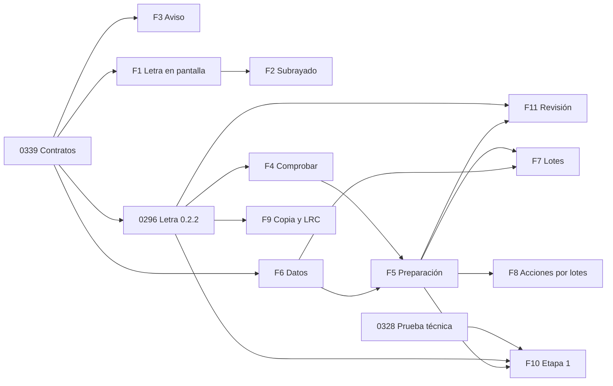

# Backlog de Shinobi Karaoke 0.2.2

Ver el [plan](plan-4.md) y el [flujo de Git](../../workflow.md). **Una feature = una fase**: cada una tiene sus tareas, su verificación con informe y su criterio de «hecha», y se integra por separado (PR borrador por feature contra la rama de la versión). Decisiones: ADR [0022](../../adr/0022-letra-en-pantalla-varias-lineas-y-subrayado-de-lo-cantado.md) (features 1 y 2), [0023](../../adr/0023-aviso-de-version-nueva-con-github-releases.md) (3), [0024](../../adr/0024-encaje-de-la-letra-con-la-voz-y-lineas-dudosas.md) (4 y 11), [0025](../../adr/0025-preparacion-desatendida-y-datos-de-la-cancion-automaticos.md) (5 y 6), [0026](../../adr/0026-importacion-por-lotes-y-acciones-por-lotes-en-la-biblioteca.md) (7 y 8), [0027](../../adr/0027-copia-de-seguridad-paquete-de-cancion-y-exportar-lrc.md) (9) y [0028](../../adr/0028-sincronia-automatica-por-alineacion-forzada-prueba-tecnica-y-etapa-1.md) (10, **Propuesto** hasta su prueba técnica), con revisiones de los ADR 0003, 0005, 0006, 0009, 0018, 0019, 0020 y 0021. Decisiones provisionales del arquitecto: [0159](../../preguntas/0159-decisiones-provisionales-del-arquitecto-de-0-2-2.md). Numeración de las entregas: `0.2.2-alpha.N` (ADR 0020).

## Resumen por feature

| Orden | Feature | Tareas | Tamaño | Depende de | Entrega propuesta |
|---|---|---|---|---|---|
| 0 | Contratos compartidos | [0339](../../tareas/0339-contratos-compartidos-de-0-2-2.md) | M | — | — |
| 1 | **3** · Aviso de versión nueva | 0284–0286 | S | 0339 | alpha.1 |
| 1 | **10 (prueba técnica)** · Alineación forzada | 0328 | M | — (solo `docs/spikes/`) | resultado en alpha.1 |
| 2 | **1** · Letra en pantalla | 0287–0292 | L | 0339 | alpha.1 |
| 3 | **2** · Subrayado y aviso de daltonismo | 0293–0295 | S–M | 1 | alpha.1 |
| 2 | Contratos de la letra (4, 5, 10, 11) | 0296 | M | 0339 | — |
| 3 | **4** · Comprobar la letra contra la voz | 0297–0301, 0367–0369, 0378, 0379, 0381 | M | 0296 | alpha.1 (guardas de prudencia: siguiente alpha) |
| 4 | **6** · Datos automáticos | 0302–0305 | S–M | 0339 | alpha.2 |
| 5 | **5** · Preparación desatendida | 0306–0312, 0371–0374, 0377, 0380, 0382, 0386 | L | 4, 6 (0302) | alpha.2 (letras sin marca: siguiente alpha) |
| 6 | **11** · Revisión guiada | 0334–0337, 0370 | M | 0296; UI tras 4 y 5 | alpha.2 |
| 7 | **7** · Importación por lotes | 0313–0317, 0375, 0384 | L | 5 (0309), 6 | alpha.3 |
| 8 | **8** · Acciones por lotes | 0318–0322 | M | 5; la exportación por lotes no depende de nada | alpha.3 |
| 8 | **9** · Copia, paquete y `.lrc` | 0323–0327, 0376, 0383 | M–L | 0296 | alpha.3 |
| 9 | **10 (etapa 1)** · Sincronizar con la voz | 0329–0333 (si la prueba sirve) | L | 0328, 0296, 5 | alpha.4 |
| — | Cierre de cada entrega | [0338](../../tareas/0338-cierre-de-una-entrega-0-2-2-alpha.md) | S | las features de la entrega | — |

Orden del flujo de entrada que proponen los diseñadores: 4 → 6 → 5 → 7. Se respeta. La feature 3 va primero porque es pequeña, independiente y **hace que las entregas siguientes se anuncien solas** a quien tenga alpha.1.

## Feature 3 · Aviso de versión nueva (S)

| Tarea | Tamaño | Depende de |
|---|---|---|
| [0284 · Versiones y servicio en main](../../tareas/0284-actualizaciones-version-y-servicio-en-main.md) | S | 0339 |
| [0285 · Aviso en la interfaz](../../tareas/0285-aviso-de-version-nueva-en-la-interfaz.md) | S | 0284 |
| [0286 · Verificación e informe](../../tareas/0286-verificacion-e-informe-de-la-feature-3.md) | S | 0284, 0285 |

**Hecha cuando**: la app empaquetada con canal `publicada` avisa de una *Release* más nueva de su canal, no consulta en `desarrollo` ni `local`, el doble recibe solo las cabeceras previstas y la pregunta 0037 consta como cerrada.

## Feature 1 · Letra en pantalla con varias líneas (L)

| Tarea | Tamaño | Depende de |
|---|---|---|
| [0287 · Esquema y reemplazo por canción](../../tareas/0287-esquema-de-letra-en-pantalla-y-reemplazo-por-cancion.md) | S | 0339 |
| [0288 · Modelo de puestos](../../tareas/0288-modelo-de-puestos-en-render.md) | M | 0287 |
| [0289 · Disposición y suelo de contraste](../../tareas/0289-disposicion-del-bloque-y-suelo-de-contraste.md) | M | 0287 |
| [0290 · `PantallaLetra` con varias líneas](../../tareas/0290-pantalla-letra-con-varias-lineas.md) | L | 0288, 0289 |
| [0291 · Panel Estilo](../../tareas/0291-panel-estilo-letra-en-pantalla.md) | M | 0287, 0290 |
| [0292 · Verificación e informe](../../tareas/0292-verificacion-e-informe-de-la-feature-1.md) | S | 0287–0291 |

**Hecha cuando**: F1-R1 a R24 pasan en Vitest y en la prueba de exportación, las capturas F1-R25 están revisadas por el diseñador, una biblioteca de 0.2.1 se ve con 5 líneas sin reescribir archivos y 0.2.1 sigue abriendo una canción de 0.2.2.

## Feature 2 · Subrayado y aviso de daltonismo (S–M)

| Tarea | Tamaño | Depende de |
|---|---|---|
| [0293 · Subrayado](../../tareas/0293-subrayado-de-lo-cantado.md) | S | 0290 |
| [0294 · Aviso y controles](../../tareas/0294-aviso-de-daltonismo-y-controles-del-subrayado.md) | S | 0293, 0291 |
| [0295 · Verificación e informe](../../tareas/0295-verificacion-e-informe-de-la-feature-2.md) | S | 0293, 0294 |

**Hecha cuando**: F2-R1 a R9 cumplidos; el video usa solo el estilo.

## Contratos de la letra para las features 4, 5, 10 y 11

| Tarea | Tamaño | Depende de |
|---|---|---|
| [0296 · Campos nuevos de la letra y reglas de main](../../tareas/0296-contratos-de-datos-de-la-letra-de-0-2-2.md) | M | 0339 |

## Feature 4 · Comprobar la letra contra la voz (M)

| Tarea | Tamaño | Depende de |
|---|---|---|
| [0297 · `encaje.ts`](../../tareas/0297-funcion-de-encaje-de-la-letra-con-la-voz.md) | S | 0296 |
| [0298 · Encaje en main y picos tras separar](../../tareas/0298-encaje-en-main-y-picos-al-terminar-la-separacion.md) | M | 0297 |
| [0299 · Vista Letra](../../tareas/0299-comprobacion-en-la-vista-letra.md) | M | 0298 |
| [0300 · Editor](../../tareas/0300-comprobar-la-letra-en-el-editor.md) | M | 0297, 0296 |
| [0367 · Comprobación diferida y remates](../../tareas/0367-comprobacion-diferida-y-remates-de-la-feature-4.md) | M | 0298, 0299, 0300 |
| [0369 · «Quitar la corrección» impide la diferida](../../tareas/0369-quitar-la-correccion-impide-la-diferida.md) | S | 0367 |
| [0368 · Script `calibrar:encaje`](../../tareas/0368-script-de-calibracion-del-encaje.md) | S | 0297 |
| [0378 · Veredicto en d = 0 y guardas de fiabilidad](../../tareas/0378-encaje-veredicto-en-d0-y-guardas-de-fiabilidad.md) | S–M | 0297 |
| [0381 · `calibrar:encaje` con guardas y criterio de seguridad](../../tareas/0381-calibrar-encaje-con-guardas-de-fiabilidad.md) | S | 0378 |
| [0379 · La limitación en la interfaz](../../tareas/0379-limitacion-del-encaje-en-la-interfaz.md) | S | 0378 y la spec (05/06) |
| [0385 · Medir el encaje por inicios (letras sin fines)](../../tareas/0385-medir-el-encaje-por-inicios-en-letras-sin-fines.md) — hecha: **no cumple, vía cerrada** (pregunta 0305) | S | 0378, 0381 |
| [0301 · Verificación, calibración e informe](../../tareas/0301-verificacion-e-informe-de-la-feature-4.md) | S | 0297–0300, 0367–0369, 0378, 0379, 0381 |

**Hecha cuando** (revisado el 2026-11-22 tras la [medida con canciones reales](medidas-con-canciones-reales.md); preguntas 0275–0277):

1. **Demostrado**: con canciones reales, la corrección se propone, se aplica y se quita o deshace en un paso (canciones 6 y 14 de la medida).
2. **Seguridad**, medible ya con la copia de las 18 canciones del MVP tras 0378 y 0381: `calibrar:encaje` da 0 ajenas aceptadas, 0 desplazadas ≥ 0,8 s que salgan `coincide`, 0 propias `desfasada` y 0 correcciones con error > 200 ms («Criterio de seguridad: SÍ»), en las variantes tal cual y sin fines.
3. **Eficacia, pendiente del usuario** (pregunta 0280): con ≥ 8 canciones revisadas a mano y con fines, las propias que salen `coincide` y los ±0,8 s corregidos en las de voz no continua. Si no llegan a lo que midió ADR 0024 (10/10 y corrección a ±0,8 s), se recalibran las constantes con nota en el ADR.

**No demostrado y declarado como limitación**: con letras de LRCLIB sin fines o con voz casi continua, la comprobación **no detecta** desfases ni distingue la letra correcta. La app dice «No está claro» y no corrige ni elige sola. Medido con las 18 canciones del MVP: 0/17 `coincide`, seguridad SÍ (pregunta 0295). Las notas de la versión **no** anuncian la corrección de desfases (texto en la respuesta de 0295). La vía de los inicios (0385) se midió y se cerró (pregunta 0305). Queda pendiente de la feature 10 o de medir con canciones revisadas a mano (pregunta 0280).

## Feature 6 · Datos de la canción automáticos (S–M)

| Tarea | Tamaño | Depende de |
|---|---|---|
| [0302 · Worker y heurística del nombre](../../tareas/0302-metadatos-de-archivo-youtube-y-nombre.md) | S | 0339 |
| [0303 · Propuesta por campo en main](../../tareas/0303-propuesta-de-datos-por-campo-en-main.md) | S | 0302 |
| [0304 · «Añadir canción»](../../tareas/0304-datos-automaticos-en-anadir-cancion.md) | M | 0303 |
| [0305 · Verificación e informe](../../tareas/0305-verificacion-e-informe-de-la-feature-6.md) | S | 0302–0304 |

**Hecha cuando**: los criterios de 03 · Feature 6 pasan, salvo F6-N7 y F6-N8, que dependen de la elección de letra y de los Ajustes de la feature 5 y se cierran con ella (0308, 0311 y 0312; pregunta 0220); y un archivo etiquetado y un vídeo de YouTube Music llegan con título, artista y álbum sin teclear.

## Feature 5 · Preparación desatendida (L)

| Tarea | Tamaño | Depende de |
|---|---|---|
| [0306 · Registro y estado derivado](../../tareas/0306-registro-de-preparacion-y-derivados.md) | S | 0296 |
| [0307 · Cola automática de LRCLIB e interruptor](../../tareas/0307-cola-automatica-de-lrclib-e-interruptor.md) | M | 0306 |
| [0308 · `ServicioPreparacion`](../../tareas/0308-servicio-de-preparacion-desatendida.md) | L | 0307, 0298, 0306, 0302, 0367 |
| [0309 · Tanda, pausa, paradas y reanudar](../../tareas/0309-tanda-pausa-paradas-y-reanudar-al-abrir.md) | M | 0308 |
| [0310 · Biblioteca](../../tareas/0310-lista-para-revisar-en-la-biblioteca.md) | M | 0306, 0308 |
| [0311 · Progreso, Letra, editor y Ajustes](../../tareas/0311-preparacion-en-progreso-letra-editor-y-ajustes.md) | M | 0308, 0307 |
| [0377 · Recuento sin registro, sonda sin LRCLIB y notificación](../../tareas/0377-recuento-de-revision-sin-registro-y-privacidad-de-la-sonda.md) | M | 0309, 0310, 0334, 0336 |
| [0374 · Red de seguridad del cierre con trabajos](../../tareas/0374-red-de-seguridad-del-cierre-con-trabajos.md) | S | 0309 |
| [0373 · Motivo de la no elección y del error de búsqueda](../../tareas/0373-motivo-de-la-no-eleccion-en-la-preparacion.md) | S | 0310, 0311 |
| [0372 · Evento del aviso de tanda y LRCLIB sin red real en E2E](../../tareas/0372-avisos-de-tanda-y-pruebas-sin-red-real.md) | S | 0309 |
| [0371 · `calibrar:encaje` con letras sin fines](../../tareas/0371-calibrar-encaje-con-letras-sin-fines.md) | S | 0368 |
| [0380 · «Preparar» con letras sin marca (main y contrato)](../../tareas/0380-preparar-letras-sin-marca-con-confirmacion.md) | S–M | 0308 |
| [0382 · Confirmación de «Preparar» con letras sin marca](../../tareas/0382-confirmacion-de-preparar-con-letras-sin-marca.md) | S | 0380 y la spec (02) |
| [0386 · «Ajustar los fines…» en Lista y Letra lista sin cambiar su estado](../../tareas/0386-ajustar-los-fines-en-canciones-lista-sin-cambiar-su-estado.md) | S–M | 0380, 0382 |
| [0312 · Verificación e informe](../../tareas/0312-verificacion-e-informe-de-la-feature-5.md) | S | 0306–0311, 0371–0374, 0377, 0380, 0382 |

**Hecha cuando** (revisado el 2026-11-22; preguntas 0277 y 0278):

- F6-N7 y F6-N8 (álbum desde LRCLIB y aviso de búsqueda automática) pasan.
- Un WAV y un vídeo llegan solos a «Lista para revisar» con el doble, cuya letra trae fines y voz con pausas. **Con letras de LRCLIB sin fines (el caso real) la canción llega a «Elige la letra»** con las candidatas buscadas y ordenadas, y llega a «Lista para revisar» tras un clic. **Que elija sola** con ese material queda **pendiente de la feature 10** (prueba 0328, fase 1 en marcha) **o de una medida con canciones revisadas a mano** (preguntas 0295, 0305 y 0280), salvo que el usuario acepte elegir sin comprobar (pregunta 0280, opción B). La vía de los inicios (0385) se cerró. **Con red real** (permiso del usuario, pregunta 0280) se anota cuántas canciones caen en «Elige la letra» y que ninguna elección automática es de otra canción u otra versión.
- Los borradores **sin letra** del usuario se preparan con «Preparar» (red real). Los que tienen **letra anterior a 0.2.2** reciben fines tras confirmar, sin que cambie ningún inicio, ni el desfase, ni las palabras (0380, 0382). Lo mismo para las **Lista y Letra lista**, sin cambiar su estado y con «Quitar esos fines» disponible (0386).
- La elección y la corrección automáticas cumplen el criterio de seguridad de la feature 4 (punto 2).
- Con el interruptor apagado no sale ninguna petición a LRCLIB al añadir.
- Cerrar con trabajos en cola y volver a abrir los reanuda.

**Cerrado**: el criterio de adopción de los fines prudentes (pregunta 0222) se midió y **no se cumple**. No se adoptan.
**Limitación declarada**: con LRC sin fines, lo normal es «Elige la letra», no la elección sola.

## Feature 11 · Revisión guiada de líneas dudosas (M)

| Tarea | Tamaño | Depende de |
|---|---|---|
| [0334 · Detección, recuento y calibración](../../tareas/0334-deteccion-de-lineas-dudosas.md) | S | 0296 |
| [0335 · Modo «Revisar»](../../tareas/0335-modo-revisar-en-el-editor.md) | M | 0334 (y 0300 terminada: mismo panel Funciones) |
| [0336 · Desde la Biblioteca](../../tareas/0336-revision-guiada-desde-la-biblioteca.md) | S | 0334, 0335, 0310 |
| [0370 · Retirar `origen_fin` al fijar un fin a mano](../../tareas/0370-retirar-origen-fin-al-editar-un-fin-a-mano.md) | S | 0335 (antes de 0308 y 0332) |
| [0337 · Verificación e informe](../../tareas/0337-verificacion-e-informe-de-la-feature-11.md) | S | 0334–0336, 0370, 0377 |

**Hecha cuando** (revisado el 2026-11-22; pregunta 0279): en **canciones revisadas a mano por el usuario** (las 10 de la calibración original u otras ≥ 8 que revise; pregunta 0280) se señala ≤ 10 % de líneas; una línea dada por buena no vuelve salvo que cambie; y «Fin al final de la voz» es un paso de deshacer. Con letras sin revisar la cifra es informativa (18 canciones del MVP: 10,1 % global y 5,5 % sin las tres con letra de otra versión o fines por palabra) y no cierra ni abre el criterio.

## Feature 7 · Importación por lotes (L)

| Tarea | Tamaño | Depende de |
|---|---|---|
| [0313 · Worker](../../tareas/0313-worker-leer-etiquetas-y-listas-de-youtube.md) | M | 0302, 0339 |
| [0314 · Lote en main](../../tareas/0314-lote-en-main.md) | L | 0313, 0309 |
| [0375 · Contrato final de la lectura del lote](../../tareas/0375-contrato-final-de-la-lectura-del-lote.md) | M | 0313, 0314 |
| [0315 · Modo lote en «Añadir canción»](../../tareas/0315-modo-lote-en-anadir-cancion.md) | L | 0314, 0304, 0375 |
| [0316 · Cola del lote en la interfaz](../../tareas/0316-cola-de-lote-en-progreso-y-biblioteca.md) | M | 0309, 0315 |
| [0384 · Datos de cada vídeo al descargar, nombre de la carpeta y tiempo de enlaces sueltos](../../tareas/0384-datos-de-cada-video-al-descargar-y-remates-de-la-lectura-del-lote.md) | S–M | 0316 (alpha.3 si cabe; si no, alpha.4) |
| [0317 · Verificación e informe](../../tareas/0317-verificacion-e-informe-de-la-feature-7.md) | S | 0313–0316 |

**Hecha cuando**: un álbum real de YouTube y una carpeta real entran en una acción, los duplicados vienen desmarcados, el resumen avisa de espacio y tiempo, y la decisión legal sobre listas está confirmada o anotada.

## Feature 8 · Acciones por lotes en la Biblioteca (M)

| Tarea | Tamaño | Depende de |
|---|---|---|
| [0318 · Operaciones en main](../../tareas/0318-operaciones-por-lotes-en-main.md) | M | 0308 |
| [0319 · Exportación por lotes en main](../../tareas/0319-exportacion-por-lotes-en-main.md) | M | 0339 |
| [0320 · Barra de selección](../../tareas/0320-barra-de-seleccion-y-acciones-por-lotes.md) | M | 0318 |
| [0321 · Exportar varias](../../tareas/0321-dialogo-de-exportar-varias-canciones.md) | M | 0319, 0320 |
| [0322 · Verificación e informe](../../tareas/0322-verificacion-e-informe-de-la-feature-8.md) | S | 0318–0321 |

**Hecha cuando**: las cinco acciones («Preparar», «A la cola», «Exportar video…», «Editar datos…» y «Eliminar…»; «Marcar como lista» por lotes no está en el alcance, ADR 0026, revisión de la pregunta 0290) funcionan con resultado por canción y `CONFIRMACION_OBSOLETA`, y tres canciones reales se exportan a una carpeta en un lote.

## Feature 9 · Copia de seguridad, paquete y `.lrc` (M–L)

| Tarea | Tamaño | Depende de |
|---|---|---|
| [0323 · Exportar `.lrc`](../../tareas/0323-exportar-la-letra-a-lrc.md) | S | 0296 |
| [0324 · Escribir paquetes y copias](../../tareas/0324-escribir-paquetes-y-copias.md) | M | 0339 |
| [0325 · Importar y restaurar](../../tareas/0325-importar-paquetes-y-restaurar.md) | L | 0324 |
| [0376 · Remates de copias y paquetes](../../tareas/0376-remates-de-copias-y-paquetes.md) | S–M | 0324, 0325 |
| [0326 · Interfaz](../../tareas/0326-paquete-y-copia-en-la-interfaz.md) | M | 0325, 0323, 0376 |
| [0383 · Remates de interfaz: letra desde el editor, paquetes en actividad y cierre, enlace en Añadir, carpeta del toast](../../tareas/0383-remates-de-interfaz-de-la-feature-9.md) | S–M | 0323, 0326 (punto 4 tras 0315) |
| [0327 · Verificación e informe](../../tareas/0327-verificacion-e-informe-de-la-feature-9.md) | S | 0323–0326, 0376, 0383 |

**Hecha cuando**: la biblioteca real se copia y se restaura en otro usuario del sistema sin perder nada, un paquete ligero de una canción de YouTube recupera solo su audio, un `.lrc` exportado se vuelve a importar con los mismos inicios, y la decisión legal del paquete con audio está confirmada o anotada.

## Feature 10 · Sincronía automática por alineación (prueba técnica M + etapa 1 L)

| Tarea | Tamaño | Depende de |
|---|---|---|
| [0328 · Prueba técnica](../../tareas/0328-prueba-tecnica-de-alineacion-forzada.md) (prioridad alta: de ella depende también la elección automática de la feature 5, pregunta 0295) | M | — (fase 1, filtro con la copia del MVP: puede empezar ya; fase 2, decisión: canciones con fines a mano) |
| [0329 · Worker `alinear-letra`](../../tareas/0329-worker-alinear-letra.md) | L | 0328 (si sirve) |
| [0330 · Modelos, cola y canales](../../tareas/0330-modelos-de-alineacion-y-servicio-en-main.md) | M | 0328, 0296 |
| [0331 · `aplicarAlineacion` y palabras `auto`](../../tareas/0331-aplicar-alineacion-y-palabras-automaticas.md) | M | 0330 |
| [0332 · Interfaz y preparación](../../tareas/0332-sincronizar-con-la-voz-en-la-interfaz.md) | L | 0331, 0308 (y 0335 terminada: mismo panel Funciones) |
| [0333 · Verificación e informe (o plan B)](../../tareas/0333-verificacion-e-informe-de-la-feature-10.md) | S | 0328 y, si sirve, 0329–0332 |

**Hecha cuando**: (a) la prueba técnica tiene su resultado escrito en el ADR 0028 con el criterio de §2.4; y (b) si sirve, «Sincronizar con la voz» cumple los criterios de 06 · Feature 10 en una canción lenta y en la rápida del usuario; si no sirve, la propuesta 027 queda lista para su spec (feature 10-B) y la 016 ya está cubierta por la feature 11.

## Lotes paralelos y dueños de archivos

Varios programadores trabajan a la vez en el mismo árbol: **cada archivo tiene un solo dueño a la vez**. La tarea 0339 va primero y deja declarados todos los contratos comunes; después, `shared/ipc.ts`, `shared/canales.ts`, `shared/errores.ts`, `shared/config.ts`, `preload/index.ts`, `main/index.ts` y `main/ipc/handlers.ts` solo se tocan para sustituir un manejador «no implementado» propio o para un cambio pequeño acordado, nunca por dos lotes a la vez (la sesión principal lo serializa).

| Lote | Features (en orden) | Archivos de los que es dueño |
|---|---|---|
| **0 · Contratos** | 0339 | los comunes de arriba y los `fixturesApi.ts` |
| **A · Distribución** | F3 | `main/actualizaciones/**` (nuevo), `shared/version.ts` (nuevo), la sección Acerca de `vistas/ajustes/`, el botón ⚙ de la barra superior, la mención en `vistas/primer-arranque/`, `e2e/actualizaciones.spec.ts` |
| **B · Render** | F1 → F2 | `renderer/src/karaoke/**` (`render.ts`, `pantalla.ts`, `contraste.ts`, `barrido.ts`, `PantallaLetra.tsx` y su CSS), `renderer/src/exportacion/**` (anfitrión), `shared/pantalla.ts`, `shared/estilo.ts`, `shared/temas.ts`, `main/temas/**`, `main/sesion/` (solo la instantánea), la sección Estilo de `vistas/editor/` (componentes del panel, no el reducer), la casilla de Ajustes de F2 (cuando A haya terminado con Ajustes), `e2e/exportacion.spec.ts` (solo en 0290) |
| **C · Letra y editor** | 0296 → F4 → F11 → (F10 UI) | `shared/letra.ts`, `shared/letras/**`, `shared/encaje.ts`, `shared/dudosas.ts`, `shared/idioma.ts`, `shared/silencios.ts` (los parámetros nuevos los añade 0308 con permiso de C o C mismo antes), `main/letras/**`, `main/picos/**`, `vistas/letra/**`, `vistas/editor/**` salvo la sección Estilo y `preciso/` (incluido el reducer `estado.ts`: si 0291 o 0294 necesitan una acción nueva, la piden a C), `app/scripts/calibrar-*.ts`, `e2e/letras.spec.ts`, `e2e/editor*.spec.ts` |
| **D · Pipeline** | F6 → F5 → F7 | `worker/shinobi_worker/**` (metadatos, `leer-etiquetas`, listas, `importar-archivo-cola`), `main/fuente/**`, `main/preparacion/**` (nuevo), `main/trabajos/**`, `main/avisos/**`, `main/biblioteca/**`, `main/separacion/**` (solo el encadenado de picos), `shared/cancion.ts`, `shared/derivados.ts`, `shared/metadatosNombre.ts`, `shared/identidad.ts`, `vistas/anadir/**`, `vistas/progreso/**`, `vistas/biblioteca/**`, `e2e/importar-*.spec.ts`, `e2e/separacion.spec.ts`, `e2e/biblioteca*.spec.ts` |
| **E · Salidas** | F9 → F8 | `main/copias/**` (nuevo), `main/exportacion/**`, `renderer/src/vistas/exportacion/**`, diálogos de copia en `vistas/ajustes/` (tras A), `app/package.json` y `THIRD_PARTY_NOTICES.md` (yazl, yauzl); la barra de selección y los diálogos de `vistas/biblioteca/` **cuando D haya terminado F5** (0310) |
| **F · Alineación** | 0328 → F10 | `docs/spikes/0028-alineacion/**`, `worker/shinobi_worker/alinear*.py` (nuevo), `main/alineacion/**` (nuevo), `shared/alineacion.ts` (nuevo), `app/resources/runtime-manifest.json` (solo `modelos_alineacion`); su interfaz del editor (0332) **después** de 0335 |

Reglas de convivencia:

- **Pueden empezar a la vez** tras 0339: A (0284), B (0287), C (0296), D (0302), E (0324 y 0319) y F (0328, que ni siquiera necesita 0339).
- **Puntos de espera**: 0293 espera a 0290; 0308 espera a 0298 (C) y 0302 (D); 0318 espera a 0308; 0320/0326 esperan a que D termine 0310 en `vistas/biblioteca/`; 0335 espera a 0300; 0332 espera a 0335 y 0308; la casilla de Ajustes de F2 y los diálogos de F9 esperan a 0285.
- `docs/pruebas.md` y `app/e2e/criticos/` son de `qa`: las tareas que los afecten lo anotan para la sesión principal.
- Las capturas de revisión van a `docs/ux/revisiones/0.2.2-feature-N/`.

## Entregas propuestas (`0.2.2-alpha.N`)

| Entrega | Features | Por qué juntas |
|---|---|---|
| **alpha.1** | 3, 1, 2, 4 (+ resultado de la prueba técnica de la 10) | Lo más visible para quien canta y el aviso de versión, que hace que las siguientes entregas se anuncien solas. La 4 es la base de la 5 y ya ayuda en la vista Letra |
| **alpha.2** | 6, 5, 11 | El núcleo de la automatización: la canción llega sola a «Lista para revisar» y se revisa en minutos |
| **alpha.3** | 7, 8, 9 | Trabajo con muchas canciones: lotes, acciones por lotes y copias |
| **alpha.4** | 10 (etapa 1) o 10-B (propuesta 027) | Depende de la prueba técnica |

Cada entrega cierra con [0338](../../tareas/0338-cierre-de-una-entrega-0-2-2-alpha.md). Si hay que recortar, lo que menos duele aplazar a 0.2.3 es la 9 y la exportación por lotes de la 8; la 7 sin la 5 pierde casi todo su valor (es lo que ya pasó con los 5 borradores abandonados).

## Opinión sobre el riesgo de las once

- **Volumen**: 56 tareas (≈ 2 veces 0.2.1, que tuvo 27 y salió con varias en una sola alfa). Tamaños: tres L (1, 5, 7), una L+M (10), dos M–L (9 y la 5 con su cola) y el resto M o menos.
- **Riesgo técnico mayor**: la 5 y la 7 cambian el comportamiento del flujo principal en main (cola que se reanuda, peticiones automáticas, canciones que nacen sin audio) y tocan los críticos; la 1 reescribe el render de las cuatro superficies, incluida la exportación. La 10 es incierta por naturaleza (por eso va como prueba técnica con criterio cerrado).
- **Riesgo de producto**: tres decisiones legales o de privacidad (LRCLIB automático, listas de YouTube, paquete con audio) quedan provisionales (pregunta 0159).
- **Recomendación**: no publicar las once juntas. Cortar en las cuatro entregas de arriba, integrar por feature con su PR y su guía manual, y mantener la regla de un dueño por archivo con la tarea 0339 primero.

## Decisiones y preguntas de 0.2.2

- Respondidas por el arquitecto: [0153](../../preguntas/0153-contratos-de-las-features-4-a-7-para-las-specs.md), [0156](../../preguntas/0156-contratos-de-las-features-1-a-3-de-0-2-2-para-las-specs.md), [0157](../../preguntas/0157-contratos-de-las-features-8-a-11-para-las-specs.md); cerrada [0037](../../preguntas/0037-autoactualizacion-de-la-app.md) con la opción B.
- Abiertas para el usuario (no bloquean): [0154](../../preguntas/0154-decisiones-provisionales-de-ux-de-las-features-4-a-7.md), [0155](../../preguntas/0155-decisiones-provisionales-de-ux-de-0-2-2-features-1-a-3.md) y [0158](../../preguntas/0158-decisiones-provisionales-de-ux-de-las-features-8-a-11.md) (diseñadores), [0159](../../preguntas/0159-decisiones-provisionales-del-arquitecto-de-0-2-2.md) (arquitecto); [0280](../../preguntas/0280-que-hace-hoy-la-comprobacion-de-la-letra-con-tus-canciones.md) (arquitecto: qué hace hoy la comprobación con canciones reales, opción prudente y qué hace falta del usuario).
