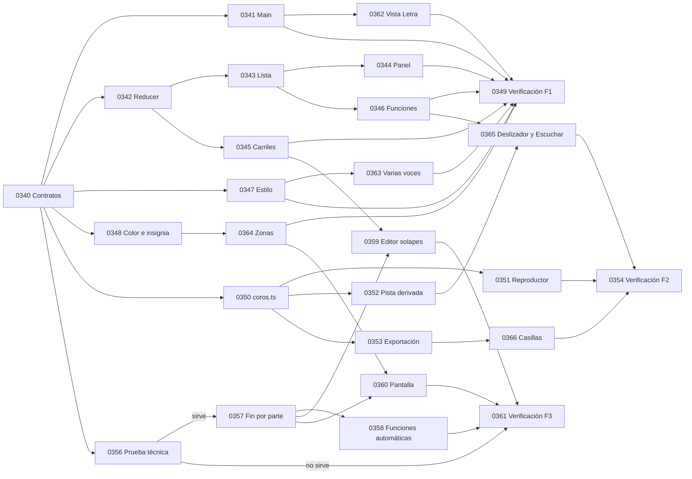

# Backlog de Shinobi Karaoke 0.2.3

Ver el [plan](plan-5.md) y el [flujo de Git](../../workflow.md). **Una feature = una fase**: cada una tiene sus tareas, su verificación con informe y su criterio de «hecha», y se integra por separado (PR borrador por feature contra la rama de la versión). Decisiones: ADR [0029](../../adr/0029-reparto-de-la-letra-entre-cantantes-y-coro.md) (features 1 y 3) y [0030](../../adr/0030-voz-original-en-las-lineas-de-coro.md) (feature 2). Decisiones provisionales: [0160](../../preguntas/0160-decisiones-provisionales-de-ux-de-varios-cantantes-y-coros.md) (UX) y [0165](../../preguntas/0165-decisiones-provisionales-del-arquitecto-de-varios-cantantes-y-coros.md) (técnicas, con su ampliación de 0.2.3). Numeración de las entregas: `0.2.3-alpha.N` (ADR 0020).

**Cuándo empieza**: cuando 0.2.2 esté integrada en su PR hacia `develop`. Se apoya en lo que 0.2.2 deja hecho: la reserva de los campos del reparto (0296, 0287), el color por línea y el ancho como variable (0290), el subrayado con el color del nodo (0293), `confusionDaltonismo(a, b)` (0294), el panel Funciones (0300, 0335) y la exportación por lotes (0319, 0321).

## Resumen por feature

| Orden | Feature | Tareas | Tamaño | Depende de | Entrega propuesta |
|---|---|---|---|---|---|
| 0 | Contratos compartidos | [0340](../../tareas/0340-contratos-compartidos-de-0-2-3.md) | M | 0.2.2 integrada | — |
| 1 | **1** · Cantantes por línea (zonas incluidas) | 0341–0349, 0362–0364 | L | 0340 | alpha.1 |
| 2 | **2** · Voz en los coros | 0350–0354, 0365, 0366 | M | 0340; 0365 tras 0346 | alpha.1 (o alpha.2) |
| 1 (prueba) · 3 | **3** · Voces a la vez (**prueba: sirve**; pendiente de confirmación del usuario) | 0356 · 0357–0361 | M + L | 0340; 0357–0360 tras 0356 si sirve, 0341, 0345 y 0364 | prueba en alpha.1 · feature en alpha.2 |
| — | **10 (de 0.2.2)** · Sincronizar con la voz (**condicionada**; provisional, pregunta 0280) | 0329–0333 | L | fase 2 de 0328 («sirve»); 0340; con reparto, 0341 | alpha.2 o posterior |
| — | Cierre de cada entrega | [0355](../../tareas/0355-cierre-de-una-entrega-0-2-3-alpha.md) | S | las features de la entrega | — |

## Feature 1 · Cantantes por línea (L)

| Tarea | Tamaño | Depende de |
|---|---|---|
| [0340 · Contratos compartidos](../../tareas/0340-contratos-compartidos-de-0-2-3.md) | M | 0.2.2 integrada |
| [0341 · Reparto en main, letra, `.lrc` y paquete](../../tareas/0341-reparto-en-main-letra-corregida-y-lrc.md) | S–M | 0340 |
| [0362 · Vista Letra: aviso al sustituir y resumen](../../tareas/0362-reparto-en-la-vista-letra.md) | S | 0341 |
| [0342 · Reducer: selección múltiple y reparto](../../tareas/0342-seleccion-multiple-y-reparto-en-el-reducer.md) | M | 0340 |
| [0343 · Lista: chip, menú, atajos y selección múltiple](../../tareas/0343-chip-menu-quien-canta-y-atajos.md) | L | 0342 |
| [0344 · Panel Sincronía y riel](../../tareas/0344-fila-canta-en-el-panel-sincronia.md) | S | 0343 |
| [0345 · Línea de tiempo con carriles](../../tareas/0345-linea-de-tiempo-con-carriles.md) | L | 0342 |
| [0346 · Funciones › «Cantantes y coros»](../../tareas/0346-funciones-cantantes-y-coros.md) | M | 0342, 0343 |
| [0347 · Estilo: «Colores de los cantantes» y contraste](../../tareas/0347-colores-por-cantante-en-estilo-y-contraste.md) | M | 0340 |
| [0363 · «Varias voces» en «Letra en pantalla»](../../tareas/0363-control-varias-voces-en-letra-en-pantalla.md) | S | 0340, 0347 |
| [0348 · Render: color, insignia y paréntesis](../../tareas/0348-render-color-insignia-y-parentesis.md) | M | 0340 |
| [0364 · Disposición por zonas](../../tareas/0364-disposicion-por-zonas.md) | L | 0348 |
| [0349 · Verificación e informe](../../tareas/0349-verificacion-e-informe-de-la-feature-1-de-0-2-3.md) | S | 0340–0348, 0362–0364 |

**Hecha cuando**: cada parte se ve en su zona y en su color (con «Cada una en su zona»), y con una sola zona como en 0.2.2; una canción sin reparto se ve y se guarda igual que en 0.2.2 (capturas comparadas y ningún archivo reescrito al abrir); con la canción de ejemplo se asigna una línea por las cinco vías (menú, C, chip, arrastre y Alt + ↑/↓), cada una en un paso de deshacer; un cantante recién añadido tiene su carril vacío y se le puede arrastrar una línea; a 1280 × 720 con tres carriles no hay scroll de página y a 1024 × 576 se juntan solos; en el reproductor y en el video la línea de cada cantante barre en su color con su insignia y el coro va entre paréntesis; una canción con reparto abierta y guardada en 0.2.2 lo conserva.

## Feature 2 · Voz en los coros (M)

| Tarea | Tamaño | Depende de |
|---|---|---|
| [0350 · `shared/coros.ts`](../../tareas/0350-envolvente-de-los-coros.md) | S | 0340 |
| [0351 · Reproductor y secundaria](../../tareas/0351-voz-en-los-coros-en-el-reproductor.md) | M | 0350 |
| [0352 · Editor: pista derivada en el motor](../../tareas/0352-voz-en-los-coros-en-el-editor.md) | M | 0350 |
| [0365 · Funciones: deslizador y «Escuchar un coro»](../../tareas/0365-deslizador-voz-en-los-coros-y-escuchar.md) | S–M | 0352, 0346 |
| [0353 · Exportación: envolvente en main y worker](../../tareas/0353-voz-en-los-coros-en-la-exportacion.md) | M | 0350 |
| [0366 · Casilla en los diálogos de una y de varias](../../tareas/0366-casilla-de-los-coros-en-los-dialogos-de-exportacion.md) | S–M | 0353 |
| [0354 · Verificación e informe](../../tareas/0354-verificacion-e-informe-de-la-feature-2-de-0-2-3.md) | S | 0350–0353, 0365, 0366 |

**Hecha cuando**: con la voz guía silenciada, en una línea de coro la voz suena al nivel de la canción (± 1 dB) y fuera de ella no suena, en el reproductor, la ventana secundaria y la vista previa con «Instrumental»; las rampas no se oyen en 3 canciones reales (guía manual); el video «Solo instrumental» con la casilla marcada lleva la voz solo en los tramos de coro y sin ella no la lleva.

## Feature 3 · Voces a la vez (condicionada: prueba M + L)

Indicación del usuario del 2026-11-22: dúo, trío, «Todos» y coro tienen la misma base, una línea de tiempo por parte con su color y su espacio en pantalla. Las **zonas por parte** y los **colores** entran con la feature 1 en cualquier caso; lo que queda condicionado es que **líneas de partes distintas se solapen en el tiempo**. Dictamen provisional (ADR 0029 §7, ampliación de 0165): salida **(b)**, entra condicionada a una prueba técnica con criterio cerrado.

| Tarea | Tamaño | Depende de |
|---|---|---|
| [0356 · Prueba técnica](../../tareas/0356-prueba-tecnica-de-voces-a-la-vez.md) | M | 0340 (solo `docs/spikes/`) |
| [0357 · Fin por parte en las reglas de la letra](../../tareas/0357-fin-por-parte-en-las-reglas-de-la-letra.md) | M | 0356 (sirve), 0341 |
| [0358 · Funciones automáticas con solapes](../../tareas/0358-funciones-automaticas-con-voces-a-la-vez.md) | M | 0357 |
| [0359 · Editor con regiones solapadas](../../tareas/0359-editor-con-regiones-solapadas.md) | M, con riesgo (sin prototipo) | 0357, 0345 |
| [0360 · Voces a la vez en pantalla](../../tareas/0360-voces-a-la-vez-en-pantalla.md) | S (y repetir la medida con la 0364 real) | 0357, 0364 |
| [0361 · Verificación e informe (o cierre sin ella)](../../tareas/0361-verificacion-e-informe-de-la-feature-3-de-0-2-3.md) | S | 0356 y, si sirve, 0357–0360 |

**Resultado de la prueba (2026-11-23)**: **sirve**, con las condiciones resueltas en las preguntas 0365–0368 (ADR 0029, «Resultado de la prueba técnica de voces a la vez»). **Entra en alpha.2**, pendiente de la confirmación del usuario (0165, fila 10). Orden: 0357 → 0358 y 0360 a la vez → 0359 (cuando B haya cerrado 0345) → 0361. Compatibilidad aceptada: una canción con solapes se ve dañada en versiones anteriores, sin perder nada.

**Hecha cuando**: (a) la prueba técnica tiene su resultado escrito en ADR 0029 con el criterio de §7; y (b) si sirve, dos cantantes con frases cruzadas y un coro que acompaña a la voz principal se ven a la vez, cada uno en su zona con su barrido, en el reproductor y en el video, y una letra sin solapes da los mismos resultados que antes en todas las funciones automáticas; si no sirve, la propuesta 037 queda aplazada con el informe.

**Criterios de la spec por tarea**: cada criterio `C1-`, `C2-` y `C1S-` de las specs 02, 05, 06, 07 y 10 aparece citado en el texto de al menos una tarea (73 de 73, comprobado el 2026-11-22).

## Feature 10 de 0.2.2 · Sincronizar con la voz (condicionada)

Pasó de 0.2.2 a 0.2.3 de forma provisional (ADR 0028, revisión del 2026-11-23; pregunta 0280, punto 4, pendiente del usuario).
- **Condición**: la fase 2 de la prueba técnica [0328](../../tareas/0328-prueba-tecnica-de-alineacion-forzada.md) da «todo» o «solo fines» con los fines hechos a mano del usuario (V1). La fase 1 pasó el filtro, pero no demuestra fines ni palabras.
- **Tareas**: las de 0.2.2, sin tareas nuevas. Son [0329](../../tareas/0329-worker-alinear-letra.md), [0330](../../tareas/0330-modelos-de-alineacion-y-servicio-en-main.md), [0331](../../tareas/0331-aplicar-alineacion-y-palabras-automaticas.md), [0332](../../tareas/0332-sincronizar-con-la-voz-en-la-interfaz.md) y [0333](../../tareas/0333-verificacion-e-informe-de-la-feature-10.md). Si entra, primero la acción explícita del editor y sin el paso de la preparación (propuesta [038](../../propuestas/038-sincronizar-con-la-voz-solo-a-peticion.md)). Al retomarlas, el arquitecto añade dos criterios: `aplicarAlineacion` conserva `parte`, y la pestaña Funciones con «Cantantes y coros» (0346) tiene sitio para la acción.
- **Si no sirve o no llega**: plan B de ADR 0028 §4 (propuesta 027), en la versión que decida el usuario.
- **Lote**: F (el de la prueba). Las tareas 0329–0333 no comparten archivos con la feature 1 salvo el panel Funciones (después de 0346) y `shared/alineacion.ts`, que también toca 0358 (la toma primero quien llegue y la otra espera).

## Preparación pedida a 0.2.2 (sin efecto visible)

Para que las zonas de la feature 1 no obliguen a reabrir el render de 0.2.2. La sesión principal ha pasado estos criterios a las tareas en curso 0287, 0288, 0289 y 0296; el de 0290 ya está en la tarea (2026-11-22).

| Tarea de 0.2.2 | Criterio que habría que añadir |
|---|---|
| 0296 (en curso) | La reserva de `lineas[].parte` y `letra.partes` usa la forma exacta de ADR 0029 §1: `partes.cantantes[]` con `id` `"c1"`…`"c4"` y `nombre: string \| null`, `partes.voz_en_coros` (0–1); `parte` ∈ `c2`…`c4`, `todos`, `coro`. |
| 0287 (ya **hecha**: reservó `colores_partes` con claves `c1`…`c4`, `todos` y `coro`, compatible; 0.2.3 ignora `c1`) | Falta solo reservar `estilo.pantalla.zonas` (`"por_parte" \| "una"`, opcional, tolerante, conservado al escribir, sin uso). |
| 0288 | `fotogramaEn` y `fotogramaEstatico` trabajan sobre la lista de líneas que reciben (una subsecuencia de la letra), con el índice de sucesos cacheado por esa lista. Test: dos subsecuencias de una misma letra dan fotogramas independientes y cada una cumple «nunca dos cambios a la vez». |
| 0289 | `disponerBloque` recibe una región `{ y0Px, altoPx }` (en 0.2.2, toda la pantalla) y calcula el ancla, el apilado y el recorte 10 %–86 % relativos a ella. Test: un bloque en la mitad inferior de la pantalla. |
| 0290 (añadido a la tarea) | `PantallaLetra` pinta una lista de zonas (`[{ id, lineas, region }]`; en 0.2.2, siempre una que cubre la pantalla); los indicadores de espera y la cuenta van en la zona de la línea que viene; la clave de cada nodo incluye la zona. |
| 0293 | Ninguno nuevo (el subrayado ya toma el color de su nodo). |

## Lotes paralelos y dueños de archivos

Cada archivo tiene **un solo dueño a la vez**. La 0340 va primero y deja declarados los contratos comunes; después, `shared/ipc.ts`, `shared/canales.ts`, `shared/config.ts`, `shared/letra.ts`, `shared/estilo.ts`, `shared/reparto.ts`, `shared/letrasBusqueda.ts`, `shared/exportacion.ts`, `preload/index.ts` y `main/ipc/handlers.ts` solo se tocan para un cambio pequeño acordado, nunca por dos lotes a la vez (la sesión principal lo serializa).

| Lote | Tareas (en orden) | Archivos de los que es dueño |
|---|---|---|
| **0 · Contratos** | 0340 | los comunes de arriba, los `fixturesApi.ts`, `vistas/apiNuevaFalsa.ts` y la semilla de E2E |
| **A · Main y letra** | 0341 → 0362 | `main/letras/**`, `shared/letras/**` (`editar.ts`, `lrc.ts`), los tests de `main/copias/` y `main/preparacion/` que toca 0341; `vistas/letra/**` (0362) |
| **B · Editor** | 0342 → 0343 → 0344 → 0346; 0345 en paralelo con 0343–0344 | `vistas/editor/**` salvo la sección Estilo y `preciso/`; el reducer `estado.ts` es de 0342 (después, 0343–0346 piden sus acciones al dueño del lote); `atajos.ts` es de 0343 (0345 añade `Alt + ↑/↓` cuando 0343 termine); `PistaSincronia.tsx`, su CSS y `distribucion.ts` son de 0345; `e2e/editor-reparto.spec.ts` |
| **C · Render y estilo** | 0348 → 0364; 0347 → 0363 a la vez | `renderer/src/karaoke/PantallaLetra.tsx`, su CSS, `render.ts`, `barrido.ts`, `estiloCss.ts` (0348), y además `zonas.ts` (nuevo) y `pantalla.ts` (0364); `renderer/src/karaoke/contraste.ts`, la sección Estilo de `vistas/editor/` (incluida «Letra en pantalla») y `main/temas/**` (0347 y después 0363) |
| **F · Voces a la vez** | 0356 (en paralelo desde el principio); si sirve, 0357 → 0358, y 0359 y 0360 cuando B haya cerrado 0345 y C haya cerrado 0364 | `docs/spikes/0029-voces-a-la-vez/**` (0356); después, `shared/letra.ts` y `shared/letras/tiempos.ts` (0357, con permiso del lote 0), `shared/solapes.ts` (nuevo) y los adaptadores alrededor de silencios, encaje, dudosas y `.lrc`, sin cambiar el código de esas funciones (0358); la pista de la línea de tiempo (0359, tras B) y `zonas.ts`/`PantallaLetra.tsx` (0360, tras C) |
| **D · Audio** | 0350 → 0351, 0352 y 0353 (a la vez); 0365 tras 0352 y con B cerrado en 0346; 0366 tras 0353 | `shared/coros.ts` (0350); `karaoke/motorReproductor.ts`, `vistas/reproductor/**` y la secundaria (0351); `karaoke/motorAudio.ts` y `estiramiento*.ts` o el worker de mezcla nuevo (0352); la sección de coros de Funciones (0365, con permiso de B); `worker/shinobi_worker/exportar.py` y `main/exportacion/**` (0353); `vistas/exportacion/**` y el diálogo de varias de `vistas/biblioteca/` (0366) |

Reglas de convivencia:

- **Pueden empezar a la vez** tras 0340: A (0341), B (0342), C (0347 y 0348), D (0350) y F (0356).
- **Puntos de espera**: 0356 puede empezar tras 0340; 0359 espera a 0345 y 0360 a 0364; 0343 y 0345 esperan a 0342; 0346 espera a 0343; 0364 espera a 0348; 0363 espera a 0347 (misma pestaña); 0365 espera a 0346 (misma sección de Funciones) y a 0352; 0366 espera a 0353; 0349 espera a toda la feature 1; 0354 a toda la feature 2.
- `docs/pruebas.md` y `app/e2e/criticos/` son de `qa`.
- Capturas de revisión en `docs/ux/revisiones/0.2.3-feature-N/`.

## Entregas propuestas (`0.2.3-alpha.N`)

| Entrega | Features | Por qué |
|---|---|---|
| **alpha.1** | 1 y 2 (+ resultado de la prueba técnica de la 3) | Cantantes con su carril, color y zona, y la voz en los coros: lo que el usuario puede usar ya. Si la 2 se retrasa (memoria del editor o chasquidos), la 1 sale sola |
| **alpha.2** | 3 (si la prueba sirve) | Cambia la regla central de la letra: mejor en una entrega propia para probarla con dúos reales |

Cada entrega cierra con [0355](../../tareas/0355-cierre-de-una-entrega-0-2-3-alpha.md). Después, `0.2.3` sin sufijo.

## Riesgos

- **Specs pendientes**: las tareas enlazan a las secciones «0.2.3 · Feature 1/2» de `ux/06-editor.md`, `07-reproductor.md`, `10-exportacion.md` y `sistema-visual.md`, que el diseñador está escribiendo. Ninguna tarea con interfaz empieza sin su spec.
- **Zonas** (0364): una variante nueva del modelo de puestos (`subidaAlSalir`) y una geometría por región; es la otra tarea L con 0343 y 0345.
- **Línea de tiempo** (0345): 6 carriles a 1024 × 576 y el arrastre vertical frente a los tiradores; es la tarea L.
- **Memoria del editor** (0352, 0365): un tercer buffer de ≈ 85 MB por 4 min (≈ 210 MB por 10 min).
- **Chasquidos** (0351, 0352, 0353): rampas de 150 ms sin comprobar a oído.
- **Compatibilidad**: la reserva de 0.2.2 tiene que tener la forma de ADR 0029 §1 (0340 lo comprueba con una copia congelada del esquema de 0.2.2).
- **Voces a la vez**: condicionadas a la prueba (0356). Si no sirve, dos de las tres referencias del usuario no se cubren en 0.2.3 (las zonas y los colores sí); ver la ampliación de 0165 y la [propuesta 037](../../propuestas/037-prueba-tecnica-de-voces-a-la-vez.md).
- **Preparación en 0.2.2**: si las tareas 0287, 0288, 0289, 0290 y 0296 no recogen los criterios de arriba, la 0364 tendrá que reabrir `pantalla.ts`, `render.ts` y `PantallaLetra.tsx` (sube de L a L+) y la 0340 unificar la forma reservada.
